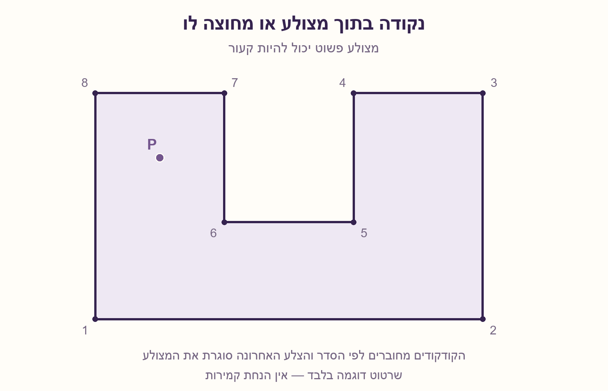
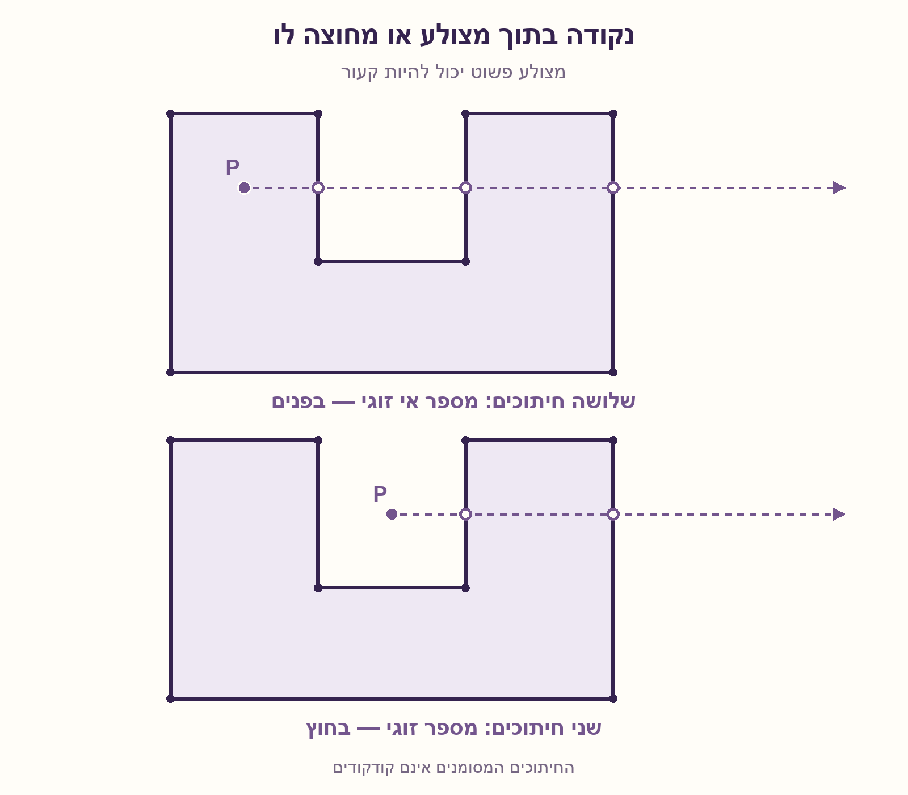

# PREP-087 — נקודה בתוך מצולע — ספירת חיתוכי קרן

מקור: [צילום 1](../sources/prep-087-source.png), [צילום 2 החוזר עם תגים](../sources/prep-087-additional-2026-10-22.png). פתרון מוצע בסיוע AI; ביקורת מקצועית ממתינה.

## נוסח המקור

נתונות N נקודות במישור XY. מחברים את הנקודות בקווים ליצירת צורה סגורה כלשהי. הנקודות בעלות אינדקס כך שנקודה 1 מחוברת בקו לנקודה 2 שמחוברת בקו לנקודה 3 וכו'. בנוסף, נתונה נקודה נוספת P במישור. תן אלגוריתם שבעזרתו ניתן לקבוע האם הנקודה בתוך הצורה או מחוצה לה. N מספר סופי, P אינה על אחד הישרים התוחמים את הצורה.

## השאלה הערוכה

נתונים N≥3 קודקודים במישור, לפי סדר ההיקף: V1,V2,…,VN. מחברים כל זוג עוקב ומחברים גם את VN ל־V1. נתונה נקודה P; קבעו אם היא בתוך המצולע או מחוצה לו. אין להניח שהמצולע קמור. הציעו אלגוריתם, הסבירו למה הוא נכון וציינו סיבוכיות.

הבהרות לנוסח המקור: בגרסה העיקרית מניחים מצולע פשוט — ללא חיתוך עצמי, ללא צלעות באורך אפס ובעל פנים לא ריק — וקואורדינטות שלמות מדויקות. רשימת הקודקודים אינה חוזרת על V1 בסופה. לפי המקור P אינה נמצאת על הישר התומך של שום צלע, ולכן בפרט אינה על השפה. איך תטפלו גם בנקודת שפה אם ההבטחה מוסרת? אם מאפשרים צורה החותכת את עצמה, ציינו מה עוד צריך להגדיר לפני שיש משמעות חד־משמעית ל'בפנים'.



## שלושה רמזים

1. דמיינו מסלול ישר מ־P עד נקודה רחוקה בוודאות מחוץ לצורה. מה משתנה בכל חצייה אמיתית של השפה?

2. בחרו קרן אופקית ימינה וספרו רק צלעות החותכות אותה מימין ל־P. שימו לב לקרן שעוברת בדיוק דרך קודקוד.

3. צלע A→B מועמדת רק כש־(Ay>Py)!=(By>Py). בעזרת cross=(Bx−Ax)(Py−Ay)−(By−Ay)(Px−Ax), החיתוך מימין כאשר ל־cross ול־By−Ay אותו סימן. הפכו ביט בכל חיתוך.

## הצעה לפתרון

### הקרן מחליפה בין פנים לחוץ
למצולע פשוט יש אזור פנימי ואזור חיצוני. שולחים מ־P קרן אופקית ימינה עד אינסוף. רחוק מספיק נמצאים בחוץ; כל חצייה אמיתית של השפה מחליפה בין פנים לחוץ. לכן מספר חיתוכים אי־זוגי פירושו ש־P בפנים, ומספר זוגי — בחוץ. אין צורך במונה גדול: מספיק להפוך משתנה בוליאני בכל חיתוך. הכלל עובד גם למצולע קעור ובכל כיוון של רשימת הקודקודים.

### בדיקת צלע בלי חילוק
עוברים על כל N הצלעות, כולל האחרונה שחוזרת לקודקוד הראשון. עבור A=(Ax,Ay), B=(Bx,By), P=(Px,Py) מחשבים:

```text
cross = (Bx-Ax)*(Py-Ay) - (By-Ay)*(Px-Ax)
straddles = (Ay > Py) != (By > Py)
```

אם `straddles` שקר, הצלע אינה נספרת. אחרת By−Ay אינו אפס, ואפשר לבדוק אם החיתוך מימין בלי לחשב שיפוע או מספר עשרוני:

```text
right = (cross > 0) == (By > Ay)
if straddles and right:
    inside = not inside
```

הסיבה היא `x_intersection−Px = cross/(By−Ay)`; החיתוך מימין בדיוק כשהמנה חיובית. הסימן של המכנה חשוב — אי אפשר לבדוק תמיד רק `cross>0`.

### קודקודים, צלעות אופקיות ושפה
התנאי החצי־פתוח ב־y כולל קצה תחתון ומוציא קצה עליון. הוא מונע טעות זוגיות כשהקרן פוגעת בקודקוד: במעבר דרך השפה נספרת צלע אחת, ובנגיעה משיקה נספרות אפס או שתיים, כך שהזוגיות אינה משתנה. צלע אופקית אינה נספרת כלל. אין להוסיף גם ספירה נפרדת לקודקוד.

בגרסה הכללית בודקים קודם אם `cross==0` וגם קואורדינטות P נמצאות בטווחי x ו־y של הקטע; אז מחזירים `boundary`. בדיקת ישר בלבד אינה מספיקה: נקודה על המשך צלע יכולה להיות מחוץ לקטע. בהבטחה החזקה של המקור בדיקת השפה לא תצליח, אך היא שימושית במימוש כללי.

### דוגמה, דיוק וסיבוכיות
בשרטוט הפתרון, נקודה בזרוע השמאלית של המצולע הקעור נותנת שלושה חיתוכים ימינה ולכן נמצאת בפנים. נקודה במגרעת נותנת שני חיתוכים ולכן נמצאת בחוץ. בדיקת 'אותו צד של כל הצלעות' הייתה מניחה קמירות ואינה פתרון כללי כאן.

הקוד המצורף משתמש במספרים שלמים של Python, ולכן אינו מאבד דיוק גם בקואורדינטות גדולות ואינו דורש epsilon. בשפה עם שלמים ברוחב קבוע צריך רוחב ביניים שמספיק למכפלות ולהפרש. לקואורדינטות עשרוניות מדודות צריך להגדיר דיוק ושיטת predicates אמינה; אין הבטחה גורפת על ידי epsilon שרירותי.

לשאילתה אחת יש O(N) פעולות אריתמטיות ו־O(1) משתנים נוספים, מעבר לקלט. כאשר גודל המספרים נמדד בביטים, עלות מכפלה ואחסון של מספר ביניים תלויה באורך הביטים; O(N) הוא מודל פעולות אריתמטיות, לא זמן אחיד לכל מספר אפשרי. הקוד בודק כמה תנאי קלט זולים, אך סומך על הבטחת הפשטות ואינו מאמת אותה. בדיקת חיתוך כל זוג צלעות בנפרד הייתה מוסיפה O(N²) ואינה כלולה בטענה.

### מה אם הצורה חותכת את עצמה?
במקור נאמר רק 'צורה סגורה', בלי התחייבות לפשטות. אם מותר חיתוך עצמי, צריך להחליט על כלל מילוי: זוגיות חיתוכים או מספר ליפופים שאינו אפס עשויים להגדיר פנים שונים. אין להחליף בשקט בין הכללים. הגרסה העיקרית כאן מצהירה על מצולע פשוט; המימוש אינו דוחה אוטומטית מצולע מצטלב ואינו משמש מאמת לפשטות.




## מימוש ובדיקה

- [מימוש שלם מדויק](../solutions/prep_087_point_in_polygon.py)
- [בדיקה עצמאית](../checks/check_prep_087.py)
- [תוצאות בדיקה](../checks/prep-087-verification.json)
- [מחולל שרטוטים](../solutions/draw_prep_087_polygon.py)

עברו 38,576 השוואות למימוש עצמאי של מספר ליפופים, מהן 16,650 עומדות גם בהבטחת המקור שאין קולינריות עם שום ישר צלע. נבדקו שש צורות קבועות, 120 מצולעי מדרגות פשוטים אקראיים, 10,010 השוואות אנליטיות, 3,528 שינויי כיוון/שיקוף/הזזה/קנה מידה עם שלמים ענקיים, 155 מקרי שפה בצורות הקבועות וחמש דחיות קלט בסיסיות. זהו מימוש שלם מדויק; אין מאמת פשטות או בדיקה של מדיניות מילוי לצורות מצטלבות.

## מקור טכני

[CGAL: bounded_side_2](https://doc.cgal.org/latest/Polygon/group__PkgPolygon2Functions.html). התיעוד מתאר כלל זוגיות וזמן לינארי; המימוש והבדיקות כאן נכתבו בנפרד.

## English

### Point in a polygon — ray crossing parity

Given N≥3 planar vertices in perimeter order V1,V2,…,VN, join consecutive vertices and close the polygon by joining VN to V1. Determine whether a query point P is inside or outside. Do not assume convexity. Give an algorithm, explain its correctness and state its complexity.

Added clarifications: the main version assumes a simple polygon, with no self-intersections or zero-length edges and a nonempty interior, and exact integer coordinates. Do not repeat V1 at the end of the list. The source promises that P lies on no edge's supporting line, so it is in particular not on the boundary. How would you also classify boundary points if this promise were removed? If self-intersections are allowed, what must be defined before 'inside' is unambiguous?

### A ray alternates between inside and outside
A simple polygon has an interior and an exterior. Send a horizontal ray rightward from P to infinity. Sufficiently far away it is outside; each genuine boundary crossing changes between inside and outside. Hence an odd crossing count places P inside, and an even count places it outside. A Boolean toggle replaces a large counter. This works for concave polygons and for either vertex orientation.

### Test each edge without division
Visit all N edges, including the closing last-to-first edge. For A=(Ax,Ay), B=(Bx,By), P=(Px,Py), compute:

```text
cross = (Bx-Ax)*(Py-Ay) - (By-Ay)*(Px-Ax)
straddles = (Ay > Py) != (By > Py)
```

An edge is ignored unless `straddles` holds. Then By−Ay is nonzero, and we can test for a rightward intersection without slopes or floating point:

```text
right = (cross > 0) == (By > Ay)
if straddles and right:
    inside = not inside
```

This follows from `x_intersection−Px = cross/(By−Ay)`: the intersection is right of P precisely when this ratio is positive. The denominator's sign matters; testing only `cross>0` for every edge is incorrect.

### Vertices, horizontal edges and boundaries
The half-open y test includes a lower endpoint and excludes an upper endpoint. It preserves parity when the ray hits a vertex: a genuine passage counts one incident edge, while a tangency counts zero or two, leaving parity unchanged. Horizontal edges do not contribute. Do not also count a vertex separately.

For the general helper, first check whether `cross==0` and P lies within both x and y ranges of the segment; return `boundary` if so. Collinearity alone only tests the infinite supporting line: a point on an edge extension need not be on the segment. The source's stronger promise excludes these cases, but boundary support is useful in reusable code.

### Example, precision and complexity
In the solution figure, a point in the concave polygon's left arm yields three rightward crossings and is inside. A point in its notch yields two crossings and is outside. Requiring the query to lie on the same side of every edge would assume convexity and does not solve the general question.

The attached Python implementation uses arbitrary-precision integers, so even large integer coordinates remain exact and no epsilon is needed. A fixed-width implementation needs enough intermediate width for products and their difference. For measured noninteger coordinates, specify the precision model and robust predicates; an arbitrary epsilon offers no universal guarantee.

One query takes O(N) arithmetic operations and O(1) extra variables beyond the input. In bit complexity, multiplication and intermediate storage depend on coordinate bit length; the arithmetic-operation bound does not make every possible integer operation constant-time. The code checks some cheap input conditions but trusts the simplicity promise. It does not validate simplicity: a separate all-pairs edge-intersection check would add O(N²) and is outside this bound.

### What if the closed shape intersects itself?
The source says only 'closed shape', without guaranteeing simplicity. If self-intersections are allowed, first choose a fill rule: odd-even parity and nonzero winding can define different interiors. Do not silently substitute one for the other. Our main version explicitly assumes a simple polygon; the implementation neither automatically rejects a crossing polygon nor serves as a simplicity validator.
