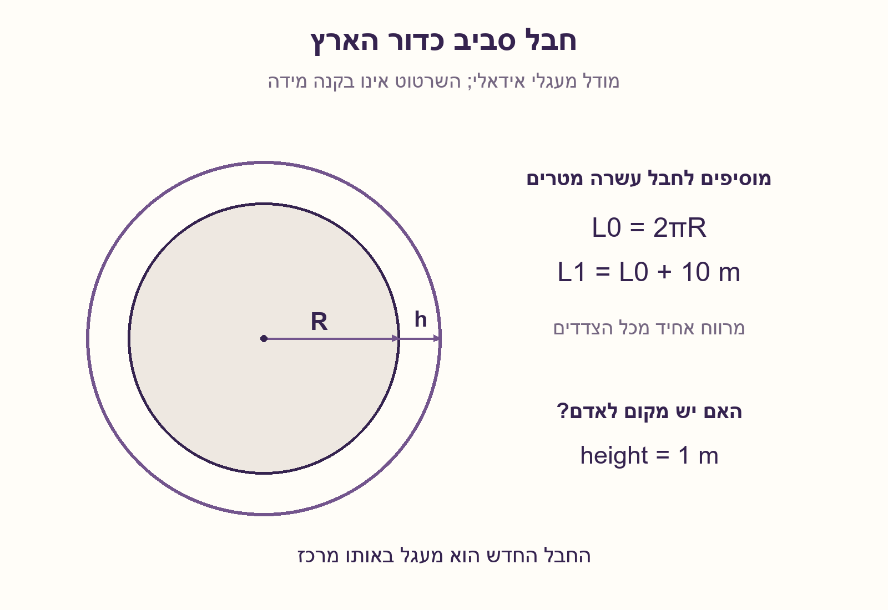
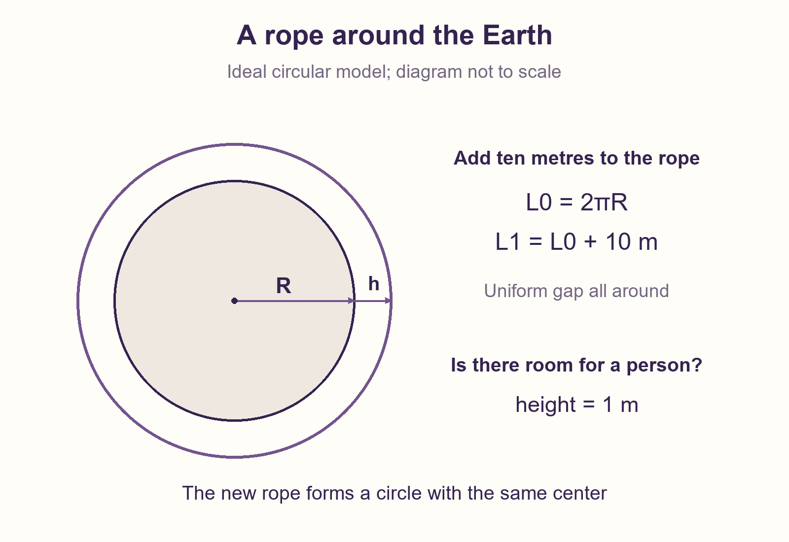
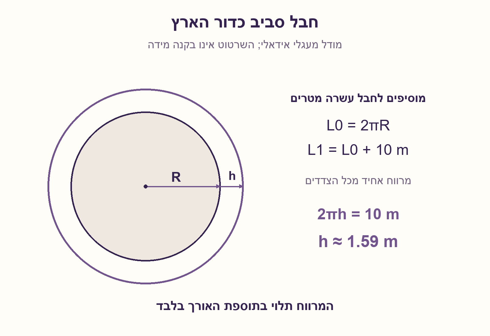
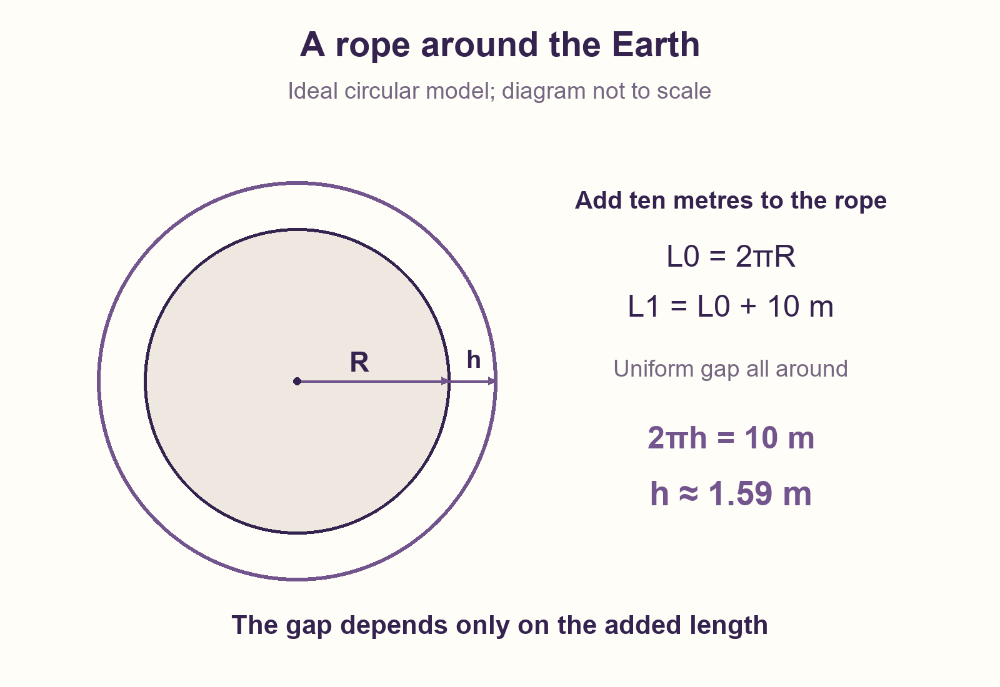

# PREP-090 — חבל סביב כדור הארץ — מה משנים עשרה מטרים?

מצב: בביקורת; הצעה לפתרון בסיוע AI, ממתינה לבדיקה מקצועית אנושית.

## מקור

יש לנו חבל שכרוך סביב כדור הארץ. נניח שרדיוס כדור הארץ הוא R. אחרי שעטפנו את כדור הארץ כך שאין שום רווח אנו לוקחים את אותו החבל ומיישרים אותו, כעת נוסיף לו 10מ׳ לאורכו. נעטוף את כדה״א כך שהחבל מקיף את כדה״א במידה שווה (משמע אין יתרות חבל בשום מקום או התחכמות כזו או אחרת). האם אדם בגובה 1 מטר יכול לעבור מתחת לחבל (לאחר הוספת ה10 מ׳)

[צילום מקור](../sources/prep-090-source.png)

חברות לפי המקור בלבד, ללא אימות עצמאי: Mellanox, Elbit, Elta, Intel

## נוסח ערוך

חבל מתוח מקיף את כדור הארץ במעגל שרדיוסו R, ללא רווח מפני השטח. מוסיפים לאורך החבל 10 מטרים ומסדרים אותו מחדש במעגל בעל אותו מרכז, כך שהמרווח מהקרקע אחיד בכל נקודה. האם אדם שגובהו מטר אחד יכול לעבור מתחתיו? חשבו את המרווח והסבירו אם הוא תלוי ב־R.

מודל שהוגדר במפורש: כדור הארץ הוא כדור מושלם, מסלול החבל הוא מעגל גדול בתחילה ומעגל באותו מישור ומרכז אחרי ההארכה. החבל דק ואינו נמתח, וניתן להחזיקו במרווח האחיד שנדרש בשאלה. אין לנסות לדמות חבל אמיתי שמשתפל תחת כבידה או נשען על השטח.

## שלושה רמזים

1. מה משתנה בין המעגל הישן לחדש: הרדיוס כולו, או רק התוספת לרדיוס?
2. סמנו את המרווח ב־h וכתבו את שני ההיקפים לפני ההארכה ואחריה.
3. חסרו את ההיקף הישן מהחדש. הביטוי שמכיל את R מתבטל; השוו את מה שנותר לעשרה מטרים.

## הצעה לפתרון

### אל תתחילו מגודלו של כדור הארץ
עשרה מטרים נראים זניחים לעומת היקף כדור הארץ. אבל השאלה אינה בכמה אחוזים החבל התארך, אלא בכמה מטרים הרדיוס שלו גדל. אלה שתי שאלות שונות.

### מסמנים את המרווח
נסמן את המרווח האחיד ב־h. הרדיוס של החבל היה R וכעת הוא R+h. לכן:

```text
old length = 2πR
new length = 2π(R+h)
added length = 2π(R+h) − 2πR = 2πh
```

החלק שהיה שם קודם, 2πR, מתבטל. כל עשרת המטרים שנוספו משמשים רק להגדלת הרדיוס.

### כמה מרווח נקבל?
מתקיים 2πh=10, ולכן h=10/(2π), כלומר בערך 1.59 מטר. כן: במודל הנתון יש מספיק מקום לאדם שגובהו מטר. מדובר במרווח הרדיאלי בין פני הכדור לחבל, לא בקוטר.

### דרך אינטואיטיבית לזכור
כל תוספת של מטר אחד לרדיוס של מעגל דורשת בערך 6.28 מטרים נוספים להיקף שלו. זה נכון למעגל סביב תפוז וגם למעגל סביב כדור הארץ. כאן נתנו לנו 10 מטרים, יותר מ־6.28, ולכן נקבל יותר ממטר של מרווח. רדיוס כדור הארץ אינו נחוץ לחישוב.

### למה חייבים מרווח אחיד?
אם מרימים רק נקודה אחת בחבל וכל היתר נשאר על הקרקע, מתקבלת בעיה אחרת: החבל אינו מעגל קונצנטרי והרדיוס אינו פשוט R+h. הפתרון הזה נשען בדיוק על ההנחה שהמרווח אחיד לכל אורך החבל.

### בדיקה קצרה בראיון
כדי לקבל מרווח של מטר צריך להוסיף 2π מטרים, בערך 6.28. מכיוון שהוספנו 10 מטרים, התשובה החיובית מסתדרת גם בלי לחשב את 1.59 במדויק.

## assumptions

[
  "כדור מושלם, מסלול מקורי במעגל גדול ומעגל חדש באותו מישור ומרכז.",
  "המרווח אחיד; הרדיוס החדש הוא R+h, עם R חיובי וכל האורכים במטרים.",
  "חבל דק ללא מתיחה שניתן לתמוך בו כרצוננו; אין שקיעה, הרים או אילוצי מגע."
]

## optimality

{
  "criterion": "מציאת המרווח האחיד לאחר הוספת אורך נתון.",
  "result": "עבור תוספת dL מתקיים h=dL/(2π); עבור 10 מטר מתקבל כ־1.59 מטר.",
  "proof": "מחסרים 2πR מ־2π(R+h); מתקבל dL=2πh.",
  "scope": "פתרון יחיד במודל מעגלים קונצנטריים, לא בעיית אופטימיזציה של צורת חבל אמיתי."
}

## edge_cases

[
  "תוספת אפס נותנת מרווח אפס.",
  "תוספת של 2π מטרים נותנת בדיוק מטר מרווח בכל רדיוס.",
  "הרמת נקודה יחידה או מרווח שאינו אחיד משנים את המודל.",
  "אם רוצים מרווח H, יש להוסיף 2πH מטרים."
]

## common_mistakes

[
  "לחלק עשרה מטרים בהיקף כדור הארץ ולהסיק שהמרווח זניח.",
  "לחשב שינוי בקוטר ולזהות אותו בטעות עם המרווח הרדיאלי.",
  "להניח שצריך לדעת את רדיוס כדור הארץ המספרי.",
  "לפתור הרמה מקומית של החבל אף שהמקור דורש מרווח אחיד."
]

## interview_answer

"אסמן מרווח אחיד h. תוספת האורך היא 2π(R+h)−2πR=2πh=10, ולכן h=10/(2π), בערך 1.59 מטר. אדם בגובה מטר יכול לעבור במודל האידאלי. הרדיוס R מתבטל: המרווח תלוי רק בתוספת האורך."

## solution_extensions

{
  "question": "כמה אורך צריך להוסיף כדי לקבל מרווח אחיד של שני מטרים?",
  "direction": "מכפילים את המרווח ב־2π: נדרשים 4π מטרים, בלי תלות ברדיוס המקורי.",
  "status": "מוכן בארכיון; לא מחובר לתור המשך אינטראקטיבי."
}

## source_ambiguities

[
  "כדור מושלם ומסלול מעגל גדול הם הגדרת מודל מפורשת, לא תיאור פני הארץ האמיתיים.",
  "המרווח האחיד נדרש במקור; אופן החזקת החבל במיקום זה אינו מתואר ומונח כאפשרי.",
  "גובה האדם הוא מטר לפי המקור, ולא גובה אנושי ממוצע."
]

## technical_references

[]

## verification

"עברו 30 צירופים של רדיוסים ותוספות, מול חישוב היקפים עצמאי ב־Decimal עם 100 ספרות ו־π המחושב בזהות Machin. נבדקו מרווח מטר, תוספת אפס ושישה קלטים פסולים. זו בדיקת מודל גאומטרי, לא ניסוי בחבל אמיתי."

## English question

A taut rope circles a spherical Earth along a circle of radius R, initially with no gap from the surface. Add ten metres of rope and arrange it as a larger circle with the same center, leaving the same clearance everywhere. Can a one-metre-tall person pass underneath? Find the clearance and explain whether it depends on R.

Explicit ideal model: Earth is a perfect sphere. The original route is a great circle; the enlarged rope remains in that plane with the same center. The rope is thin and inextensible and can be supported at the stipulated uniform gap. This is not a simulation of a real rope sagging under gravity or resting on terrain.

## Three hints

1. What matters between the old and new circles: the whole radius, or the added radius?
2. Call the gap h and write the two circumferences before and after extending the rope.
3. Subtract the old circumference from the new one. The terms containing R cancel; equate the remainder to ten metres.

## Proposed solution

### Do not start with the size of Earth
Ten metres seems tiny compared with Earth's circumference. But the question asks for an absolute increase in radius, not the percentage increase in rope length. Those are different quantities.

### Name the gap
Let h be the uniform gap. The rope's radius changes from R to R+h, so:

```text
old length = 2πR
new length = 2π(R+h)
added length = 2π(R+h) − 2πR = 2πh
```

The original contribution, 2πR, cancels. Only the increase in radius accounts for the ten added metres.

### Calculate the clearance
We have 2πh=10, hence h=10/(2π), approximately 1.59 metres. Yes: a one-metre-tall person fits in this ideal model. This is the radial gap from the sphere to the rope, not a diameter increase.

### An intuitive way to remember
Increasing any circle's radius by one metre requires about 6.28 additional metres of circumference. That is true for a circle around an orange and for a circle around Earth. We supplied ten metres, more than 6.28, so the gap exceeds one metre. Earth's radius is unnecessary.

### Why uniform clearance matters
Pulling up just one point of a rope while the rest stays on the ground is a different problem. The rope is no longer a concentric circle and its radius is not simply R+h. This derivation relies on the stated uniform gap around the whole route.

### A quick interview check
A one-metre clearance requires 2π metres of added rope, about 6.28. Since ten metres were added, the answer must be yes even without evaluating 1.59 precisely.

## assumptions (English)

[
  "Perfect sphere, original great-circle route and enlarged circle in the same plane with the same center.",
  "Uniform clearance, so the new radius is R+h; R is positive and all lengths use metres.",
  "Thin inextensible rope held in the required shape; sag, terrain and contact mechanics are excluded."
]

## optimality (English)

{
  "criterion": "Find uniform clearance after a given circumference increment.",
  "result": "For added length dL, h=dL/(2π); ten metres gives about 1.59 metres.",
  "proof": "Subtract 2πR from 2π(R+h), obtaining dL=2πh.",
  "scope": "Unique answer for concentric circles, not an optimization of a real rope's shape."
}

## edge_cases (English)

[
  "Zero added length gives zero clearance.",
  "Adding 2π metres gives exactly one metre of clearance at any radius.",
  "Lifting a single point or allowing uneven clearance changes the model.",
  "To obtain clearance H, add 2πH metres."
]

## common_mistakes (English)

[
  "Dividing ten metres by Earth's circumference and treating the tiny ratio as the gap.",
  "Confusing diameter change with radial clearance.",
  "Assuming a numerical Earth radius is required.",
  "Solving a locally lifted rope despite the required uniform gap."
]

## interview_answer (English)

"Let h be uniform clearance. The extra length is 2π(R+h)−2πR=2πh=10, so h=10/(2π), about 1.59 metres. A one-metre person fits in the ideal model. R cancels: clearance depends only on the extra length."

## solution_extensions (English)

{
  "question": "How much extra rope produces a uniform two-metre gap?",
  "direction": "Multiply clearance by 2π: the required increment is 4π metres, independent of original radius.",
  "status": "Prepared in the archive; not connected to the interactive follow-up queue."
}

## source_ambiguities (English)

[
  "A perfect sphere and great-circle route are explicit idealizations, not claims about real terrain.",
  "The source requires a uniform gap; how the rope is held there is unspecified and assumed possible.",
  "The source specifies a one-metre person, not average human height."
]

## technical_references (English)

[]

## verification (English)

"Passed thirty radius/increment combinations against an independent 100-digit Decimal circumference calculation with pi from Machin's identity. Checked the one-metre threshold, zero increment and six invalid inputs. This verifies geometry, not a physical rope experiment."









## Verification artifacts

[solutions/prep_090_earth_rope.py](../solutions/prep_090_earth_rope.py)

[checks/check_prep_090.py](../checks/check_prep_090.py)

[checks/prep-090-verification.json](../checks/prep-090-verification.json)
