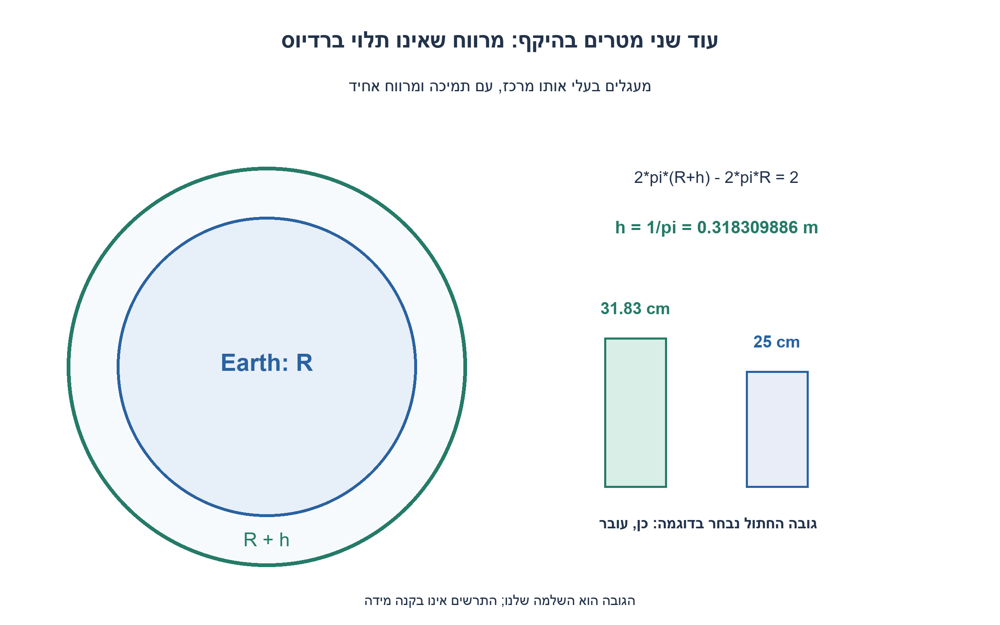
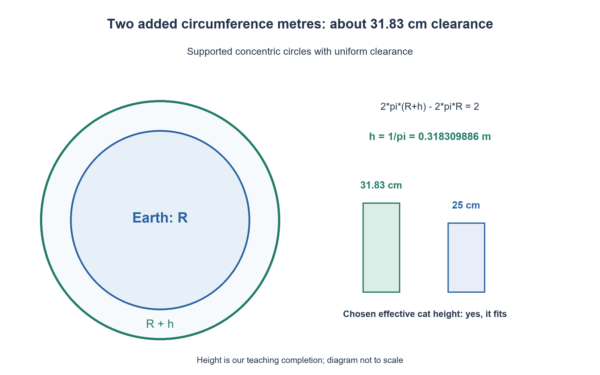

# PREP-090 — חבל סביב כדור הארץ — מה משנים עשרה מטרים?

פתרון מוצע בסיוע AI; ביקורת מקצועית אנושית ממתינה. הקושי אינו מכויל.

## עברית

### וריאציה מספרית: שני מטרים וחתול
מוסיפים לחבל רק 2 מטרים. שמרו במפורש את מודל המעגלים בעלי אותו מרכז והמרווח האחיד של התרגיל הקודם; החבל נתמך במרווח זה ואינו משתפל.

המקור החדש שואל על חתול בלי לתת גובה. כהשלמה לימודית שלנו נבחר גובה מעבר אפקטיבי 0.25 מטר. חשבו את המרווח, קבעו אם חתול בגובה שנבחר עובר והציגו את התנאי לגובה חתול כללי H. אל תציגו את הגובה שנבחר כנתון מהראיון או כתכונה של כל חתול.

1. איזה רדיוס משתנה כשמאריכים היקף מעגל?
2. חסרו 2πR מהמשוואה של המעגל החדש. מה נותר מהתלות ברדיוס הארץ?
3. קבלו 2πh=2 ולכן h=1/π. השוו את 0.25 למרווח, והכלילו לתנאי H≤2/(2π).

### אותו ביטול, תוצאה מספרית אחרת
ההיקף המקורי הוא 2πR, והחדש הוא 2π(R+h). תוספת שני המטרים נותנת `2π(R+h)−2πR=2`, ולכן `h=1/π≈0.318309886` מטר: כ־ 31.83 ס״מ. הרדיוס R מתבטל, בדיוק כמו בתרגיל עשרת המטרים; אי אפשר להעביר לכאן אוטומטית את המרווח 1.59 מטר מהתוצאה הקודמת.

גובה המעבר שנבחר, 25 ס״מ, קטן מ־ 31.83 ס״מ, ולכן בדוגמה הערוכה התשובה היא כן. המרווח הנוסף מעל גובה זה כ־ 6.83 ס״מ. עבור גובה כללי H נדרש `H≤1/π` במודל אידאלי שמאפשר נגיעה בגבול; מעבר ללא מגע דורש אי־שוויון ממש. חתול בגובה אפקטיבי 40 ס״מ לא עובר לפי אותו מודל. המילה ״חתול״ לבדה אינה יחידת מידה.

החישוב O(1) פעולות ממשיות ו־ O(1) עזר כאשר האורך נתון; בקוד נמנעים מחיסור שני היקפים עצומים ומחשבים ישירות מן התוספת. אין כאן סימולציית כבידה, תמיכה מכנית או ניסוי בבעל חיים. נבדקו 36 צירופי אורך/גובה מול משוואת ההיקף, שתי הכרעות הגובה וקלטים פסולים. התוצאה תלויה בהנחת מרווח אחיד; הרמה של נקודה אחת בלבד היא שאלה גאומטרית אחרת.

```python
"""Ideal concentric supported rope; chosen cat effective height is 0.25 m."""
from math import isfinite, pi


def rope_clearance(extra_length=2.0, effective_height=0.25):
    for value in (extra_length, effective_height):
        if type(value) not in (int, float) or not isfinite(value) or value < 0:
            raise ValueError('lengths must be finite nonnegative real numbers')
    gap = extra_length / (2 * pi)
    return {'gap_metres': gap, 'fits': effective_height <= gap,
            'margin_metres': gap - effective_height}
```




## English

### Numerical variant: two metres and a cat
Add only two metres of rope. Retain the explicitly supported concentric-circle model and uniform radial clearance from the earlier exercise; the rope does not sag.

The new source asks about a cat but supplies no height. As our teaching completion choose an effective passage height of 0.25 metre. Find the gap, decide whether this chosen cat fits and give the condition for a general height H. The chosen height is neither a source fact nor a claim about every cat.

1. Which radius changes when a circle's circumference is extended?
2. Subtract 2πR from the enlarged-circle equation. What remains of Earth's radius?
3. Use 2πh=2, so h=1/π. Compare 0.25 with the gap; in general require H≤2/(2π).

### Same cancellation, a different numerical result
Original circumference is 2πR and the enlarged one is 2π(R+h). Two added metres give `2π(R+h)−2πR=2`, hence `h=1/π≈0.318309886` metre, about 31.83 cm. R cancels exactly as in the ten-metre exercise, but the previous 1.59-metre answer cannot be reused unchanged.

The explicitly chosen effective height, 25 cm, is below 31.83 cm, so this edited example answers yes, leaving about 6.83 cm. A general height H fits when `H≤1/π` if boundary contact is allowed; no-contact passage requires strict inequality. A 40-cm effective height would not fit under the same model. Cat alone does not specify a length.

This takes O(1) real-arithmetic operations and O(1) auxiliary storage for supplied lengths. The code computes directly from the extension instead of subtracting huge nearly equal circumferences. There is no gravitational/mechanical simulation or animal trial. Checks cover 36 length-height pairs using the circumference identity, the two height verdicts and invalid values. Uniform supported clearance is essential; lifting only one point is a different geometry.

```python
"""Ideal concentric supported rope; chosen cat effective height is 0.25 m."""
from math import isfinite, pi


def rope_clearance(extra_length=2.0, effective_height=0.25):
    for value in (extra_length, effective_height):
        if type(value) not in (int, float) or not isfinite(value) or value < 0:
            raise ValueError('lengths must be finite nonnegative real numbers')
    gap = extra_length / (2 * pi)
    return {'gap_metres': gap, 'fits': effective_height <= gap,
            'margin_metres': gap - effective_height}
```




## חומר משלים / Supporting material

```json
{
  "assumptions": {
    "he": "מודל אידאלי נתמך עם מרווח אחיד; תוספת 2 מטרים; גובה אפקטיבי 0.25 מטר הוא בחירה שלנו; נגיעה בגבול מותרת.",
    "en": "Ideal supported uniform clearance; two added metres; 0.25-metre effective height is our choice; boundary contact allowed."
  },
  "optimality": {
    "he": "O(1) פעולות אריתמטיות ועזר; R מתבטל ואין צורך להעריך את רדיוס הארץ.",
    "en": "O(1) arithmetic/auxiliary storage; R cancels and Earth radius is unnecessary."
  },
  "verification": {
    "he": "36 צירופי אורך/גובה, בדיקת 25 ו־ 40 ס״מ וחמישה קלטים פסולים. אין ניסוי פיזי.",
    "en": "36 length-height pairs, 25/40-cm verdicts and five invalid cases. No physical trial."
  },
  "edge_cases": {
    "he": "גובה אפס; תוספת אפס; גובה גדול מהמרווח; שוויון שנוגע בגבול; ערכים לא סופיים.",
    "en": "Zero height/extension; excessive height; equality with boundary contact; nonfinite values."
  },
  "common_mistakes": {
    "he": "לחשוב שהתוספת זניחה בגלל גודל הארץ; לבלבל רדיוס וקוטר; להניח גובה לכל חתול; לערבב תמיכה אחידה עם הרמת נקודה.",
    "en": "Dismissing extension relative to Earth; mixing radius/diameter; assuming every cat height; mixing uniform support with a single lifted point."
  },
  "interview_answer": {
    "he": "הוספת 2 מטרים להיקף מגדילה רדיוס ב־ 1/π מטר. החתול שבחרנו בגובה 25 ס״מ עובר, וההכרעה הכללית היא לפי H.",
    "en": "Two added circumference metres increase radius by 1/pi metre. Our 25-cm cat fits; general fit depends on H."
  },
  "source_ambiguities": {
    "he": "המקור לא קבע גובה חתול או תמיכה מכנית. הגובה והמרווח הנתמך נבחרו במפורש, והמקור נשמר.",
    "en": "Source supplies no cat height or mechanical support. Height and supported uniform clearance are explicit choices; source retained."
  },
  "solution_extensions": {
    "he": [
      {
        "question": "כמה חבל צריך להוסיף כדי להבטיח מרווח של H מטרים?",
        "answer_direction": "2πH מטרים, בלי תלות ב־ R; לתוספת שולי ביטחון מוסיפים אותם ל־ H לפני החישוב.",
        "principle": "הפרש גדלים מוחלט לעומת שינוי יחסי."
      }
    ],
    "en": [
      {
        "question": "How much rope must be added for clearance H?",
        "answer_direction": "2*pi*H metres independently of R; add the chosen safety margin to H first.",
        "principle": "Absolute differences versus relative changes."
      }
    ]
  }
}
```
