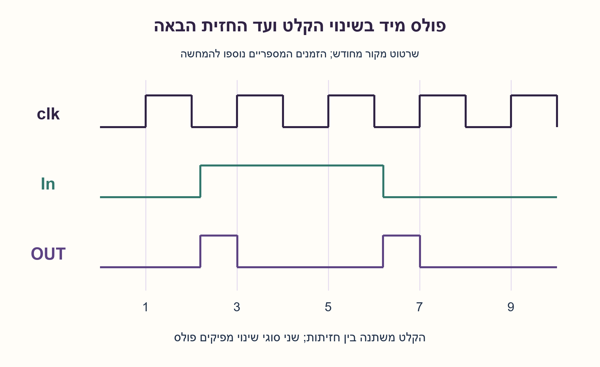
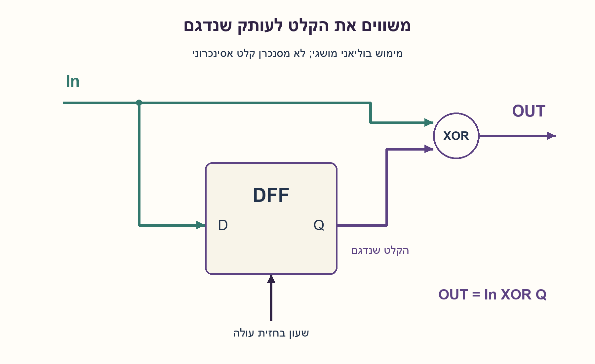
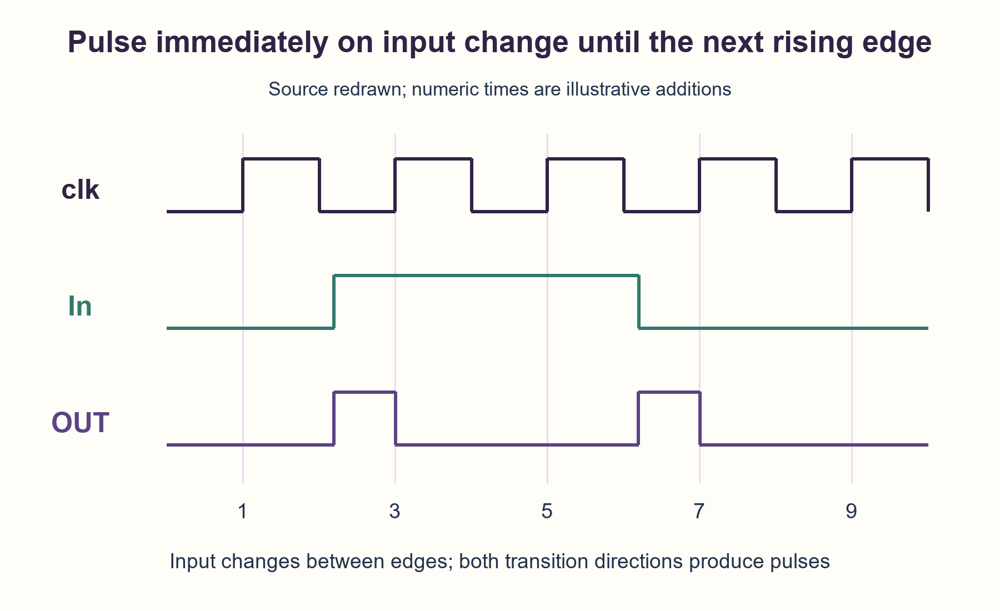
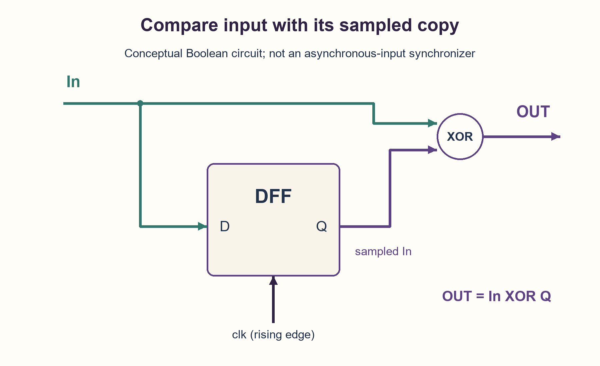

# PREP-091 — פולס בשתי חזיתות הקלט — עד חזית השעון הבאה

## מקור שנמסר

בנה מעגל עם הפונקציונליות הבאה: [דיאגרמת clk, In ו־OUT בצילום המקור].

[צילום המקור הפנימי](../sources/prep-091-source.png)

סטטוס: הצעה לפתרון בסיוע AI; ביקורת מקצועית אנושית ממתינה.

## עברית

### פולס בשתי חזיתות הקלט — עד חזית השעון הבאה

בנו מעגל המתאים לדיאגרמת התזמון המצורפת. הקלט In עולה בין החזית הראשונה לשנייה של clk ויורד בין השלישית לרביעית. OUT עולה מיד עם כל אחד משני שינויי הקלט וחוזר לאפס בחזית העולה הבאה. הציעו רכיבי זיכרון ולוגיקה, ונמקו את הפעולה.

הבהרת עריכה: תרשים סופי אינו מגדיר לבדו כל התנהגות אפשרית. כאן נבחר חוזה אידאלי שבו OUT מציין אי־התאמה בין In הנוכחי לערך In שנדגם בחזית העולה האחרונה. המילה ״מיד״ מתעלמת מהשהיית התפשטות. הקלט יציב סביב כל חזית דגימה ובדוגמה משתנה לכל היותר פעם אחת בין שתי חזיתות. אתחול ידוע ל־In=0 ולעותק השמור 0 נוסף למודל; המקור אינו מציין איפוס. הבדילו בין המימוש הבוליאני הזה לבין גלאי שינוי סינכרוני שמוציא פולס רק אחרי הדגימה.



### רמזים / Hints

1. מה ההבדל בין ערך הקלט כרגע לבין הערך שהיה בחזית השעון האחרונה?
2. שמרו עותק של In בדלגלג D. איזה שער מוציא 1 כאשר שני הביטים שונים?
3. חברו In גם ל־D של דלגלג בחזית עולה וגם לכניסה אחת של XOR. חברו את Q לכניסה השנייה. עקבו אחרי רגע שינוי הקלט ורגע הדגימה הבא.

### הצעה לפתרון / Proposed solution

### האינטואיציה: הקלט כבר השתנה, העותק עדיין לא
נחזיק בדלגלג D תמונה של הקלט מהחזית העולה האחרונה. בין חזיתות התמונה קפואה. כשהקלט משתנה, הוא שונה מהתמונה ונרצה OUT=1. בחזית הבאה מצלמים מחדש; התמונה שוב שווה לקלט ולכן OUT=0.

### דלגלג אחד ושער XOR
מחברים D=In, את clk לשעון הדלגלג, ואת In ו־Q לשער XOR:

```text
on rising edge: Q <- In
between edges:  OUT = In XOR Q
```

בתחילה In=Q=0 ולכן OUT=0. כשהקלט עולה ל־1, Q נשאר 0: ה־XOR מוציא 1. בחזית העולה הבאה Q נעשה 1 והפולס נגמר. בהמשך הקלט יורד ל־0 בעוד Q עדיין 1: שוב שני הביטים שונים, ולכן נוצר פולס גם בירידה. בחזית הבאה Q נעשה 0 ו־OUT חוזר לאפס. אין צורך בשני גלאים נפרדים לעלייה ולירידה.

### בדוגמה המספרית של השרטוט המחודש
נבחר חזיתות בזמנים 1,3,5,7,9, שינוי ל־1 בזמן 2.2 ושינוי ל־0 בזמן 6.2. OUT גבוה בקטעים [2.2,3) ו־[6.2,7). אלה זמנים שהוספנו להמחשה, ולא מדידות מהצילום. רוחב הפולס הוא הזמן שנותר עד החזית הבאה; הוא אינו בהכרח מחזור מלא.

### למה חייבים זיכרון, ומה בדיוק הובטח?
אותם In=0 ו־clk=0 יכולים להופיע אחרי היסטוריות שבהן Q היה 0 או 1; OUT שונה בשני המקרים. לכן שערים קומבינטוריים של In ושל clk לבדם אינם מספיקים לחוזה הזה. דלגלג אחד ו־XOR הם מימוש קטן וישיר; אין כאן הוכחת מינימום שטח או השהיה בכל ספריית תאים.

אם הקלט עולה ואז יורד שוב לפני הדגימה, ה־XOR עולה ואז יורד: הוא לא זוכר ש״היה אירוע״ ולא צובר פולסים. זו משמעות חוזה אי־ההתאמה. לדרישה של זכירת כל אירוע, פולס ברוחב קבוע או אות תקין לשעון אחר נדרש פתרון אחר. גם PREP-004 שונה: גלאי סינכרוני יכול לדווח מחזור מאוחר יותר ואינו מגיב מיד בקלט האסינכרוני.

### גבולות תזמון אמיתיים
הקלט חייב לעמוד ב־setup/hold של הדלגלג. שינוי סמוך מדי לחזית עלול לגרום למטא־יציבות; פולס קצר עלול לא להיתפס ברכיב המשך. אחרי חזית יש השהיית clk-to-Q, ובנתיבי XOR יש השהיות ופוטנציאל לתקלות מעבר. לכן אין להשתמש ב־OUT כשעון נקי ואין להציג את המעגל כמסנכרן CDC. שינוי בדיוק בחזית לא מוגדר במודל; גם סדר אירועי סימולציה אינו תחליף לחוזה פיזי. בלי איפוס או היסטוריית דגימה ידועה, ההתחלה אינה מובטחת.

מודל Python בודק במפורש אירועי שינוי קלט ואירועי חזית נפרדים. הבדיקות הסופיות משוות אותו לשמירת ערך הדגימה האחרון ולדוגמת המקור; הן אינן סימולציית HDL, סינתזה או בדיקת תזמון פיזית.



## English

### Both-edge input pulse until the next rising clock edge

Build a circuit matching the supplied timing diagram. In rises between rising clock edges one and two and falls between edges three and four. OUT rises immediately on either input transition and returns low at the next rising clock edge. Identify storage and logic and justify the behavior.

Editorial clarification: a finite trace does not uniquely define every possible input behavior. The chosen ideal contract makes OUT indicate disagreement between current In and In sampled at the last rising edge. “Immediately” ignores propagation delay. Input is stable around sampling edges and the example has at most one transition between successive rising edges. Known initial In=0 and stored copy=0 are added for the model; no reset is specified by the source. Distinguish this Boolean circuit from a synchronous detector whose pulse begins only after sampling.



### רמזים / Hints

1. What differs between the input now and the input value at the last rising clock edge?
2. Keep a copy of In in a D flip-flop. Which gate returns one when two bits differ?
3. Drive both D of a rising-edge flip-flop and one XOR input with In. Drive the other XOR input with Q. Follow an input transition and the next sampling edge.

### הצעה לפתרון / Proposed solution

### Intuition: input changed, stored copy did not
A D flip-flop stores a snapshot of In at each rising edge. The snapshot stays fixed between edges. An input transition makes current In disagree with that snapshot, so OUT should rise. The next rising edge refreshes the snapshot, removes the disagreement and ends the pulse.

### One D flip-flop and an XOR
Connect D=In and clock the flip-flop from clk. XOR current In with Q:

```text
on rising edge: Q <- In
between edges:  OUT = In XOR Q
```

Initially In=Q=0 and OUT=0. When In rises to one, Q remains zero, so XOR becomes one. The next rising clock edge sets Q to one and ends the pulse. When In later falls to zero, Q is still one: XOR again becomes one. The following sampling edge sets Q to zero and ends that pulse. Separate rise and fall detectors are unnecessary.

### Illustrative redraw times
Use rising edges at 1,3,5,7,9, an input rise at 2.2 and fall at 6.2. OUT is high on [2.2,3) and [6.2,7). These times were added for clarity, not measured from the source. Pulse width is the remaining interval until the next rising edge, not necessarily one full period.

### Why memory, and which contract?
The same current In=0 and clk=0 can follow histories with stored Q=0 or Q=1, requiring different OUT values. Combinational gates on current In and clk alone cannot implement that history dependence. One flip-flop plus XOR is a direct small topology; no global minimum physical area or delay is established.

If In rises and falls again before sampling, XOR rises and falls too. It reports disagreement, not a sticky record that an event occurred, and does not queue pulses. Remembering every event, fixed pulse width or transfer into another clock domain requires another contract and design. PREP-004 is distinct: a synchronous detector may report a cycle later and does not respond immediately to this asynchronous transition.

### Real timing limits
In must satisfy setup/hold. A transition too close to sampling can cause metastability; a narrow output pulse may be missed downstream. Real clk-to-Q and XOR path delays also affect pulses and transient behavior. OUT is not a clean generated clock and this is not a CDC synchronizer. Coincident input/clock events are excluded; simulator scheduling does not resolve the physical contract. Without reset or a known previous sample, startup is not guaranteed.

The Python model uses distinct input-change and rising-edge events. Finite checks compare it with retained last-sample state and the source example. They do not constitute HDL simulation, synthesis, static timing or physical verification.



## קוד ובדיקות

[מודל Python](../solutions/prep_091_async_change_pulse.py) · [בדיקות](../checks/check_prep_091.py) · [תוצאות](../checks/prep-091-verification.json)
