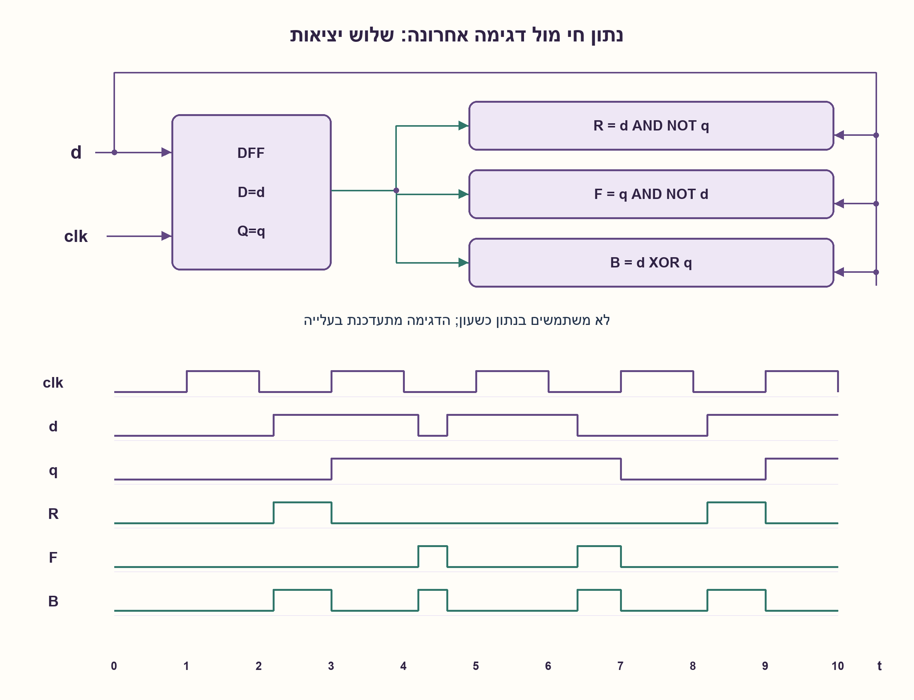
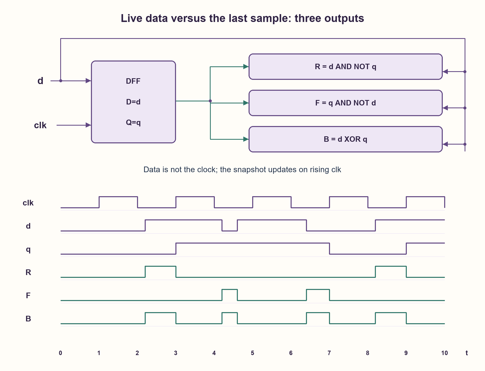

# PREP-091 — פולס בשתי חזיתות הקלט — עד חזית השעון הבאה

פתרון מוצע בסיוע AI; ביקורת מקצועית אנושית ממתינה. הקושי אינו מכויל.

[צילום מקור פרטי](../sources/2026-11-01-batch20-01.png)

מצורפות דיאגרמות הגלים הבאות. בנה את המעגל עבור כל אחת מהדיאגרמות.

חברות לפי הדיווח בצילום בלבד: .

[צילום מקור פרטי](../sources/2026-11-01-batch20-02.png)

[תמונת המשך לאותה שאלה: שלוש דיאגרמות עם הסימונים clock, d, out; מתחתיהן שלושה שרטוטי מעגל מסומנים 1, 2, 3 תחת הכותרת פתרון.]

חברות לפי הדיווח בצילום בלבד: .

## עברית

### הרחבה: שלושה פלטים לפי קוטביות השינוי
בנו מעגל עבור כל אחד משלושת תרשימי התזמון: (1) תגובה לעליית d, (2) תגובה לירידת d, (3) תגובה לשני הכיוונים. הפלט מתחיל בשינוי הנתון בין קצות השעון ומסתיים בעליית השעון הבאה, או כשאי־ההתאמה נעלמת קודם.

מודל אידאלי: q הוא d שנשמר בעליית השעון האחרונה; לפני תחילת התצפית d=q=0 אחרי דגימה ידועה. אירועי נתון ושעון אינם בו־זמניים והקלט יציב בחלון setup/hold. ללא השהיות שערים. יש לממש את שלושת הביטויים ולבדוק מה קורה אם d משתנה שוב לפני השעון. אין להפוך את d לשעון ואין להחליף את הדופק החי בדופק סינכרוני באורך קבוע.

1. איזה מידע נשאר ברכיב בין שתי עליות שעון? השוו אותו ל־d העכשווי.
2. לזיהוי עלייה נדרשים נתון נוכחי 1 ודגימה קודמת 0. מה התנאים לירידה?
3. חברו D=d ו־CLK=clk. העלייה היא d AND NOT q, הירידה q AND NOT d, ושני הכיוונים XOR.

### צילום של העבר מול הנתון החי
נשתמש ב־D flip-flop אחד: D מחובר ל־d וכניסת השעון ל־clk. q מתעדכן רק בעלייה; יציאות השערים משתמשות גם ב־d העכשווי:

```text
R = d AND NOT q
F = q AND NOT d
B = d XOR q = R OR F
```

ארבעת המצבים (d,q) הם 00,10,11,01, עם יציאות (R,F,B) בהתאמה 000,101,000,011. עליית d אחרי דגימת אפס נותנת 10 ופותחת R ו־B. דגימת האחד הבאה מחזירה 11 וסוגרת אותם. ירידת d אחרי דגימת אחד נותנת 01, ולכן נפתחים F ו־B; דגימת האפס סוגרת אותם. R ו־F לעולם אינם 1 יחד במודל הבינארי.

זה מוכיח גם את שלושת התרשימים: כל קטע בין אירועים נשען על זוג הנתון/דגימה, ועליית שעון משווה את q ל־d ולכן מאפסת את כל היציאות. דופק יכול להיות חלק קטן מהמחזור; אין הבטחה לרוחב מחזור שלם. אם d עולה ויורד לפני הדגימה כאשר q=0, R ו־B עולים ויורדים איתו; F נשאר אפס. הזיהוי הוא אי־התאמה עם הדגימה, לא רישום דביק של כל אירוע.

עבור פלט יחיד מספיק FF אחד וביטוי השער המתאים. אם צריכים את שלושתם יחד, אפשר לשתף את אותו q; אין צורך בשלושה FF. אין חיבור של d לשעון ה־FF: החלפת הנתון והשעון משנה את המערכת. לחלופין, גוזר סינכרוני שמשווה שתי דגימות נותן סמנטיקת תזמון אחרת ואינו מחליף את המעגל החי הזה.

המקור אינו מגדיר reset. קוד RTL מקבל תחילה דגימת d=0 ידועה; לפני הדגימה q יכול להיות X ואין הבטחת פלט. במערכת אמיתית נדרשים תנאי setup/hold, וייתכנו metastability ודפקים צרים בגלל השהיות. זה אינו מסנכרן CDC ואסור להסיק שהפלט מתאים לשעון. תזמון אירועים בו־זמניים דורש חוזה פיזי נוסף, לא בחירת סדר סימולציה שרירותי.

מודל אירועים נבדק מול שמירת ערך הדגימה האחרונה, כולל כמה שינויים בין קצוות, וחיבורי RTL נבדקו בנפרד. הבדיקה אינה סינתזה או אישור התנהגות אנלוגית.

### מודל Python שנבדק

```python
"""Live-data disagreement until the next sampling edge; event order is explicit."""


def edge_events(events, initial=0):
    if initial not in (0, 1):
        raise ValueError('binary initial sample required')
    current = saved = initial
    out = []
    for kind, value in events:
        if kind == 'data' and value in (0, 1):
            current = value
        elif kind == 'clock':
            saved = current
        else:
            raise ValueError('data/clock event required; simultaneous events excluded')
        out.append([current & (1 - saved), saved & (1 - current), current ^ saved])
    return out
```


### קוד SystemVerilog; תוצאות סימולציה בדוח נפרד

```systemverilog
module live_edge_polarities(input wire clk,d, output wire rise_only,fall_only,both_edges);
  reg q;
  // No source reset is specified. Observe outputs only after a known initial
  // d=0 sampling edge; initial X before that edge is intentionally retained.
  always @(posedge clk) q <= d;
  assign rise_only = d & ~q;
  assign fall_only = q & ~d;
  assign both_edges = d ^ q;
endmodule
```




### assumptions

```json
[
  "אירועים נפרדים, דגימת אפס ידועה לפני תחילת התצפית, דגימה בעליית clk.",
  "d הוא נתון חי; q נשמר בין קצוות."
]
```

### optimality

FF אחד משותף ושלושה ביטויי פלט; זמן דופק תלוי במיקום שינוי הנתון. אין מינימום שטח פיזי.

### verification

כל עקבות האירועים הקצרות מול אורקל דגימה אחרונה; RTL ודוח הידור/הרצה נפרדים. אין בדיקת metastability.

### edge_cases

```json
[
  "שינוי חוזר לפני שעון יכול לסגור דופק מוקדם.",
  "לפני דגימה ידועה q אינו ידוע.",
  "אירועים בו־זמניים מחוץ למודל."
]
```

### common_mistakes

```json
[
  "להחליף D ו־CLK.",
  "להניח רוחב דופק מחזור שלם.",
  "להציג FF אחד כפתרון CDC בטוח."
]
```

### interview_answer

אשמור את d האחרון ב־q. הזוג 10 הוא עלייה, 01 ירידה ושני אי־השוויונות הם XOR; בעליית clk דגימת d מבטלת את אי־ההתאמה.

### source_ambiguities

תרשימי אירועים אינם מגדירים התנהגות לכל רצף אנלוגי. המודל בוחר דגימה בעלייה ונתון חי; יש להבחין בין כניסת הנתון לכניסת השעון.

### solution_extensions

```json
[
  {
    "question": "איך מבטיחים שלא מאבדים שני שינויים בין דגימות?",
    "answer_direction": "צריך מנגנון אירועים, מונה או handshake לפי קצב וחוזה; XOR מול דגימה יכול להתאפס לאחר מספר זוגי של שינויים.",
    "principle": "זיהוי הבדל ורישום כל אירוע הן דרישות שונות."
  }
]
```

## English

### Extension: three outputs distinguished by transition polarity
Build circuits for (1) rising d changes, (2) falling d changes and (3) both directions. Output starts at a data change between clock edges and ends at the next rising clock edge, or earlier if disagreement disappears.

Ideal model: q is d sampled at the last rising clock edge. Before observation a known sample establishes d=q=0. Data and clock events are not simultaneous and setup/hold are valid; gate delays are ignored. Derive all three outputs and analyze another data change before the clock. Do not clock the flip-flop from d or replace the live pulse by a fixed-length synchronous one.

1. What information remains between rising clock edges? Compare it with current d.
2. A rising disagreement needs current1 and saved0. Which pair gives falling disagreement?
3. Connect D=d and CLK=clk. Use d AND NOT q, q AND NOT d, and XOR for both directions.

### Compare a stored snapshot with live data
Use one D flip-flop with D=d and CLK=clk. q changes only on rising clock edges; output gates also see current d:

```text
R = d AND NOT q
F = q AND NOT d
B = d XOR q = R OR F
```

For (d,q)=00,10,11,01 the output triples (R,F,B) are 000,101,000,011. A rise after a saved zero opens R and B; sampling the one closes them. A fall after a saved one opens F and B; sampling zero closes them. R and F cannot be asserted together in the binary model.

This proves all three waveform constructions: on each interval outputs depend on current/saved values; at a sampling edge q becomes d and every output clears. Pulse width is the remaining time to sampling, not a full period. If d rises and falls before sampling while q=0, R and B follow that excursion and F remains zero. These outputs indicate disagreement, not a sticky history of every event.

One requested output uses one FF and its gate expression. All three outputs can share q; three FFs are unnecessary. Do not connect d to the clock input: interchanging data and clock changes the system. A synchronous detector comparing two sampled values instead has a different timing contract.

No reset is specified. The RTL test first samples known d=0; q may be X before that and startup output is not promised. Physical setup/hold, metastability, gate delays and narrow pulses still matter. This is not a CDC synchronizer or a clean generated clock. Simultaneous events require an additional physical contract, not an arbitrary simulation ordering.

An event model was compared with an independent last-sample oracle, including repeated changes between edges, and RTL connections were tested separately. Neither constitutes synthesis or analog signoff.

### Verified Python teaching model

```python
"""Live-data disagreement until the next sampling edge; event order is explicit."""


def edge_events(events, initial=0):
    if initial not in (0, 1):
        raise ValueError('binary initial sample required')
    current = saved = initial
    out = []
    for kind, value in events:
        if kind == 'data' and value in (0, 1):
            current = value
        elif kind == 'clock':
            saved = current
        else:
            raise ValueError('data/clock event required; simultaneous events excluded')
        out.append([current & (1 - saved), saved & (1 - current), current ^ saved])
    return out
```


### SystemVerilog; simulation results are in a separate report

```systemverilog
module live_edge_polarities(input wire clk,d, output wire rise_only,fall_only,both_edges);
  reg q;
  // No source reset is specified. Observe outputs only after a known initial
  // d=0 sampling edge; initial X before that edge is intentionally retained.
  always @(posedge clk) q <= d;
  assign rise_only = d & ~q;
  assign fall_only = q & ~d;
  assign both_edges = d ^ q;
endmodule
```




### assumptions

```json
[
  "Distinct events, a known initial zero sample, rising-clk sampling.",
  "d is live data; q is retained between clock edges."
]
```

### optimality

One shared FF and three output expressions; pulse width depends on data-change timing. No physical-area minimum.

### verification

All short event histories against a last-sample oracle; separate RTL compile/run evidence. No metastability measurement.

### edge_cases

```json
[
  "Another change can end a pulse before sampling.",
  "q is unknown before a known sample.",
  "Simultaneous events are outside the model."
]
```

### common_mistakes

```json
[
  "Swapping D and CLK.",
  "Assuming every pulse lasts a full cycle.",
  "Treating one FF as a safe CDC synchronizer."
]
```

### interview_answer

Retain the last d sample in q. Pair10 detects rising disagreement,01 falling, and either is XOR. Sampling d clears the disagreement.

### source_ambiguities

Finite event drawings do not define every analog behavior. The model uses rising-clock sampling and live data; distinguish the data input from the clock input.

### solution_extensions

```json
[
  {
    "question": "How can two changes between samples be retained?",
    "answer_direction": "An event protocol, counter or handshake is needed under a rate contract. XOR can return to zero after an even number of changes.",
    "principle": "Detecting disagreement and recording every event are different requirements."
  }
]
```
