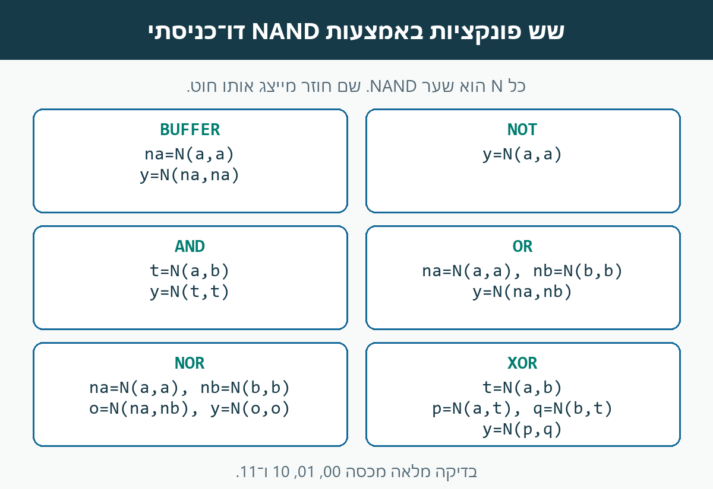
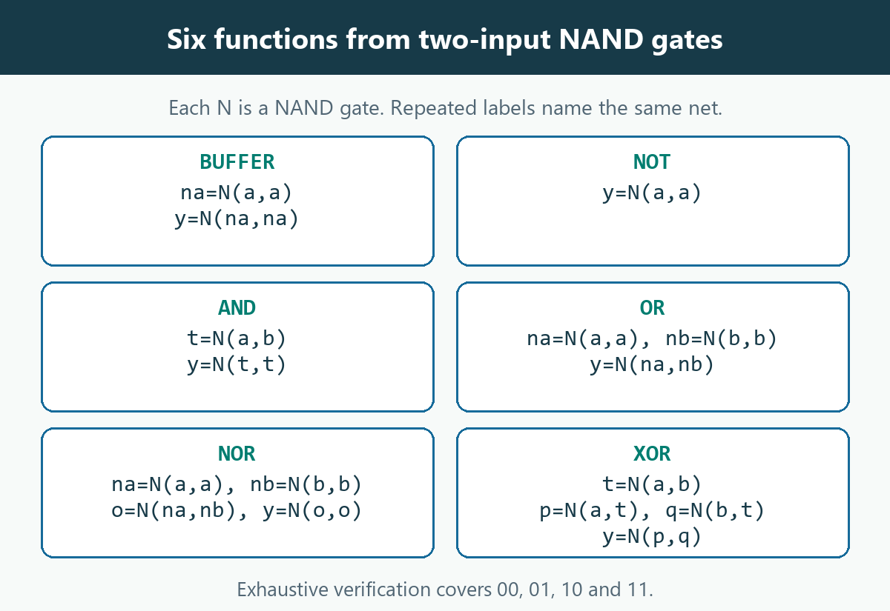

# PREP-092 — מימוש XOR באמצעות שערי NAND

הצעה לפתרון. ביקורת מקצועית אנושית ממתינה.

## עברית

### הרחבה: ספריית פונקציות משערי NAND
ממשו את `BUFFER`,‏`NOT`,‏`AND`,‏`OR`,‏`NOR` ו־`XOR` באמצעות שערי `NAND` דו־כניסתיים בלבד. מותר להשתמש בחיבור שתי כניסות לאותו אות ובפיצול אות. עבור `BUFFER` השתמשו במימוש באמצעות שערים. כתבו את חיבורי השערים, והסבירו כיצד לוודא את כל הפונקציות.

1. מה עושה NAND עם שתי כניסות זהות?
2. בנו AND על ידי היפוך NAND, והשתמשו בדה מורגן לבניית OR.
3. הפכו OR לקבלת NOR והשתמשו באות המשותף `NAND(a,b)` בשני ענפי ה־XOR.

### שימוש בהיפוך ובדה מורגן

#### כיווני חשיבה להרחבה
1. מה עושה NAND עם שתי כניסות זהות?
2. בנו AND על ידי היפוך NAND, והשתמשו בדה מורגן לבניית OR.
3. הפכו OR לקבלת NOR והשתמשו באות המשותף `NAND(a,b)` בשני ענפי ה־XOR.

נסמן `N(x,y)=¬(x∧y)`. קשרו את שתי הכניסות של שער כדי לקבל `inv(x)=N(x,x)`. הזינו כל שם ביניים רק משערים שכבר הוגדרו. במימוש משותף אחד אפשר להשתמש שוב ב־`na`, `nb`, `t` ו־`o`.

```text
na = N(a,a)                 NOT = na
nb = N(b,b)
BUFFER = N(na,na)
t = N(a,b)                  AND = N(t,t)
o = N(na,nb)                OR = o
NOR = N(o,o)
p = N(a,t)
q = N(b,t)
XOR = N(p,q)
```

`BUFFER` הוא היפוך כפול. `AND` הופך את הפלט השלילי של NAND. לפי דה מורגן, `N(na,nb)=a∨b` ולכן ההיפוך שלו הוא NOR. ב־XOR שני ענפי הביניים מציגים 0 בשורות `10` ו־`01` בהתאמה. השער האחרון מניע 1 כאשר לפחות אחד משני הענפים אפס, כלומר בדיוק כשהקלטים שונים.

| a | b | BUFFER(a) | NOT(a) | AND | OR | NOR | XOR |
| --- | --- | --- | --- | --- | --- | --- | --- |
| 0 | 0 | 0 | 1 | 0 | 0 | 1 | 0 |
| 0 | 1 | 0 | 1 | 0 | 1 | 0 | 1 |
| 1 | 0 | 1 | 0 | 0 | 1 | 0 | 1 |
| 1 | 1 | 1 | 0 | 1 | 1 | 0 | 0 |

במימושים נפרדים מספרי השערים בסדר הטבלה הם 2,1,2,3,4,4. בנוסח המשותף הרשום לעיל נדרשים עשרה שערים. אלה עלויות המבנים המוצגים, והתרגיל אינו מניח מינימום עבור רשת רב־מוצאית. קל לבדוק את ארבעת הצירופים בסימולציה. שער `N(a,a)` הוא מהפך בודד ולכן `BUFFER` דורש שער נוסף במימוש הזה.



## English

### Follow-up: A library of NAND-only functions
Build `BUFFER`, `NOT`, `AND`, `OR`, `NOR` and `XOR` using only two-input `NAND` gates. Tied inputs and fanout are allowed. Use a gate implementation for `BUFFER`. Give the gate connections and explain how to verify all outputs.

1. What does NAND do with two identical inputs?
2. Invert NAND to form AND, and apply De Morgan to construct OR.
3. Invert OR for NOR. Reuse `NAND(a,b)` in both branches of the XOR.

### Reuse inversion and De Morgan

#### Hints for the follow-up
1. What does NAND do with two identical inputs?
2. Invert NAND to form AND, and apply De Morgan to construct OR.
3. Invert OR for NOR. Reuse `NAND(a,b)` in both branches of the XOR.

Let `N(x,y)=¬(x∧y)`. Tie a gate's inputs together to get `inv(x)=N(x,x)`. Drive each named internal signal from gates already defined. The joint implementation can reuse `na`, `nb`, `t` and `o`.

```text
na = N(a,a)                 NOT = na
nb = N(b,b)
BUFFER = N(na,na)
t = N(a,b)                  AND = N(t,t)
o = N(na,nb)                OR = o
NOR = N(o,o)
p = N(a,t)
q = N(b,t)
XOR = N(p,q)
```

`BUFFER` inverts twice. `AND` inverts the negated NAND output. De Morgan gives `N(na,nb)=a∨b`, which can then be inverted for NOR. For XOR the two branches produce zero on rows `10` and `01`, respectively. The final NAND produces one when at least one branch is zero, precisely when the inputs differ.

| a | b | BUFFER(a) | NOT(a) | AND | OR | NOR | XOR |
| --- | --- | --- | --- | --- | --- | --- | --- |
| 0 | 0 | 0 | 1 | 0 | 0 | 1 | 0 |
| 0 | 1 | 0 | 1 | 0 | 1 | 0 | 1 |
| 1 | 0 | 1 | 0 | 0 | 1 | 0 | 1 |
| 1 | 1 | 1 | 0 | 1 | 1 | 0 | 0 |

Implemented separately the gate counts in table order are 2,1,2,3,4,4. The joint construction above has ten gates. These are construction costs and the exercise does not assume a minimum for a multi-output network. Exhaustive simulation takes four input assignments. `N(a,a)` is one inverter, so `BUFFER` uses a second gate in this construction.



[צילום מקור פנימי 26](../sources/2026-11-18-batch31-26.png)
[קובץ המימוש](../solutions/digital1118.sv)
[קובץ המימוש](../solutions/digital1118_models.py)
[תוצאות בדיקות](../checks/digital1118-verification.json)
