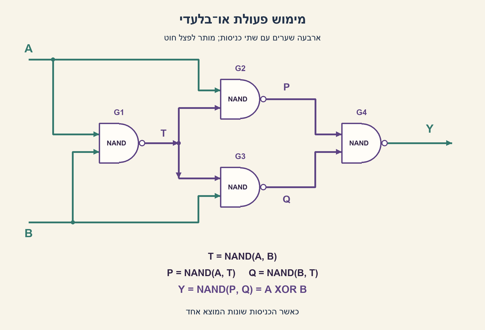
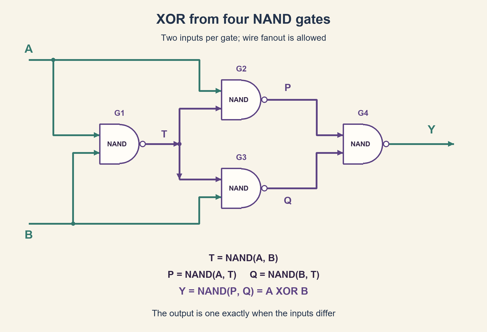

# PREP-092 — מימוש XOR באמצעות שערי NAND

פתרון מוצע בסיוע AI; ביקורת מקצועית אנושית ממתינה. הקושי לא כויל.

## מקור

[צילום המקור](../sources/prep-092-source.png)

ממש שער xor בעזרת שערי nand?

שיוכי החברות בצילום מדווחים ולא אומתו באופן עצמאי: Intel.

## נוסח ערוך

מימוש XOR באמצעות שערי NAND

ממשו Y=A XOR B באמצעות שערי NAND בעלי שתי כניסות בלבד. הציגו חיבורים או משוואות לכל שער, הסבירו מדוע המוצא הוא 1 בדיוק כשהכניסות שונות, ואמתו את ארבע שורות טבלת האמת.

הבהרות: לרשותכם הכניסות A ו־B ללא היפוך מוכן. מותר לפצל חוט למספר כניסות ולחבר את שתי כניסותיו של שער לאותו חוט. אין שערי NOT חינמיים, קבועים חיצוניים, משוב או רכיבי זיכרון. נבחן מעגל קומבינטורי במצב יציב; אין דרישה להוכחת חסינות מתקלות מעבר. נסו לשתף תוצאת ביניים כדי לצמצם שערים.

### שלושה רמזים

1. XOR צריך להחזיר 1 במקרים 01 ו־10 בלבד. חשבו על שני התנאים A AND NOT B ו־NOT A AND B.
2. התחילו מתוצאה משותפת T=NAND(A,B). מה מתקבל ב־NAND(A,T) וב־NAND(B,T)?
3. שני שערי הביניים הם ההיפוכים של שני תנאי ה־XOR. חברו אותם ל־NAND אחרון ויישמו את דה־מורגן.

### הצעה לפתרון

### ארבעה שערים ותוצאה אחת משותפת
NAND מחזיר 0 רק כששתי כניסותיו 1. נשתמש תחילה בשער אחד כדי לחשב תוצאה משותפת, ונעביר אותה לשני שערים נוספים:

```text
T = NAND(A, B)
P = NAND(A, T)
Q = NAND(B, T)
Y = NAND(P, Q)
```

השער הראשון נספר פעם אחת אף שהחוט T מתפצל. אין כאן שער XOR מוסתר או מהפכים חיצוניים.

### ההסבר האינטואיטיבי: כל צד מזהה מקרה אחד של שוני
נבחן את P. כאשר A=0, ה־NAND שלו מחזיר 1 מיד. כאשר A=1, התוצאה T היא NOT B, ולכן P יוצא 0 בדיוק כש־B=0. כלומר P הוא אות פעיל־נמוך למקרה A=1,B=0: אפס אומר שהמקרה הזה זוהה.

באופן סימטרי, Q יוצא 0 בדיוק במקרה A=0,B=1. ה־NAND האחרון מחזיר 1 אם לפחות אחד משני אותות הביניים הוא 0. לכן הוא מחזיר 1 בדיוק באחד משני מקרי השוני. כשהכניסות שוות, P=Q=1 ולכן המוצא 0.

### בודקים את כל האפשרויות
| A | B | T | P | Q | Y |
| --- | --- | --- | --- | --- | --- |
| 0 | 0 | 1 | 1 | 1 | 0 |
| 0 | 1 | 1 | 1 | 0 | 1 |
| 1 | 0 | 1 | 0 | 1 | 1 |
| 1 | 1 | 0 | 1 | 1 | 0 |

אפשר גם לכתוב P=NOT(A AND NOT B) ו־Q=NOT(NOT A AND B). לכן לפי דה־מורגן, NAND(P,Q)=(A AND NOT B) OR (NOT A AND B), שהיא בדיוק פעולת XOR.

### עלות, מינימליות ותזמון
במימוש ארבעה שערי NAND בעלי שתי כניסות. המסלול הארוך ביותר עובר בשלושה שערים: G1 ואז G2 או G3 ואז G4. אם כל שער אידאלי מעכב d, עומק המסלול הוא לכל היותר 3d; אין בכך ניתוח תזמון פיזי, עומסי חיווט או חסינות לגליצ'ים.

במודל המצומצם שהוגדר, ארבעה שערים הם גם מינימום. לכך מצורפת בדיקה ממצה הניתנת לשחזור: מייצגים כל חוט בארבע סיביות של טבלת האמת, ומונים כל בחירה של זוג חוטים קודמים עבור כל שער. יש 3 רשתות בנות שער אחד, 18 בנות שניים ו־180 בנות שלושה. שום חוט פלט בהן אינו XOR. כל מעגל קומבינטורי חסר מעגלים ניתן לסדר כך שכל שער משתמש רק בכניסות ובשערים קודמים; לכן המנייה מכסה את כל המעגלים עד שלושה שערים במודל הזה. זו טענת מספר שערים בלבד, לא מינימום שטח טרנזיסטורים, הספק או השהיה בספרייה פיזית.

הקוד המצורף מדמה את ערכי האמת לאחר התייצבות. הוא אינו סימולציה מתוזמנת ואינו הוכחה להיעדר פולסים קצרים בעת שינוי הכניסות.

```python
"""Four two-input Boolean NAND gates; ideal steady-state truth values only."""


def nand(a: bool, b: bool) -> bool:
    return not (a and b)


def xor_from_nand(a: bool, b: bool) -> bool:
    shared = nand(a, b)
    left = nand(a, shared)
    right = nand(b, shared)
    return nand(left, right)
```



## English edition

Implement XOR using NAND gates

Implement Y=A XOR B using only two-input NAND gates. Give each gate's connections or equation, explain why the output is one exactly when inputs differ, and verify all four truth-table rows.

Clarifications: only uncomplemented A and B are supplied. Wire fanout and tying both pins to one wire are allowed. No free NOT gates, external constants, feedback or storage. Analyze steady-state combinational behavior; hazard freedom is not required. Try sharing an intermediate result to reduce gate count.

### Three hints

1. XOR is one only for 01 and 10. Think of the conditions A AND NOT B and NOT A AND B.
2. Start with a shared T=NAND(A,B). What do NAND(A,T) and NAND(B,T) produce?
3. The middle gates negate the two XOR conditions. Feed both into a final NAND and apply De Morgan's law.

### Proposed solution

### Four gates sharing one intermediate result
A NAND is zero only when both inputs are one. First compute a shared result, then feed it into two middle gates:

```text
T = NAND(A, B)
P = NAND(A, T)
Q = NAND(B, T)
Y = NAND(P, Q)
```

The first gate is counted once even though its wire T fans out. No hidden XOR or external inverter is used.

### Intuition: each side recognizes one unequal case
Consider P. If A=0, its NAND immediately outputs one. If A=1, T is NOT B, so P becomes zero exactly when B=0. Thus P is an active-low detector for A=1,B=0: zero means that case was recognized.

Symmetrically, Q is zero exactly for A=0,B=1. The final NAND outputs one when at least one middle signal is zero. Those are precisely the two unequal-input cases. For equal inputs, P=Q=1 and the output is zero.

### Check every input assignment
| A | B | T | P | Q | Y |
| --- | --- | --- | --- | --- | --- |
| 0 | 0 | 1 | 1 | 1 | 0 |
| 0 | 1 | 1 | 1 | 0 | 1 |
| 1 | 0 | 1 | 0 | 1 | 1 |
| 1 | 1 | 0 | 1 | 1 | 0 |

Equivalently P=NOT(A AND NOT B) and Q=NOT(NOT A AND B). De Morgan then gives NAND(P,Q)=(A AND NOT B) OR (NOT A AND B), the XOR function.

### Cost, minimality and timing
The construction uses four two-input NAND gates. Its longest path crosses three gates: G1, then G2 or G3, then G4. If every ideal gate has delay d, the path bound is 3d; this is not physical timing, wire-load analysis or a hazard-free guarantee.

Four is also a minimum in the explicitly stated restricted model. A reproducible exhaustive check packs each wire's four-row truth table into four bits, then enumerates every pair of preceding wires as the inputs to each gate. There are 3 one-gate networks, 18 two-gate networks and 180 three-gate networks. No output wire computes XOR. Every acyclic combinational network admits an ordering in which a gate uses only external inputs and preceding gates, so this enumeration covers all networks with at most three gates in this model. The claim concerns gate count only, not minimum transistor area, power or physical-library delay.

The attached Python code models settled truth values. It is not a timed simulation and does not rule out short pulses while inputs change.

```python
"""Four two-input Boolean NAND gates; ideal steady-state truth values only."""


def nand(a: bool, b: bool) -> bool:
    return not (a and b)


def xor_from_nand(a: bool, b: bool) -> bool:
    shared = nand(a, b)
    left = nand(a, shared)
    right = nand(b, shared)
    return nand(left, right)
```



## חומר משלים דו־לשוני / Bilingual supporting material

```json
{
  "assumptions": {
    "he": [
      "שערי NAND בעלי שתי כניסות בלבד; כניסות חיצוניות A,B ללא היפוך מוכן.",
      "מותר פיצול חוט וחיבור שני פינים לאותו חוט; אין קבועים או מהפכים חיצוניים חינמיים.",
      "מעגל קומבינטורי חסר משוב, בערכים לוגיים שהתייצבו."
    ],
    "en": [
      "Only two-input NAND gates; external inputs are uncomplemented A,B.",
      "Fanout and tied input pins are allowed; no free external constants or inverters.",
      "Acyclic combinational network evaluated at settled Boolean values."
    ]
  },
  "netlist": {
    "he": [
      "G1: T=NAND(A,B)",
      "G2: P=NAND(A,T)",
      "G3: Q=NAND(B,T)",
      "G4: Y=NAND(P,Q)"
    ],
    "en": [
      "G1: T=NAND(A,B)",
      "G2: P=NAND(A,T)",
      "G3: Q=NAND(B,T)",
      "G4: Y=NAND(P,Q)"
    ]
  },
  "truth_table": {
    "he": [
      {
        "A": 0,
        "B": 0,
        "T": 1,
        "P": 1,
        "Q": 1,
        "Y": 0
      },
      {
        "A": 0,
        "B": 1,
        "T": 1,
        "P": 1,
        "Q": 0,
        "Y": 1
      },
      {
        "A": 1,
        "B": 0,
        "T": 1,
        "P": 0,
        "Q": 1,
        "Y": 1
      },
      {
        "A": 1,
        "B": 1,
        "T": 0,
        "P": 1,
        "Q": 1,
        "Y": 0
      }
    ],
    "en": [
      {
        "A": 0,
        "B": 0,
        "T": 1,
        "P": 1,
        "Q": 1,
        "Y": 0
      },
      {
        "A": 0,
        "B": 1,
        "T": 1,
        "P": 1,
        "Q": 0,
        "Y": 1
      },
      {
        "A": 1,
        "B": 0,
        "T": 1,
        "P": 0,
        "Q": 1,
        "Y": 1
      },
      {
        "A": 1,
        "B": 1,
        "T": 0,
        "P": 1,
        "Q": 1,
        "Y": 0
      }
    ]
  },
  "optimality": {
    "he": "ארבעה שערים, עומק מרבי של שלושה. מינימום מספר שערים אומת במנייה ממצה עד שלושה שערים, ורק במודל NAND דו־כניסתי חסר משוב וללא היפוכים או קבועים חיצוניים חינמיים. לא נטען מינימום שטח פיזי או השהיה.",
    "en": "Four gates, maximum depth three. Minimum gate count is established by exhaustive enumeration through three gates only in the acyclic two-input NAND model with no free external inversion or constants. No physical-area or delay minimum is claimed."
  },
  "edge_cases": {
    "he": [
      "00 ו־11 מחזירים 0; 01 ו־10 מחזירים 1.",
      "ב־11 התוצאה T=0 ושני שערי הביניים מחזירים 1.",
      "שינוי כניסות בו־זמני עשוי ליצור גליצ'ים; טבלת אמת אינה הוכחת חסינות.",
      "חוט T משותף, אך פיצולו אינו שער נוסף במודל זה."
    ],
    "en": [
      "00 and 11 give zero; 01 and 10 give one.",
      "For 11, T=0 and both middle gates output one.",
      "Concurrent input transitions may cause glitches; a truth table does not establish hazard freedom.",
      "The T wire is shared; fanout is not another gate in this model."
    ]
  },
  "common_mistakes": {
    "he": [
      "חיבור NAND(A,B) ישירות למוצא: זה אינו XOR.",
      "ספירה של שער T פעמיים בגלל פיצול החוט.",
      "שימוש ב־NOT, AND או OR בלי לבנות אותם מהשערים המותרים.",
      "בלבול בין XOR ל־XNOR.",
      "הסקת חסינות לגליצ'ים או אופטימליות פיזית מטבלת אמת בלבד."
    ],
    "en": [
      "Using NAND(A,B) directly as XOR.",
      "Counting the shared T gate twice because its wire splits.",
      "Using free NOT, AND or OR gates outside the allowed library.",
      "Confusing XOR with XNOR.",
      "Inferring hazard freedom or physical optimality from a truth table."
    ]
  },
  "interview_answer": {
    "he": "מחשבים T=NAND(A,B), ואז P=NAND(A,T) ו־Q=NAND(B,T), ולבסוף Y=NAND(P,Q). P ו־Q הם גלאים פעילים־נמוך לשני מקרי השוני; לכן ה־NAND האחרון מחזיר 1 בדיוק ב־01 וב־10. ארבעה שערים, עומק שלושה.",
    "en": "Compute T=NAND(A,B), P=NAND(A,T), Q=NAND(B,T), then Y=NAND(P,Q). P and Q are active-low detectors of the two unequal cases, so the final NAND outputs one exactly for 01 and 10. Four gates, depth three."
  },
  "source_ambiguities": {
    "he": [
      "המקור לא מגדיר מספר כניסות לשער או הרשאה לפיצול חוט; הנוסח מגדיר NAND דו־כניסתי ופיצול מותר.",
      "טענת מינימליות היא תוספת עריכה במודל מוגדר; המקור מבקש מימוש בלבד."
    ],
    "en": [
      "The source does not define gate fan-in or fanout permission; this edition uses two-input NAND with allowed fanout.",
      "The scoped minimum-gate result is an editorial extension; the source asks only for an implementation."
    ]
  },
  "verification": {
    "he": "אומתו כל ארבע שורות טבלת האמת מול A!=B, וכן כל 3/18/180 הרשתות המסודרות טופולוגית בעלות שער NAND אחד/שניים/שלושה במודל המוצהר. נבדק ציור מול ארבע משוואות החיבור. ללא הידור HDL, סינתזה, STA או בדיקת השהיה פיזית.",
    "en": "Verified all four truth rows against A!=B, plus all 3/18/180 topologically ordered one/two/three-NAND networks in the stated model. Diagram checked against the four connection equations. No HDL compilation, synthesis, STA or physical-delay verification."
  },
  "diagram_description": {
    "he": "G1 יוצר T ומפצל אותו ל־G2 ול־G3. A מחובר גם ל־G2 ו־B גם ל־G3. מוצאי P,Q נכנסים ל־G4. נקודות מסמנות פיצול מחובר; העיגול ביציאת כל שער מציין היפוך.",
    "en": "G1 creates T and fans it into G2 and G3. A also enters G2 and B also enters G3. Their P,Q outputs enter G4. Dots mark connected branches; each output bubble denotes inversion."
  },
  "relationship_note": {
    "he": "העיקרון קשור למימוש XOR מספריית רכיבים מוגבלת ב־PREP-031 וב־PREP-015; ספריית NAND כאן שונה ומצריכה רשת אחרת.",
    "en": "Related to constrained-library XOR constructions in PREP-031 and PREP-015; the NAND library here requires a different network."
  },
  "solution_extensions": {
    "he": {
      "question": "כיצד נבנה XNOR מאותה רשת?",
      "direction": "מוסיפים NAND שמקבל את Y בשתי כניסותיו כדי להפוך אותו. זו הרחבה ישירה ולא טענה למינימום מספר שערי XNOR.",
      "status": "מוכן בתוכן; אינו מחובר לתור שאלות ההמשך."
    },
    "en": {
      "question": "How can the same network produce XNOR?",
      "direction": "Add a NAND with Y tied to both inputs to invert it. This is a direct extension, not a minimum-XNOR-gate claim.",
      "status": "Prepared in content; not connected to the interactive follow-up queue."
    }
  }
}
```
