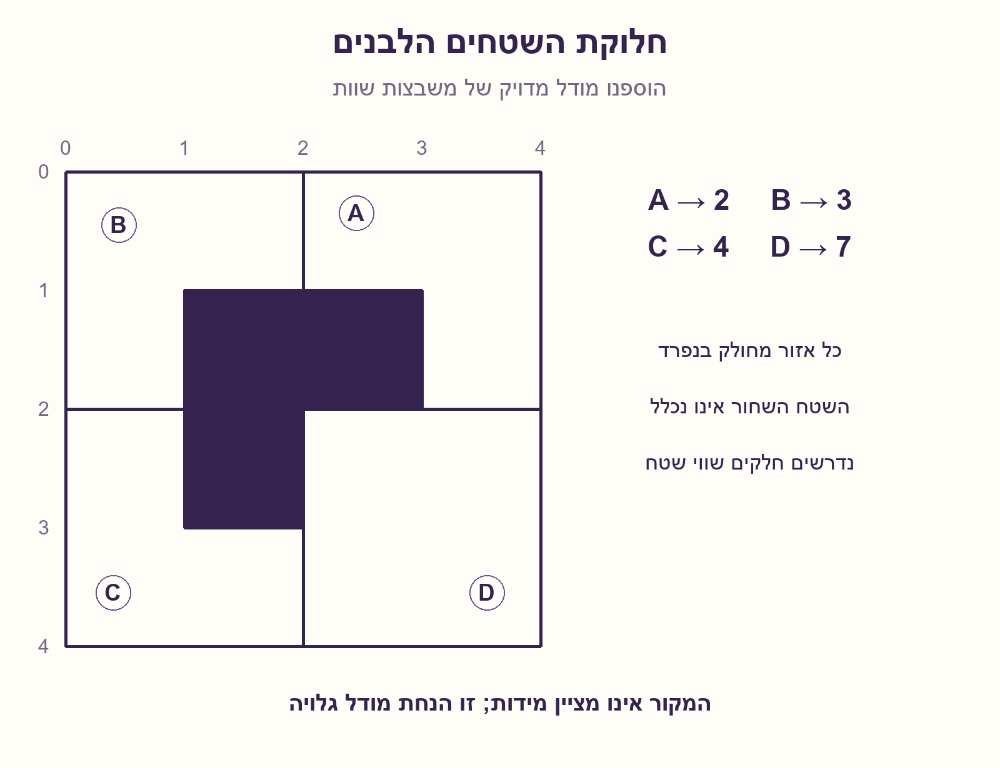
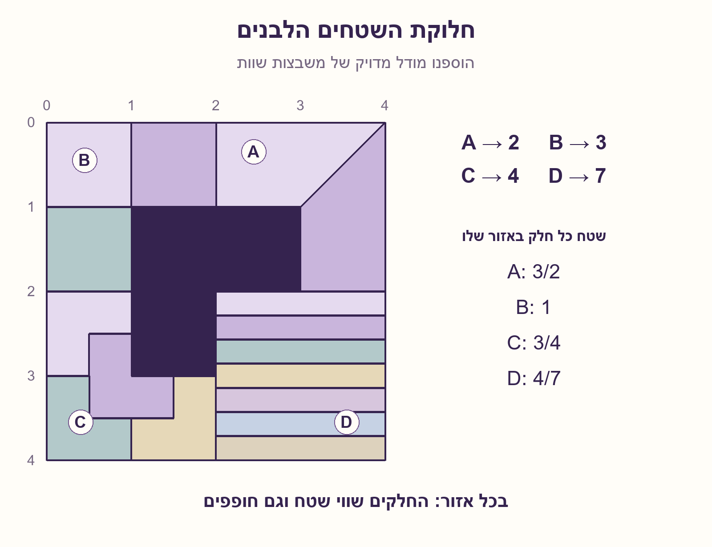
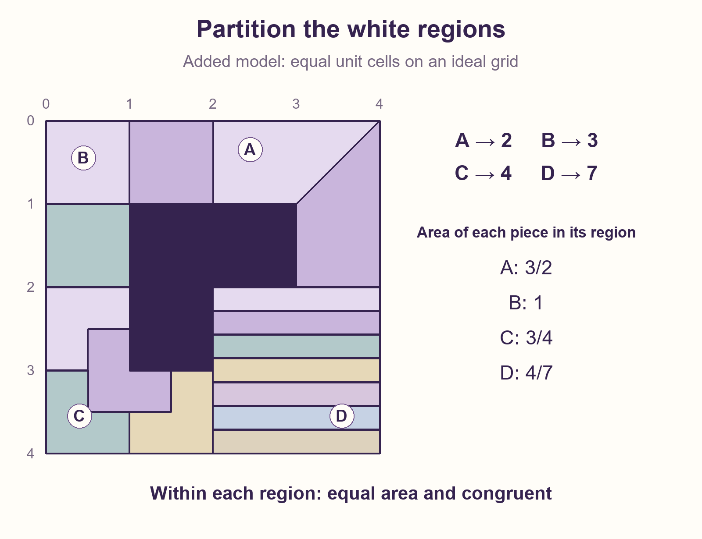

# PREP-093 — מחלקים את האזורים הלבנים — 2, 3, 4 ו־7 חלקים

מצב: בביקורת; הצעה לפתרון בסיוע AI, ממתינה לבדיקה מקצועית אנושית.

## מקור

נתונה הצורה המצורפת — התייחסו לשטח הלבן: 1. חלק את א׳ ל־2 חלקים שווים. 2. חלק את ב׳ ל־3 חלקים שווים. 3. חלק את ג׳ ל־4 חלקים שווים. 4. חלק את ד׳ ל־7 חלקים שווים.

[צילום מקור](../sources/prep-093-source.png)

חברות לפי המקור בלבד, ללא אימות עצמאי: Intel, Rafael

## נוסח ערוך

התבוננו בשרטוט המחודש. חלקו את האזור הלבן א׳ (A, מימין למעלה) לשני חלקים שווי שטח, את ב׳ (B, משמאל למעלה) לשלושה, את ג׳ (C, משמאל למטה) לארבעה, ואת ד׳ (D, מימין למטה) לשבעה. כל אזור מחולק בנפרד; אין צורך שהחלקים מאזורים שונים יהיו שווים זה לזה. השטח הכהה אינו חלק מהמשימה. הציעו קווי חלוקה והוכיחו את השוויון.

מודל מידות שהוספנו במפורש: הריבוע החיצוני הוא 4×4 יחידות ומחולק באמצע לארבעה רבעים של 2×2. השטח הכהה הוא L של שלוש משבצות יחידה, שנוגס במשבצת אחת מכל אחד מהאזורים A,B,C. לכן שלושתם הם L משלוש משבצות ו־D הוא ריבוע שלם. המקור לא מספק מידות מדויקות; אין להסיק יחס מדויק מפיקסלים. ״שווים״ מתפרש לפחות כשווי שטח; אפשר לתת כאן אפילו חלקים חופפים בתוך כל אזור.

## שלושה רמזים

1. האם ארבע המשימות מחייבות את אותה צורה של חלקים, או שכל אזור נבדק בנפרד? ספרו משבצות לבנות בכל אזור.
2. ב־A חפשו ציר סימטריה; ב־B כבר יש שלוש משבצות; ב־D אפשר לחתוך לרצועות שוות.
3. ב־C חלקו כל משבצת לארבע משבצות קטנות. L קטן במרכז משאיר עוד שלושה L-ים קטנים בפינות.

## הצעה לפתרון

### מתחילים מהמשבצות, לא מחיתוכים אקראיים
במודל שבשרטוט, כל אחד מהאזורים A,B,C מכיל שלוש משבצות יחידה. לכן שטחו 3. האזור D הוא ריבוע של 2×2 ושטחו 4. אנחנו מחלקים כל אזור לעצמו: שטח חלק ב־A יהיה 3/2, ב־B יהיה 1, ב־C יהיה 3/4 וב־D יהיה 4/7. אין צורך ששטח חלק ב־A ישתווה לשטח חלק ב־D.

### A: שני חלקים — נצלו סימטריה
לאזור A יש פינה פנימית, הנקודה שבה המשבצת הכהה נוגעת בשתי המשבצות הלבנות. חברו אותה בקו ישר לפינה החיצונית הנגדית, בפינה הימנית העליונה של המסגרת. מתקבלים שני טרפזים שהם תמונות ראי זה של זה. לכן הם חופפים ושווי שטח, 3/2 לכל אחד. במערכת הצירים המצוירת הקו הוא מהנקודה (3,1) אל (4,0). אין למתוח אותו דרך השטח הכהה.

### B: שלושה חלקים — כל משבצת היא חלק
ה־L הזה מורכב בדיוק משלוש משבצות יחידה. ממשיכים את גבולות המשבצות בתוך האזור: קטע מ־(1,0) ל־(1,1), וקטע מ־(0,1) ל־(1,1). נקבל שלושה ריבועי יחידה, כל אחד בשטח 1.

### C: ארבעה חלקים — L קטן בתוך L גדול
דמיינו חלוקה של כל משבצת יחידה לארבע משבצות שצלע כל אחת חצי יחידה. כעת יש ב־C שתים־עשרה משבצות קטנות. נחלק אותן לארבע קבוצות, כל קבוצה היא L של שלוש משבצות קטנות.

הדרך לראות את הסידור: שימו L קטן אחד במרכז, מסביב לפינה הפנימית של האזור. הוא לוקח את המשבצת הפנימית מכל אחד משלושת ריבועי היחידה. בכל ריבוע יחידה נשארות שלוש משבצות קטנות, שיוצרות L נוסף. כך מתקבלים שלושה חלקים פינתיים וחלק מרכזי — ארבעה L-ים חופפים בסך הכול. כל אחד בשטח 3×(1/2)²=3/4. השרטוט הצבוע מראה בדיוק אילו משבצות מחוברות לכל חלק.

### D: שבעה חלקים — לא חייבים להמשיך להשתמש ב־L
D הוא ריבוע שלם. חלקו את גובהו לשבעה מרווחים שווים והעבירו שישה קווים אופקיים. מתקבלים שבעה מלבנים, כל אחד ברוחב 2 ובגובה 2/7; שטח כל אחד 4/7. אין דרישה שגם החלקים ב־D יהיו בצורת L, או שידמו לחלקים ב־C.

### מה הוכחנו, ומה הנחנו?
בכל אחד מארבעת האזורים החלקים מכסים בדיוק את הלבן, אינם חופפים בשטח פנימי, והם אפילו חופפים גאומטרית זה לזה בתוך אותו אזור. הגבולות המשותפים הם קווים חסרי שטח. ההוכחה מתייחסת למודל המשבצות המדויק שציינו; אם למקור יש מידות אחרות, צריך לקבל אותן ולבדוק מחדש, ולא להסתמך על גודל משוער מהצילום.

## assumptions

[
  "המידות 4×4 ומשבצות היחידה הן שחזור אידאלי מפורש שנוסף; לא נתון שנמדד מהצילום.",
  "כל אחד משלושת אזורי ה־L הלבנים הוא 2×2 פחות משבצת יחידה, ו־D הוא ריבוע 2×2 מלא.",
  "כל אזור מחולק בפני עצמו; החלקים מכסים אותו ללא חפיפה של פנים וללא שימוש בשטח הכהה.",
  "נדרשים חלקים מחוברים שווי שטח. ההצעה מספקת גם חפיפה גאומטרית בתוך כל אזור; סיבוב ושיקוף מותרים להשוואה."
]

## optimality

{
  "criterion": "בניית 2,3,4,7 חלקים שווי שטח בתוך A,B,C,D בהתאמה.",
  "result": "A: שני טרפזים חופפים; B: שלושה ריבועים; C: ארבעה L-ים קטנים; D: שבע רצועות מלבניות.",
  "proof": "סימטריה ב־A, יחידות שטח ב־B, הקטנה פי שניים בכל צלע ואריח מרכזי ב־C, גובה שווה ב־D.",
  "scope": "בניית קיום במודל המידות המוצהר; אין טענה למינימום מספר פעולות חיתוך או לפתרון יחיד."
}

## edge_cases

[
  "השטח הכהה אינו מתווסף לאף חלק.",
  "שוויון שטחים נדרש בתוך אזור, לא בין כל 16 החלקים בארבעת האזורים.",
  "קווים משותפים אינם יוצרים חפיפה בעלת שטח חיובי.",
  "הגדלה אחידה של כל השרטוט שומרת על השוויון והחפיפה.",
  "שינוי לא אחיד של המידות עלול לשבור את הסימטריה ואת אריחי ה־L."
]

## common_mistakes

[
  "להניח שהחלקים בכל ארבעת האזורים חייבים להיראות אותו דבר.",
  "לחלק מלבן חוסם ולכלול בטעות שטח כהה.",
  "לחלק את צלעות ה־L לארבע ולצפות אוטומטית לארבעה שטחים שווים.",
  "לייחס למידות משוערות בצילום דיוק שלא קיים במקור.",
  "לספור שלושה L-ים בפינות של C ולשכוח את ה־L המרכזי."
]

## interview_answer

"במודל המשבצות, A,B,C הם L בשטח 3 ו־D ריבוע בשטח 4. ב־A אחבר את הפינה הפנימית לפינה החיצונית הנגדית לקבלת שני טרפזים חופפים. B מתפרק לשלוש משבצות. C מתפרק לארבעה L-ים בחצי קנה מידה: אחד במרכז ושלושה בפינות. D מתחלק לשבע רצועות שוות. השטחים לכל חלק הם 3/2,1,3/4,4/7 בהתאמה."

## solution_extensions

{
  "question": "האם אפשר לחלק את C לשישה־עשר L-ים חופפים?",
  "direction": "כן. מפעילים שוב את חלוקת ארבעת ה־L-ים על כל אחד מארבעת החלקים. כל צלע קטנה לרבע מהמקור והשטח של כל חלק הוא 3/16.",
  "status": "כיוון הרחבה מוכח; מוכן בארכיון ואינו מחובר לתור המשך אינטראקטיבי."
}

## source_ambiguities

[
  "בצילום אין מידות ואין הבטחה מפורשת ליחסי צלעות; המודל המדויק 4×4 נוסף וסומן.",
  "המילה ׳שווים׳ יכולה להתפרש כשווי שטח או כחופפים. ההצעה מקיימת גם וגם בתוך כל אזור במודל הנתון.",
  "אין דרישה למספר קווי חיתוך מינימלי, לחיתוך פיזי רציף, או לצורה משותפת לכל האזורים.",
  "תג המקור 2312313 נשמר כתג גולמי בלבד ואינו מסווג כחברה או כמיומנות."
]

## technical_references

[]

## verification

"נבדקו בדיוק שברי שטח של כל 16 החלקים, סכום שטח לבן 13, וחפיפה גאומטרית בתוך כל אזור לאחר הזזה ושיקוף או סיבוב. אורקל גאומטרי נפרד בדק 50,176 נקודות ללא נקודות גבול מול הגדרת המשבצות, ללא חורים או חפיפות שנמצאו. הסריקה היא בדיקה נוספת לבניית הריצוף המדויקת; אינה טענה על כל מצולע או על המידות המקוריות בצילום."

## English question

Use the redrawn figure. Partition white region A (upper right) into two equal-area pieces, B (upper left) into three, C (lower left) into four, and D (lower right) into seven. Partition each region separately; pieces from different regions need not have equal areas. The dark area is excluded. Give dividing lines and justify equality.

Explicitly added dimensions: the outer square is 4×4 units and its midlines form four 2×2 quarters. The dark L comprises three unit cells, removing one cell from each of A,B,C. Each of those three white regions is thus an L triomino, while D is a complete square. The source supplies no exact dimensions; pixel ratios do not establish measurements. Interpret equal as at least equal area; this model even admits congruent pieces within each region.

## Three hints

1. Must all four tasks use one common piece shape, or is each region independent? Count white unit cells in each region.
2. Look for reflection symmetry in A; B already has three unit squares; D can use equal strips.
3. In C, quarter each unit square. A central small L leaves three more small L shapes at the corners.

## Proposed solution

### Start with cells, not random cuts
In the stated grid model, A,B,C each contain three unit cells and have area three. D is a 2×2 square of area four. Each region is a separate task: piece areas are 3/2 in A, 1 in B, 3/4 in C and 4/7 in D. A piece in A need not match a piece in D.

### A: two pieces — use reflection symmetry
A has a reentrant corner where the dark cell touches two white cells. Join it to the opposite outer corner, at the upper-right corner of the frame. The two resulting trapezoids are mirror images. They are congruent and each has area 3/2. In the displayed coordinates the cut joins (3,1) to (4,0). Do not extend it through the dark area.

### B: three pieces — one cell per piece
This L consists of three unit squares. Continue their cell boundaries inside the region: from (1,0) to (1,1), and from (0,1) to (1,1). The three pieces are unit squares of area one.

### C: four pieces — a small L inside a large L
Imagine dividing each unit square into four half-unit squares. C now consists of twelve small cells. Group them into four L shapes, each formed from three small cells.

To see the arrangement, put one small L centrally around the reentrant corner of the region. It takes the innermost small cell from each of the three unit squares. Each unit square then has three small cells left, forming another L. Thus there are three corner pieces and one central piece: four congruent L shapes in all. Each area is 3×(1/2)²=3/4. The colored diagram identifies the cells belonging to each piece.

### D: seven pieces — no need to keep using L shapes
D is a full square. Divide its height into seven equal intervals with six horizontal lines. This produces seven rectangles, each of width two and height 2/7, hence area 4/7. D's pieces need not be L shaped or resemble C's pieces.

### What was proved, and what was assumed?
Within every region the pieces cover exactly the white area, have disjoint interiors, and are even mutually congruent. Shared boundary lines have zero area. This proof uses the explicitly stated exact grid model. Different original dimensions would require fresh data and a new check rather than estimates from screenshot pixels.

## assumptions (English)

[
  "The 4×4 dimensions and unit cells are an openly added ideal reconstruction, not screenshot measurements.",
  "Each white L is a 2×2 square minus one unit cell; D is a complete 2×2 square.",
  "Each region is partitioned independently, covering it with disjoint interiors and excluding dark area.",
  "Pieces are connected and equal in area. The construction also gives congruent pieces within each region, allowing rotations and reflections for comparison."
]

## optimality (English)

{
  "criterion": "Construct 2,3,4,7 equal-area pieces within A,B,C,D respectively.",
  "result": "A: two congruent trapezoids; B: three squares; C: four small L shapes; D: seven rectangular strips.",
  "proof": "Reflection in A, unit squares in B, half-scale L tiling with a central tile in C, equal heights in D.",
  "scope": "Existence construction under explicit dimensions; no minimum-cut or uniqueness claim."
}

## edge_cases (English)

[
  "No dark area belongs to a piece.",
  "Area equality is required within a region, not among all sixteen pieces across four regions.",
  "Shared boundary lines do not create positive-area overlap.",
  "Uniformly scaling the diagram preserves equality and congruence.",
  "Changing relative dimensions can break reflection symmetry and the L tiling."
]

## common_mistakes (English)

[
  "Requiring all four regions to use the same piece shape.",
  "Partitioning a bounding rectangle and accidentally including dark area.",
  "Dividing L boundary lengths by four and assuming equal areas follow.",
  "Treating estimated screenshot dimensions as exact source data.",
  "Counting C's three corner L tiles but forgetting the central L."
]

## interview_answer (English)

"Under the grid model, A,B,C are area-three L shapes and D is an area-four square. Split A along its reflection axis into two congruent trapezoids. Split B into three unit squares. Tile C with four half-scale L shapes: one central and three at corners. Split D into seven equal strips. Piece areas are 3/2,1,3/4,4/7 respectively."

## solution_extensions (English)

{
  "question": "Can C be divided into sixteen congruent L shapes?",
  "direction": "Yes. Repeat the four-L construction inside each of its four tiles. Each length is one quarter of the original and each piece has area 3/16.",
  "status": "Proved extension direction; prepared in the archive, not connected to the interactive follow-up queue."
}

## source_ambiguities (English)

[
  "The screenshot supplies no dimensions or exact side-length ratios; the exact 4×4 model was added and labelled.",
  "Equal could mean equal area or congruent. This construction satisfies both within each region under the stated model.",
  "The source does not require a minimum number of cuts, a physical continuous cutting procedure, or one piece shape shared by all regions.",
  "Source tag 2312313 is retained only as a raw tag, not interpreted as a company or skill."
]

## technical_references (English)

[]

## verification (English)

"Checked exact rational areas of all sixteen pieces, total white area thirteen, and within-region congruence under translation and a square symmetry. An independent geometry oracle checked 50,176 nonboundary sample points against the cell definition, finding no gaps or overlaps. Sampling supplements the exact tiling construction; it makes no general polygon or original screenshot-dimension claim."

## Verification artifacts

[solutions/prep_093_equal_partitions.py](../solutions/prep_093_equal_partitions.py)

[checks/check_prep_093.py](../checks/check_prep_093.py)

[checks/prep-093-verification.json](../checks/prep-093-verification.json)
