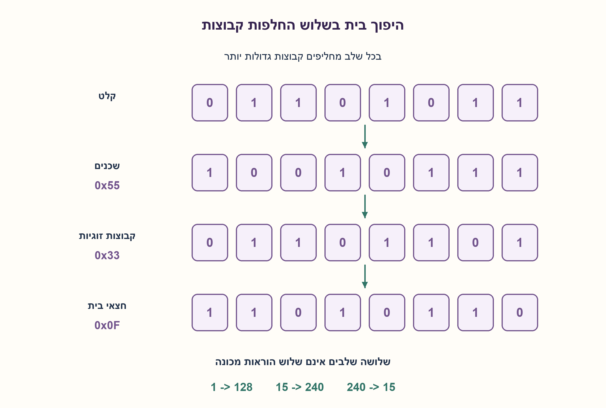
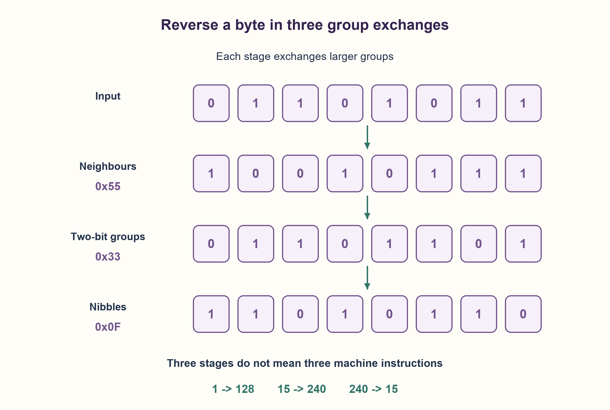

# PREP-094 — היפוך סדר שמונה סיביות — ללא מערך

פתרון מוצע בסיוע AI; ביקורת מקצועית אנושית ממתינה.

## נוסח ערוך

### סעיף נוסף — מימוש C ושיפור מספר שלבי ההיפוך
כתבו פונקציית C המקבלת uint8_t ומחזירה היפוך של כל שמונת הביטים. דוגמאות המקור: f(1)=128, f(15)=240, f(240)=15. הציגו דרך ישירה ואחריה שיפור באמצעות מסכות והזזות, ללא מערך או טבלת חיפוש. הסבירו מה בדיוק משתפר.

הנחות: נדרש יעד C99 ומעלה המספק uint8_t. הפרמטר כבר בן שמונה ביטים ללא סימן; המרה אליו אינה בדיקת טווח של ערך מקורי רחב יותר. הסעיף משמר את דרישת שמונת הביטים ואת הפתרון הקודם, ואינו מחליף אותם בהיפוך רק של הביטים המשמעותיים.

### שלושה רמזים לסעיף החדש

1. אפשר לקרוא ביט מהקצה הימני ולבנות תוצאה שמאלה — מדוע צריך שמונה צעדים גם כשהקלט כבר אפס?
2. במקום להעביר כל ביט בנפרד, אפשר להחליף זוגות של קבוצות ביטים שלמות.
3. החליפו שכנים עם 0x55, קבוצות של שני ביטים עם 0x33 ואז חצאי בית עם 0x0F; שמרו פעולות unsigned והסבירו שלושה שלבים, לא שלוש הוראות מכונה.

### הצעה לפתרון

### שתי דרכים לאותו היפוך מדויק
הדרך הישירה קוראת בכל פעם את הביט הימני, מזיזה את התוצאה שמאלה ומצרפת אותו. חוזרים בדיוק שמונה פעמים, כולל אפסים מובילים. כך 00000001 הופך ל־10000000 ולא נשאר 1.

בשיפור עובדים על כמה ביטים במקביל. מסכה 0x55 היא 01010101: היא בוחרת ביט אחד מכל זוג. הזזה שמאלה של הקבוצה הזאת וצירוף הביטים מהעמדות המשלימות שהוזזו ימינה מחליפים שכנים. בשלב הבא 0x33=00110011 מחליפה קבוצות של שני ביטים. לבסוף 0x0F מחליפה את ארבעת הביטים הנמוכים בארבעת הגבוהים. כל שלב מחליף את שני חצאי הקבוצות בגודלו; אחרי גדלים 1,2,4 כל שמונה העמדות הפוכות.

למשל 00001111 נותר 00001111 אחרי שני השלבים הראשונים, ובשלב האחרון הופך ל־11110000, כלומר 240. השיטה משמרת את מספר האחדות והיא היפוך של סדר, לא NOT או סיבוב.

הקוד משתמש ב־unsigned למשתני הביניים ובמסכות בעלות הסיומת u. ערכי הביניים נשארים בתחום בית, והזזות אינן של מספר שלילי. uint8_t קיים רק ביעדים המספקים טיפוס בדיוק ברוחב הזה. הפונקציה אינה יכולה לדעת אם הקורא המיר אליה קודם מספר מחוץ לטווח; בדיקה כזאת שייכת לממשק הקורא.

שתי הדרכים O(1) לזמן ולזיכרון כי הרוחב שמונה קבוע. השיפור הוא שמונה צעדים סדרתיים לעומת שלושה שלבי החלפת קבוצות, שכל אחד מהם כולל כמה פעולות. בהכללה לרוחב W מתאים: O(W) לעומת O(log W) שלבי מילים, בהנחות מסכות ופעולות מילה. אין כאן מדידה שמוכיחה מהיר יותר בכל מהדר או מעבד, ולא טענה לשלוש הוראות מכונה.

שני מודלי Python הושוו לכל 256 ההיפוכים מול אורקל מחרוזת ביטים עצמאי, עם בדיקת היפוך כפול ושימור אחדות. קוד C אמיתי צורף, אך clang,gcc,cl,g++ לא נמצאו ב־PATH בבדיקה ולכן הוא לא קומפל או הורץ כאן. זהו אימות של המודלים והנמקת פעולות C, לא ראיית הרצה של C.

```c
/* C99+; requires a target providing the exact-width uint8_t type.
 * Input is already an unsigned byte; integer-to-uint8_t caller conversion
 * is not rejection of an out-of-domain original integer.
 * No arrays, lookup tables, strings or signed shifts are used.
 */
#include <stdint.h>

uint8_t reverse_byte_loop(uint8_t value)
{
    uint8_t result = 0;
    for (unsigned i = 0; i < 8; ++i) {
        result = (uint8_t)(((unsigned)result << 1) | ((unsigned)value & 1u));
        value = (uint8_t)((unsigned)value >> 1);
    }
    return result;
}

uint8_t reverse_byte_masks(uint8_t value)
{
    unsigned x = value;
    x = ((x & 0x55u) << 1) | ((x >> 1) & 0x55u);
    x = ((x & 0x33u) << 2) | ((x >> 2) & 0x33u);
    x = ((x & 0x0Fu) << 4) | ((x >> 4) & 0x0Fu);
    return (uint8_t)x;
}
```




## Edited prompt

### Additional part — C implementation and fewer reversal stages
Write a C function taking uint8_t and returning the reversal of all eight bits. Source examples: f(1)=128,f(15)=240,f(240)=15. Give a direct approach then improve it with masks/shifts, without an array or lookup table. Specify what improves.

Assume C99+ on a target providing uint8_t. The parameter is already an unsigned byte; caller conversion is not range validation of an original wider integer. This part retains the original eight-bit contract/solution rather than reversing only significant bits.

### Three hints for the new part

1. Read the rightmost bit and build leftward; why are eight steps needed even after remaining input becomes zero?
2. Instead of moving each bit separately, exchange pairs of whole bit groups.
3. Swap neighbours using 0x55, two-bit groups using 0x33, then nibbles using 0x0F. Use unsigned operations; distinguish three stages from three machine instructions.

### Proposed solution

### Two ways to reverse the same complete byte
The direct method repeatedly extracts the rightmost bit, shifts the result left and appends it. Execute exactly eight times, including leading zeros:00000001 becomes10000000, not1.

The improvement exchanges groups in parallel. Mask 0x55=01010101 selects one position per neighbouring pair. Shifting that group left and combining the complementary positions shifted right swaps neighbours. Mask 0x33=00110011 then swaps two-bit groups;0x0F finally swaps low/high nibbles. Each stage exchanges halves of its groups; group sizes1,2,4 reverse all eight positions.

For 00001111 the first two stages leave it unchanged; the nibble exchange produces 11110000, value 240. Reversal preserves the set-bit count; it is neither NOT nor rotation.

Intermediate variables are unsigned and masks use u suffixes. Intermediates remain byte-sized; no negative signed shift occurs. uint8_t requires a target providing that exact-width type. The callee cannot detect an out-of-range original integer already converted by its caller; that validation belongs at the calling interface.

Both approaches take O(1) time/storage for fixed width eight. The improvement is eight serial steps versus three group-exchange stages, each containing multiple operations. Generalizing suitable word widths W gives O(W) versus O(log W) word stages under the word/mask model. No benchmark establishes universal speed across compilers/CPUs, and three stages do not mean three machine instructions.

Both Python models matched an independent bit-string oracle on all 256 inputs, with reversal-involution and set-bit-count checks. Actual C source is supplied, but clang,gcc,cl,g++ were not found on PATH, so C was not compiled/executed here. This verifies the executable models and explains C semantics, not C runtime evidence.

```c
/* C99+; requires a target providing the exact-width uint8_t type.
 * Input is already an unsigned byte; integer-to-uint8_t caller conversion
 * is not rejection of an out-of-domain original integer.
 * No arrays, lookup tables, strings or signed shifts are used.
 */
#include <stdint.h>

uint8_t reverse_byte_loop(uint8_t value)
{
    uint8_t result = 0;
    for (unsigned i = 0; i < 8; ++i) {
        result = (uint8_t)(((unsigned)result << 1) | ((unsigned)value & 1u));
        value = (uint8_t)((unsigned)value >> 1);
    }
    return result;
}

uint8_t reverse_byte_masks(uint8_t value)
{
    unsigned x = value;
    x = ((x & 0x55u) << 1) | ((x >> 1) & 0x55u);
    x = ((x & 0x33u) << 2) | ((x >> 2) & 0x33u);
    x = ((x & 0x0Fu) << 4) | ((x >> 4) & 0x0Fu);
    return (uint8_t)x;
}
```




## מקור וחומר משלים / Source and supporting material

[צילום מקור פרטי](../sources/2026-10-25-batch20-12.png)

השאלה מצורפת בתמונה ולאחר מכן שאלו גם כיצד אפשר לייעל את הפונקציה. Write a function in C programming language that gets an8 bit unsigned integer as a parameter and returns its binary-mirror. f(1)=128 since f(0b00000001)=0b10000000; f(15)=240 since f(0b00001111)=0b11110000; f(240)=15.

```json
{
  "assumptions": {
    "he": [
      "סעיף C: uint8_t קיים ביעד; הקלט כבר בית unsigned וכל שמונת הביטים נחשבים."
    ],
    "en": [
      "C part: target provides uint8_t; input is already an unsigned byte and all eight bits matter."
    ]
  },
  "optimality": {
    "he": "שתי הדרכים קבועות לרוחב8; שלושה שלבי מסכות במקום שמונה איטרציות. הכללה O(logW) לעומת O(W) שלבי מילים, ללא מדידת מהירות.",
    "en": "Both fixed-width approaches are constant; three mask stages replace eight iterations. O(logW) versus O(W) generalized word stages, without measured speed claims."
  },
  "edge_cases": {
    "he": [
      "1,15,240; אפס,255,one-hot ואפסים מובילים."
    ],
    "en": [
      "1/15/240; zero,255,one-hot and leading zeros."
    ]
  },
  "common_mistakes": {
    "he": [
      "לעצור כשהקלט אפס, להפוך באמצעות NOT או להשתמש בהזזה חתומה שלילית.",
      "להציג שלושה שלבים כשלוש הוראות או מודל Python כהידור C."
    ],
    "en": [
      "Stopping at zero, using NOT or a negative signed shift.",
      "Equating three stages with three instructions or Python modeling with C compilation."
    ]
  },
  "interview_answer": {
    "he": "אציג לולאה של שמונה ביטים, ואז החלפות שכנים, זוגות וחצאי בית במסכות 0x55,0x33,0x0F. שני המימושים קבועים לבית; השיפור הוא במספר שלבי העבודה, בלי להבטיח זמן מעבד שנמדד.",
    "en": "Start with eight bit steps, then exchange neighbours, pairs and nibbles with0x55/0x33/0x0F. Both are constant for a byte; the improvement is fewer stages, without measured CPU-time guarantees."
  },
  "source_ambiguities": {
    "he": "המקור החדש מוסיף C ובקשת ייעול לאותו יעד של094. נאמר במפורש מהו יעד uint8_t ומה לא נבדק; VSW-003 היא הכללת מסכות ל־32 ביטים.",
    "en": "New source adds C and optimization to 094’s same target. uint8_t assumptions and unperformed compilation are explicit; VSW-003 is the 32-bit mask generalization."
  },
  "verification": {
    "he": "כל256 הקלטים בשני מודלי Python מול ביטים הפוכים, כולל היפוך כפול. C לא קומפל: ארבע פקודות מהדר לא נמצאו ב־PATH.",
    "en": "All 256 inputs in two Python models versus reversed bits, including involution. C uncompiled: four compiler commands absent from PATH."
  },
  "solution_extensions": {
    "he": {
      "question": "איך מרחיבים לרוחב32?",
      "direction": "ממשיכים בהחלפת בתים וחצאי מילה עם מסכות unsigned ברוחב מתאים; אין להשתמש בהזזה בגודל הרוחב.",
      "status": "מוכן בתוכן בלבד; הרמזים המקוריים נשמרו."
    },
    "en": {
      "question": "How does this extend to 32 bits?",
      "direction": "Continue byte and halfword exchanges using width-correct unsigned masks; avoid shifts equal to the width.",
      "status": "Content prepared only; original hints retained."
    }
  }
}
```
