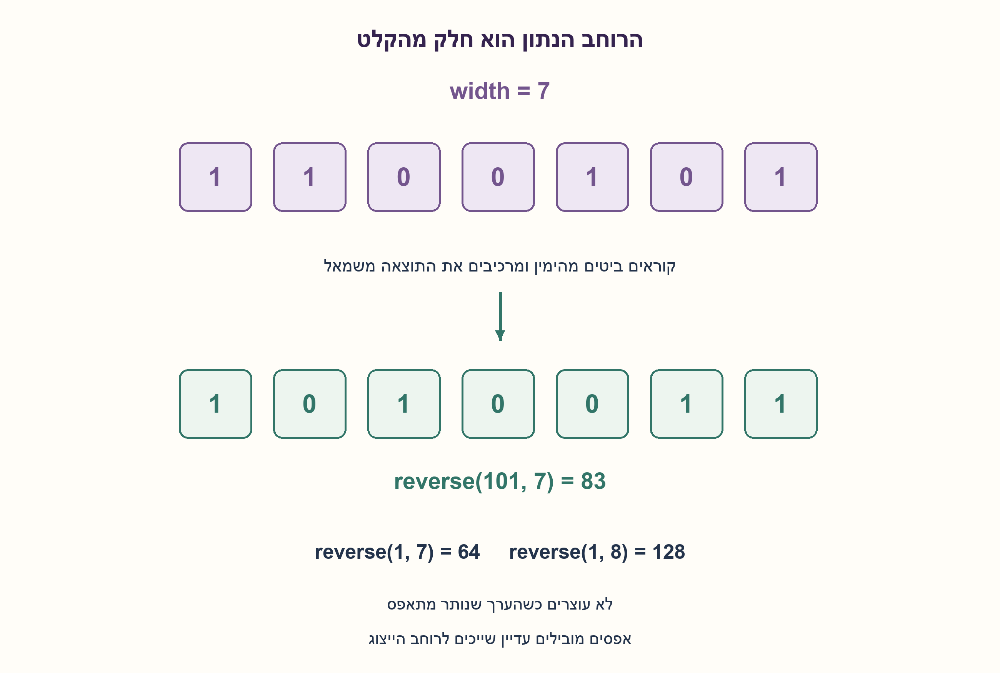
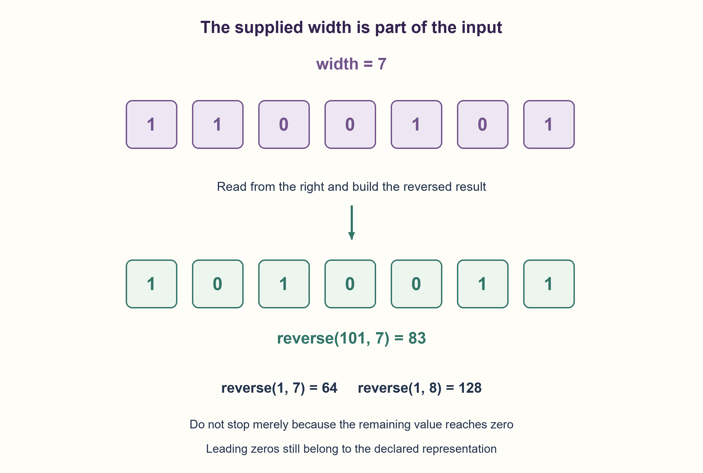

# PREP-094 — היפוך סדר שמונה סיביות — ללא מערך

פתרון מוצע בסיוע AI; ביקורת מקצועית אנושית ממתינה.

## מקור פרטי / Private source

נתון מספר בינארי ומספר הסיביות. ממש קוד בשפה לבחירתך, גם פסאודו־קוד אפשרי, שהופך את סדר הסיביות: MSB הופכת ל־LSB ולהפך. לדוגמה 1100101 הופך ל־1010011.

[צילום מקור פרטי](../sources/2026-10-30-batch40-16.png)

## נוסח ערוך

### הרחבה: הרוחב נתון כחלק מהקלט
נתונים מספר בינארי ורוחב הייצוג W. כתבו קוד או פסאודו־קוד שהופך בדיוק את W הסיביות: ה־MSB הופכת ל־LSB ולהפך. דוגמת המקור היא W=7: הקלט1100101 הופך ל־1010011.

נבחר קלט ללא סימן0≤value<2^W, עם W שלם לא שלילי. אפסים מובילים שייכים לרוחב ואסור להשמיטם; W=0 מקבל רק value=0 ומחזיר0. מימוש הסקאלרים אינו משתמש במערך או במחרוזת, אף שהמקור החדש לא חייב הגבלה זו. גרסת8 הביט המקורית וה־C שלה נשמרות בנפרד. נתחו מספר איטרציות, מקום במילים לעומת ביטים ומודל מספרים ברוחב לא חסום.

### שלושה רמזים

1. אם הערך הוא1, האם הפלט זהה עבור רוחב7 ועבור רוחב8?
2. אחרי חילוץ הביט הימני שומרים מקום לבא באמצעות הזזה שמאלה של התוצאה. מספר החזרות חייב להיות הרוחב הנתון.
3. בצעו W פעמים result=(result<<1)|(value&1), ואז value>>=1. התחילו result=0, אל תעצרו כשהערך מתאפס, ובדקו שהקלט מתאים לרוחב לפני ההרצה.

### הצעה לפתרון

### אותו ערך יכול לייצג שורות ביטים שונות
המספר1 הוא0000001 ברוחב7 ו־00000001 ברוחב8. היפוך הראשון נותן1000000=64 והשני10000000=128. לכן אי אפשר להחליף רוחב נתון באורך הייצוג המשמעותי של הערך, ואי אפשר להסתפק בעצירה כשהעותק של הקלט מתאפס.

נאתחל result=0. בכל אחד מ־W צעדים נחלץ את הביט הנמוך value&1, נזיז את result שמאלה ונוסיף אותו באמצעות OR; אחר כך נזיז את value ימינה. דוגמת1100101 מעובדת דרך הביטים1,0,1,0,0,1,1 ונותנת1010011=83 אחרי שבעה צעדים. זהו שינוי מיקומים ולא NOT או סיבוב מעגלי.

אינווריאנט: אחרי k צעדים התוצאה מחזיקה את k הביטים הנמוכים המקוריים בסדר הפוך, והקלט שנותר הוא המקור מוזז ימינה ב־k. הצעד הבא מוסיף בדיוק את הביט המקורי הבא בסדר ההפוך. אחרי W צעדים כל מיקומי הייצוג, כולל אפסים מובילים, טופלו. ההיפוך שומר על מספר האחדות, והיפוך נוסף באותו רוחב משחזר את הקלט. W=0 הוא המקרה הריק והמוגדר, ללא איטרציות.

יש בדיוק W איטרציות ומספר קבוע של משתנים. אם W נכנס במילת מכונה ופעולות עליה קבועות, העלות O(W) זמן ו־O(1) מילות עזר, שאינן O(1) ביטים כאשר גודל המילה עצמו משתנה. בקוד Python המספרים אינם חסומים: כל סקלר יכול לדרוש O(W) ביטים והזזה יכולה לעלות לפי רוחבו; אין להציג את מספר האיטרציות כהוכחת זמן לינארי בביטים ללא מודל. חסם גס למודל הפעולות הארוכות הוא O(W²) עבודת ביטים. אין טענת אופטימליות של הלולאה; מסכות קבועות יכולות לשפר מקרה של רוחב ידוע כפי שבסעיף ה־C הקודם.

נבדקו8,191 קלטים ממצים ברוחבים0..12 ועוד800 דגימות עד127 ביט מול היפוך מחרוזת בעלת רוחב מדויק באורקל בלבד. נבדקו היפוך כפול, שמירת אחדות, דוגמת המקור, ההבדל בין7 ל־8 ביט ודחיית קלט לא תקין. זהו מודל Python, ללא הידור של קוד C חדש. שלושת רמזי הסעיף בחומר המשלים; תור הרמזים המקורי נשאר כפי שהיה ואינו בוחר רמזים אוטומטית לפי וריאציה.

```python
"""Reverse exactly the supplied width, retaining leading zero positions.

Scalar Python model. O(width) loop iterations; arbitrary-size bit-operation
costs depend on width. width=0 accepts only value=0 and returns zero.
"""


def reverse_bits(value, width):
    if type(width) is not int or width < 0:
        raise ValueError("width must be a nonnegative integer")
    if type(value) is not int or not 0 <= value < (1 << width):
        raise ValueError("value must fit the supplied unsigned width")
    result = 0
    for _ in range(width):
        result = (result << 1) | (value & 1)
        value >>= 1
    return result
```




### assumptions

[
  "מספר ללא סימן המתאים בדיוק לרוחב W שלם לא שלילי; כל האפסים המובילים נשמרים כחלק מהייצוג.",
  "W=0 מקבל רק0. קוד הסקאלרים נמנע ממערך וממחרוזת; המקור החדש מתיר בחירת שפה ואף פסאודו־קוד."
]

### optimality

בדיוק W איטרציות ו־O(1) סקלרים. O(W) זמן במודל מילה מתאימה; Python ארוך דורש עד O(W) ביטי אחסון לסקלר ועלות פעולות תלוית רוחב. אין טענת מינימום.

### edge_cases

[
  "רוחב0,1,7,8; קלט0 וכל הביטים דלוקים.",
  "אפסים מובילים, ערך1 ברוחבים שונים, רוחב שאינו חזקה של שתיים.",
  "ערך מחוץ לרוחב או רוחב שלילי/לא שלם נדחה."
]

### common_mistakes

[
  "להשתמש באורך הייצוג המשמעותי במקום הרוחב שנמסר.",
  "לעצור כשהקלט שנותר מתאפס.",
  "לכנות O(1) סקלרים O(1) ביטים, או להחיל מסכות8 ביט בלי התאמה לרוחב אחר."
]

### interview_answer

אחלץ את הביט הימני ואצרף אותו לתוצאה מוזזת שמאלה, בדיוק W פעמים. כך אפסים מובילים ממשיכים להזיז את התוצאה ומתקבל היפוך של הרוחב שנמסר; הדוגמה ברוחב7 מחזירה83.

### source_ambiguities

המקור החדש מספק רוחב ולא קובע סימן או שפת מימוש. זה שינוי מהותי לעומת8 ביט, ולכן נוסף כסעיף נפרד עם חוזה מפורש, בלי להחליף את נוסחי והרמזים הקודמים. VSW-003 הפרטית מציגה32 ביט בלבד.

### verification

8,191 קלטים ממצים ברוחבים0..12 ועוד800 קלטים רחבים; אורקל מחרוזת נפרד, היפוך כפול ושמירת אחדות. Python הורץ.

### solution_extensions

[
  {
    "question": "מה משתנה כשמספר חתום הוא הקלט?",
    "answer_direction": "יש להגדיר אם הופכים תבנית ברוחב קבוע וללא סימן או ייצוג עם סימן. ממירים לתבנית בלתי מסומנת באותו רוחב; לא מבצעים הזזה אריתמטית לא מוגדרת בחוזה.",
    "status": "בחומר משלים; רמזי הווריאנט אינם מחליפים את התור המקורי."
  }
]

## Edited prompt

### Extension: width is part of the input
Given a binary number and representation width W, write code or pseudocode reversing exactly W bit positions, exchanging MSB and LSB. Source example uses W=7:1100101 becomes1010011.

Choose unsigned0<=value<2^W with nonnegative integer W. Leading zeros belong to the width and must not be discarded; W=0 accepts only value0 and returns0. The scalar implementation uses no array/string even though the new source does not impose that restriction. Original eight-bit and C contracts remain separate. Analyze iterations, words versus bits, and unbounded numeric representations.

### Three hints

1. For value1, should widths7 and8 produce the same answer?
2. After extracting the rightmost bit, shift the result left to make room for the next. The iteration count must equal the supplied width.
3. Repeat result=(result<<1)|(value&1), then value>>=1 exactly W times. Start result0, do not stop at value0, and validate width fit first.

### Proposed solution

### One value can denote different bit rows
Value1 is0000001 at width7 and00000001 at width8. Reversal yields1000000=64 and10000000=128 respectively. Thus significant-bit length cannot replace the supplied width, and stopping when the remaining value reaches zero loses declared leading-zero positions.

Start result0. For each of W steps extract value&1, shift result left and append the bit with OR, then shift value right. Input1100101 is consumed as1,0,1,0,0,1,1 and becomes1010011=83 after seven steps. This reverses positions rather than complementing or rotating.

Invariant: after k steps the result holds the original low k bits in reversed order; the remaining input is the original shifted right k. The next iteration appends exactly the next original bit in reverse order. After W iterations every declared position, including leading zeros, has been processed. Popcount is preserved and another reversal at the same width recovers input. W=0 is the explicitly defined empty case with no iterations.

There are exactly W iterations and a constant number of scalar variables. When W fits a machine word with constant-cost operations, this is O(W) time/O(1) auxiliary words, not O(1) bits if word size itself varies. Python's unbounded scalars may need O(W) bits each, and shifts depend on operand width; iteration count alone does not prove linear bit complexity. A coarse long-operation bound is O(W²) bit work. No loop-optimality claim: fixed masks can improve a specified fixed width, as in the retained C part.

8,191 exhaustive inputs at widths0..12 plus800 seeded values through127 bits matched exact-width bit-string reversal used only by the oracle. Tests checked involution, popcount, the source example, seven/eight-bit distinctions and invalid values. Actual Python model, without compiling new C. Three extension hints remain supplemental; the original interactive hint queue is unchanged and does not automatically select hints by variant.

```python
"""Reverse exactly the supplied width, retaining leading zero positions.

Scalar Python model. O(width) loop iterations; arbitrary-size bit-operation
costs depend on width. width=0 accepts only value=0 and returns zero.
"""


def reverse_bits(value, width):
    if type(width) is not int or width < 0:
        raise ValueError("width must be a nonnegative integer")
    if type(value) is not int or not 0 <= value < (1 << width):
        raise ValueError("value must fit the supplied unsigned width")
    result = 0
    for _ in range(width):
        result = (result << 1) | (value & 1)
        value >>= 1
    return result
```




### assumptions

[
  "Unsigned value fitting nonnegative integer width W; leading-zero positions retained.",
  "W=0 accepts only0. Scalar code avoids array/string, while the new source allows any language or pseudocode."
]

### optimality

Exactly W iterations/O(1) scalars. O(W) in a suitable word model; Python long integers use up to O(W) bits per scalar and width-dependent operations. No minimum claim.

### edge_cases

[
  "Widths0,1,7,8; zero/all ones.",
  "Leading zeros, value1 at different widths, non-power-of-two widths.",
  "Out-of-width values or negative/noninteger width rejected."
]

### common_mistakes

[
  "Using significant-bit length rather than supplied width.",
  "Stopping when remaining input becomes zero.",
  "Equating constant scalars with constant bits or applying byte masks unchanged to other widths."
]

### interview_answer

Extract the low bit and append to the left-shifted result exactly W times. Leading zeros still shift the result, yielding the declared-width reversal; the seven-bit example returns83.

### source_ambiguities

The new source supplies width but omits signedness/language. This materially generalizes eight bits, so add a separate explicit contract while preserving old prompts/hints. Private VSW-003 uses32 bits only.

### verification

8,191 exhaustive width0..12 inputs plus800 wide inputs; independent text oracle, involution and popcount. Python executed.

### solution_extensions

[
  {
    "question": "What changes for signed input?",
    "answer_direction": "Define whether reversing a fixed-width unsigned pattern or a signed textual representation. Convert to a same-width unsigned pattern; do not rely on an unstated arithmetic-shift contract.",
    "status": "Supplemental; variant hints do not replace the original queue."
  }
]
