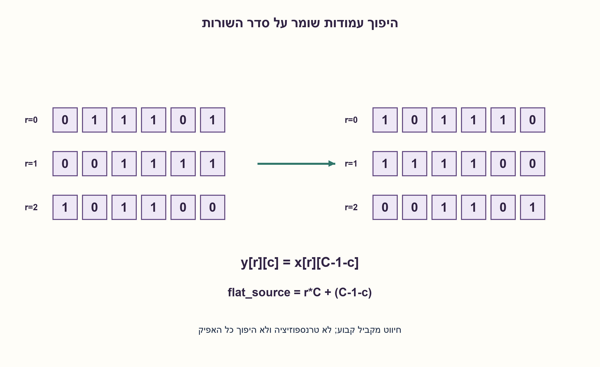

# PREP-094 — היפוך סדר שמונה סיביות — ללא מערך

פתרון מוצע בסיוע AI; ביקורת מקצועית אנושית ממתינה. הקושי אינו מכויל.

[צילום מקור פרטי](../sources/2026-10-31-batch21-19.png)

ממש מערכת שהופכת את אחד הממדים של מערך דו־ממדי של ביטים. דוגמה: כניסה בשורות 0,1,2: 011101;001111;101100. מוצא בשורות 0,1,2: 101110;111100;001101.

חברות לפי הדיווח בצילום בלבד: NVIDIA, Intel, Elta, Apple, Elbit, Marvell.

## עברית

### הרחבה: היפוך עמודות בתוך כל שורת מטריצת ביטים
ממשו מערכת ההופכת ממד אחד במערך ביטים דו־ממדי. בדוגמה, השורות 011101;001111;101100 הופכות ל־101110;111100;001101. מספר השורות וסדרן נשמרים: הדוגמה הופכת את סדר העמודות בתוך כל שורה, ולא מבצעת transpose.

נבחר אפיק מקביל של R×C ביטים, עם R, C חיוביים וקבועים בזמן בניית המעגל. אינדקס c=0 מתאר את התו השמאלי בכתיב השורה, ו־flat index=r·C+c בייצוג row-major. יש למפות את האינדקסים הללו לכתיב האפיק הממשי באופן עקבי. אין שעון או זיכרון במימוש החיווט הראשי.

1. השוו את השורה הראשונה לפני ואחרי: האם התחלפו השורות או התהפך סדר הביטים בתוכן?
2. לכל יציאה (r, c) יש כניסה אחת באותה שורה, בעמודה C−1−c.
3. ממשו y[r][c]=x[r][C−1−c]. באפיק שטוח נקודת המקור היא r·C+(C−1−c), ולא R·C−1−(r·C+c).

### הופכים ציר, לא מחליפים צירים
הדוגמה מגדירה y[r][c]=x[r][C−1−c]. מכיוון שהרוחב קבוע וכל הביטים זמינים יחד, זהו חיווט חד־חד־ערכי בלבד. לולאת generate בתיאור חומרה תפרוס חיבורים קבועים; היא אינה מריצה R·C מחזורי שעון. אין צורך ב־MUX, במחבר או באוגר כאשר כיוון ההיפוך אינו נשלט.

הנכונות נובעת ישירות ממיפוי העמודות: c=0 מקבל את C−1, האחרון מקבל אפס, וכל עמודה פנימית מקבלת את בת־הזוג שלה. המיפוי הוא תמורה והפעלה פעמיים מחזירה את המקור: C−1−(C−1−c)=c. בשורה 011101 מתקבל 101110, כפי שמופיע בצילום. אם C אי־זוגי, הביט המרכזי נשאר במקום; אם C=1, הכול נשאר ללא שינוי.

בהיפוך הציר האחר היינו כותבים y[r][c]=x[R−1−r][c]. ב־transpose היינו מחליפים את צורת המערך ל־C×R וכותבים y[c][r]=x[r][c]. היפוך כל האפיק השטוח הופך גם את סדר השורות, ולכן אינו עונה לדוגמה. יש להפריד בין אינדקסי שורה/עמודה לבין MSB/LSB של טיפוס packed במימוש.

מחיר לוגי: R·C חיבורים וללא שערים או זיכרון במודל האידאלי. אין מכך הבטחה לשטח או השהיה אפסיים בניתוב פיזי; מרחקי חיווט וקיבולים עדיין קיימים. מודל Python יוצר פלט בזמן ובמקום O(R·C), כי הוא מעתיק ערכים. במערכת שבה המטריצה נמצאת בזיכרון ונקראת בטור, דרושים כתובות, פורטים ומדיניות גישה; חיווט אפיק מקביל אינו פתרון חינם לבעיה הטורית.

### מודל לוגי בפייתון שהורץ

```python
"""Reverse columns within every row; retain row order and matrix shape."""


def reverse_columns(matrix):
    if not matrix or not matrix[0]:
        raise ValueError("hardware model requires positive row and column counts")
    columns = len(matrix[0])
    if any(len(row) != columns or any(bit not in (0, 1) for bit in row) for row in matrix):
        raise ValueError("rectangular binary matrix required")
    return [[matrix[row][columns - 1 - col] for col in range(columns)]
            for row in range(len(matrix))]


def flat_wire_index(row, col, columns):
    return row * columns + columns - 1 - col
```




### assumptions

```json
[
  "ממדים חיוביים וקבועים; כל הביטים זמינים במקביל.",
  "c=0 הוא השמאלי בכתיב השורה; מיפוי row-major מפורש."
]
```

### optimality

מיפוי קבוע יכול להתבצע בחוטים בלבד. ספירת חיבורים אינה הערכת שטח ניתוב או תדר.

### verification

5050 מטריצות ביטים בממדים 1..3 על 1..4 נבדקו מול היפוך שורות עצמאי, מיפוי אפיק שטוח ואינוולוציה; גם דוגמת 3×6 נבדקה. אין סינתזה או ניתוב.

### edge_cases

```json
[
  "מטריצה לא ריבועית אינה משנה ממדים.",
  "עמודה אחת אינה משתנה; רוחב אי־זוגי משאיר אמצע."
]
```

### common_mistakes

```json
[
  "לבצע transpose.",
  "להפוך את האפיק כולו ובכך להפוך גם שורות.",
  "לבלבל לולאת generate עם אלגוריתם סדרתי."
]
```

### interview_answer

אשאיר את r ואחליף את c ב־C−1−c. עבור אפיק מקביל קבוע זה חיווט; אגדיר בנפרד אינדקסי packed וייצוג זיכרון טורי.

### source_ambiguities

הדוגמה מכריעה שהציר הראשי הוא העמודות. אין להסיק גודל, שעון או ארכיטקטורת RAM מעבר לכך. תוכן היפוך המספר המקורי נשמר.

### solution_extensions

```json
[
  {
    "question": "מה אם כניסת control בוחרת האם להפוך או להשאיר?",
    "answer_direction": "לכל ביט יתווסף MUX בין x[r][c] ל־x[r][C−1−c], בעוד ביטי אמצע יכולים להישאר חיווט.",
    "principle": "שליטה בזמן ריצה הופכת פרמוטציה קבועה ללוגיקת בחירה."
  }
]
```

## English

### Extension: reverse columns within each row of a bit matrix
Implement reversal of one dimension of a two-dimensional bit array. Example rows 011101;001111;101100 become 101110;111100;001101. Row count/order remain unchanged: this reverses columns inside each row, not a transpose.

Choose a parallel R×C-bit interface with positive dimensions fixed at circuit construction. Index c=0 denotes the leftmost displayed character; row-major flat index is r·C+c. Map these logical indices consistently to the actual bus declaration. The main wiring implementation has no clock or storage.

1. Compare the first row before and after: did rows move, or did the bits inside each row reverse?
2. Each output (r, c) reads one input in the same row, at column C−1−c.
3. Use y[r][c]=x[r][C−1−c]. The row-major source index is r·C+(C−1−c), not R·C−1−(r·C+c).

### Reverse an axis rather than interchange axes
The example specifies y[r][c]=x[r][C−1−c]. With fixed dimensions and all bits available together, this is a bijective wire permutation. An HDL generate loop elaborates fixed connections; it does not execute R·C clock cycles. No MUX, adder or register is needed when reversal direction is fixed.

Correctness follows from the column mapping: output zero receives input C−1, the last output receives zero, and every interior column receives its mirrored partner. Applying the permutation twice restores the source because C−1−(C−1−c)=c. Row 011101 becomes 101110 as in the source. Odd widths leave the center bit unchanged, and C=1 is the identity.

Reversing the other axis would give y[r][c]=x[R−1−r][c]. Transposition instead changes shape to C×R with y[c][r]=x[r][c]. Reversing the entire flat bus also reverses row order, so it does not match this example. Separate logical row/column indices from packed-type MSB/LSB conventions.

Logical cost is R·C wires, with no gates or storage in the ideal model. Routed area and delay are not zero: wire lengths and capacitance remain. The Python model takes O(R·C) time and output space because it copies values. A serially accessed memory representation needs address, port and access-policy design; a parallel wire mapping does not make that problem free.

### Executed Python logical model

```python
"""Reverse columns within every row; retain row order and matrix shape."""


def reverse_columns(matrix):
    if not matrix or not matrix[0]:
        raise ValueError("hardware model requires positive row and column counts")
    columns = len(matrix[0])
    if any(len(row) != columns or any(bit not in (0, 1) for bit in row) for row in matrix):
        raise ValueError("rectangular binary matrix required")
    return [[matrix[row][columns - 1 - col] for col in range(columns)]
            for row in range(len(matrix))]


def flat_wire_index(row, col, columns):
    return row * columns + columns - 1 - col
```


### assumptions

```json
[
  "Positive fixed dimensions and all bits available in parallel.",
  "c=0 is the displayed leftmost bit; row-major mapping is explicit."
]
```

### optimality

Fixed mapping can use wires only. Wire count is not routed area or frequency characterization.

### verification

5050 bit matrices at row counts one through three and column counts one through four matched independent row reversal, flat-bus mapping and involution, plus the supplied 3×6 example. No synthesis or routing.

### edge_cases

```json
[
  "A non-square matrix retains its shape.",
  "One column is unchanged; odd widths retain a center."
]
```

### common_mistakes

```json
[
  "Transposing instead of reversing.",
  "Reversing the entire bus and therefore the rows too.",
  "Confusing elaboration-time generate wiring with sequential execution."
]
```

### interview_answer

Keep r and replace c by C−1−c. A fixed parallel bus needs wiring; packed indexing and serial-memory access require explicit separate mappings.

### source_ambiguities

The example selects column reversal. Width, clock and RAM architecture are otherwise unspecified. Original scalar bit-reversal content is retained.

### solution_extensions

```json
[
  {
    "question": "What if a control selects reversal or identity at runtime?",
    "answer_direction": "Each bit selects between x[r][c] and x[r][C−1−c] with a MUX; center bits may remain direct wires.",
    "principle": "Runtime control turns fixed wiring into selection logic."
  }
]
```
