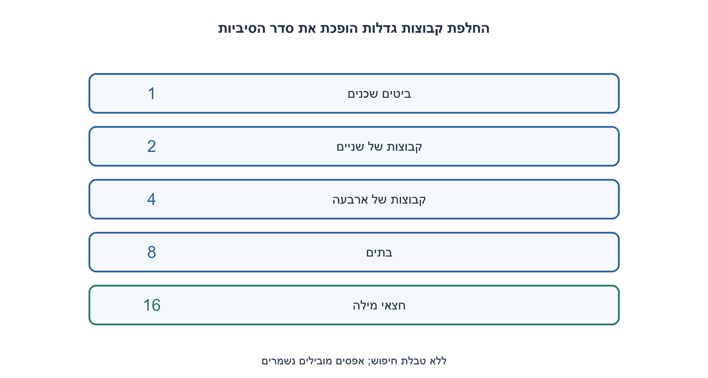
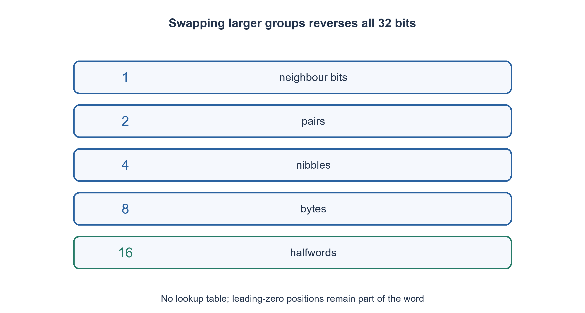

# PREP-094 — היפוך סדר שמונה סיביות — ללא מערך

פתרון מוצע בסיוע AI; ביקורת מקצועית אנושית ממתינה. הקושי אינו מכויל.

## עברית

### סעיף נוסף: היפוך בית והכללה ל־ 32 ביטים במקום קבוע
 א. הפכו בית בן שמונה ביטים, למשל 00111010 ל־ 01011100, בלי מערך ובלי לאתחל LUT מראש. שפרו את מספר שלבי ההיפוך בעזרת מסכות.
 ב. הפכו את כל 32 הביטים של uint32_t, כך שביט 0 עובר למקום 31 ולהפך. מערך טבלה הממפה כל קלט 32 ביט לפלט אינו מתאים למגבלת הזיכרון. השתמשו במספר קבוע של משתנים, ללא מערך או טבלת חיפוש. הסבירו את עלות ההכללה לרוחב w, והבדילו בין מספר שלבי תלות, מספר הוראות וזמן שנמדד בפועל.

 הנחות: יעד C99 ומעלה מספק uint8_t ו־ uint32_t. אלה תבניות ללא סימן ברוחב קבוע, כולל אפסים מובילים; אין להסיק רוחב מהערך. השיפור אינו הבטחת זמן מעבד מסוים, ולא היפוך של ביטים משמעותיים בלבד.

1. האם אפשר להחליף קבוצה של ביטים בהזזה אחת במקום להזיז כל ביט לבדו?
2. אחרי החלפת שכנים, החליפו זוגות, אחר כך קבוצות של ארבעה וכן הלאה. איזה תפקיד למסכה?
3. ל־ 32 ביט בצעו החלפות במרחקים 1,2,4,8,16. לפני הזזה שמאלה מסכו את החצי הנמוך בכל קבוצה; שלבו ב־ OR את שני הכיוונים, בטיפוס ללא סימן.

### מחליפים את סדר הגושים ובתוכם
בסריקה הישירה קוראים ביט בכל פעם. במימוש מקביל מחליפים תחילה כל שני שכנים בעזרת מסכת 0101 חוזרת, אחר כך כל שתי קבוצות של שני ביטים בעזרת 0011 חוזרת, ואז כל שתי קבוצות של ארבעה. בבית, שלושת השלבים כבר הפכו את כל הסדר. ב־ 32 ביט מוסיפים החלפת בתים והחלפת שתי מחציות 16 ביט.

אחרי שלב בגודל g, כל בלוק בן 2 g ביטים מכיל את הבלוק המקורי בסדר הפוך: שתי המחציות כבר הפוכות מבפנים לפי ההנחה, והחלפתן משלימה את היפוך הבלוק הגדול. בהתחלה הביטים הבודדים הפוכים טריוויאלית. כש־ 2 g מגיע לרוחב המילה, כל המילה הפוכה. מסכות משאירות בכל תוצאה רק את חצי הקבוצה המתאים ומונעות ערבוב של הקבוצות.

למשל 00111010 עובר בשלושת השלבים 0101,0011,00001111 ל־ 01011100. ב־ 32 ביט,1 מחזיר 0x80000000 ולא 1. בטיפוסים מסומנים הזזה ימינה עשויה לשכפל סימן, והזזה שמאלה עשויה להפר כללי שפה; כאן כל ההזזות הן על uint32_t ולמרחק קטן 32. אין הזזה ברוחב המילה.

לרוחב w שהוא חזקה של שתיים, יש log₂w שלבים עם מספר קבוע של פעולות מסכה/הזזה בכל שלב במודל מילת־מכונה. ברוחב 32 יש חמישה שלבים וזיכרון של מספר קבוע של מילים. אין פירוש הדבר חמש הוראות מכונה: כל שורה כוללת כמה פעולות, והקומפיילר עשוי לבחור הוראה ייעודית. מספר איטרציות קטן יותר אינו מדידת מהירות; cache, ארכיטקטורה והקשר הקריאה חשובים. עבור רוחב שאינו חזקה של שתיים או מספרים גדולים יש להגדיר מסכות ומודל עלות מתאים, ולא להעתיק את המסכות הללו.

טבלה מלאה בת 2³²תוצאות 32 ביט דורשת 2³⁴בתים, כלומר 16 GiB, לא 4 GiB; גם טבלה של בית אחד לכל קלט הייתה 4 GiB אבל אינה מחזיקה תוצאת 32 ביט. טבלת 256 בתים להיפוך בית ואיחוי ארבעה בתים אפשרית כאשר טבלה מותרת, אך כאן הקוד נשאר ללא טבלה בהתאם לסעיף א. טבלת Nibble קטנה היא פשרה אחרת כאשר האילוצים מאפשרים אותה.

רתמת C הוכנה להשוואה ללולאת סיביות עצמאית: כל 256 הבתים,65,536 מילים בעלות מבנה משתנה,100,000 מילים פסאודו־אקראיות, כל 32 הביטים הבודדים וגבולות 0/UINT32_MAX. נבדק גם היפוך כפול במקרים המובנים. הקוד הודר ב־ GCC C99 עם ‎-O2 -Wall -Wextra -Werror -pedantic והורץ בהצלחה בסביבה מבודדת: 165,792 מקרי מילים ו־ 156 מקרי מחיקה, 234,489 טענות בדיקה ואפס בלוקים חיים. אין כאן טענת benchmark.

```c
/* C99, unsigned exact-width patterns; no arrays or lookup tables. */
#include <stdint.h>

uint8_t reverse8_masks(uint8_t value) {
    uint32_t x = value;
    x = ((x >> 1) & UINT32_C(0x55)) | ((x & UINT32_C(0x55)) << 1);
    x = ((x >> 2) & UINT32_C(0x33)) | ((x & UINT32_C(0x33)) << 2);
    x = ((x >> 4) & UINT32_C(0x0F)) | ((x & UINT32_C(0x0F)) << 4);
    return (uint8_t)x;
}

uint32_t reverse32_masks(uint32_t x) {
    x = ((x >> 1) & UINT32_C(0x55555555)) | ((x & UINT32_C(0x55555555)) << 1);
    x = ((x >> 2) & UINT32_C(0x33333333)) | ((x & UINT32_C(0x33333333)) << 2);
    x = ((x >> 4) & UINT32_C(0x0F0F0F0F)) | ((x & UINT32_C(0x0F0F0F0F)) << 4);
    x = ((x >> 8) & UINT32_C(0x00FF00FF)) | ((x & UINT32_C(0x00FF00FF)) << 8);
    return (x >> 16) | (x << 16);
}
```




## English

### Additional part: byte reversal and constant-storage uint32 reversal
A. Reverse all eight bits of a byte, for example00111010 to 01011100, without an array or preinitialized LUT. Reduce reversal stages using masks.
B. Reverse all 32 bits of uint32_t, mapping bit 0 to 31 and vice versa. A table mapping every 32-bit input to a result does not fit the memory constraint. Use a fixed number of scalar variables, with no array or lookup table. Analyze general word width w and distinguish dependent stages, instructions and measured runtime.

Assume C99+providing uint8_t and uint32_t. These are fixed-width unsigned patterns, including leading zeros; do not infer width from value. Optimization is not a processor-speed guarantee and does not reverse only significant bits.

1. Can whole groups move with a shift rather than relocating one bit at a time?
2. After swapping neighbors, exchange pairs, then groups of four, and so on. Why is a mask needed?
3. For32 bits swap at distances1,2,4,8,16. Mask the lower half of each group before left shifting and OR the two directions using unsigned types.

### Reverse the blocks and their internal order
A direct scan moves one bit at a time. Parallel reversal first swaps neighboring bits with repeated0101, then two-bit groups with repeated0011, then nibbles. Three stages complete a byte. A32-bit word additionally swaps bytes and 16-bit halves.

After the stage of size g, each2 g-bit block contains its original bits in reverse order: its two halves are already internally reversed, and exchanging them reverses the larger block. Single bits form the trivial base. Reaching the entire word proves reversal. Masks isolate the intended halves so shifted groups do not mix.

For example00111010 becomes01011100 after the three byte stages. For32 bits,1 returns0x80000000 rather than 1. Signed right shifts can propagate a sign, and signed left shifts have additional language restrictions; these functions use uint32_t operands and shift distances strictly below32. No shift equals the width.

For power-of-two width w there are log₂wstages, each with a fixed number of machine-word mask/shift operations. Width32 uses five stages and constant scalar words. Five stages do not mean five machine instructions: each line includes multiple operations, and a compiler may select a dedicated instruction. Fewer iterations are not a benchmark; cache, architecture and call context matter. Non-power-of-two widths and arbitrary-precision integers require suitable masks and a stated cost model.

A full table of 2³² 32-bit outputs needs 2³⁴ bytes, namely 16 GiB, not 4 GiB. Even one byte per input would need4 GiBbut cannot store a 32-bit output. A256-byte byte-reversal table plus four-byte recombination is a valid alternative when tables are allowed, but the supplied code remains table-free under partA. Smaller nibble tables are another permitted-constraints trade-off.

The C harness compares against an independent bit-at-a-time oracle: all 256 bytes,65,536 structured words,100,000 pseudorandom words, all 32 one-hot positions and 0/UINT32_MAXboundaries. Structured values also check double reversal. Strict isolated GCC C99 compilation with -O2 -Wall -Wextra -Werror -pedantic and native execution passed:165,792 word cases and 156 removal cases,234,489 assertions and zero live blocks. No benchmark claim is made.

```c
/* C99, unsigned exact-width patterns; no arrays or lookup tables. */
#include <stdint.h>

uint8_t reverse8_masks(uint8_t value) {
    uint32_t x = value;
    x = ((x >> 1) & UINT32_C(0x55)) | ((x & UINT32_C(0x55)) << 1);
    x = ((x >> 2) & UINT32_C(0x33)) | ((x & UINT32_C(0x33)) << 2);
    x = ((x >> 4) & UINT32_C(0x0F)) | ((x & UINT32_C(0x0F)) << 4);
    return (uint8_t)x;
}

uint32_t reverse32_masks(uint32_t x) {
    x = ((x >> 1) & UINT32_C(0x55555555)) | ((x & UINT32_C(0x55555555)) << 1);
    x = ((x >> 2) & UINT32_C(0x33333333)) | ((x & UINT32_C(0x33333333)) << 2);
    x = ((x >> 4) & UINT32_C(0x0F0F0F0F)) | ((x & UINT32_C(0x0F0F0F0F)) << 4);
    x = ((x >> 8) & UINT32_C(0x00FF00FF)) | ((x & UINT32_C(0x00FF00FF)) << 8);
    return (x >> 16) | (x << 16);
}
```




## חומר משלים / Supporting material

```json
{
  "assumptions": {
    "he": [
      "C99 בטיפוסיםללאסימןברוחב 8 ו־ 32; אין מערך או LUT במימוש.",
      "כל מיקומי האפסים המובילים נשמרים; הניתוח מבחין בין רוחב קבוע להכללה."
    ],
    "en": [
      "C99 unsigned8/32-bit types; no array or LUT in implementation.",
      "Preserve leading-zero positions; distinguish fixed widths from a generalized analysis."
    ]
  },
  "optimality": {
    "he": "שלושה שלבים לבית וחמישהל־ 32 ביט, O(1) מילים; log₂w שלבי מילה לרוחב מתאים. אין טענת זמן מדוד.",
    "en": "Three byte stages and five32-bit stages, O(1) words; log₂wstages for suitable width. No measured-speed claim."
  },
  "verification": {
    "he": "GCC C99 מחמיר והרצה מבודדת עברו:165,792 מקרי מילים,156 מקרי מחיקה,234,489 בדיקות ואפס בלוקים חיים. ללא benchmark.",
    "en": "Strict GCC C99 and isolated native execution passed:165,792 word cases,156 removal cases,234,489 assertions and zero live blocks. No benchmark."
  },
  "edge_cases": {
    "he": [
      "0, כל הביטים 1, אחד בקצה, אפסים מובילים, היפוך כפול, דוגמת המקור."
    ],
    "en": [
      "Zero, all ones, endpoint one-hot bits, leading zeros, double reversal, source example."
    ]
  },
  "common_mistakes": {
    "he": [
      "להשתמש ב־ signed או להזיז 32 מקומות.",
      "לבלבל בין היפוך סדר ל־ NOT או להיפוךבתים.",
      "לטעון שטבלת 2³²מילים דורשת רק 4 GiB.",
      "לבלבל חמישה שלבים עם חמש הוראות או עם מהירות שנמדדה."
    ],
    "en": [
      "Using signed operands or shifting by 32.",
      "Confusing bit reversal with NOT or byte swapping.",
      "Claiming2³²words require only 4 GiB.",
      "Equating five stages with five instructions or measured speed."
    ]
  },
  "interview_answer": {
    "he": "אחליף שכנים, זוגות, רביעיות, בתים וחצאי מילה באמצעות מסכות והזזות לא־מסומנות. כל שלב מכפיל את גודל הבלוק שכבר הפוך; אין צורך בטבלת ענק.",
    "en": "Swap neighbors, pairs, nibbles, bytes and halfwords using unsigned masks/shifts. Each stage doubles the reversed block size; no huge table is needed."
  },
  "source_ambiguities": {
    "he": "המקור מציע LUT כאופטימיזציה שנפסלה בגלל מקום ואינו מגדיר גודל תוצאה לטבלה. תוקן חישוב המקום; ההרחבה אינה משנה את חוזי הרוחב הישנים.",
    "en": "The source rejects a large LUT for space but omits output-entry size. Storage arithmetic is explicit; this addendum preserves earlier width contracts."
  },
  "solution_extensions": {
    "he": [
      {
        "question": "מה אם קיימת הוראת חומרה להפיכת ביטים?",
        "answer_direction": "אפשר להשתמש ב־ intrinsic כשמותר, ולבדוק תמיכת יעד ופלט קומפיילר. עדיין יש להגדיר רוחב ולהשוות ביצועים במדידה.",
        "principle": "שיפור מכוון יעד אינו משנה את פונקציית ההיפוך."
      }
    ],
    "en": [
      {
        "question": "What if a hardware bit-reversal instruction exists?",
        "answer_direction": "Use an intrinsic when allowed, checking target support and generated output. Width still matters and performance requires measurement.",
        "principle": "Target-specific optimization preserves the reversal contract."
      }
    ]
  }
}
```
