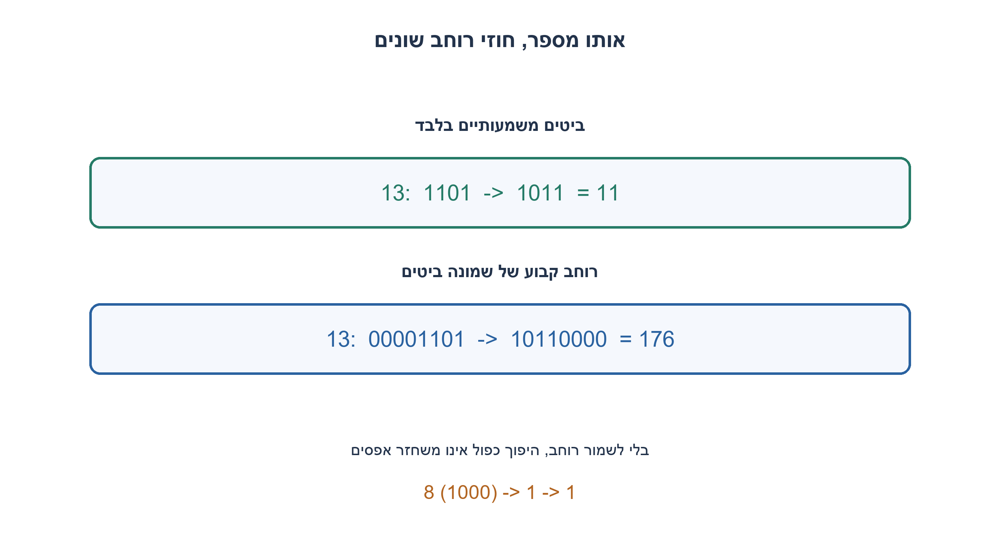
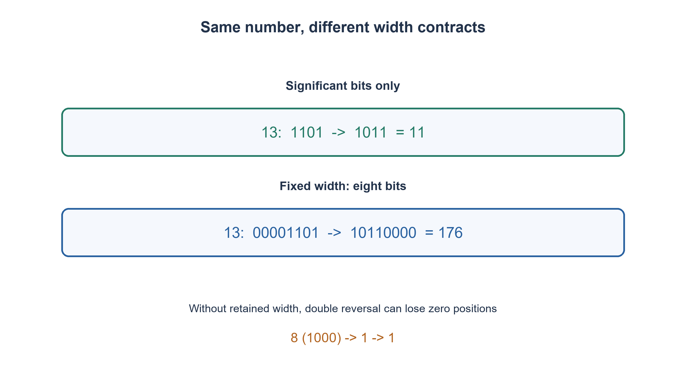

# PREP-094 — היפוך סדר שמונה סיביות — ללא מערך

פתרון מוצע בסיוע AI; ביקורת מקצועית אנושית ממתינה. הקושי אינו מכויל.

## עברית

### סעיף נוסף: הופכים רק את הייצוג המשמעותי של מספר
כתבו פונקציה המקבלת מספר לא־שלילי בטווח uint32 ומחזירה את המספר שמתקבל מהיפוך הכתיב הבינארי הקצר שלו. לדוגמה, 13 נכתב 1101 ומחזיר 1011, כלומר 11. עבור אפס נגדיר תוצאה אפס. אין מערך או מחרוזת במימוש.

זהו חוזה שונה מהסעיף המקורי בעל שמונה ביטים: שם 13=00001101 מחזיר 10110000=176. כאן רוחב ההיפוך הוא bit_length של הערך, ואפסים מובילים אינם חלק מהקלט. הסעיפים הקודמים נשארים ברוחביהם; אין לשנות אותם כדי להתאים לדוגמה החדשה.

1. לפני כתיבת לולאה קבעו אם הופכים שמונה ביטים, W נתון, או רק את הכתיב הקצר.
2. אם הופכים רק ביטים משמעותיים, מתי אין עוד ביט קלט שצריך להעביר?
3. כל עוד n אינו אפס: out=(out<<1)|(n&1), ואז n>>=1. עבור n=0 הלולאה ריקה ומוחזר אפס.

### אותה פעולת ביטים, תנאי סיום אחר
נתחיל ב־out=0. בכל צעד ניקח את הביט הימני של n, נזיז את out שמאלה ונוסיף את הביט בקצהו הימני; אחר כך נזיז את n ימינה. נעצור כאשר n=0. עבור 1101, סדר הביטים שנלקח הוא 1,0,1,1, ולכן out נבנה 1→10→101→1011. המימוש משתמש במספר קבוע של שלמים, ללא ייצוג טקסטואלי.

לאחר i צעדים out מכיל את i הביטים המקוריים הנמוכים בסדר הפוך, ו־n מכיל את הביטים שלא נקראו. זו בדיוק אותה הוכחת לולאה של היפוך ברוחב קבוע; ההבדל הוא שהרוחב נגזר כאן מהביט הגבוה המקורי. עבור אפס מוסכם פלט אפס. עבור מספר חיובי בעל W ביטים הלולאה מבצעת W צעדים, O(W) זמן ו־O(1) מילות עזר; בטווח uint32 יש לכל היותר 32 צעדים.

הסכנה היא איבוד רוחב: 8=1000 הופך ל־0001, שמוחזר כמספר 1. היפוך משמעותי נוסף של 1 מחזיר שוב 1, לא 8. לכן הפעולה על מספרים אינה אינוולוציה בלי לשמור גם את רוחב המקור. אם רוצים round trip יש להעביר W בנפרד ולהשתמש בסעיף בעל רוחב נתון. גם 13 מבחין בין החוזים: 11 כאן, 176 בשמונה ביטים.

קוד C משתמש ב־uint32_t ולכן הזזות הן לא־מסומנות ומוגדרות; אין הזזה במספר מיקומים השווה לרוחב הטיפוס. פרמטר unsigned אינו מאמת את ערך הקורא לפני המרה אליו. מודל Python מאמת שלם לא־שלילי בטווח כדי שלא להיכנס ללולאת הזזה ימינה של מספר שלילי. נבדקו 65,539 ערכים מול היפוך מחרוזת בינארית באורקל, וקוד C99 הודר והורץ בנפרד באותם מקרי רוחב. האורקל רשאי להשתמש במחרוזת; הפתרון אינו משתמש בה.

```python
"""Reverse only significant bits of an unsigned 32-bit value; zero maps to zero."""


def reverse_significant(n):
    if type(n) is not int or not 0 <= n <= 0xffffffff:
        raise ValueError('unsigned 32-bit integer required')
    out = 0
    while n:
        out = (out << 1) | (n & 1)
        n >>= 1
    return out
```


```c
/* Significant-bit reversal, not fixed-eight-bit reversal. C99 uint32_t. */
#include <stdint.h>
uint32_t reverse_significant(uint32_t n) {
    uint32_t out = 0;
    while (n != 0) {
        out = (out << 1) | (n & UINT32_C(1));
        n >>= 1;
    }
    return out;
}
```




## English

### Additional part: reverse only the significant representation
Given a nonnegative uint32-range integer, reverse its shortest binary representation and return the resulting integer. For example, 13 is 1101 and returns 1011, namely 11. Define zero to return zero. Use no array or string in the implementation.

This differs from the original eight-bit contract: there, 13=00001101 reverses to 10110000=176. Here reversal width is the value’s bit_length; leading zeroes are not supplied. Earlier fixed-width parts retain their own widths rather than being changed to match this example.

1. First decide whether reversal covers eight positions, an explicit W, or only the shortest representation.
2. For significant-only reversal, when are there no input bits left to move?
3. While n is nonzero, set out=(out<<1)|(n&1), then n>>=1. Zero performs no iterations and returns zero.

### The bit operation is the same; the stopping rule differs
Start out=0. Take n’s low bit, shift out left, append that bit, then shift n right. Stop when n becomes zero. For 1101, consumed bits are 1,0,1,1, producing 1→10→101→1011. Only a constant number of integer variables is used, without textual representation.

After i iterations, out contains the original low i bits in reverse order and n contains the unread bits. This is the fixed-width reversal invariant, but width now ends at the original highest set bit. Zero returns zero by convention. A positive W-bit value takes W iterations: O(W) time and O(1) auxiliary words, at most 32 steps within uint32.

Width is lost in the numeric result: 8=1000 reverses to 0001, returned as integer 1. Significant-only reversal of that 1 returns 1 again, not 8. Thus the numeric operation is not an involution unless original width is retained. A round trip needs explicit W and the earlier width-specified contract. Input 13 distinguishes the versions: 11 here, 176 at eight bits.

The C reference uses uint32_t, so shifts are unsigned and defined; it never shifts by the type width. An unsigned parameter does not validate the caller’s original wider/signed value before conversion. Python validates the nonnegative range to avoid negative right-shift nontermination. 65,539 values were compared with an independent binary-string oracle, and C99 was separately compiled and run over the same width cases. Oracle strings are allowed; the solution uses none.

```python
"""Reverse only significant bits of an unsigned 32-bit value; zero maps to zero."""


def reverse_significant(n):
    if type(n) is not int or not 0 <= n <= 0xffffffff:
        raise ValueError('unsigned 32-bit integer required')
    out = 0
    while n:
        out = (out << 1) | (n & 1)
        n >>= 1
    return out
```


```c
/* Significant-bit reversal, not fixed-eight-bit reversal. C99 uint32_t. */
#include <stdint.h>
uint32_t reverse_significant(uint32_t n) {
    uint32_t out = 0;
    while (n != 0) {
        out = (out << 1) | (n & UINT32_C(1));
        n >>= 1;
    }
    return out;
}
```




## חומר משלים / Supporting material

```json
{
  "assumptions": {
    "he": [
      "מספר שלם בטווח 0..2^32−1; רוחב משמעותי בלבד; אפס מחזיר אפס."
    ],
    "en": [
      "Integer in 0..2^32−1; significant width only; zero returns zero."
    ]
  },
  "optimality": {
    "he": "O(W) צעדים, W=bit_length(n), לכל היותר 32 כאן; O(1) מילות עזר. רוחב התוצאה אינו שומר אפסים מובילים.",
    "en": "O(W) steps for W=bit_length(n), at most 32 here, and O(1) auxiliary words. Numeric output does not retain leading zeroes."
  },
  "verification": {
    "he": "65,539 ערכי Python ו־C מול אורקל עצמאי, כולל כל הטווח 0..65535 וגבולות uint32. C99 עבר GCC עם דגלי אזהרה מחמירים בסביבה מבודדת; אין בדיקת כל 2^32 הערכים.",
    "en": "65,539 Python and C values checked against independent oracles, including 0..65535 and uint32 boundaries. C99 passed strict GCC compilation in isolation; the full 2^32 domain was not exhaustively enumerated."
  },
  "edge_cases": {
    "he": [
      "0; 1; 13; חזקות שתיים; אפסים נגררים; 0xffffffff; קלט שלילי מחוץ לתחום."
    ],
    "en": [
      "0; 1; 13; powers of two; trailing zeroes; 0xffffffff; negative input outside the contract."
    ]
  },
  "common_mistakes": {
    "he": [
      "להחליף את פתרון שמונה הביטים ב־while n ואז לאבד אפסים.",
      "לטעון שהיפוך כפול מחזיר תמיד מקור בלי לשמור W.",
      "הזזה ימינה של מספר שלילי עד אפס עלולה לא להסתיים."
    ],
    "en": [
      "Replacing fixed-eight-bit reversal with while n loses required zeroes.",
      "Claiming double reversal always restores the input without retaining W.",
      "Right-shifting a negative integer until zero can fail to terminate."
    ]
  },
  "interview_answer": {
    "he": "אברר את הרוחב לפני הפתרון. בסעיף הזה הופכים עד שהקלט הלא־מסומן מתאפס; 13 מחזיר 11, אך ברוחב שמונה הוא עדיין מחזיר 176.",
    "en": "Clarify width first. This part reverses until unsigned input becomes zero: 13 returns 11, while the eight-bit part still returns 176."
  },
  "source_ambiguities": {
    "he": "דוגמת המקור 13→11 קובעת היפוך משמעותי; נוספה וריאציה נפרדת בלי למחוק היפוך קבוע, W נתון או מטריצה.",
    "en": "The source example 13→11 selects significant-only reversal; this is a separate variant preserving fixed-width, explicit-W and matrix parts."
  },
  "solution_extensions": {
    "he": [
      {
        "question": "איזה מידע מינימלי צריך כדי שהיפוך כפול ישחזר גם אפסים?",
        "answer_direction": "שומרים או מעבירים את W המקורי, לא מסיקים אותו מהתוצאה שאיבדה אפסים מובילים.",
        "principle": "ייצוג מספרי עלול לאבד מידע על רוחב."
      }
    ],
    "en": [
      {
        "question": "What information makes double reversal restore zero positions too?",
        "answer_direction": "Retain or pass original width W instead of inferring it from an output that lost leading zeroes.",
        "principle": "A numeric representation can lose width information."
      }
    ]
  }
}
```
