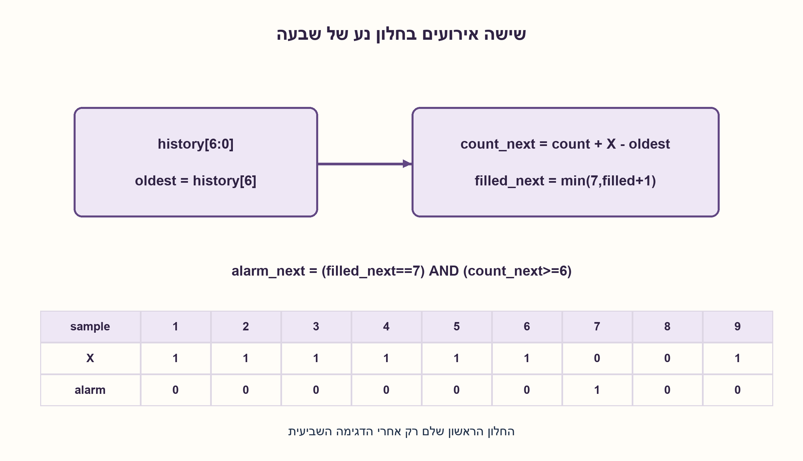
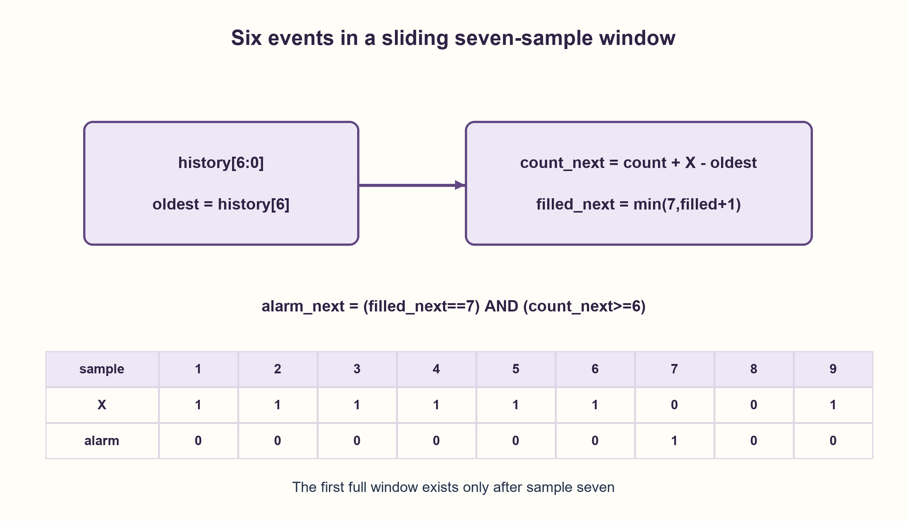

# PREP-095 — בודק לחלון זז — לפחות שלושה אחדים בעשר דגימות

פתרון מוצע בסיוע AI; ביקורת מקצועית אנושית ממתינה. הקושי אינו מכויל.

[צילום מקור פרטי](../sources/2026-10-30-batch90-13.png)

יש רכיב שמקבל שעון ועוד כניסה בעלת ביט יחיד. המטרה היא להוציא 1 כאשר בכל 7 מחזורים רצופים יש לפחות 6 שגיאות.

חברות לפי הדיווח בצילום בלבד: Apple.

## עברית

### וריאציה: לפחות שש שגיאות מתוך שבע
כניסת error נדגמת בכל עליית שעון. הפיקו 1 כאשר בחלון שבע הדגימות האחרונות יש לפחות שש 1. הפיקו 0 אחרת.

זוהי דרישה שונה משלוש בעשר לעיל. החלונות חופפים וכוללים את הדגימה הנוכחית. המקור אינו מגדיר אתחול: בווריאציה נבחר שהפלט 0 עד להשלמת שבע דגימות אחרי reset; החוזה המקורי עם ריפוד באפסים נשמר במקומו. הפלט מתעדכן לאחר החזית הדוגמת ללא מחזור השהיה נוסף, והקלט יציב לפי דרישות setup/hold.

1. החלון מחליק בדגימה אחת: מגיעה שגיאה חדשה ואחת ישנה יוצאת.
2. סכום השגיאות יכול להתעדכן בהוספת הקלט וחיסור הביט שיוצא, במקום לספור את כל החלון מחדש.
3. שמרו 7 סיביות ומונה שגיאות. השתמשו ב־count_next=count+error−oldest, והכריעו לפי count_next כדי לכלול את הדגימה הנוכחית.

נשמור אוגר הזזה history בן 7 סיביות, כאשר history[6] היא הישנה ביותר, מונה count בטווח 0–7 ומונה filled עד 7. באיפוס כולם 0. בכל חזית מחשבים מהמצב הישן: expired=history[6], count_next=count+error−expired, history_next={history[5:0], error}, filled_next=min(7, filled+1). הפלט הבא הוא filled_next=7 וגם count_next≥6.

האינווריאנט הוא ש־history מכיל את שבע הדגימות האחרונות עם אפסי אתחול, ו־count שווה למספר האחדות בו. בהזזה מוציאים בדיוק את expired ומוסיפים בדיוק את error, ולכן העדכון שומר את האינווריאנט. filled משמש רק לחוזה ההתחלה: לפני שבע דגימות אין עדיין חלון מלא. לאחר מכן כל חלון חופף נבדק, לא רק בלוקים שמסתיימים בכפולה של 7.

רצף שש 1 ואז 0 נותן פלט 1 בדגימה השביעית. שש 1 בלבד עדיין נותנות 0 לפי מדיניות החלון המלא. שבע 1 ושני 0 יתנו 1 בשביעית ובשמינית ורק אחר כך 0; הפלט אינו ננעל ויכול לרדת כששגיאות ישנות פגות. יש להכריע לפי הספירה המעודכנת, לא לפי count שלפני הדגימה. ה־SV משתמש ב־filled הישן≥6, השקול לתנאי filled_next=7.

העלות היא שבע סיביות היסטוריה, ספירה קטנה ולוגיקת חיבור/חיסור קטנה; כפל סמלי של שתי חלופות אינו הוכחת מינימום FF. ניתן גם לבצע popcount של היסטוריה ישירות. הבדיקות השוו כל קידומת של כל מילה באורך עד 12 לסכימת חיתוך של הרשימה. הן אינן הוכחת תזמון פיזי או הרצת סימולטור HDL.

### מודל לוגי בפייתון שהורץ

```python
"""Assert after a full seven-sample sliding window contains at least six ones."""


def monitor(bits):
    history = 0
    count = filled = 0
    trace = []
    for bit in bits:
        if type(bit) is not int or bit not in (0, 1):
            raise ValueError("error samples must be binary integers")
        expired = (history >> 6) & 1
        history = ((history << 1) | bit) & 127
        count += bit - expired
        filled = min(7, filled + 1)
        alarm = int(filled == 7 and count >= 6)
        trace.append((alarm, count, filled, history))
    return trace
```


### קוד SystemVerilog מוצע; לא הודר בבדיקה זו

```systemverilog
// Sliding full windows, registered alarm including the current error sample.
module six_of_seven (
  input logic clk, rst, error_in,
  output logic alarm
);
  logic [6:0] history;
  logic [3:0] count;
  logic [2:0] filled;
  logic [3:0] next_count;
  always_comb next_count = count + {3'b0,error_in} - {3'b0,history[6]};
  always_ff @(posedge clk) begin
    if (rst) begin
      history <= 7'd0; count <= 4'd0; filled <= 3'd0; alarm <= 1'b0;
    end else begin
      history <= {history[5:0],error_in};
      count <= next_count;
      if (filled < 3'd7) filled <= filled + 3'd1;
      alarm <= filled >= 3'd6 && next_count >= 4'd6;
    end
  end
endmodule
```




### assumptions

```json
[
  "חלון חופף בן 7 הכולל את הדגימה הנוכחית; לפחות 6 ולא בדיוק 6.",
  "לעניין ההתחלה נבחר חלון מלא; זו תוספת מוצהרת ואינה משנה את המקור 095."
]
```

### optimality

אוגר היסטוריה בן 7 ביטים וספירות קטנות; עדכון קבוע לכל דגימה. אין טענת מינימום חומרה.

### verification

8,191 מילים ו־90,114 תצפיות קידומת מול סכומי חלונות בלתי תלויים. ה־SV לא הודר.

### edge_cases

```json
[
  "דגימה 6 עדיין אינה חלון מלא.",
  "בדיוק 6 או 7 שגיאות בחלון: פלט 1.",
  "ירידה טבעית של count אחרי יציאת שגיאה; reset מתחיל חלון חדש."
]
```

### common_mistakes

```json
[
  "בדיקה פעם בשבעה מחזורים בלבד.",
  "בדיקת count הישן וחלון שזז מחזור מאוחר.",
  "אי־הגדרת התנהגות לפני שבע דגימות."
]
```

### interview_answer

אשמור את שבע הדגימות האחרונות ואת סכומן. אוסיף את הקלט ואחסיר את היוצא, ואשווה את הסכום החדש לשש כאשר יש חלון מלא.

### source_ambiguities

```json
[
  "המקור אינו קובע התנהגות באתחול; נבחר חלון מלא.",
  "הביטוי „בכל 7” מפורש כאן כחלון נע של הדגימות האחרונות, לא כבלוקים."
]
```

### solution_extensions

```json
[
  {
    "question": "מה משתנה אם מותר ריפוד באפסים בהתחלה?",
    "answer_direction": "אפשר להסיר את חסימת filled; שש 1 ראשונות ידליקו כבר בדגימה 6. שאר משוואות הספירה נשארות.",
    "principle": "מדיניות אתחול משנה את העקבות הראשונות."
  }
]
```

## English

### Variant: at least six errors in seven samples
Sample error at every rising clock edge. Output 1 when at least six of the last seven samples are 1; output 0 otherwise.

This differs from the retained three-in-ten task. Windows overlap and include the current sample. Startup was unspecified: choose output 0 until seven post-reset samples have been acquired. The original zero-padded contract remains unchanged. Output settles after the capturing edge without another cycle of latency; input meets setup/hold.

1. Each step adds a new error bit and expires the oldest one.
2. Update the count by adding the new bit and subtracting the expired bit.
3. Store seven history bits and a count. Use count_next=count+error−oldest so the current sample is included in the decision.

Store a seven-bit history shift register, with history[6] oldest, count in 0..7 and a filled counter saturating at 7. Reset all to 0. From the old state compute expired=history[6], count_next=count+error−expired, history_next={history[5:0], error} and filled_next=min(7, filled+1). Next alarm is filled_next=7 AND count_next≥6.

Invariant: history contains the last seven samples with initial zero padding, and count is its number of ones. A shift removes exactly expired and inserts exactly error, preserving the count. filled enforces the chosen startup contract: no full window before sample seven. Thereafter every overlapping window is checked, not just disjoint blocks ending at multiples of 7.

Six ones then zero must produce1 on sample seven; six ones alone still produce0 under the full-window policy. Seven ones then two zeros produce1 on samples seven and eight, then0. The output is not latched forever: it falls as old errors expire. Decide using the updated count rather than the old one. The SV’s old-filled≥6 condition equals filled_next=7.

Cost is seven history bits, small count state and small add/subtract logic; no minimum-FF proof is claimed. Direct popcount of the shifted history is another option. Checks compare every prefix of every word through length 12 with independent list-slice sums. They are neither physical timing qualification nor HDL simulation.

### Executed Python logical model

```python
"""Assert after a full seven-sample sliding window contains at least six ones."""


def monitor(bits):
    history = 0
    count = filled = 0
    trace = []
    for bit in bits:
        if type(bit) is not int or bit not in (0, 1):
            raise ValueError("error samples must be binary integers")
        expired = (history >> 6) & 1
        history = ((history << 1) | bit) & 127
        count += bit - expired
        filled = min(7, filled + 1)
        alarm = int(filled == 7 and count >= 6)
        trace.append((alarm, count, filled, history))
    return trace
```


### Proposed SystemVerilog; not compiled in this check

```systemverilog
// Sliding full windows, registered alarm including the current error sample.
module six_of_seven (
  input logic clk, rst, error_in,
  output logic alarm
);
  logic [6:0] history;
  logic [3:0] count;
  logic [2:0] filled;
  logic [3:0] next_count;
  always_comb next_count = count + {3'b0,error_in} - {3'b0,history[6]};
  always_ff @(posedge clk) begin
    if (rst) begin
      history <= 7'd0; count <= 4'd0; filled <= 3'd0; alarm <= 1'b0;
    end else begin
      history <= {history[5:0],error_in};
      count <= next_count;
      if (filled < 3'd7) filled <= filled + 3'd1;
      alarm <= filled >= 3'd6 && next_count >= 4'd6;
    end
  end
endmodule
```




### assumptions

```json
[
  "An overlapping seven-sample window including the current sample; at least six, not exactly six.",
  "Full-window startup is an explicit added policy; original095 is unchanged."
]
```

### optimality

Seven history bits and small counters; constant work per sample. No hardware minimum claimed.

### verification

8,191 words and 90,114 prefix observations against independent window sums. SV was not compiled.

### edge_cases

```json
[
  "Sample six is not a full window.",
  "Exactly six or seven errors in the window: output 1.",
  "Count decreases as an old error expires; reset starts a fresh window."
]
```

### common_mistakes

```json
[
  "Checking only every seventh cycle.",
  "Using old count and reporting one cycle late.",
  "Leaving startup behavior unstated."
]
```

### interview_answer

Retain seven samples and their sum, add the incoming bit, subtract the outgoing bit and compare the updated sum with six once the window is full.

### source_ambiguities

```json
[
  "The source omits startup; full windows are chosen explicitly.",
  "“Every7” is interpreted as a sliding recent-sample window, not disjoint blocks."
]
```

### solution_extensions

```json
[
  {
    "question": "What changes with zero-padded startup?",
    "answer_direction": "Remove the filled gate: six initial ones can assert on sample six. Count updates stay the same.",
    "principle": "Startup policy changes initial traces."
  }
]
```
