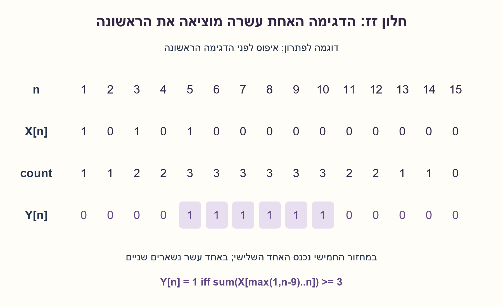
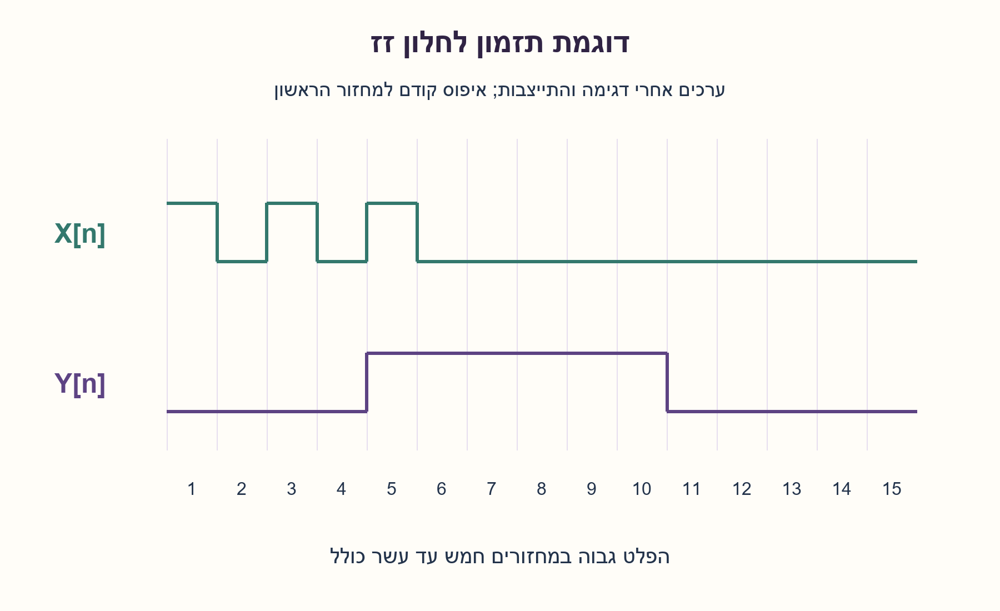
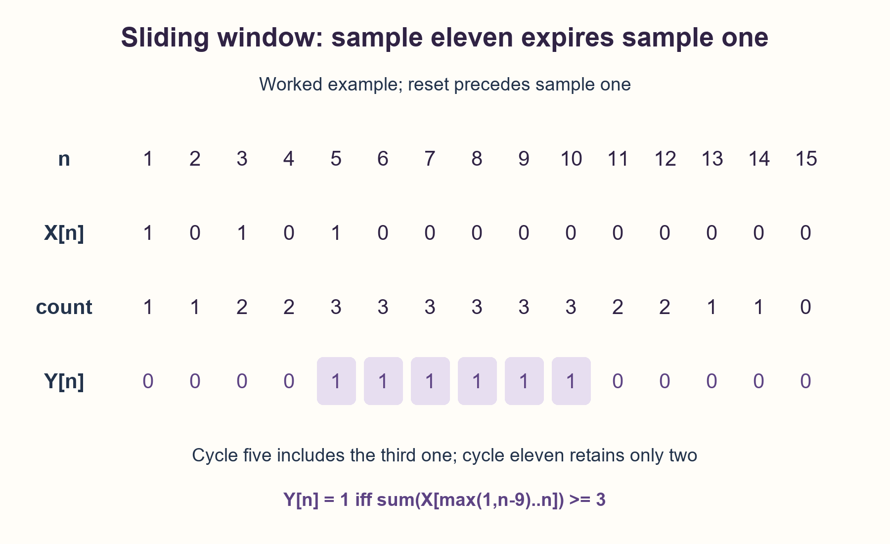
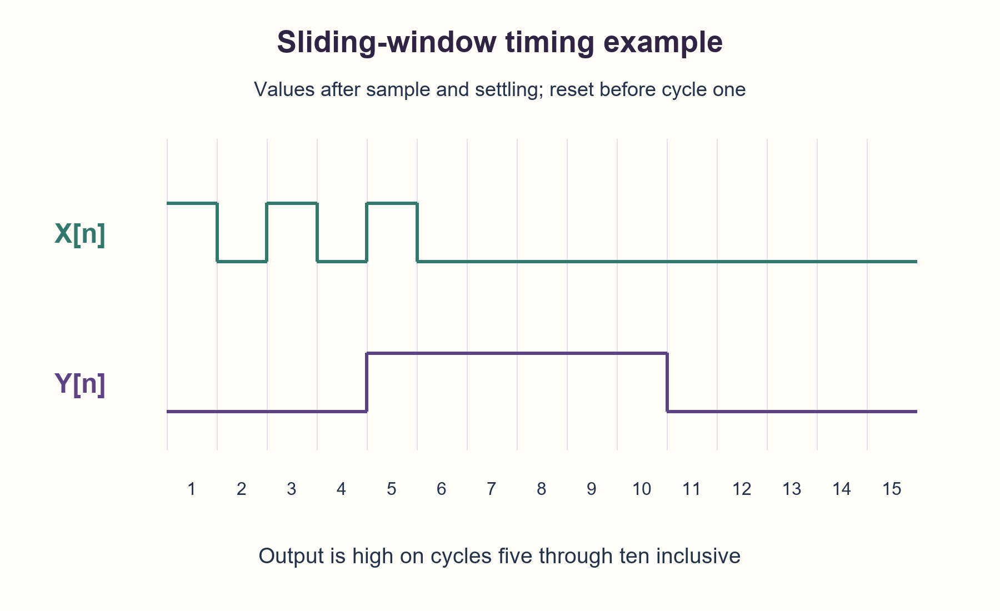

# PREP-095 — בודק לחלון זז — לפחות שלושה אחדים בעשר דגימות

## מקור שנמסר

נתון רכיב עם כניסות X ו־CLK ומוצא Y. X משתנה בעליית שעון. Y הוא 1 אם במשך עשרה מחזורי שעון X הייתה לפחות שלושה מחזורים על 1. צייר דיאגרמת גלים וכתוב תוכנית לבדיקת תקינות הרכיב.

[צילום המקור הפנימי](../sources/prep-095-source.png)

סטטוס: הצעה לפתרון בסיוע AI; ביקורת מקצועית אנושית ממתינה.

## עברית

### בודק לחלון זז — לפחות שלושה אחדים בעשר דגימות

לרכיב כניסת ביט X, שעון CLK ומוצא Y. בכל מחזור Y צריך להיות 1 אם מתוך עשר דגימות השעון האחרונות לפחות שלוש דגימות של X היו 1. ציירו דוגמת קלט ופלט וכתבו תוכנית בדיקה בשפה לבחירתכם שמזהה סטייה מהדרישה.

הבהרות שנוספו: זהו חלון זז של עשר דגימות, כולל הדגימה הנוכחית, ולא קבוצות נפרדות של עשרה מחזורים. Y=0 בכל מקרה אחר. לפני הדגימה הראשונה ההיסטוריה מאופסת; בתחילת הריצה משלימים דגימות חסרות באפס, ולכן אפשר לקבל 1 כבר בדגימה השלישית. x[n] הוא ערך הביט שנבחר לדגימה n; y[n] נבדק אחרי שהרכיב התייצב עבור אותה דגימה, ללא מחזור השהיה נוסף. המקור אומר ש־X משתנה בעליית שעון אך אינו מגדיר סדר סימולציה: יש לקבוע במפורש מתי קלט נדגם ומתי קוראים Y כדי לא ליצור מרוץ. בקוד נשתמש ברשימות דגימות לוגיות שהתקבלו כך.

### רמזים / Hints

1. האם די במונה כולל של אחדים מאז האיפוס? מה קורה לאחד שהופיע לפני עשרה מחזורים?
2. שמרו רק את עשר הדגימות האחרונות. בכל מחזור מכניסים אחת ומוציאים את הישנה ביותר, ואז בודקים את הסף.
3. במודל Python אפשר לשמור עשרה ביטים בשלֵם: הזזה, הכנסת X ומסכה 0x3FF. השוו bit_count()>=3 ל־Y שנצפה בכל מחזור; בדקו גם את רגע הכניסה של האחד השלישי ואת פקיעת האחד הישן.

### הצעה לפתרון / Proposed solution

### מדמיינים חלון שנע עם הזמן
בכל מחזור מוסיפים את X החדש מימין, ואם יש יותר מעשר דגימות משמיטים את הישנה ביותר משמאל. השאלה בכל רגע היא כמה אחדים נמצאים עכשיו בתוך החלון. אחד ישן יוצא גם אם לא הגיע אחד חדש במקומו.

למשל X מתחיל ב־1,0,1,0,1 ואז אפסים. בדגימה 5 נכנס האחד השלישי, ולכן Y עולה מיד בדגימה הזאת. עד דגימה 10 שלושת האחדים עוד בחלון. בדגימה 11 הדגימה הראשונה יצאה: נשארים רק שני אחדים ו־Y יורד. זו בדיקה חשובה לקצה החלון.

### מודל ייחוס ובודק הם שני תפקידים
מודל הייחוס מקבל את X הדגום ומחשב מה Y צריך להיות. הבודק מקבל גם את Y האמיתי ומשווה ביניהם. חישוב הפלט הצפוי בלי לקרוא את Y של הרכיב אינו בדיקת הרכיב. הקוד המצורף מספק WindowMonitor למודל ו־check_samples שמחזיר את אינדקסי המחזורים השגויים ברשימות שהוזנו.

```python
history = ((history << 1) | x) & 0x3FF
expected_y = int(history.bit_count() >= 3)
```

ההזזה מפנה מקום לדגימה החדשה והמסכה משאירה בדיוק עשרה ביטים; האחד הישן ביותר נופל החוצה. את ההשוואה ל־Y עושים אחרי עדכון ההיסטוריה, כדי שהדגימה הנוכחית תיכלל. history מתחיל ב־0 ומתאפס בכל reset שסוכם. זו תוכנית בדיקה בפייתון, ולא טענה שכך חייבים לממש את החומרה. חומרה אפשרית היא רגיסטר היסטוריה ומסכם, או מונה המתעדכן לפי הביט הנכנס והיוצא.

### נוסחה שמגדירה בדיוק מה בודקים
במספור דגימות מ־1, עם x[k]=0 עבור k<=0:

```text
count[n] = sum(x[k] for k=n-9,...,n)
y[n] = 1 iff count[n] >= 3
```

שומרים עשר דגימות, לא את כל העבר. לחלון קבוע של עשרה ביטים העלות קבועה לכל מחזור. בהכללה לאורך W, אחסון ההיסטוריה הוא W ביטים ועלות bit_count של שלם שרירותי אינה בהכרח פעולה קבועה.

### איך מחברים לבדיקת סימולציה בלי מרוץ?
יש להגדיר את עסקת הדגימה. דוגמה תקינה: מנהלים את x[n] מספיק לפני חזית הקליטה, קוראים את X שנלכד, ומחכים לסיום עדכוני הרכיב לפני קריאת Y. בסביבת clocking או cocotb אפשר לבחור שלב קריאה סופי מתאים, כגון ReadOnly אחרי RisingEdge. אי אפשר להניח שקריאה מייד אחרי זיהוי עליית CLK כבר רואה את מוצאי הדלגלגים המעודכנים.

אם מנהל הקלט משנה X דווקא אחרי עליית השעון, רכיב שמדגם באותה חזית בדרך כלל לוכד את הערך הקודם: יש לשייך את הקלט החדש לדגימה הבאה. זו מוסכמת תזמון, לא באג שסף שלוש פותר. אם מפרט הרכיב מגדיר Y מושהה במחזור, מוסיפים צינור השוואה של מחזור ומעדכנים גם את הדיאגרמה; אין להזיז את הציפיות אוטומטית עד שהבדיקה עוברת. הקוד הנוכחי משתמש בחוזה ללא השהיה נוספת ובלי ערכי X/Z.

### מקרי בדיקה שמגלים טעויות
אפסים בלבד, שני אחדים בלבד, האחד השלישי בדיוק עכשיו, אחדים צמודים או רחוקים, עשרה אחדים רצופים, מעבר של אחד אל מחוץ לחלון, תחילת ריצה ואיפוס באמצע. בדיקה עצמאית מחשבת לכל מחזור סכום של פרוסת העבר המפורשת ומשווה למודל הביטים. בנוסף הפכו Y במחזור אחד ובדקו שהבודק מזהה דווקא אותו. הבדיקות המצורפות רצות מול נתונים סינתטיים; לא חובר DUT אמיתי ולא הורצה סימולציית HDL.





## English

### Sliding-window checker — at least three ones in ten samples

A component has bit input X, clock CLK and output Y. Each cycle Y must be one if at least three of the last ten clock samples of X were one. Draw an input/output example and write a checker in a language of your choice that detects violations.

Added clarifications: the window slides every sample and includes the current sample; it is not a sequence of disjoint ten-cycle blocks. Y must be zero otherwise. Reset initializes the history to zero and missing startup samples are zero-padded, so output may already become one on sample three. x[n] denotes the value assigned to sample n; observe y[n] after settling for that sample, with no additional cycle latency. The source says X changes on rising edges but does not specify simulator scheduling. Define the input sampling and Y observation phases explicitly to avoid a race. The Python code operates on logical sample sequences acquired under that convention.

### רמזים / Hints

1. Is a lifetime total of ones sufficient? What happens to a one that occurred ten cycles ago?
2. Retain only the latest ten samples. Insert one and expire the oldest each cycle, then compare the current count against the threshold.
3. A Python monitor can shift the new X into an integer and mask with 0x3FF. Compare bit_count()>=3 against observed Y every cycle; test both arrival of the third one and expiration of an old one.

### הצעה לפתרון / Proposed solution

### Imagine a moving window
Append the new X sample and, once more than ten are present, discard the oldest. Count only ones inside the current window. An old one expires even if no new one replaces it.

For X=1,0,1,0,1 followed by zeros, sample five inserts the third one and immediately makes Y high. All three remain through sample ten. At sample eleven the first sample expires, leaving only two and making Y low. This is a useful window-boundary test.

### Reference model versus DUT checker
The reference model consumes sampled X and computes expected Y. A checker additionally reads actual DUT Y and compares the two. Computing expected output alone does not test the DUT. The attached Python provides WindowMonitor and check_samples, which returns zero-based failing-cycle indexes for supplied sample sequences.

```python
history = ((history << 1) | x) & 0x3FF
expected_y = int(history.bit_count() >= 3)
```

The shift admits the new bit and the mask retains precisely ten bits, discarding the expired one. Compare only after updating history so the current sample is included. Initialize history to zero and reset it whenever the agreed reset occurs. This is a Python checking model, not a required hardware implementation. Hardware might use a history shift register and adder or update a count from incoming and outgoing bits.

### Exact temporal definition
Number samples from one and define x[k]=0 for k<=0:

```text
count[n] = sum(x[k] for k=n-9,...,n)
y[n] = 1 iff count[n] >= 3
```

Only ten samples are retained, not the lifetime history. The fixed ten-bit window has constant per-cycle cost. For a generalized W-bit window, history needs W bits and arbitrary-width Python bit_count need not be constant cost.

### Connecting to simulation without a race
Define a sample transaction: drive x[n] sufficiently before the capture edge, identify the captured X, and wait for DUT updates to settle before observing Y. A clocking discipline or cocotb can select an appropriate final observation phase, such as ReadOnly after RisingEdge. Returning from a rising-edge trigger alone does not imply downstream flip-flop outputs have updated.

If the driver changes X just after the rising edge, a DUT sampling at that edge generally captures the old value; assign the new value to the next sample. Threshold arithmetic cannot resolve that scheduling convention. If the specified DUT has an extra registered cycle of latency, delay expected comparisons one cycle and change the waveform explicitly rather than shifting expectations until a test passes. The supplied checker uses zero additional cycle latency and binary values, not X/Z states.

### Tests that expose mistakes
Use all zeros, only two ones, the exact third one, adjacent and separated ones, ten consecutive ones, expiration at the window boundary, startup and reset in the middle. An independent oracle sums the explicit suffix of the input at every sample. Flip one observed Y and confirm the checker identifies exactly that cycle. The supplied checks use synthetic sequences; no real DUT or HDL simulator was connected.





## קוד ובדיקות

[מודל Python](../solutions/prep_095_sliding_window_monitor.py) · [בדיקות](../checks/check_prep_095.py) · [תוצאות](../checks/prep-095-verification.json)


## מקור נוסף — 30.10.2026, מקבץ90

[צילום מקור פרטי 13](../sources/2026-10-30-batch90-13.png)

יש רכיב שמקבל שעון ועוד כניסה בעלת ביט יחיד. המטרה היא להוציא 1 כאשר בכל 7 מחזורים רצופים יש לפחות 6 שגיאות.

שיוכי מקור מדווחים: Apple.

נוספה וריאציה טכנית בשתי השפות; הנוסח, הפתרון והרמזים הקודמים נשמרו כתחילית. הפתרון המורחב ממתין לביקורת מקצועית.

[הווריאציה המלאה / Full variant](prep-095-six_of_seven-batch90-addendum.md)
