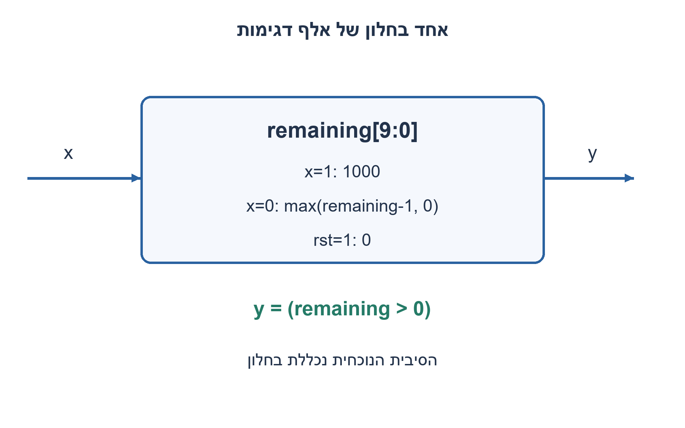
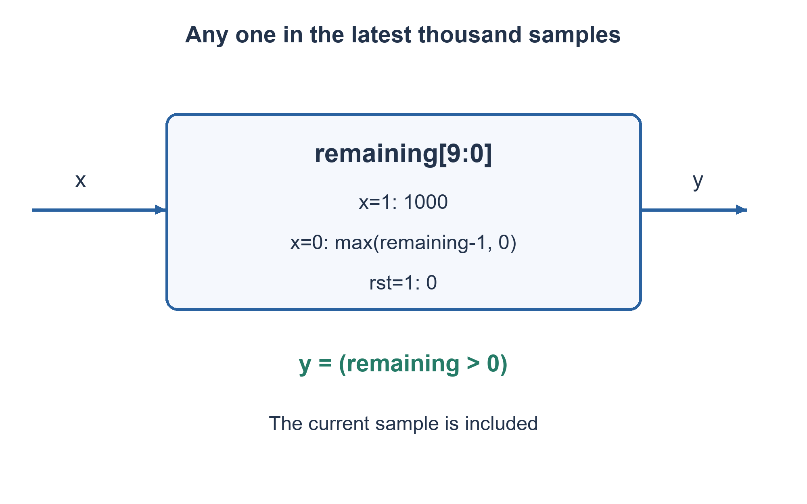

# PREP-095 — בודק לחלון זז — לפחות שלושה אחדים בעשר דגימות

פתרון מוצע בסיוע AI; ביקורת מקצועית אנושית ממתינה. הקושי אינו מכויל.

[צילום מקור פרטי](../sources/2026-11-07-batch10-01.png)

כתוב פסאודו קוד למכונה שמקבלת בכניסה ביט בודד 1/0 ומוציאה 1 אם באלף המחזורים האחרונים נכנס 1.

חברות לפי הדיווח בצילום בלבד: NVIDIA.

## עברית

### וריאציה: לפחות אחד בחלון של אלף מחזורים
כתבו פסאודו קוד ומימוש סינכרוני שמוציאים 1 אם התקבלה לפחות סיבית 1 אחת באלף הדגימות האחרונות, ו־0 אחרת.

הבהרה שנבחרה למקור הקצר: ״נכנס 1״ פירושו לפחות אחד, ולא אלף אחדים רצופים. החלון כולל את הדגימה הנוכחית; אחרי איפוס ההיסטוריה חסרה ומושלמת באפסים. בכל עליית שעון נקלט ביט; האיפוס סינכרוני וגובר על הקלט. היציאה לאחר העלייה מתאימה לחלון המעודכן.

1. האם צריך לזכור כל סיבית, או רק מתי יפסיק האחד האחרון להשפיע?
2. בכל אחד חדש אפשר לחדש זמן תפוגה של אלף דגימות. מה עושים כשנכנס אפס?
3. טענו מונה רווי ל־1000 באחד, הקטינו באפס עד 0, והוציאו 1 כל עוד המונה חיובי. בדקו את האפס ה־999 ואת האפס ה־1000 אחרי האחד.

### שומרים את חיי האחד האחרון
נגדיר `remaining` כמספר החלונות, כולל הנוכחי, שבהם האחד האחרון עדיין נכלל. לאחר איפוס ערכו 0. בכל דגימה:

```text
if x == 1: remaining = 1000
else: remaining = max(remaining - 1, 0)
y = (remaining > 0)
```

אם האחד האחרון התקבל בזמן t, אז בזמן t+d, כל עוד לא הגיע אחד חדש, המונה הוא `max(1000-d,0)`. לכן היציאה 1 בדיוק עבור d=0..999. האפס ה־999 עוד משאיר את האחד בחלון; האפס ה־1000 מסלק אותו. אחד חדש מאפס את הגיל ומחדש את הספירה. אין גלישה כלפי מטה משום שהמונה נעצר באפס.

נדרשים עשרה דלגלגים, כי יש לייצג 1001 ערכים 0..1000. רשומת הזזה של אלף סיביות ושער OR גם נכונה, אך מיותרת לתנאי ״לפחות אחד״. למספר סף גדול מאחד נצטרך מידע נוסף: המונה הזה אינו סופר כמה אחדים בחלון, ולכן אינו מחליף את הפתרון המקורי של שלושה מתוך עשר.

לחלון W, זמן עדכון אלגוריתמי O(1) ומצב O(log W) סיביות. מימוש מחסר ברוחב log W אינו בעל השהיה פיזית קבועה לכל W; אין טענת מינימום שערים.

### קוד SystemVerilog; תוצאות סימולציה בדוח נפרד

```systemverilog
`timescale 1ns/1ps
module prep095_recent_one_batch1107b10 #(parameter integer WINDOW=1000)(
 input logic clk,rst,x, output logic y);
 localparam integer CW=$clog2(WINDOW+1);
 logic [CW-1:0] remaining;
 always @(posedge clk) begin
   if(rst) remaining<=0;
   else if(x) remaining<=WINDOW;
   else if(remaining!=0) remaining<=remaining-1'b1;
 end
 assign y=(remaining!=0);
endmodule
```




### assumptions

```json
[
  "אחד לפחות; חלון כולל דגימה נוכחית; אפסים לפני תחילת הקלט.",
  "אין bit_valid; כל עלייה היא דגימה."
]
```

### optimality

עשרה ביטי מצב עבור W=1000; עדכון קבוע באלגוריתם ומחסר בן עשרה ביטים. בכלליות O(log W) זיכרון סיביות.

### verification

אימות RTL אמיתי: Icarus Verilog 12 קימפל את חמש הווריאציות והרתמה עברה 138,967 בדיקות בסביבה מבודדת ללא רשת: 2,046 מילים טוריות, 5,000 מחזורי FIFO, 1,300 מחזורי חלון וכל 16 זוגות המקסימום. בדיקת Python עצמאית מרחיבה את הכיסוי ל־4,094 מילים ו־10,000 מחזורי FIFO. ראיות: checks/batch1107b10-native-verification.json ו־checks/batch1107b10-hardware-model-verification.json. זו סימולציה דיגיטלית מוגבלת; לא בוצעו סינתזה או ניתוח תזמון.

### edge_cases

```json
[
  "איפוס, זרם אפסים, שני אחדים סמוכים, אחד נוסף לפני התפוגה.",
  "999 לעומת 1000 אפסים אחרי אחד; חלון W=1."
]
```

### common_mistakes

החלפת ״לפחות אחד״ ב״כל האלף אחד״; טעינת 999; חיתוך המונה לתשע סיביות; גלישה מאפס.

### interview_answer

אזכור רק כמה דגימות נשארו עד שהאחד האחרון יוצא מהחלון. אחד טוען 1000, אפס מקטין עד אפס, והיציאה בודקת חיוביות.

### source_ambiguities

המשמעות ״לפחות אחד״ והכללת המחזור הנוכחי נבחרו במפורש כהשלמה לימודית. הצילום אינו דורש שכל האלף יהיו אחד.

### solution_extensions

```json
{
  "question": "מה משתנה אם נדרשים שני אחדים בחלון?",
  "direction": "צריך גם את גיל האחד השני האחרון; מונה תפוגה יחיד אינו מספיק.",
  "tests": [
    "שני אחדים במרחק 999",
    "שני אחדים במרחק 1000"
  ]
}
```

## English

### Variant: any one in a thousand-cycle window
Write pseudocode and synchronous hardware producing 1 exactly when at least one of the latest thousand samples was one.

Chosen clarification of the terse source: this means any one, not a thousand consecutive ones. Include the current sample and zero-pad missing startup history. Every rising edge accepts one bit; synchronous active-high reset overrides data. The post-edge output describes the updated window.

1. Must you remember every bit, or only when the most recent one expires?
2. Each new one refreshes a thousand-sample expiry. What should a zero do?
3. Load 1000 on one; on zero decrement toward zero. Output whether the count is positive. Check the 999th and 1000th zero after a one.

### Remember the lifetime of the most recent one
Let `remaining` be the number of windows, including the present one, in which the latest one still appears. Reset it to zero. For each sample:

```text
if x == 1: remaining = 1000
else: remaining = max(remaining - 1, 0)
y = (remaining > 0)
```

If the latest one arrived at t, then at t+d, until another one arrives, the counter is `max(1000-d,0)`. Thus output is one exactly for d=0..999. The 999th following zero still includes that one; the 1000th removes it. A new one refreshes the expiry. Saturating at zero prevents underflow.

Ten flip-flops represent the 1001 values 0..1000. A thousand-bit shift register with OR reduction is also correct, but unnecessary for an any-one predicate. A threshold above one needs more information: this counter does not count ones in the window and does not replace the original three-in-ten checker.

For window W the algorithm has O(1) updates and O(log W) state bits. Physical decrement delay still depends on the counter width; no globally minimum gate count is claimed.

### SystemVerilog; simulation results are in a separate report

```systemverilog
`timescale 1ns/1ps
module prep095_recent_one_batch1107b10 #(parameter integer WINDOW=1000)(
 input logic clk,rst,x, output logic y);
 localparam integer CW=$clog2(WINDOW+1);
 logic [CW-1:0] remaining;
 always @(posedge clk) begin
   if(rst) remaining<=0;
   else if(x) remaining<=WINDOW;
   else if(remaining!=0) remaining<=remaining-1'b1;
 end
 assign y=(remaining!=0);
endmodule
```




### assumptions

```json
[
  "Any one; include the present sample and zero-pad startup.",
  "No bit_valid: every edge samples."
]
```

### optimality

Ten state bits for W=1000, with a fixed algorithmic update and a ten-bit decrementer; generally O(log W) bits.

### verification

Executed RTL verification: Icarus Verilog 12 compiled the five variants and the harness passed 138,967 checks in an isolated network-denied environment: 2,046 serial words, 5,000 FIFO cycles, 1,300 window cycles and all 16 maximum-input pairs. Independent Python checks extend coverage to 4,094 words and 10,000 FIFO cycles. Evidence: checks/batch1107b10-native-verification.json and checks/batch1107b10-hardware-model-verification.json. This is bounded digital simulation, not synthesis or timing analysis.

### edge_cases

```json
[
  "Reset, all zeros, adjacent ones and refresh before expiry.",
  "999 versus 1000 zeros after a one; W=1."
]
```

### common_mistakes

Confusing any one with all ones; loading 999; using nine bits; underflowing zero.

### interview_answer

Remember only how many samples remain before the latest one leaves. A one loads 1000; a zero decrements toward zero; output tests positivity.

### source_ambiguities

Any-one semantics and inclusion of the current cycle are explicit teaching clarifications; the screenshot does not demand all thousand bits be one.

### solution_extensions

```json
{
  "question": "What changes for at least two ones?",
  "direction": "Also track the second-most-recent one; a single expiry counter is insufficient.",
  "tests": [
    "Ones 999 samples apart",
    "Ones 1000 samples apart"
  ]
}
```
