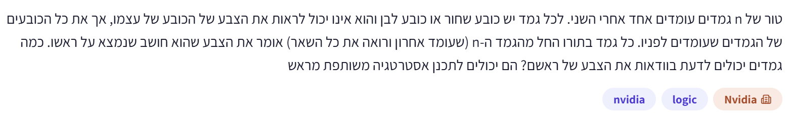

# PREP-096 — כובעים בטור — תיאום מראש ותשובות סדרתיות

מקור שנמסר ב־24.10.2026; פתרון מוצע בסיוע AI, ממתין לביקורת אנושית. שיוך NVIDIA מדווח מהצילום בלבד.

## מקור ללא שינוי



טור של n גמדים עומדים אחד אחרי השני. לכל גמד יש כובע שחור או כובע לבן והוא אינו יכול לראות את הצבע של הכובע של עצמו, אך את כל הכובעים של הגמדים שעומדים לפניו. כל גמד בתור החל מהגמד ה־n (שעומד מאחוריו ורואה את כל השאר) אומר את הצבע שהוא חושב שנמצא על ראשו. כמה גמדים יכולים לדעת בוודאות את הצבע של ראשם? הם יכולים לתכנן אסטרטגיה משותפת מראש.

## נוסח לאתר

בטור עומדים n גמדים, כאשר n חיובי. לכל אחד כובע שחור או לבן. כל גמד רואה את כל הכובעים שלפניו, אך אינו רואה את כובעו או את הכובעים שמאחוריו. אין מידע על מספר הכובעים מכל צבע.

הגמד האחורי, הרואה את כל האחרים, עונה ראשון; אחריו עונים בזה אחר זה לכיוון הקדמי. כל אחד רשאי לומר רק ״שחור״ או ״לבן״ כתשובתו לגבי כובעו. כמה גמדים יכולים לדעת בוודאות את צבעם ולענות נכון, בלי קשר לסידור הכובעים? תנו אסטרטגיה והסבירו מדוע אי אפשר להבטיח יותר.

הבהרות שנוספו לעריכה: כולם רשאים לתאם מראש אסטרטגיה, שומעים וזוכרים את כל התשובות הקודמות, ומכירים את סדר הטור. אין תקשורת נוספת, רמזים בתזמון או שינוי כובעים. ״שחור״ מקודד כ־1 ו״לבן״ כ־0 לצורך ההסבר; אלה עדיין שתי המילים היחידות שמותר לומר. המקור אינו מציין במפורש את שמיעת התשובות, ובלעדיה אין להניח שמנגנון הזוגיות הזה זמין.

### שלושה רמזים

1. האם הגמד הראשון יכול לנצל את מילת הצבע שלו כדי למסור מידע שימושי על כל הכובעים שהוא רואה, גם בלי לדעת את צבעו?
2. שתי מילים מספיקות להבדיל בין מספר זוגי למספר אי־זוגי של כובעים שחורים. מה הגמד הבא רואה לעומת מה שהראשון ראה?
3. שלבו את הזוגיות שהוכרזה עם הצבעים הנכונים שכבר נאמרו ועם הכובעים שעוד רואים. בכל שלב חסר ביט צבע אחד בלבד.

## פתרון מוצע

### הרעיון: התשובה הראשונה מעבירה ביט מידע אחד

אפשר להבטיח ש־**n−1 גמדים ידעו את צבעם ויענו נכון**. האחורי משתמש בתשובתו כדי לעזור לכולם: הוא מודיע אם מספר הכובעים השחורים שלפניו זוגי או אי־זוגי. הוא אינו רואה את כובעו ולכן לא מובטחת לו תשובה נכונה על עצמו.

מסכימים מראש: ״לבן״ פירושו מספר זוגי של שחורים; ״שחור״ פירושו מספר אי־זוגי. המידע הזה נקרא זוגיות. אין צורך להעביר את מספר הכובעים השחורים עצמו — רק איזה משני המצבים מתקיים.

### איך הגמד הבא משלים את החסר?

הגמד הבא יודע את הזוגיות של כל הכובעים שלפני האחורי. הוא רואה את כולם חוץ מכובע אחד באותה קבוצה: כובעו שלו.

- אם מספר השחורים שהוא רואה כבר מתאים לזוגיות שנאמרה, כובעו לבן.
- אם הזוגיות אינה מתאימה, כובעו שחור: הוספת שחור אחד היא בדיוק מה שהופך זוגיות.

כשהוא אומר את צבעו הנכון, הבאים בתור שומעים עוד נתון. כל אחד משתמש בזוגיות המקורית, בצבעים הנכונים שכבר נאמרו ובכובעים שהוא עדיין רואה. שוב נשאר צבע לא ידוע אחד בלבד — שלו.

### דוגמה של חמישה גמדים

נמספר מהקדמי 1 עד האחורי 5. הצבעים בפועל, מהקדמי לאחורי, הם: שחור, לבן, שחור, שחור, לבן.

| מי עונה? | מה מאפשר לו לענות? | תשובתו |
| --- | --- | --- |
| 5, האחורי | רואה שלושה שחורים: מספר אי־זוגי | שחור — הודעת זוגיות; במקרה הזה כובעו דווקא לבן |
| 4 | רואה שני שחורים; כדי שבארבעת הכובעים יהיה מספר אי־זוגי, שלו שחור | שחור, בוודאות |
| 3 | יודע ש־4 שחור ורואה עוד שחור אחד; נדרש שחור נוסף | שחור, בוודאות |
| 2 | שני השחורים שכבר נאמרו והשחור הנראה כבר נותנים מספר אי־זוגי | לבן, בוודאות |
| 1, הקדמי | שלושת הצבעים הנכונים ששמע כוללים שני שחורים; שלו משלים לאי־זוגי | שחור, בוודאות |

### נוסחה וקוד מקומי

XOR של ביטי הצבע הוא 0 למספר זוגי של שחורים ו־1 לאי־זוגי. עבור כל גמד אחרי הראשון:

```text
my_color = first_parity_message XOR previous_correct_colors XOR visible_colors
```

**התשובה הראשונה היא הודעת זוגיות, לא צבע אמיתי ידוע.** משלבים אותה פעם אחת עם שאר התשובות הקודמות, שהן כבר צבעים נכונים. אסור להתייחס אליה כאילו גילתה את כובעו של האחורי.

```python
def reply(visible, heard):
    result = 0
    for color in visible:
        result ^= color
    for answer in heard:
        result ^= answer
    return result
```

בראשון heard ריק, ולכן מתקבלת זוגיות הכובעים שהוא רואה. בכל הבאים heard כולל תחילה את הודעת הזוגיות ואחריה את הצבעים הנכונים שכבר נאמרו. הקוד מקבל רק מידע שמותר לגמד לראות או לשמוע; אינו מקבל את צבע כובעו.

### מדוע זה נכון לכל n?

ההודעה הראשונה היא XOR של n−1 הכובעים האחרים. אצל כל גמד בהמשך, הכובעים האלה מתחלקים לשלוש קבוצות: צבעים שכבר נשמעו נכון, צבעים שרואים לפניו וכובעו שלו. XOR של ההודעה עם שתי הקבוצות הידועות מבטל כל ביט ידוע ומשאיר בדיוק את צבעו. זה נכון לגמד השני, ואחרי שענה נכון גם לבא אחריו — כך עד הקדמי.

### למה אי אפשר להבטיח שכל n ידעו?

נחליף רק את כובעו של האחורי. כל מה שהוא רואה נשאר זהה, ואין עדיין תשובות קודמות. לכן אין לו דרך להבחין בין שני המצבים. באחד כובעו שחור ובשני לבן, ולכן שום תשובה שלו אינה מובטחת כנכונה בשניהם. כבר בגלל הגמד הראשון אי אפשר להבטיח n תשובות נכונות; האסטרטגיה משיגה n−1 ולכן מיטבית במדד זה. ייתכן שבמקרה גם הראשון ינחש נכון, אך הוא לא יודע זאת בוודאות.

### עלות ומקרי קצה

עבור n=1 אין אחרים שאפשר להציל: מובטחים אפס יודעים, אף שהיחיד עשוי לנחש נכון. עבור כל n גדול יותר, כל מי שאינו הראשון יודע את צבעו. בקוד הפשוט כל תשובה עוברת על המידע הגלוי והנשמע בזמן O(n), עם ביט צבירה אחד מעבר לקלט; סימולציה של כל הטור היא O(n²). אפשר לעדכן את זוגיות התשובות הנשמעות בביט אחד במקום לסרוק שוב את ההיסטוריה. ניתוח זה אינו טענה שאפשר לספור את כל הכובעים הנראים בלי להביט בהם. אם אין שמיעה של תשובות או אין סדר משותף, ההוכחה אינה חלה.

### assumptions

[
  "n חיובי, צבעים בינאריים וסדר תשובות מהאחורי לקדמי.",
  "תיאום מראש, שמיעת כל התשובות וזיכרון מקומי; אין תקשורת נוספת.",
  "אין מגבלה ידועה על מספר הכובעים מכל צבע."
]

### optimality

{
  "criterion": "מספר היודעים את צבעם בוודאות, בכל סידור אפשרי.",
  "result": "n−1; הראשון מעביר זוגיות ולא יודע את כובעו.",
  "proof": "החלפת כובעו של הראשון משאירה את כל תצפיותיו זהות; אי אפשר להבטיח n. ביט הזוגיות מאפשר לכל יתר n−1 להסיק את צבעם."
}

### edge_cases

[
  "n=1: אין יודע מובטח; n=2: הקדמי יודע.",
  "כל הכובעים באותו צבע או תבניות זוגיות מתחלפות.",
  "הראשון עשוי לענות נכון במקרה, אך אינו יודע זאת.",
  "שמיעה חסרה או סדר שונה דורשים בעיה אחרת."
]

### common_mistakes

[
  "לספור את ההודעה הראשונה כאילו היא צבעו האמיתי של האחורי.",
  "לנסות להעביר את מספר השחורים המלא במילה אחת במקום רק זוגיות.",
  "לשכוח שהבאים משתמשים גם בתשובות הקודמות ולא רק במה שהם רואים.",
  "לטעון שכל n בהכרח טועים או צודקים במקום להבחין בין הבטחה למקרה."
]

### interview_answer

האחורי אומר שחור אם מספר השחורים שלפניו אי־זוגי ולבן אם הוא זוגי. כל הבא משלב את הזוגיות עם הצבעים שכבר נשמעו ועם מה שהוא רואה, ונשאר רק כובעו. כך n−1 יודעים בוודאות. אי אפשר להבטיח גם לראשון לדעת, כי כובעו אינו משפיע על שום מידע שיש לו.

### source_ambiguities

{
  "audibility": "המקור אינו אומר במפורש ששומעים תשובות. זו הנחה שנוספה והיא חיונית.",
  "inventory": "לא ניתנה מכסה לכל צבע; אין לייבא את חמשת הכובעים של PREP-033.",
  "objective": "מבחינים בין לדעת בוודאות לבין ניחוש שעשוי להצליח."
}

### solution_extensions

{
  "question": "מה משתנה אם יש k צבעים וכל תשובה יכולה להיות אחד מ־k שמות הצבעים?",
  "answer_direction": "ממספרים צבעים 0..k−1 ומשדרים סכום מודולו k במקום XOR; כל הבא מחסר את הצבעים הידועים ומוצא את שלו.",
  "tests": "הכללת ביט הזוגיות למידע מודולרי; נשארים k שמות מותרים."
}

### verification

בדיקת Python ממצה של 32,766 עולמות עבור n=1..14, ובהם 393,220 תשובות של גמדים שאינם הראשונים. נבדקו 16,383 זוגות עולמות עם אותו מידע גלוי וצבע אחורי שונה, ועוד 120 עולמות מדגמיים עד n=1024. נבדקו שימור הקלט וארבע דחיות קלט. ההוכחה הכללית והחסם העליון כתובים בנפרד; אין כאן ניסוי פיזי או ביקורת אנושית.

### relationship_note

קשורה ל־PREP-033 בנושא כובעים, אך כאן n כללי, אין מכסת צבעים ידועה והמידע מועבר במכוון בתשובות סדרתיות.

## English website wording

There are n dwarfs in a line, with positive n. Each wears a black or white hat. Every dwarf sees all hats ahead, but neither their own hat nor hats behind. The number of hats of each color is unknown.

The rearmost dwarf, who sees everyone else, answers first; answers then proceed toward the front. Each may say only “black” or “white” as their answer about their own hat. How many dwarfs can be guaranteed to know their own color and answer correctly for every hat arrangement? Give a strategy and explain why no larger guarantee is possible.

Editorial assumptions: everyone may agree on the strategy beforehand, hears and remembers all previous answers, and knows the line order. No other communication, timing signals or hat changes are allowed. Black is encoded as 1 and white as 0 for explanation; the spoken answers remain only the two color words. The source does not explicitly state audibility; the parity channel must not be assumed available without it.

### Three hints

1. Can the first dwarf use their color word to communicate something useful about all visible hats, without knowing their own?
2. Two words distinguish even from odd black-hat count. Which hat is missing from the next dwarf’s view compared with the first speaker’s?
3. Combine the announced parity, correct colors already heard and hats still visible. At each step exactly one color bit remains unknown.

## Proposed solution

### The idea: the first answer carries one bit of information

We can guarantee that **n−1 dwarfs know their own color and answer correctly**. The rearmost dwarf uses their answer to help everyone else: it announces whether the number of black hats ahead is even or odd. Their own hat is invisible to them, so their own answer is not guaranteed correct.

Agree beforehand: “white” means an even number of black hats; “black” means odd. This is parity. The exact number of black hats is unnecessary — only which of these two cases applies.

### How does the next dwarf find the missing color?

The next dwarf knows the parity of every hat ahead of the rear dwarf. They see all hats in that group except one: their own.

- If the black hats they see already have the announced parity, their own hat is white.
- If the parity differs, their hat is black: adding one black hat flips parity.

Their correct color becomes another fact the remaining dwarfs hear. Each later dwarf combines the original parity, the correct colors already announced and the hats still visible. Again exactly one unknown color remains — their own.

### A five-dwarf example

Number dwarfs from front 1 to rear 5. Actual hats, front to rear, are black, white, black, black, white.

| Speaker | What determines the answer? | Answer |
| --- | --- | --- |
| 5, rear | Sees three black hats: odd parity | Black — a parity message; their actual hat happens to be white |
| 4 | Sees two black hats; their own must make the total odd | Black, with certainty |
| 3 | Knows 4 is black and sees one further black hat; one more is needed | Black, with certainty |
| 2 | The two announced black hats plus the visible black already give odd parity | White, with certainty |
| 1, front | The three correct colors heard include two blacks; their own must make the total odd | Black, with certainty |

### A formula and local code

XOR of color bits is 0 for an even number of blacks and 1 for odd. For every dwarf after the first:

```text
my_color = first_parity_message XOR previous_correct_colors XOR visible_colors
```

**The first answer is a parity message, not a known true hat color.** Include it once with subsequent replies, which are correct colors. Never treat it as revealing the rear dwarf's actual hat.

```python
def reply(visible, heard):
    result = 0
    for color in visible:
        result ^= color
    for answer in heard:
        result ^= answer
    return result
```

For the first speaker, heard is empty and the result is visible-hat parity. For later speakers, heard contains the initial parity message followed by correct color replies. The function receives only permitted visible and audible information, never the speaker's own hat.

### Why does this work for every n?

The first message is the XOR of the other n−1 hats. For each later dwarf those hats partition into correctly announced colors, visible hats ahead, and their own hat. XORing the message with the two known groups cancels every known bit, leaving exactly their own color. This proves the second dwarf correct; after their correct reply the same argument proves the next, all the way to the front.

### Why can we not guarantee all n know?

Change only the rearmost dwarf's own hat. Everything they see stays the same, and nobody has spoken yet. They cannot distinguish these two worlds. Their hat is black in one and white in the other, so no answer can be guaranteed correct in both. The first speaker alone rules out a guarantee of n correct answers; the strategy achieves n−1 and is optimal for that worst-case guarantee. The first dwarf may happen to guess correctly, but does not know with certainty.

### Cost and edge cases

For n=1, zero dwarfs are guaranteed to know, although the sole dwarf can guess correctly by chance. For larger n everyone except the first knows. The simple code scans visible and heard inputs in O(n) time per reply, with one accumulator bit beyond its inputs; simulating the whole line takes O(n²). Heard-answer parity can instead be maintained in one bit without rescanning the history. This is not a claim that visible hats can be counted without inspecting them. Without audible replies or an agreed order, the proof does not apply.

### assumptions

[
  "Positive n, binary colors and rear-to-front answers.",
  "Pre-agreement, audible answers and private memory; no other communication.",
  "No known inventory limit for either hat color."
]

### optimality

{
  "criterion": "Number guaranteed to know their own color for every arrangement.",
  "result": "n−1; the first transmits parity without knowing their own hat.",
  "proof": "Flipping the first speaker’s invisible hat leaves observations identical, ruling out n. Parity lets all other n−1 infer their colors."
}

### edge_cases

[
  "n=1 guarantees zero knowers; n=2 guarantees the front dwarf.",
  "Uniform colors and alternating parity patterns.",
  "The first may be correct by chance but does not know.",
  "Missing audibility or a different answer order changes the contract."
]

### common_mistakes

[
  "Treating the initial parity message as the rear dwarf’s true hat color.",
  "Trying to encode the full black-hat count in one word instead of parity.",
  "Ignoring previous correct replies when decoding later hats.",
  "Confusing a worst-case guarantee with whether all n happen to be correct."
]

### interview_answer

The rear dwarf announces parity of black hats ahead. Each later dwarf XORs that message with correctly announced colors and visible hats, leaving their own color. Thus n−1 know with certainty. The first cannot know, because flipping only their invisible hat changes none of their observations.

### source_ambiguities

{
  "audibility": "The source does not explicitly state hearing replies; this added assumption is essential.",
  "inventory": "No color inventory is given; do not import PREP-033’s five-hat restriction.",
  "objective": "Knowing with certainty differs from a possibly successful guess."
}

### solution_extensions

{
  "question": "What if there are k colors and each answer may be one of the k color names?",
  "answer_direction": "Encode colors 0..k−1 and announce a sum modulo k instead of XOR; subtract known colors to recover each missing one.",
  "tests": "Generalizing parity to modular information while retaining exactly k permitted words."
}

### verification

Python exhaustively checks 32,766 worlds for n=1..14, including 393,220 nonfirst replies, plus16,383 paired worlds differing only in the invisible rear hat and120 seeded worlds up to n=1024. Input preservation and4 invalid-world rejections are checked. The general proof and upper bound are separate; no physical experiment or human review.

### relationship_note

Related to PREP-033’s hats theme, but here n is general, color inventories are unknown and sequential answers deliberately carry information.

## Files and verification

- [Local reply and simulation model](../solutions/prep_096_line_hats_parity.py)
- [Independent checks](../checks/check_prep_096.py)
- [Verification evidence](../checks/prep-096-verification.json)
