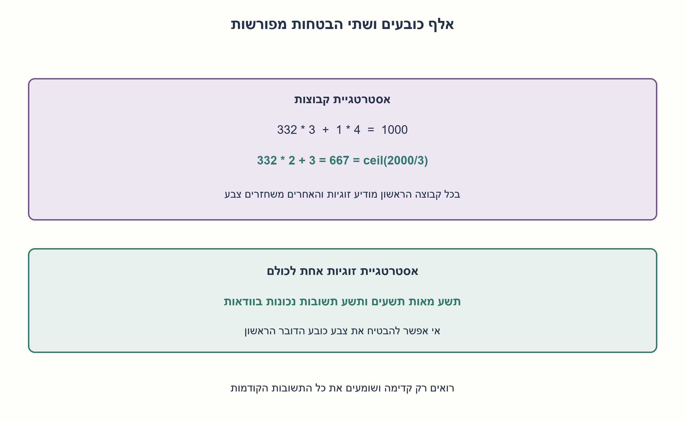
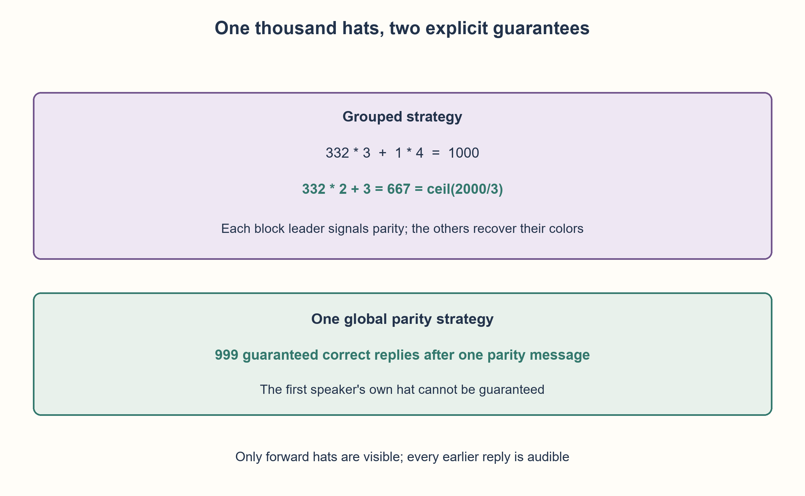

# PREP-096 — אלף כובעים בשני צבעים — מבטיחים 667 ואז 999

פתרון מוצע בסיוע AI; ביקורת אנושית ממתינה. הקושי לא כויל.

[צילום מקור פרטי](../sources/2026-10-30-batch70-29.png)

יש 1000 גמדים, כל אחד חובש כובע אדום או כחול. עומדים בטור כך שכל גמד רואה את כל הגמדים והכובעים שלפניו, לא את שלו או את שמאחוריו. כל גמד בתורו חייב לומר אדום או כחול, אסור לשתוק או לומר משהו אחר. מתחילים מהגמד שרואה את כולם. כולם שומעים את כל ההכרזות. מי שאמר את צבע כובעו ניצח. אפשר לתאם אסטרטגיה מראש. א. מצא אסטרטגיה שבה ינצחו לפחות שני שליש מהגמדים. ב. מצא אסטרטגיה שבה ינצחו כולם מלבד אחד.

## עברית

אלף כובעים בשני צבעים — מבטיחים 667 ואז 999

### וריאציה: 1,000 משתתפים, שני צבעים ושתי רמות של הבטחה
אלף משתתפים עומדים בטור. לכל אחד כובע אדום או כחול, וצבעים יכולים לחזור ללא הגבלה או מכסה ידועה. כל משתתף רואה רק את הכובעים שלפניו, אינו רואה את שלו, ושומע את כל התשובות שכבר נאמרו. מתחילים מהאחרון בטור, שרואה 999 כובעים, ומתקדמים קדימה. כל אדם חייב לענות פעם אחת רק "אדום" או "כחול";תשובה נכונה מצילה אותו. מותר לתאם אסטרטגיה מראש, בלי מחוות, קצב דיבור או תקשורת נוספת.

א. הבטיחו הצלה של לפחות שני שלישים. עבור 1,000 אנשים פירוש הדבר לפחות 667 בכל חלוקת צבעים. ב. מצאו אסטרטגיה שמבטיחה הצלה של כולם מלבד אחד, והוכיחו שלא ניתן להבטיח הצלה של כל האלף. אפשר להשתמש כבר בסעיף א באסטרטגיה החזקה של סעיף ב;הציגו גם בנייה מקומית בקבוצות שמסבירה את רף 667.

1. רף של שני שלישים הוא ceil(2·1000/3)=667, ולא 666. איך אדם ראשון בקבוצה יכול להשתמש בתשובתו כדי למסור ביט מידע לאחרים?
2. בקבוצת שלושה, הראשון מדווח זוגיות של שני הכובעים שלפניו. השניים האחרים יכולים להסיק את צבעיהם. טפלו בשארית:332 שלישיות ועוד רביעייה אחת.
3. לבנייה של 999, האדם הראשון מדווח זוגיות של כל 999 הכובעים שהוא רואה. בכל תור מחסרים ב־XOR את הצבעים שנשמעו ואת הצבעים שעוד רואים. הראשון אינו יכול לדעת את כובעו משני עולמות הנבדלים רק בו.

### תחילה: מה פירוש לפחות שני שלישים?
מספר ניצולים הוא שלם. שני שלישים מתוך 1,000 הם 666 ושני שלישים, ולכן נדרשים לפחות 667. אסטרטגיה שנותנת רק 666 אינה עומדת בדרישה.

נקבע אדום=0 וכחול=1, ונשתמש בזוגיות:סכום הסיביות מודולו 2, כלומר XOR. כשאדם אומר צבע כדי למסור זוגיות, אין הבטחה שזה צבע כובעו. השומעים יודעים מראש מה תפקיד כל תשובה.

### א. קבוצות קטנות: 332 שלישיות ועוד רביעייה
נחלק את הטור לפי סדר הדיבור ל־332 קבוצות של 3 ולקבוצה אחת של 4. בתחילת כל קבוצה, הדובר הראשון אומר את הזוגיות של כל הכובעים האחרים בקבוצתו בלבד. הוא רואה אותם, ואינו משתמש בכובעים שמחוץ לקבוצה.

הבא אחריו שומע את ביט הזוגיות ורואה את כל הכובעים שעוד נותרו בקבוצה. אם יעשה XOR ביניהם, יישאר בדיוק הביט של כובעו. הוא אומר את צבעו האמיתי. הבא שומע גם את צבעי החברים שכבר השיבו נכון, ומסיר מהזוגיות אותם ואת מה שהוא עוד רואה. כך כל חברי הקבוצה מלבד המוביל משיבים בוודאות נכון. זה פועל גם לקבוצה בגודל 4:המוביל מקודד שלושה כובעים, וכל שלושתם מפענחים בתורם.

```text
332 groups of 3: at least 332*2 = 664 correct
1 group of 4:   at least 3 correct
total guarantee: 667
```

המובילים עשויים גם הם לנחש נכון, אבל ההבטחה אינה סומכת על כך. טעות חלוקה נפוצה היא 333 שלישיות ועוד אדם בודד:השלישיות מבטיחות 666 והבודד אינו יודע כלום, ולכן לא מובטחים 667. מצרפים אותו לשלישייה אחת ויוצרים רביעייה.

### ב. קבוצה אחת גדולה: 999 בטוחים
אותו רעיון פועל בלי החלוקה:האדם הראשון בטור הדיבור, מאחור, אומר את הזוגיות של 999 הכובעים שלפניו. הוא יכול לטעות לגבי כובעו שלו, אך תשובתו מוסרת ביט נכון על הקבוצה.

נסמן את הביט הראשון ב־s ואת צבע כובעו של אדם j ב־h_j, כשמספור האנשים הוא לפי סדר הדיבור. לכל j≥1:

```text
s = h_1 XOR h_2 XOR ... XOR h_999
h_j = s XOR (h_1 XOR ... XOR h_(j-1))
          XOR (h_(j+1) XOR ... XOR h_999)
```

כל מה שמימין לנוסחה זמין לאדם j:את s הוא שמע, צבעים שכבר נאמרו אחרי המוביל נכונים לפי האינדוקציה, ואת הנותרים הוא רואה. כל ביט אחר מופיע פעמיים ומתבטל;רק h_j נשאר. לכן 999 האנשים שאחרי המוביל משיבים נכון לכל חלוקת צבעים. הם אינם משתמשים בתשובה הראשונה כאילו הייתה צבע כובעו של המוביל;זו זוגיות של שאר הטור.

האסטרטגיה הזו לבדה עומדת גם בסעיף א:999≥667. החלוקה המקומית מוצגת כדי להמחיש כיצד מידע משותף הופך ידע חזותי לתשובה אישית, ואינה פתרון אופטימלי גלובלי.

### מדוע אי אפשר להבטיח 1,000?
קחו שתי חלוקות שבהן 999 הכובעים הקדמיים זהים, ורק הכובע של האדם שמדבר ראשון מתחלף. הוא רואה ושומע בדיוק אותו דבר בשתיהן:הוא רואה את אותם 999 כובעים, ואף אחד עוד לא דיבר. לכן כל אסטרטגיה קבועה תגרום לו לענות אותה תשובה בשתי החלוקות, והוא יטעה לפחות באחת מהן. גם אקראיות אינה יכולה להבטיח צדק בוודאות בשתיהן. לפיכך 1,000 אינו מובטח;999 הוא המקסימום של הבטחת המקרה הגרוע, ולא טענה שרק 999 יכולים לשרוד בפועל.

### עלות ובדיקה
יש תשובה אחת לאדם. המוביל הגדול מחשב XOR על 999 כובעים;ניסוח מקומי ישיר לכל אדם עשוי לעבור על O(N) כובעים שנראים או נשמעו. בהדמיה המצורפת, ששולפת תתי־רצפים ומחשבת מחדש, הזמן הכולל O(N²) והזיכרון O(N);אין טענה להדמיית זמן לינארי. המידע המתואם הנוסף הוא ביט זוגיות אחד בכל קבוצה, מעבר לזיכרון התצפיות הרגיל.

נבדקו כל 8,190 חלוקות הצבעים באורכים 1 עד 12, ועוד 200 חלוקות של 1,000 עם זרע אקראי קבוע. בנוסף נבנו עדים שבהם כל 333 המובילים בקבוצות טועים, כך שמתקבלים בדיוק 667, ועד גלובלי שבו הראשון טועה ומתקבלים 999. הפונקציות של כל אדם מקבלות רק מה שהוא רואה ושומע, ולא את כובעו הנסתר.

```python
"""Local replies for grouped two-thirds and global all-but-one guarantees."""


def group_sizes(n):
    if type(n) is not int or n < 3:
        raise ValueError("group construction specified for n>=3")
    triples, remainder = divmod(n, 3)
    if remainder == 0:
        return (3,) * triples
    return (3,) * (triples - 1) + (3 + remainder,)


def grouped_reply(visible, heard, groups):
    step = len(heard)
    start = 0
    for size in groups:
        if step < start + size:
            local = step - start
            if local == 0:
                return sum(visible[-(size - 1) :]) % 2
            remaining = size - 1 - local
            still_visible = visible[-remaining:] if remaining else ()
            correct_heard = heard[start + 1 :]
            return (heard[start] + sum(still_visible) + sum(correct_heard)) % 2
        start += size
    raise ValueError("speaker index lies outside the agreed groups")


def global_reply(visible, heard):
    return (sum(visible) + sum(heard)) % 2


def simulate(hats, grouped=False):
    hats = tuple(hats)
    if not hats or any(type(x) is not int or x not in (0, 1) for x in hats):
        raise ValueError("nonempty binary hat line required")
    groups = group_sizes(len(hats)) if grouped else ()
    heard, correct = [], []
    for index in range(len(hats) - 1, -1, -1):
        visible = hats[:index]
        answer = (
            grouped_reply(visible, heard, groups)
            if grouped
            else global_reply(visible, heard)
        )
        heard.append(answer)
        correct.append(answer == hats[index])
    return tuple(heard), tuple(correct)
```




## English

One thousand binary hats: guarantee 667, then 999

### Variant: 1,000 people, two colors, and two guarantee levels
One thousand people stand in line. Every hat is red or blue;colors may repeat with no known quota. A person sees only the hats ahead, never their own, and hears every earlier answer. The rear person, who sees 999 hats, answers first, and turns proceed toward the front. Each person says exactly one color word, red or blue. A correct answer saves that person. A strategy may be agreed beforehand;gestures, timing codes, and other communication are forbidden.

(a) Guarantee at least two thirds survive, meaning at least 667 of 1,000 for every coloring. (b) Guarantee everyone except possibly one survives, and prove all 1,000 cannot be guaranteed. The stronger strategy also answers(a);include a local block construction to explain the 667 threshold.

1. Two thirds of 1,000 requires ceil(2000/3)=667, not 666. Can a block leader use their color word to communicate one bit?
2. In a triple, the first person signals the parity of the other two hats. Both followers infer their own hats. Handle the remainder with 332 triples and one block of four.
3. For 999, let the first person signal the parity of all 999 visible hats. Each follower XORs away prior correct colors and still-visible hats. The first person cannot distinguish worlds differing only in their own hat.

### First interpret at least two thirds
Survivors are integral. Two thirds of 1,000 is 666 and two thirds, so the guarantee must be at least 667. A construction guaranteeing only 666 fails this requirement.

Encode red as 0 and blue as 1. Parity is the bit sum modulo 2, or XOR. A leader's color word may report parity rather than the leader's own hat;everyone knows this convention beforehand.

### (a) Small blocks:332 triples and one group of four
Partition people in speaking order into 332 groups of three and one group of four. The first speaker of each group reports the parity of the other hats in that group only. Those hats are all visible to the leader.

The next person hears that bit and sees every remaining hat in the group. XORing them leaves exactly their own bit, which they announce truthfully. Each later person removes already announced truthful group colors and the still-visible group hats from the same parity. Thus everyone except the leader is guaranteed correct. A four-person group works the same way:its leader encodes three hats and all three followers decode.

```text
332 groups of 3: at least 332*2 = 664 correct
1 group of 4:   at least 3 correct
total guarantee: 667
```

Leaders may also be correct, but the guarantee does not count them. Using 333 triples and an isolated leftover gives only 666 guaranteed answers:the isolated person has no reliable information. Merge that leftover into one triple to form the group of four.

### (b) One large group:999 guaranteed
Use the same idea on the entire line. The rear person, who speaks first, announces the parity of all 999 visible hats. That color word may be wrong about their own hat but correctly encodes the rest of the line.

Let s be that first bit, and number people in speaking order. For every j≥1:

```text
s = h_1 XOR h_2 XOR ... XOR h_999
h_j = s XOR (h_1 XOR ... XOR h_(j-1))
          XOR (h_(j+1) XOR ... XOR h_999)
```

Every term on the right is available:the person heard s, earlier follower colors are truthful by induction, and later hats are visible. Every other bit occurs twice and cancels, leaving only h_j. Thus all 999 followers are correct for every coloring. The first answer is used as parity, not as the rear speaker's true hat color.

This stronger strategy already solves(a), since 999≥667. The local construction illustrates the communication principle;it is not globally optimal.

### Why not guarantee all 1,000?
Consider two worlds with the same 999 front hats but opposite hats on the first speaker. That speaker has identical observations:the same visible hats and no earlier answers. A fixed strategy must therefore give the same answer in both worlds and be wrong in at least one. Randomness cannot ensure certainty in both either. So 1,000 guaranteed correct answers are impossible. The optimal worst-case guarantee is 999;all 1,000 may still happen to be correct in a particular world.

### Cost and verification
Each person speaks once. The large-group leader XORs 999 hats;direct local decoding may scan O(N) visible or heard values per person. The supplied simulator takes O(N²) total time and O(N) space because it slices observations and recomputes parity. No linear-time simulator claim is made. The extra agreed summary is one parity bit per group, beyond ordinary observation memory.

Checks cover all 8,190 binary worlds of lengths 1 through 12, and 200 seeded 1,000-person worlds. Explicit witnesses make all 333 group leaders wrong, giving exactly 667 correct, and make the global first speaker wrong, giving exactly 999. Individual reply functions receive only visible hats and heard answers, never their own hidden hat.

```python
"""Local replies for grouped two-thirds and global all-but-one guarantees."""


def group_sizes(n):
    if type(n) is not int or n < 3:
        raise ValueError("group construction specified for n>=3")
    triples, remainder = divmod(n, 3)
    if remainder == 0:
        return (3,) * triples
    return (3,) * (triples - 1) + (3 + remainder,)


def grouped_reply(visible, heard, groups):
    step = len(heard)
    start = 0
    for size in groups:
        if step < start + size:
            local = step - start
            if local == 0:
                return sum(visible[-(size - 1) :]) % 2
            remaining = size - 1 - local
            still_visible = visible[-remaining:] if remaining else ()
            correct_heard = heard[start + 1 :]
            return (heard[start] + sum(still_visible) + sum(correct_heard)) % 2
        start += size
    raise ValueError("speaker index lies outside the agreed groups")


def global_reply(visible, heard):
    return (sum(visible) + sum(heard)) % 2


def simulate(hats, grouped=False):
    hats = tuple(hats)
    if not hats or any(type(x) is not int or x not in (0, 1) for x in hats):
        raise ValueError("nonempty binary hat line required")
    groups = group_sizes(len(hats)) if grouped else ()
    heard, correct = [], []
    for index in range(len(hats) - 1, -1, -1):
        visible = hats[:index]
        answer = (
            grouped_reply(visible, heard, groups)
            if grouped
            else global_reply(visible, heard)
        )
        heard.append(answer)
        correct.append(answer == hats[index])
    return tuple(heard), tuple(correct)
```




## חומר משלים / Supporting material

```json
{
  "assumptions": {
    "he": [
      "כובעים בשני צבעים בלבד, ללא מכסה ידועה, והצבעים יכולים לחזור.",
      "כל אחד רואה את כל הכובעים שלפניו ושומע את כל התשובות הקודמות ללא טעויות.",
      "מדברים מהאחורי לקדמי, פעם אחת לאדם ורק במילת צבע;מותר תיאום לפני ההתחלה.",
      "אין ערוץ צד של מחוות, שהיות או שינוי נוסח."
    ],
    "en": [
      "Binary hat colors may repeat with no known quota.",
      "Each person sees all hats ahead and hears all earlier answers reliably.",
      "Rear-to-front order, one color word per person, and prior coordination.",
      "No gestures, timing signals, or other side channel."
    ]
  },
  "optimality": {
    "he": "חלוקה ל־332 שלישיות ורביעייה מבטיחה 667;זוגיות אחת לכל הטור מבטיחה 999, והטיעון בשני עולמות מוכיח אופטימליות של 999. ההדמיה הישירה O(N²) זמן ו־O(N) זיכרון.",
    "en": "332 triples and one four-person group guarantee 667. Global parity guarantees 999, and indistinguishable worlds prove 999 optimal. The direct simulator takes O(N²) time and O(N) space."
  },
  "verification": {
    "he": "כל 8,190 עולמות הכובעים באורכים 1..12;200 עולמות בני 1,000;עדי מקרה גרוע עם בדיוק 667 ו־999 תשובות נכונות. למפענח המקומי אין גישה לכובע של הדובר.",
    "en": "All 8,190 binary worlds of lengths 1..12;200 worlds of size 1,000;explicit worst-case witnesses with exactly 667 and 999 correct. Local decoders cannot access the speaker's own hat."
  },
  "edge_cases": {
    "he": [
      "לכל 1,000 מתמטית נדרשים 667 כדי לעמוד ברף שני השלישים.",
      "333 שלישיות ובודד אינן מבטיחות 667.",
      "המובילים יכולים להיות נכונים במקרה אך לא נספרים בהבטחה.",
      "הבנייה המקומית מוגדרת ל־N≥3;בשני אנשים אי אפשר להבטיח ceil(2N/3)=2.",
      "999 הוא מינימום מובטח, ולא מספר מדויק של ניצולים בכל מצב."
    ],
    "en": [
      "For 1,000, at least 667 are required by the two-thirds threshold.",
      "333 triples and a singleton do not guarantee 667.",
      "Leaders can be correct by chance but do not count toward the guarantee.",
      "The grouped construction requires N≥3;two people cannot guarantee ceil(2N/3)=2.",
      "999 is a worst-case guarantee, not an exact survivor count in every world."
    ]
  },
  "common_mistakes": {
    "he": [
      "לעגל שני שלישים כלפי מטה.",
      "לכלול את צבעו המשוער של המוביל במקום את ביט הזוגיות ששידר.",
      "להשתמש בכובעים שהאדם אינו רואה או בתשובה עתידית.",
      "להסיק שאי אפשר להציל את הראשון אף פעם:אפשר במקרה, אך לא בוודאות."
    ],
    "en": [
      "Rounding two thirds down.",
      "Treating the leader's parity word as their actual hat color.",
      "Using an invisible hat or a future answer.",
      "Claiming the first person can never survive;the impossibility concerns a guarantee."
    ]
  },
  "interview_answer": {
    "he": "667 מתקבלים מ־332 שלישיות ורביעייה:בכל קבוצה הראשון מקודד זוגיות וכל היתר יודעים את צבעם. חזק יותר:הראשון מאחור מקודד זוגיות של כל 999 שלפניו, וכולם אחריו מפענחים. אי אפשר להבטיח גם אותו כי כובעו יכול להתחלף בלי לשנות שום תצפית שלו.",
    "en": "For 667, use 332 triples and one group of four;each leader signals parity and all followers decode. More strongly, the rear speaker signals all 999 visible hats, so every follower succeeds. The rear speaker cannot be guaranteed because changing only their own hat leaves their observations unchanged."
  },
  "source_ambiguities": {
    "he": [
      "המקור לא מגדיר במלואו כיוון ראייה, סדר דיבור או כללי התקשורת;הם נקבעו במפורש.",
      "לפחות שני שלישים מתוך 1,000 פורש כ־667 כדי לכבד דרישה שלמה.",
      "הווריאציה מצטרפת לרשומה הקיימת בלי להחליף את גרסאות שני/שלושה הצבעים או את רמזיהן.",
      "שיוך NVIDIA מדווח בלבד."
    ],
    "en": [
      "Viewing direction, speaking order, and communication rules are made explicit.",
      "At least two thirds of 1,000 means 667 integral survivors.",
      "This supplements the existing binary/ternary versions and retains their original hints.",
      "NVIDIA attribution is source-reported only."
    ]
  },
  "solution_extensions": {
    "he": [
      {
        "question": "אם רוצים לפחות שני שלישים עבור N שאינו מתחלק ב־3, איך מטפלים בשארית?",
        "answer_direction": "עבור N≥3, אם N=3q+1 משתמשים ב־q−1 שלישיות ורביעייה, ואם N=3q+2 משתמשים ב־q−1 שלישיות וחמישייה. בכל קבוצה מצילים בוודאות את כולם מלבד המוביל. מספר המובילים floor(N/3), ולכן מובטחים N−floor(N/3)=ceil(2N/3).",
        "principle": "הוכחת הבטחה דיסקרטית מחייבת טיפול בשארית ולא רק בממוצע."
      }
    ],
    "en": [
      {
        "question": "How should a two-thirds block strategy handle N not divisible by three?",
        "answer_direction": "For N≥3, use q−1 triples and one four-person group when N=3q+1, or q−1 triples and one five-person group when N=3q+2. Each group loses at most its leader. There are floor(N/3) leaders, so N−floor(N/3)=ceil(2N/3) are guaranteed.",
        "principle": "Discrete guarantees require handling remainders, not just averages."
      }
    ]
  }
}
```
