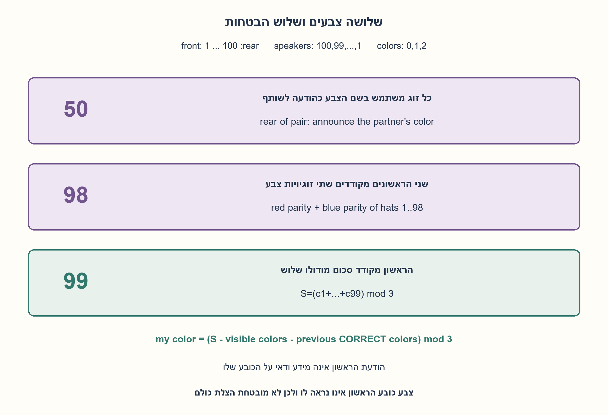
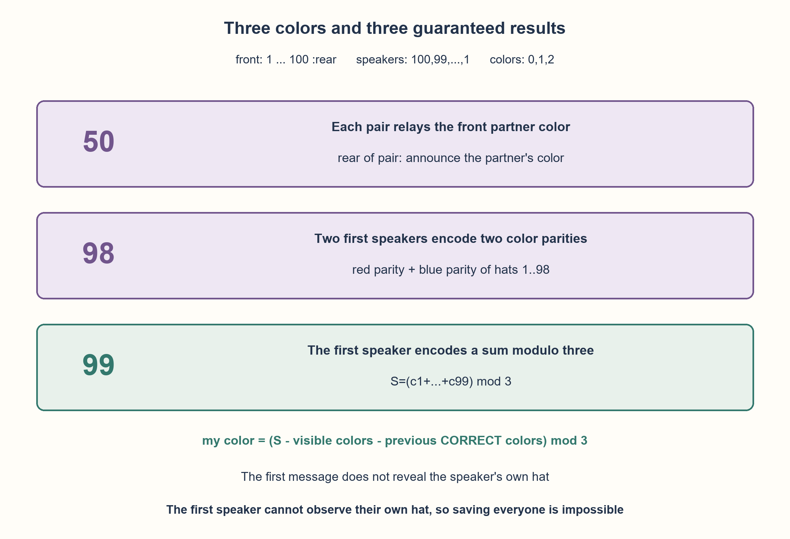

# PREP-096 — שלושה צבעים בטור — מבטיחים 50, 98 ואז 99

פתרון מוצע בסיוע AI; ביקורת אנושית ממתינה. הקושי לא כויל.

[צילום מקור פרטי](../sources/2026-10-30-batch40-20.png)

זו לא החידה הרגילה עם הגמדים. 100 גמדים עומדים בטור עם כובעים משלושה צבעים. כל גמד נשאל מה צבע כובעו ואם טעה הוא מת. כיצד ניתן להציל חצי מהגמדים? כיצד ניתן להציל את כולם מלבד שני האחרונים? כיצד ניתן להציל את כולם חוץ מהאחרון? המקור אומר גם שלכל גמד כובע בצבע אחר, ביטוי שאינו יכול לתאר 100 צבעים שונים כשיש רק שלושה.

## עברית

שלושה צבעים בטור — מבטיחים 50, 98 ואז 99

### הרחבה: 100 גמדים וכובעים בשלושה צבעים
100 גמדים עומדים בטור. לכל אחד כובע מאחד משלושה צבעים, עם חזרות מותרות; הביטוי בצילום שלכל אחד צבע אחר אינו יכול להתפרש כ־100 צבעים שונים מתוך שלושה. תכננו מראש אסטרטגיות שמבטיחות לפחות 50 תשובות נכונות, אחר כך לפחות 98, ולבסוף לפחות 99. הוכיחו את ההבטחות והאם אפשר להבטיח 100.

חוזה המידע: ממספרים מהקדמי 1 לאחורי 100. כל אחד רואה את כל הכובעים שלפניו בלבד, ללא כובעו; עונים לפי הסדר 100,99,...,1 וכל אחד שומע את כל התשובות הקודמות. כל תשובה היא שם צבע אחד מתוך שלושת השמות, ונחשבת לניחוש כובעו של הדובר; אין מסר נוסף דרך זמן, תנועה או צורת אמירה. שמות הצבעים יכולים לשמש קוד מוסכם. שני האחרונים במיקום הם 100,99, העונים ראשונים. אין מידע על מספר הכובעים מכל צבע.

1. אפשר להשתמש בתשובה שאינה בהכרח נכונה כדי לעזור למישהו שרואים לפני הדובר. איך עושים זאת בזוגות?
2. ל־98 האחרים אפשר להעביר שני ביטים על צבעים באמצעות שני הדוברים הראשונים. האם זוגיות של שני צבעים מספיקה לזהות את השלישי?
3. כדי להסתפק בדובר מסמן אחד, קודדו את שלושת הצבעים 0,1,2 והעבירו סכום מודולו 3. כל דובר אחר מחסר את הצבעים שהוא רואה ואת התשובות הקודמות שנכונות בוודאות.

### אותה תצפית, ערוץ מידע חזק יותר מהבינארי
נקרא לצבעים אדום, כחול ושלישי ונקודד אותם 0,1,2. הבחירה בשמות ובמספרים היא מוסכמה, לא נתון נוסף. נבדיל בין תשובה שהיא הודעת קוד ובין תשובה שכבר ידועה כצבע האמיתי. ההבטחות הן לפחות 50,98,99; המסמנים יכולים במקרה לנחש נכון גם בלי ודאות.

### א. מבטיחים 50 באמצעות זוגות
מחלקים לזוגות סמוכים:(100,99),(98,97),..., (2,1). הראשון בכל זוג אומר את צבע כובעו של בן הזוג שלפניו. בן הזוג שומע וחוזר על אותו צבע, ולכן הוא בוודאות צודק. נכונות הראשון אינה מובטחת. כך מובטחת תשובה נכונה אחת בכל אחד מ־50 הזוגות. כל אמירה נשארת שם צבע מותר.

### ב. מבטיחים 98 באמצעות שני מסמנים
דובר 100 אומר את זוגיות מספר האדומים בקרב 1..98 בלבד; הוא רואה גם את 99 אך מוציא אותו מהחישוב. דובר 99 אומר את זוגיות מספר הכחולים בקרב אותם 1..98. מקודדים זוגיות זוגית בשם אדום(0) ואי־זוגית בשם כחול(1). שתי התשובות הן הודעות, לא ידיעה על הכובעים של 100 ו־99.

כאשר מגיע תור i מתוך 98..1, הוא רואה את 1..i−1 ושמע את הצבעים הנכונים של 98..i+1. הוא מחסר מודולו 2 את זוגיויות הצבעים הידועים משתי ההודעות. נשארת התרומה של כובעו בלבד:

| שארית אדומים | שארית כחולים | צבע כובעו |
| --- | --- | --- |
| 1 | 0 | אדום |
| 0 | 1 | כחול |
| 0 | 0 | שלישי |

הזוג(1,1) אינו אפשרי כשהמידע והפרוטוקול תקינים, כי לכובע אחד צבע יחיד. בהתחלה 98 יכול להסיק, ואז נכונותו מאפשרת 97 להסיק, וכן הלאה. זו הוכחה באינדוקציה לכל 98. לא כוללים את שני כובעי המסמנים בספירות, שכן צבעיהם לא התגלו.

### ג. מבטיחים 99 באמצעות סכום מודולו 3
דובר 100 מחשב S=(c1+...+c99) mod 3 ואומר את שם הצבע בעל הקוד S. זו אחת משלוש הודעות אפשריות. כל דובר i אחר יודע את S, רואה את הכובעים 1..i−1, ושומע את הצבעים הנכונים של 99..i+1. לכן:

```text
ci = (S - sum(visible colors) - sum(previous CORRECT colors)) mod 3
```

שלוש הקבוצות, הנראים, הנכונים שכבר ענו וכובעו, מחלקות בדיוק את 1..99. אחרי חיסור הידועים נותר ci. עבור 99 אין תשובות נכונות קודמות ולכן הוא מסיק ישירות; ההוכחה ממשיכה באינדוקציה עד 1. את הודעת 100 משתמשים פעם אחת בתור S ולא מחסרים אותה שוב כאילו הייתה צבע כובעו האמיתי.

### למה לא 100 בוודאות?
שנו רק את כובע 100 בין שלושת הצבעים. כל מה שהוא רואה זהה, ואיש לא ענה לפניו. לכן תשובתו נשארת אותה תשובה בשלושה עולמות שאי אפשר להבחין ביניהם, והיא שגויה לפחות בשניים מהם. אין אסטרטגיה שמבטיחה את כולם בחוזה הזה.99 הוא חסם שניתן להשיג ולכן אופטימלי להבטחה במקרה הגרוע.

הקוד מקבל לכל פונקציית תשובה רק רשימת כובעים נראים ותשובות שנשמעו. רק הסימולטור יודע את כובע הדובר לצורך בדיקה. נבדקו כל 9,840 הסידורים באורכים 1..8, עוד 1,000 סידורים בני 100 ושלוש אפשרויות לכובע הראשון ב־243 תצפיות זהות. ההוכחה, ולא המדגם, מבססת את ההבטחה לכל 100.

```python
"""Replies receive only visible hats and earlier audible answers.

Color codes red=0, blue=1, third=2. Lists run front to rear. Speakers answer
rear to front. The simulator alone knows each speaker's true hat.
"""


def pair_reply(visible, heard):
    if len(heard) % 2 == 0:
        return visible[-1] if visible else 0
    return heard[-1]


def two_parities_reply(visible, heard):
    if not heard:
        # Exclude the second signaler, nearest in front of the first.
        return sum(color == 0 for color in visible[:-1]) % 2
    if len(heard) == 1:
        return sum(color == 1 for color in visible) % 2
    known = list(visible) + list(heard[2:])
    red = (heard[0] - sum(color == 0 for color in known)) % 2
    blue = (heard[1] - sum(color == 1 for color in known)) % 2
    return {(1, 0): 0, (0, 1): 1, (0, 0): 2}[red, blue]


def modulo_three_reply(visible, heard):
    if not heard:
        return sum(visible) % 3
    return (heard[0] - sum(visible) - sum(heard[1:])) % 3


def simulate(hats, strategy):
    hats = tuple(hats)
    if not hats or any(type(x) is not int or not 0 <= x < 3 for x in hats):
        raise ValueError("nonempty line of three-color hats required")
    if strategy == "two_parities" and len(hats) < 2:
        raise ValueError("two signalers require at least two people")
    methods = {"pairs": pair_reply, "two_parities": two_parities_reply, "modulo_three": modulo_three_reply}
    if strategy not in methods:
        raise ValueError("unknown strategy")
    heard, correct = [], []
    for index in range(len(hats) - 1, -1, -1):
        answer = methods[strategy](hats[:index], tuple(heard))
        heard.append(answer)
        correct.append(answer == hats[index])
    return tuple(heard), tuple(correct)
```




## English

Three colors in a line:guaranteeing 50,98, then 99

### Extension:100 dwarfs and three hat colors
Each of 100 dwarfs wears one of three hat colors, with repetition allowed. The source phrase saying everyone has a different color cannot literally mean 100 distinct colors chosen from three. Design prior-agreed strategies guaranteeing at least 50 correct answers, then at least 98, and finally at least 99. Prove each guarantee and whether 100 can be guaranteed.

Information contract:number front 1 to rear 100. Each sees all hats ahead but not their own or behind. Speakers answer 100,99,...,1 and hear every previous reply. Each reply is one of the three color names and is scored as that speaker own-hat guess;no extra timing, motion or vocal channel is allowed. Color names may carry agreed codes. The last two in line are 100 and 99, the first two speakers. No counts per color are supplied.

1. A reply that is not necessarily correct for its speaker can help someone visible ahead. How can adjacent pairs use that?
2. Two first speakers can send two bits about the remaining 98 hats. Can parities for two colors distinguish all three possibilities?
3. To use just one signaler, encode colors 0,1,2 and announce a sum modulo 3. Later speakers subtract visible colors and previous answers known to be correct.

### The same observations, with a three-symbol information channel
Call the colors red, blue and third, and encode them 0,1,2. Names and numbers are an agreed convention, not extra observations. Distinguish a coded message from a reply already known to equal its speaker true hat. Guarantees are at least 50,98,99;signalers may happen to guess correctly without certainty.

### A. Guarantee 50 with pairs
Pair adjacent people:(100,99),(98,97),..., (2,1). The first speaker of each pair announces the visible partner hat. The partner repeats that color and is guaranteed correct;the first is not. One guaranteed correct reply per pair gives 50. Every announcement remains an allowed color name.

### B. Guarantee 98 using two signalers
Speaker 100 announces the parity of red hats among 1..98 only, excluding visible speaker 99. Speaker 99 announces blue-hat parity over that same 1..98 set. Encode even parity as red(0), odd as blue(1). These two replies are information messages, not known true hats of 100/99.

Each later speaker i in 98..1 sees 1..i−1 and has heard correct colors of 98..i+1. Subtract those known red/blue parities modulo 2 from the two messages. Only the current hat contribution remains:

| Red remainder | Blue remainder | Own color |
| --- | --- | --- |
| 1 | 0 | Red |
| 0 | 1 | Blue |
| 0 | 0 | Third |

Pair(1,1) is impossible with a valid protocol because one hat has one color. Speaker 98 can infer first;that correct reply lets 97 infer, and induction continues through all 98. Do not include the signalers hats in the parity population:their actual colors were never learned.

### C. Guarantee 99 with a sum modulo 3
Speaker 100 computes S=(c1+...+c99) mod 3 and says the color name whose code is S. This is one of three possible messages. Each later speaker i knows S, sees hats 1..i−1, and hears correct colors 99..i+1. Therefore:

```text
ci = (S - sum(visible colors) - sum(previous CORRECT colors)) mod 3
```

Visible hats, already-correct speakers and the current hat partition exactly 1..99. Subtracting known contributions leaves ci. Speaker 99 starts with no earlier correct replies;induction proves every later reply correct. Use speaker 100 message once as S, not again as if it revealed that speaker actual hat.

### Why can 100 not be guaranteed?
Change only speaker 100 own hat among the three colors. Their visible information is unchanged, and nobody has spoken yet. Their answer is therefore unchanged across three indistinguishable worlds and wrong in at least two. No strategy guarantees everyone under this information contract. The achievable worst-case guarantee 99 is optimal.

Each code reply receives only visible hats and audible earlier answers. Only the simulator knows the current true hat for checking. All 9,840 assignments at lengths 1..8, another 1,000 hundred-person assignments and three first-hat alternatives in 243 identical-view classes were checked. The proof, not random sampling, establishes the guarantee for every 100-person assignment.

```python
"""Replies receive only visible hats and earlier audible answers.

Color codes red=0, blue=1, third=2. Lists run front to rear. Speakers answer
rear to front. The simulator alone knows each speaker's true hat.
"""


def pair_reply(visible, heard):
    if len(heard) % 2 == 0:
        return visible[-1] if visible else 0
    return heard[-1]


def two_parities_reply(visible, heard):
    if not heard:
        # Exclude the second signaler, nearest in front of the first.
        return sum(color == 0 for color in visible[:-1]) % 2
    if len(heard) == 1:
        return sum(color == 1 for color in visible) % 2
    known = list(visible) + list(heard[2:])
    red = (heard[0] - sum(color == 0 for color in known)) % 2
    blue = (heard[1] - sum(color == 1 for color in known)) % 2
    return {(1, 0): 0, (0, 1): 1, (0, 0): 2}[red, blue]


def modulo_three_reply(visible, heard):
    if not heard:
        return sum(visible) % 3
    return (heard[0] - sum(visible) - sum(heard[1:])) % 3


def simulate(hats, strategy):
    hats = tuple(hats)
    if not hats or any(type(x) is not int or not 0 <= x < 3 for x in hats):
        raise ValueError("nonempty line of three-color hats required")
    if strategy == "two_parities" and len(hats) < 2:
        raise ValueError("two signalers require at least two people")
    methods = {"pairs": pair_reply, "two_parities": two_parities_reply, "modulo_three": modulo_three_reply}
    if strategy not in methods:
        raise ValueError("unknown strategy")
    heard, correct = [], []
    for index in range(len(hats) - 1, -1, -1):
        answer = methods[strategy](hats[:index], tuple(heard))
        heard.append(answer)
        correct.append(answer == hats[index])
    return tuple(heard), tuple(correct)
```




## חומר משלים / Supporting material

```json
{
  "assumptions": {
    "he": [
      "סדר הדיבור מהאחורי לקדמי, וכל אחד רואה לפניו ושומע את כל הקודמים.",
      "צבעים חוזרים מתוך שלושה; אין ספירה ידועה מראש ואין ערוץ מסרים נוסף.",
      "מותר לתכנן קידוד מראש, אבל כל תשובה בפועל היא רק שם צבע.",
      "הדוברים הראשונים 100,99 הם המסמנים בענף 98;מוציאים את כובעיהם מחישוב הזוגיות."
    ],
    "en": [
      "Speakers go rear to front;each sees ahead and hears every earlier reply.",
      "Colors repeat among three, with no known counts and no extra communication channel.",
      "Prior code agreement is allowed, but each actual reply is just one color name.",
      "The first two speakers 100/99 signal in the 98 branch;exclude their hats from parity counts."
    ]
  },
  "optimality": {
    "he": "50 ו־98 הן הבטחות של האסטרטגיות המדורגות;99 אופטימלית למקרה הגרוע לפי אי־הבחנה של הראשון. קוד ההדגמה סורק מחדש מידע לכל דובר ולכן O(N²) זמן כולל ו־O(N) עקבות/קלט, עם מספר קבוע של צוברים לחישוב תשובה מעבר לרשימות. אין טענת מהירות פיזית או הצלת כולם בכל סידור.",
    "en": "The staged strategies guarantee 50 and 98;99 is worst-case optimal by first-speaker indistinguishability. The demonstration rescans information per speaker, so total time is O(N²) with O(N) input/trace storage and a constant number of accumulators beyond lists. No physical-speed or all-worlds 100-person guarantee is claimed."
  },
  "verification": {
    "he": "כל 9,840 סידורי שלושה צבעים באורכים 1..8 נבדקו בשלוש האסטרטגיות כשהן מוגדרות, וכן 1,000 סידורים בני 100. ב־243 מחלקות תצפית שונה רק כובע הראשון ונבדקה זהות הודעתו. פונקציות התשובה אינן מקבלות את הכובע שלהן. גבול 99 מוכח בנפרד.",
    "en": "Checked all 9,840 three-color worlds of lengths 1..8 with each applicable strategy, plus 1,000 hundred-person worlds. In 243 visible-view classes only the first speaker hat changes and the first message stays identical. Reply functions do not receive their own hat. The 99 upper bound is separately proved."
  },
  "edge_cases": {
    "he": [
      "הראשון עשוי לנחש נכון במקרה; ההבטחה אינה אומרת שבהכרח יטעה.",
      "ל־N=1 מובטחות אפס תשובות נכונות בענף הסכום.",
      "בענף שני המסמנים נדרשים לפחות שני אנשים.",
      "שלושה צבעים זהים לכל הכובעים אינם מפרים את ההנחות.",
      "צמד שאריות הזוגיות(1,1) מצביע על הפרת מודל או תקלה במידע, לא על צבע רביעי."
    ],
    "en": [
      "The first speaker can happen to guess correctly;the guarantee does not require a wrong answer.",
      "N=1 guarantees zero correct replies in the sum strategy.",
      "The two-signaler branch requires at least two people.",
      "All hats having the same color is allowed.",
      "Parity pair(1,1) means invalid model/history, not a fourth color."
    ]
  },
  "common_mistakes": {
    "he": [
      "להחיל XOR בינארי בלי להגדיר קוד לשלושה צבעים.",
      "להתייחס להודעת הראשון כאל צבעו האמיתי.",
      "לכלול את כובעי 100 ו־99 בספירת ענף 98 אף שצבעיהם אינם ידועים.",
      "לשנות סדר דיבור או להניח שמיעת תשובות בלי להצהיר עליה.",
      "לקרוא לכל הכובעים שונים למרות שיש 100 כובעים ורק שלושה צבעים."
    ],
    "en": [
      "Applying binary XOR without a three-color code.",
      "Treating the first message as that speaker true color.",
      "Including hats 100/99 in the 98-branch population although their colors are unknown.",
      "Changing speaking order or assuming audible replies without stating it.",
      "Calling all 100 hats distinct despite only three colors."
    ]
  },
  "interview_answer": {
    "he": "ל־50 אשתמש בזוגות:אחד אומר את כובע הבא והוא חוזר. ל־98 שני הראשונים מעבירים זוגיות אדום וכחול בקרב 98 האחרים. ל־99 הראשון אומר סכום קודי הצבעים מודולו 3 של 99 שלפניו;כל הבא מחסר נראים וצבעים נכונים שכבר נשמעו. את 100 אי אפשר להבטיח כי הראשון אינו רואה את כובעו.",
    "en": "For 50, use pairs:one says the next hat and the partner repeats it. For 98, two first speakers encode red/blue parities of the other 98. For 99, the first says the sum modulo 3 of visible color codes;each later speaker subtracts visible and already-correct colors. All 100 cannot be guaranteed because the first cannot observe their own hat."
  },
  "source_ambiguities": {
    "he": [
      "הצילום אינו מגדיר במלואו סדר, ראות וערוץ תשובות;חוזה הטור הוגדר בעריכה.",
      "הביטוי צבע אחר פורש כבחירה מתוך שלושה עם חזרות, והסתירה המילולית נשמרה בתיעוד.",
      "שיוכי Mellanox/NVIDIA מדווחים בצילום ולא אומתו עצמאית."
    ],
    "en": [
      "Speaking order, visibility and reply channel are not fully specified;the line contract is editorially explicit.",
      "Different color is interpreted as a choice among three with repetition;the literal contradiction is documented.",
      "Mellanox/NVIDIA attribution is source-reported, not independently verified."
    ]
  },
  "solution_extensions": {
    "he": [
      {
        "question": "מה משתנה עבור q צבעים ושמות צבע מותרים?",
        "answer_direction": "קודדו 0..q−1 והשתמשו בסכום מודולוq. הדובר הראשון מעביר אחת מ־q שאריות ושאר הדוברים משחזרים צבע אחד;N−1 עדיין חסם ההבטחה.",
        "principle": "גודל אלפבית התשובה קובע את ערוץ סכום הביקורת."
      }
    ],
    "en": [
      {
        "question": "What changes for q colors with q permitted color names?",
        "answer_direction": "Encode 0..q−1 and use a sum moduloq. The first speaker sends one of q residues and each later speaker recovers one color;N−1 remains the guarantee bound.",
        "principle": "The reply alphabet provides the checksum channel."
      }
    ]
  }
}
```
