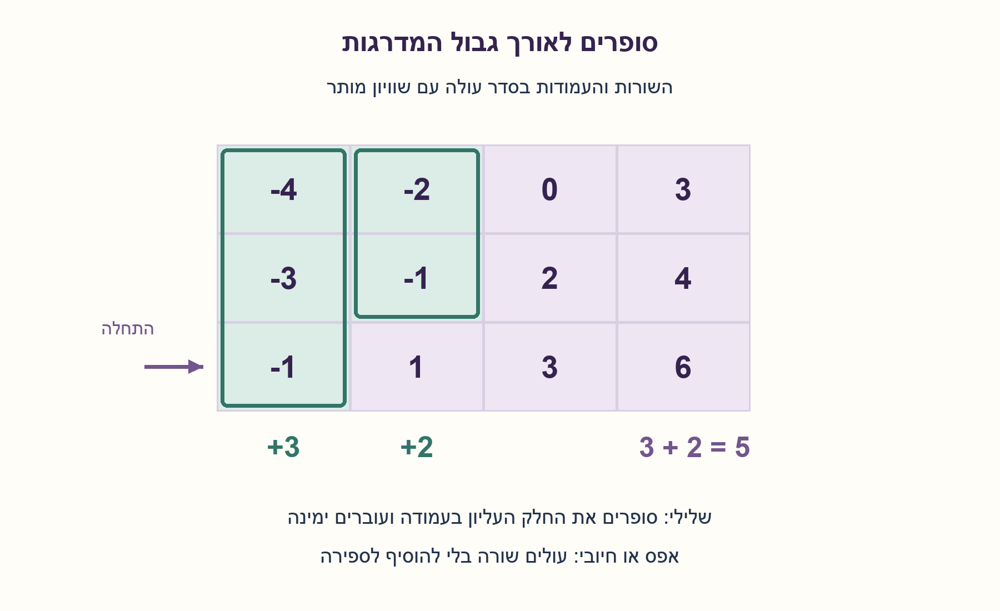
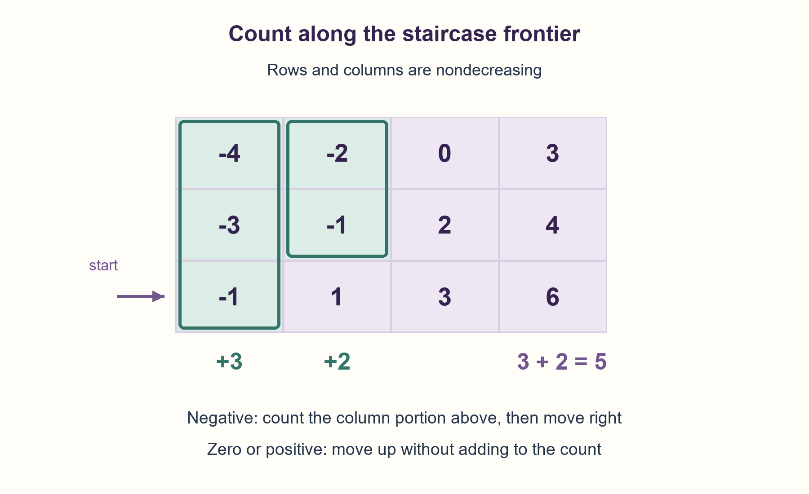

# PREP-097 — ספירת שליליים במטריצה שממוינת בשני הצירים

פתרון מוצע בסיוע AI; ביקורת מקצועית אנושית ממתינה. הקושי לא כויל.

## מקור

[צילום המקור](../sources/2026-10-24-batch20-02.png)

נתונה מטריצה כאשר העמודות וגם השורות ממויינות (משמאל לימין). צריך למצוא כמות מספרים שליליים במטריצה (בצורה יעילה מבלי לעבור על כל המטריצה).

שיוכי החברות בצילום הם דיווח לא מאומת: NVIDIA, Cisco.

## ספירת שליליים במטריצה שממוינת בשני הצירים

נתונה מטריצה מלבנית של מספרים שלמים. כל שורה ממוינת בסדר לא יורד משמאל לימין וכל עמודה בסדר לא יורד מלמעלה למטה. החזירו את מספר האיברים השליליים, בלי לעבור על כל התאים. הסבירו אלגוריתם יעיל, נכונות ועלות.

הבהרות שנוספו למקור: כיווני המיון הוגדרו במפורש, חזרות ואפסים מותרים, ואפס אינו שלילי. מטריצה ללא שורות או עם אפס עמודות מחזירה 0. הקלט אינו משתנה. מלבניות נבדקת; המיון ותחום השלמים הם הבטחות קלט, ובדיקתם המלאה אינה חלק מהאלגוריתם. גישה לתא ועלות השוואה נחשבות פעולות מילה.

### שלושה רמזים

1. מה מאפשר ערך בפינה להסיק על כל האיברים שמעליו או מימינו?
2. התחילו בפינה השמאלית התחתונה. אם היא שלילית, כל מה שמעליה באותה עמודה שלילי; אם אינה שלילית, גם יתר השורה לימינה אינם שליליים.
3. שמרו שורה r ועמודה c: בשלילי הוסיפו r+1 ועברו ימינה, ובאחרת עברו שורה למעלה. עצרו כשיוצאים מגבולות המטריצה.

### הצעה לפתרון

### הרעיון: תא אחד מסכם חלק מהמלבן שנותר
המיון יוצר גבול דמוי מדרגות בין השליליים שבצד שמאל־עליון לבין הערכים שאינם שליליים. במקום לבדוק כל תא, הולכים לאורך הגבול. מתחילים בשורה התחתונה ובעמודה השמאלית. המלבן שטרם הוכרע הוא שורות 0..r ועמודות c..C−1.

אם matrix[r][c] שלילי, כל r+1 התאים שמעליו ובכללם הוא עצמו באותה עמודה שליליים: העמודה לא יורדת כלפי מטה. סופרים אותם יחד ועוברים לעמודה הבאה. אם הערך 0 או חיובי, כל התאים שמימינו באותה שורה אינם שליליים: השורה לא יורדת ימינה. אפשר לדלג על יתר השורה ולעלות.

### דוגמה מפורשת
```text
[-4, -2, 0, 3]
[-3, -1, 2, 4]
[-1,  1, 3, 6]
```
בפינה השמאלית התחתונה נמצא ‎-1: מוסיפים 3 עבור העמודה הראשונה. עוברים ימינה ל־1, ולכן עולים אל ‎-1 בשורה האמצעית. מוסיפים עוד 2 עבור שני התאים העליונים בעמודה השנייה. כעת 2 ולאחריו 0 גורמים לעלייה עד שיוצאים. התוצאה היא 5. אין סופרים אפס כשלילי.

### למה לא מפספסים ולא סופרים פעמיים?
לפני כל צעד, כל תא שטרם סווג נמצא במלבן שנותר. צעד ימינה מסווג עמודה שלמה מתוכו כשלילית, וצעד למעלה מסווג שורה מתוכו כלא־שלילית. שני המקרים מצמצמים את המלבן בלי להשאיר חלק לא מוכרע מאחור. עמודה נספרת פעם אחת בלבד; בסיום המלבן ריק וכל השליליים נספרו.

### עלות וההנחות שמאפשרות אותה
בכל בדיקת תא השורה יורדת באחד או העמודה עולה באחד. יש לכל היותר R+C−1 בדיקות עבור מטריצה לא ריקה, ולכן זמן O(R+C) ומספר קבוע של משתנים — O(1) מילים נוספות. בדיקת אורכי השורות עולה O(R) ואינה משנה את החסם. אין סריקה מלאה לבדיקת המיון, שהייתה עולה O(RC); הקלט מבטיח אותו. כאשר אחד הממדים הוא 1, גבול המדרגות עשוי לעבור על כל השורה או העמודה, ואין הבטחה לבדוק פחות מכל התאים בכל גודל. בשלמים שרירותיים עלות ההשוואה תלויה גם באורך הביטים.

חלופה פשוטה היא חיפוש בינארי אחר האיבר הראשון שאינו שלילי בכל שורה, בעלות O(R log C). היא אינה משתמשת במיון העמודות. אין טענה ש־O(R+C) הוא החסם הטוב ביותר לכל יחס ממדים; לדוגמה, בשורה אחת חיפוש בינארי יעיל יותר.

```python
"""Count negatives in a rectangular, row/column nondecreasing matrix.

Sortedness and exact integer entries are preconditions, not scanned for validation.
The input is not mutated. Ragged rows are rejected in O(rows) time.
"""


def count_negatives(matrix):
    if not matrix:
        return 0
    columns = len(matrix[0])
    if any(len(row) != columns for row in matrix):
        raise ValueError("matrix must be rectangular")
    row, column, total = len(matrix) - 1, 0, 0
    while row >= 0 and column < columns:
        if matrix[row][column] < 0:
            total += row + 1
            column += 1
        else:
            row -= 1
    return total
```



## Count negatives in a row-and-column-sorted matrix

Given a rectangular integer matrix, each row is nondecreasing left to right and each column is nondecreasing top to bottom. Return the number of negative entries without visiting every cell. Explain an efficient algorithm, correctness and cost.

Added clarifications: both sorting directions are explicit; duplicates and zeros are allowed, and zero is not negative. No rows or zero columns returns 0. Do not modify input. Rectangular shape is checked; integer entries and sortedness are preconditions, not fully validated by the algorithm. Cell access and comparison use a word-operation model.

### Three hints

1. What does a corner value imply about entries above it or to its right?
2. Start at bottom left. A negative there makes every entry above it in that column negative; a nonnegative value makes the rest of its row to the right nonnegative.
3. Keep row r and column c: on a negative add r+1 and move right; otherwise move up. Stop after leaving the matrix.

### Proposed solution

### One cell summarizes part of the remaining rectangle
Sorted order creates a staircase boundary between the negative upper-left region and nonnegative entries. Walk that boundary instead of visiting every cell. Start at the bottom row and leftmost column. The unclassified rectangle consists of rows 0..r and columns c..C−1.

If matrix[r][c] is negative, all r+1 entries above it, including itself, in that column are negative: values do not decrease downward. Count that entire column portion and move right. If the value is zero or positive, every entry to its right in the row is nonnegative: values do not decrease rightward. Discard the remaining row and move up.

### Worked example
```text
[-4, -2, 0, 3]
[-3, -1, 2, 4]
[-1,  1, 3, 6]
```
The bottom-left value is -1: add three for the first column. Move right to 1, then up to -1 in the middle row. Add two for the upper two entries in column two. The next examined values, 2 and then 0, move upward until leaving the matrix. The answer is five. Zero is not negative.

### Why nothing is missed or counted twice
Before each step every unclassified cell lies in the remaining rectangle. Moving right classifies one whole remaining column portion as negative; moving up classifies one remaining row portion as nonnegative. Either move shrinks the rectangle without leaving unclassified entries behind. Each counted column portion is removed once. When the rectangle is empty, all negatives have been counted.

### Cost and its preconditions
Each inspected cell decrements the row or increments the column. A nonempty R×C matrix requires at most R+C−1 cell tests, giving O(R+C) time and O(1) auxiliary machine words. Checking row lengths costs O(R), preserving this bound. Sortedness is a precondition: fully validating it would cost O(RC). With one row or column, this walk may inspect every entry; it does not promise fewer than all cells for every shape. Arbitrary-width integers add bit-length-dependent comparison cost.

A simpler alternative binary-searches the first nonnegative entry in each row in O(R log C), without using column order. O(R+C) is not claimed optimal for every aspect ratio: for one row, binary search can be faster.

```python
"""Count negatives in a rectangular, row/column nondecreasing matrix.

Sortedness and exact integer entries are preconditions, not scanned for validation.
The input is not mutated. Ragged rows are rejected in O(rows) time.
"""


def count_negatives(matrix):
    if not matrix:
        return 0
    columns = len(matrix[0])
    if any(len(row) != columns for row in matrix):
        raise ValueError("matrix must be rectangular")
    row, column, total = len(matrix) - 1, 0, 0
    while row >= 0 and column < columns:
        if matrix[row][column] < 0:
            total += row + 1
            column += 1
        else:
            row -= 1
    return total
```



## חומר משלים / Supporting material

```json
{
  "assumptions": {
    "he": [
      "מטריצה מלבנית, שורות לא יורדות ימינה ועמודות לא יורדות מטה.",
      "קלט שלמים מדויק וממוין מובטח; אפס אינו שלילי; הקלט אינו משתנה.",
      "ריק מחזיר 0; שורות באורכים שונים נפסלות."
    ],
    "en": [
      "Rectangular matrix; rows nondecreasing rightward and columns nondecreasing downward.",
      "Exact integer and sortedness promises; zero is not negative; input is read-only.",
      "Empty shapes return 0; ragged rows are rejected."
    ]
  },
  "optimality": {
    "he": "סריקת הגבול O(R+C) וב־O(1) מילים; אין טענת אופטימליות לכל יחס ממדים או לחישוב על שלמים בלתי חסומים.",
    "en": "Boundary walk: O(R+C) time, O(1) words; no optimality claim for every aspect ratio or unbounded-integer arithmetic."
  },
  "edge_cases": {
    "he": [
      "אין שורות, שורות ריקות, תא יחיד, הכול שלילי או שום שלילי.",
      "אפסים וחזרות על הגבול; שורה אחת או עמודה אחת.",
      "אין להפעיל את הנוסחה על כיווני מיון אחרים בלי להתאים את הפינה."
    ],
    "en": [
      "No rows, empty rows, singleton, all-negative and no-negative matrices.",
      "Zeros and repeated boundary values; one row or column.",
      "Other sorting directions require a corresponding corner adjustment."
    ]
  },
  "common_mistakes": {
    "he": [
      "להוסיף את מספר השורה במקום r+1 באינדוקס מאפס.",
      "לספור אפס כשלילי או לבחור פינה שאינה מאפשרת לפסול קטע.",
      "להבטיח O(R+C) ובמקביל לבדוק את מיון כל התאים."
    ],
    "en": [
      "Adding r instead of r+1 with zero-based indexing.",
      "Counting zero or choosing a corner that cannot eliminate a portion.",
      "Claiming O(R+C) while fully validating every cell for sortedness."
    ]
  },
  "interview_answer": {
    "he": "אתחיל בשמאל למטה. בשלילי אוסיף את כל העמודה שמעליו ואעבור ימינה; באפס או חיובי אדלג על יתר השורה ואעלה. בכל צעד שורה או עמודה יוצאת מהמלבן, ולכן O(R+C) זמן ו־O(1) משתנים.",
    "en": "Start bottom left. For a negative, count its entire remaining column above and move right; otherwise discard the row remainder and move up. Every step removes a row or column portion: O(R+C) time and O(1) state."
  },
  "source_ambiguities": {
    "he": "המקור אומר שגם השורות וגם העמודות ממוינות אך אינו מגדיר בבירור את כיוון העמודות. כיוונים לא יורדים, מלבניות, קלט שלם ודרישת אי־שינוי הם הבהרות עריכה. תגית hardware נשמרת כתגית מקור; הבעיה אלגוריתמית.",
    "en": "The source says rows and columns are sorted without clearly specifying the column direction. Nondecreasing directions, rectangular shape, integer input and immutability are editorial clarifications. Hardware remains a source tag; the task is algorithmic."
  },
  "verification": {
    "he": "הקוד בפועל עבר 337 מטריצות ממוינות ממצות עד גודל 3×3 מעל ‎{-1,0,1}, מול אורקל שסופר בכל התאים. נבדקו גם ריק, אי־שינוי, שלמים גדולים ודחיית מבנה לא מלבני. אין אימות חומרה או מדידת ביצועים.",
    "en": "The actual implementation passed 337 exhaustive monotone matrices up to 3×3 over {-1,0,1}, compared with a full-cell counting oracle. Also checked empty shapes, immutability, large integers and ragged rejection. No hardware verification or performance benchmark."
  },
  "relationship_note": {
    "he": "שאלה חדשה; חיפוש בינארי בשורה הוא חלופה קשורה, אך כאן המיון בשני הצירים מאפשר לעבור על גבול משותף.",
    "en": "New question. Row-wise binary search is a related alternative; the two-axis ordering supports a shared boundary walk."
  },
  "solution_extensions": {
    "he": {
      "question": "איך סופרים איברים הקטנים מסף t במקום שליליים?",
      "direction": "מחליפים את ההשוואה לערך קטן מ־t. אותו נימוק מיון נשמר; לשאלה קטנים או שווים יש להתאים את תנאי השוויון.",
      "status": "מוכן בתוכן, לא מחובר לתור המשך."
    },
    "en": {
      "question": "How would you count entries below threshold t rather than below zero?",
      "direction": "Replace the comparison by value<t. The same sorted-order proof holds; counting at most t requires changing the equality boundary.",
      "status": "Prepared in content, not connected to the follow-up queue."
    }
  }
}
```
