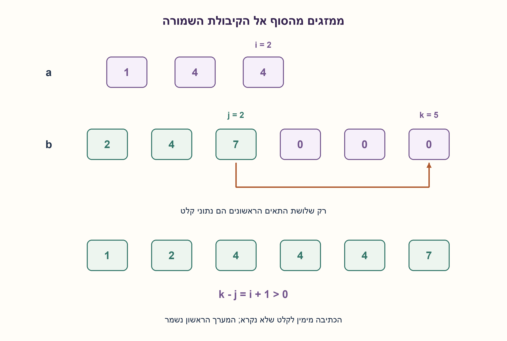
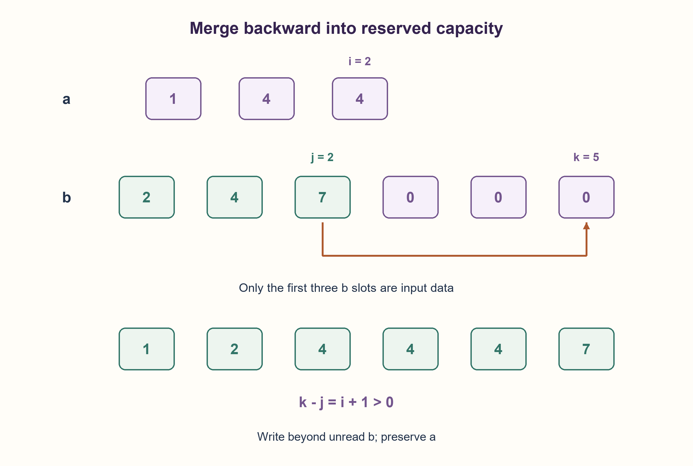

# PREP-098 — מיזוג שני מערכים ממוינים — בלי לאבד חזרות

פתרון מוצע בסיוע AI; ביקורת מקצועית אנושית ממתינה.

## נוסח ערוך

### וריאציה נוספת — מיזוג בתוך קיבולת שמורה
נתון a ממוין בסדר לא יורד ובאורך n, ו־b באורך m+n: רק m האיברים הראשונים הם קלט ממוין, ואחריהם n תאי קיבולת פנויים המסומנים באפס. מזגו את כל המופעים לתוך b ללא מערך עזר, תוך שימור a.

הבהרות: m נתון במפורש; אפס יכול להיות גם ערך נתון אמיתי, ולכן אין לחפש אפס כדי לגלות את סוף הקלט. גם שליליים וחזרות מותרים. המערכים אינם חופפים, והמקומות השמורים אינם נתונים. b נשאר אותו אובייקט באורך m+n. המיון והטיפוסים מובטחים; המימוש בודק קיבולת ו־m, אך אינו מאמת מיון. הגרסה המקורית שמחזירה מערך חדש ואינה משנה את שני הקלטים נשמרה בנפרד.

### שלושה רמזים לסעיף החדש

1. איזו כתיבה בתחילת b עלולה לדרוס איבר שעוד לא קראתם?
2. השטח הפנוי נמצא בסוף, והערך הגדול ביותר שנותר מתאים למקום האחרון שעוד לא מולא.
3. שמרו אינדקס אחרון ב־a, אינדקס אחרון בקידומת התקפה שלb ואינדקס כתיבה בסופו. מלאו מהגדול לקטן; כש־a נגמר, קידומתb שנותרה כבר במקומה.

### הצעה לפתרון

### ממלאים מהסוף כדי לא לדרוס קלט
כתיבה קדימה עלולה להחליף את b[0] לפני שנקרא. בסוף b כבר יש קיבולת פנויה, ולכן נבנה את התוצאה מהגדול לקטן. נאתחל i=n−1,j=m−1,k=m+n−1. נשווה את a[i] ל־b[j] אם j עדיין תקף; הגדול ייכתב ב־b[k], ורק האינדקס שלו יירד. k יורד בכל כתיבה. כאשר b נגמר, נמשיך להעתיק את a. כש־a נגמר אפשר לעצור: שאר הקידומת של b כבר במקומה.

לדוגמה a=[1,4,4] ו־b=[2,4,7,0,0,0],m=3. ראשית נעתיק את7 לסוף, אחריו את4 המתאים, ונמשיך לאחור עד b=[1,2,4,4,4,7]. שלוש האפסים האחרונים היו רק מקום שמור; במיזוג של a=[0] ו־b=[0,0],m=1, שני אפסי הקלט האמיתיים נשמרים. אין בדיקה של ערך האפס כדי לזהות סוף.

האינווריאנט הוא שהסיומת שכבר נכתבה ממוינת ומכילה בדיוק את המופעים הגדולים ביותר שכבר נצרכו. לפני כל כתיבה, k−j=i+1>0 כל עוד נשאר a. לכן היעד נמצא מימין לכל הקידומת שעוד לא נקראה של b, ואינו דורס אותה. a אינו יעד כתיבה ואינו חופף ל־b. בחירת הגדול הבא משמרת את הסיומת; כש־a נגמר מתקיים k=j והיתרה של b אינה צריכה לזוז. זה מוכיח סדר, ריבוי ושמירת הקלט שנותר.

בשוויון הקוד בוחר את b עבור המקום הימני, כך שהופעותa השוות קודמות להופעותb השוות בתוצאה — אותה מדיניות סדר כמו בגרסה המקורית. בטיפוסי int אין סימון שמבדיל מופעים שווים; הרחבה לרשומות תדרוש השוואת מפתחות מפורשת.

זמן O(m+n) במקרה הגרוע ו־O(1) מילות עזר, ללא פלט חדש: b הוא האחסון הקיים. אין טענת Θ(m+n) לכל מקרה; אם a ריק אפשר לעצור מיד. אם הקידומת התקפה של b ריקה, מעתיקים את a אליה. אי אפשר להבטיח שמירת שני הקלטים בגרסה הזאת, כי b נדרס בכוונה; זו וריאציה נוספת ולא החלפת החוזה המקורי.

כל3,136 זוגות מערכים ממוינים קטנים ועוד200 זוגות מדגמיים הושוו למיון חיבור הקלטים באורקל עצמאי. נבדקו זהותb, אי־שינויa, אורכים אפסיים, שליליים, אפסים אמיתיים וכפילויות. מיון מופיע באורקל בלבד, לא בפתרון.

```python
"""Merge a into b's valid sorted prefix; b has exactly len(a) reserved slots.

Integer sortedness is promised. Real zeros/negatives/duplicates are valid;
padding contents are ignored. Arrays do not overlap. a remains unchanged.
"""


def merge_into_right(a, b, m):
    if type(m) is not int or m < 0 or len(b) != m + len(a) or a is b:
        raise ValueError("require distinct arrays, valid prefix m and exact capacity m+len(a)")
    i, j, write = len(a) - 1, m - 1, len(b) - 1
    while i >= 0:
        if j >= 0 and b[j] >= a[i]:
            b[write] = b[j]
            j -= 1
        else:
            b[write] = a[i]
            i -= 1
        write -= 1
    return b
```




## Edited prompt

### Additional variant — merge into reserved capacity
Array a is nondecreasing with length n; b has length m+n, with only its first m entries containing sorted input and its last n slots reserved, shown as zeros. Merge every occurrence into b without an auxiliary array, preserving a.

m is explicit. Zero may also be real input, so never infer the input boundary by searching for zero. Negatives and duplicates are valid. Arrays do not overlap; reserved slots are not data. b retains identity and length m+n. Sortedness/types are promises; implementation checks capacity/m, not sorting. The original fresh-output variant that preserves both inputs is retained separately.

### Three hints for the new part

1. Which write at the front of b could overwrite an unread entry?
2. Free space is at the end; the largest remaining value belongs in the last unfilled slot.
3. Track the last unread a value, last valid-prefix b value and last destination slot. Fill largest first; after a ends, the remaining b prefix is already in place.

### Proposed solution

### Fill from the end to avoid overwriting input
Forward writes can overwrite b[0] before it is read. Reserved capacity is at the end, so construct largest-to-smallest. Start i=n−1,j=m−1,k=m+n−1. Compare a[i] with b[j] when j exists; write the larger into b[k] and decrement only its source index. Decrement k each write. If b runs out, copy remaining a. If a runs out, stop: the remaining b prefix is already positioned correctly.

For a=[1,4,4],b=[2,4,7,0,0,0],m=3, move7 to the end, then the appropriate4 and continue backward to[1,2,4,4,4,7]. The three trailing zeros were capacity only. For a=[0],b=[0,0],m=1, both real zeros survive. No zero-value test determines a boundary.

Invariant: the written suffix is sorted and contains precisely the largest consumed occurrences. Before each write, k−j=i+1>0 while any a remains. Thus destination lies beyond every unread b-prefix position, protecting it. a is never written and does not overlap b. Selecting the largest remaining value preserves the suffix invariant. Once a ends,k=j; leftover b needs no copying. This proves order, multiplicity and unread-input safety.

On equality the code takes b for the rightmost slot, so equal a occurrences precede equal b occurrences in the result, matching the original variant’s policy. Equal int occurrences are numerically indistinguishable; a record extension needs an explicit key comparison.

Worst-case time O(m+n), O(1) auxiliary words and no fresh output array: b is existing storage. This is not Θ(m+n) on every input; empty a permits immediate completion. An empty valid b prefix is filled from a. This variant deliberately overwrites b, so it does not claim to preserve both inputs or replace the original contract.

All 3,136 small sorted-array pairs plus 200 seeded pairs matched independently sorted concatenation. Tests cover b identity,a preservation, empty sides, negatives, real zeros and duplicates. Sorting appears only in the oracle, never in the implementation.

```python
"""Merge a into b's valid sorted prefix; b has exactly len(a) reserved slots.

Integer sortedness is promised. Real zeros/negatives/duplicates are valid;
padding contents are ignored. Arrays do not overlap. a remains unchanged.
"""


def merge_into_right(a, b, m):
    if type(m) is not int or m < 0 or len(b) != m + len(a) or a is b:
        raise ValueError("require distinct arrays, valid prefix m and exact capacity m+len(a)")
    i, j, write = len(a) - 1, m - 1, len(b) - 1
    while i >= 0:
        if j >= 0 and b[j] >= a[i]:
            b[write] = b[j]
            j -= 1
        else:
            b[write] = a[i]
            i -= 1
        write -= 1
    return b
```




## מקור וחומר משלים / Source and supporting material

[צילום מקור פרטי](../sources/2026-10-25-batch20-15.png)

Given two ordered arrays: a of size n and b of size m+n (m elements+n zeros at the end). Merge the two arrays in one array of size m+n without using extra space.

```json
{
  "assumptions": {
    "he": [
      "הקידומת b[:m] בלבד היא קלט; שארn התאים קיבולת, גם כשאפס הוא נתון אמיתי.",
      "קלטים ממוינים, ללא חפיפה; מותר לכתובb וחובה לשמרa."
    ],
    "en": [
      "Only b[:m] is input; remaining n slots are capacity even when zero is real data.",
      "Sorted disjoint inputs; b may be written while a must be preserved."
    ]
  },
  "optimality": {
    "he": "O(m+n) זמן במקרה הגרוע, O(1) מילות עזר וזהותb נשמרת. a ריק יכול להסתיים מיד; אין פלט חדש או מיון.",
    "en": "Worst-case O(m+n), O(1) auxiliary words, retained b identity. Empty a may finish immediately; no fresh output or sorting."
  },
  "edge_cases": {
    "he": [
      "a ריק, קידומתb ריקה, שניהם ריקים.",
      "אפסים אמיתיים, שליליים, שוויונות רבים; m ידוע וקיבולת מדויקת."
    ],
    "en": [
      "Empty a/b-prefix/both.",
      "Real zeros, negatives, many ties; explicit m and exact capacity."
    ]
  },
  "common_mistakes": {
    "he": [
      "להסיק את m מהאפס הראשון.",
      "לכתוב מהתחלה ולדרוס קלט או לדלג על שני אינדקסים בשוויון.",
      "להשתמש בחיתוך או מיון כפתרון בלי לחשב זיכרון, או לטעון שגםb נשמר."
    ],
    "en": [
      "Inferring m from the first zero.",
      "Overwriting unread input forward or skipping both equal heads.",
      "Hiding slice/sort storage or claiming b is preserved."
    ]
  },
  "interview_answer": {
    "he": "אמזג לאחור לתוךb: הגדול בין שני הקצוות נכנס למקום הימני הפנוי. היעד תמיד מימין לקידומתb שטרם נקראה. a נשמר; אם הוא נגמר, שארb כבר במקומו. זמן לינארי ועזר קבוע במילים.",
    "en": "Merge backward into b: put the larger remaining end value in the rightmost destination. Destination remains beyond unread b. Preserve a; stop when a ends. Linear worst-case time, constant auxiliary words."
  },
  "source_ambiguities": {
    "he": "הצילום החדש אוסר מקום נוסף ומספק קיבולת ב־b, בניגוד למערך חדש בגרסה המקורית. ממוינת היא הקידומת התקפה, לא האפסים השמורים. ההבדל נשמר כסעיף נפרד תחת098.",
    "en": "New source forbids extra space and provides b capacity, unlike the original fresh output. Only the valid prefix is sorted input, not padding. Retained as a separate098 part."
  },
  "verification": {
    "he": "3,136 זוגות ממצים ועוד200 דגימות מול מיון עצמאי; נשמרו זהותb ו־a, כולל אפסים וכפילויות.",
    "en": "3,136 exhaustive pairs plus 200 seeded pairs versus independent sorting; b identity/a preservation, zeros and duplicates checked."
  },
  "solution_extensions": {
    "he": {
      "question": "מה משתנה אם המערכים חולקים זיכרון?",
      "direction": "כתיבה עלולה להשחית גם אתa שלא נקרא. יש להגדיר בדיוק את החפיפה ולתכנן אלגוריתם אחר או להתיר העתקה; ההוכחה הנוכחית אינה חלה.",
      "status": "מוכן בחומר משלים בלבד; תור הרמזים המקורי נשמר."
    },
    "en": {
      "question": "What changes with overlapping memory?",
      "direction": "Writing can corrupt unread a as well. Specify overlap and redesign or permit copying; the current safety proof does not apply.",
      "status": "Supplemental only; original hint queue retained."
    }
  }
}
```
