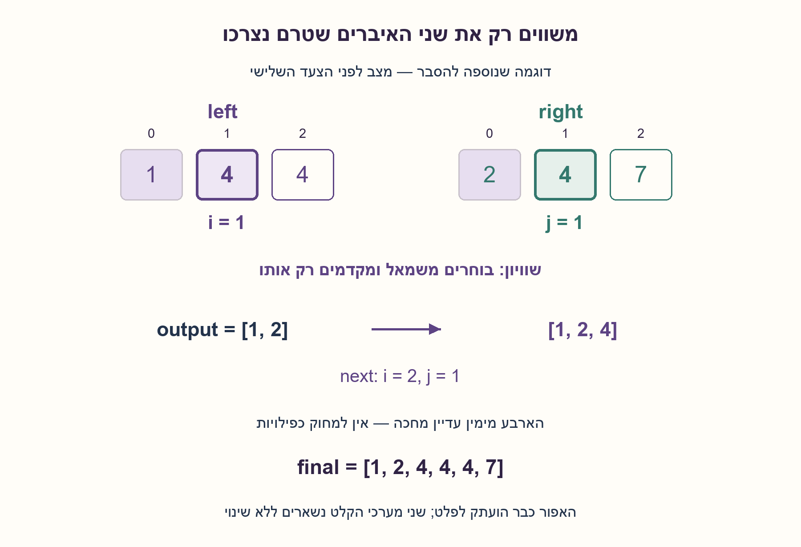
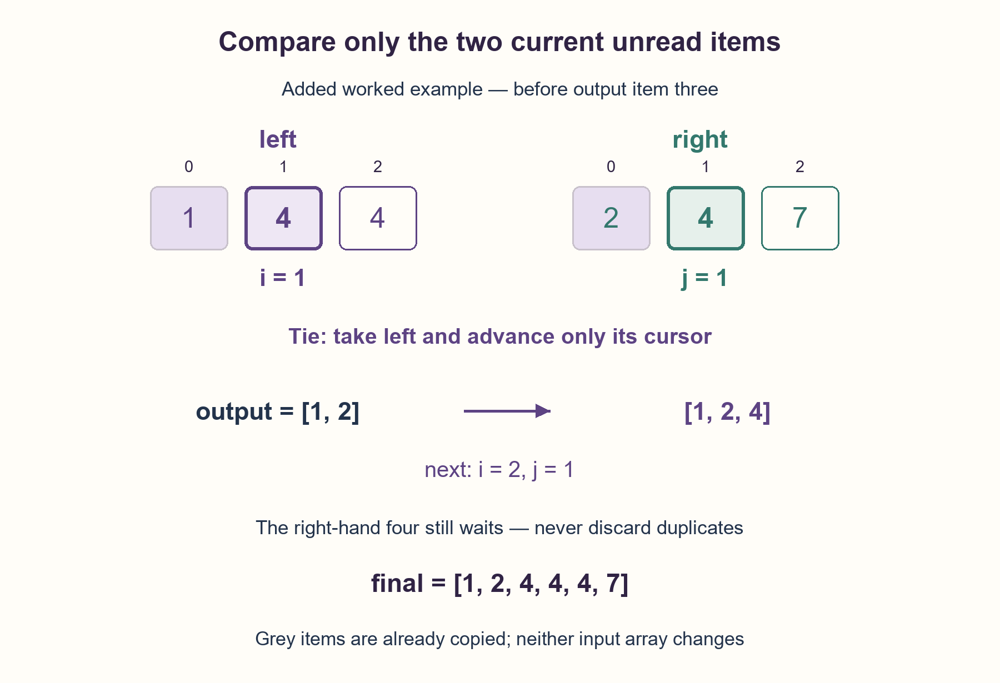

# PREP-098 — מיזוג שני מערכים ממוינים — בלי לאבד חזרות

פתרון מוצע בסיוע AI. ביקורת מקצועית ותרגום אנושיים ממתינים. קושי אינו מכויל.

## מקור שמור ללא שינוי

[צילום מקור](../sources/2026-10-24-batch20-05.png)

merge 2 sorted array

שיוך NVIDIA מדווח בצילום בלבד ולא אומת עצמאית.

## נוסח עברי

מיזוג שני מערכים ממוינים — בלי לאבד חזרות

נתונים שני מערכים של מספרים שלמים, left באורך n ו־right באורך m. כל אחד ממוין בסדר לא יורד, וחזרות מותרות. החזירו מערך חדש שמכיל את כל n+m המופעים משני הקלטים, בסדר לא יורד, בלי לשנות אותם ובלי לקרוא למיון. לדוגמה, [1,4,4] ו־[2,4,7] מתמזגים ל־[1,2,4,4,4,7].

הבהרות שנוספו לעריכה: המקור אומר רק ״merge 2 sorted array״. כאן נבחרו קלטי שלמים ממוינים, פלט חדש, שימור ריבוי ואי־שינוי קלט; אין דרישה למיזוג במקום או מקום פנוי בקצה מערך. בשוויון בחרו את המופע מהמערך השמאלי תחילה, כדי לקבל כלל יציב ועקבי. טפלו במערכים ריקים, הסבירו את הנכונות ונתחו זמן, זיכרון פלט וזיכרון עזר בנפרד.

### רמזים

1. האיבר הקטן ביותר שנותר בכל מערך נמצא בתחילת החלק שעוד לא קראנו. אילו שני איברים מספיק להשוות כדי לבחור את הבא בפלט?
2. החזיקו אינדקס נפרד לכל מערך. העתיקו את הקטן מבין שני האיברים הנוכחיים וקדמו רק את האינדקס שממנו הוא נלקח. בשוויון לא מוחקים אף מופע.
3. כל עוד לשניהם יש איבר משווים, ובשוויון בוחרים left. כשאחד נגמר, מעתיקים את כל מה שנותר בשני. כל צעד צורך מופע אחד בדיוק, ולכן נשמרים כל n+m האיברים.

### הצעה לפתרון

### הרעיון: בכל מערך מסתכלים רק על הראשון שעדיין מחכה
אין צורך לחפש שוב את המינימום בכל הקלט. מכיוון שכל מערך כבר ממוין, האיבר הראשון שטרם הועתק הוא הקטן ביותר שנותר בו. לכן הקטן מבין שני הראשונים הוא הקטן ביותר שנותר בשני המערכים יחד.

נשתמש בשני אינדקסים, i ו־j, שמתחילים באפס, וברשימת פלט חדשה. אם left[i]<=right[j], נוסיף את left[i] ונקדם רק את i. אחרת נוסיף את right[j] ונקדם רק את j. בשוויון אנו בוחרים משמאל; המופע הימני נשאר זמין לצעד מאוחר יותר.

### דוגמה: למה שלושת מופעי ארבע נשמרים?
עבור left=[1,4,4] ו־right=[2,4,7]:

| ראש משמאל | ראש מימין | מה מעתיקים? | הפלט עד עכשיו |
| --- | --- | --- | --- |
| 1 | 2 | 1 משמאל | [1] |
| 4 | 2 | 2 מימין | [1,2] |
| 4 | 4 | 4 משמאל | [1,2,4] |
| 4 | 4 | 4 משמאל | [1,2,4,4] |
| נגמר | 4 | מעתיקים את השארית [4,7] | [1,2,4,4,4,7] |

זהו מיזוג, לא איחוד של קבוצות: כל מופע נשמר. כשמשווים שני ארבעים, אין היתר להוסיף אחד ולדלג על שניהם. האינדקס מתקדם רק במערך שממנו נלקח המופע.

### מה עושים כשמערך אחד נגמר?
מעתיקים את השארית של האחר ללא השוואות נוספות בין המערכים. השארית כבר ממוינת, וכל איבריה גדולים או שווים לאיבר האחרון שהעתקנו. אותם כללים מטפלים בקלט ריק מלכתחילה: פשוט מעתיקים את הקלט השני. גם אז מחזירים רשימה חדשה, ולא את אובייקט הקלט עצמו.

### הוכחת נכונות
לאחר כל צעד, הפלט ממוין ומכיל בדיוק את המופעים שכבר נצרכו בשתי התחיליות left[:i] ו־right[:j]. הוא אינו מאבד מופע ואינו ממציא מופע. בתחילה שתי התחיליות והפלט ריקים, ולכן הטענה מתקיימת.

כאשר לשני הצדדים יש איברים, כל יתרה במערך שמאל גדולה או שווה ל־left[i], וכך גם מימין. לכן הקטן משני הראשים הוא האיבר הבא המותר בסדר המלא. העתקתו וקידום האינדקס שלו שומרים על הטענה. אם אחד הצדדים נגמר, השארית הממוינת של האחר היא כל מה שנותר. בסיום נצרכו n+m מופעים, ולכן הפלט מכיל בדיוק את כולם וממוין.

### יציבות ושמירה על הקלט
אף פעם לא מחליפים סדר של שני מופעים מאותו קלט: האינדקסים מתקדמים רק קדימה. ההכרעה left<=right מבטיחה גם שמופעים שווים משמאל יופיעו לפני מופעים שווים מימין. עבור שלמים שווים אי אפשר לראות את ההבדל המספרי, אבל זהו כלל יציב שימושי אם מרחיבים לרשומות עם מפתח. בהרחבה כזאת צריך להשוות את המפתחות, לא לשנות בשקט את הקוד להשוואת רשומות מסוג אחר.

הקוד רק קורא את left ו־right ומוסיף איברים לפלט החדש. הוא אינו מוציא איברים מתחילת הקלט, אינו ממיין אותו ואינו כותב לתוכו. הוא מניח שההבטחה על מיון ושלמים נכונה; אינו מבצע אימות מלא של חוזה הקלט.

### עלות
כל איטרציה מוסיפה מופע אחד ומקדמת אחד האינדקסים. בסך הכול נכתבים n+m איברים. מספר ההשוואות בין הראשים אינו עולה על n+m−1 כאשר שני המערכים אינם ריקים; עבור קלט ריק ייתכנו אפס השוואות כאלה. לכן הזמן הכולל Θ(n+m) במודל השוואה והעתקת מילה בעלות קבועה; ב־Python הוספה לרשימה היא אמורטית, וסך ההוספות לינארי. שלמים ענקיים מוסיפים את עלות השוואת הביטים שלהם.

הפלט דורש Θ(n+m) מקומות, וזה בלתי נמנע כשצריך להחזיר מערך מלא חדש. מעבר לפלט נשמרים רק שני אינדקסים ומספר קבוע של משתנים: O(1) מילות עזר, לא O(1) ביטים לכל גודל קלט. זמן לינארי גם הכרחי לכתיבת כל הפלט. אין כאן טענת מינימום השוואות לכל מקרה מיוחד או פתרון למיזוג במקום.

### מה אומת?
כל 3,136 זוגות המערכים הממוינים באורכים 0..5 מעל הערכים −2,0,3 הושוו לאורקל בלתי תלוי שבונה פלט מתדירויות. אומתו גם הדוגמה, קלטים ריקים, מספרים בגודל 10¹⁰⁰ ושמירת הקלט. זו הרצת קוד Python, לא מדידת ביצועים או הידור בשפה אחרת.

```python
"""Merge nondecreasing exact-integer sequences; keep multiplicity, no mutation."""


def merge_sorted(left, right):
    i = j = 0
    output = []
    while i < len(left) and j < len(right):
        if left[i] <= right[j]:
            output.append(left[i])
            i += 1
        else:
            output.append(right[j])
            j += 1
    while i < len(left):
        output.append(left[i])
        i += 1
    while j < len(right):
        output.append(right[j])
        j += 1
    return output
```



## English edition

Merge two sorted arrays without losing duplicates

Given integer arrays left of length n and right of length m, each sorted in nondecreasing order with duplicates allowed, return a fresh array containing all n+m occurrences in nondecreasing order. Do not modify either input or call sort. For example, [1,4,4] and [2,4,7] merge into [1,2,4,4,4,7].

Editorial clarifications: the source says only “merge 2 sorted array.” This edition chooses sorted integer inputs, fresh output, multiplicity preservation and immutable inputs; it does not assume in-place merging or spare array capacity. On ties choose the left input's occurrence first, giving a consistent stable rule. Handle empty arrays, prove correctness, and analyze time, output storage and auxiliary storage separately.

### Hints

1. The smallest remaining item in either array is the first unread one. Which two items suffice to choose the next output item?
2. Keep a separate index for each array. Copy the smaller current value and advance only its input index. A tie must not discard either occurrence.
3. Compare while both have unread items, taking left on equality. Once one input ends, copy the other's remaining suffix. Each step consumes exactly one occurrence, preserving all n+m items.

### Proposed solution

### The idea: inspect only the first item still waiting in each input
There is no need to search the entire input for a minimum repeatedly. Because each array is already sorted, its first unread item is its smallest remaining one. The smaller of the two current heads is therefore the smallest item remaining across both inputs.

Use indices i and j, initially zero, and a fresh output list. If left[i]<=right[j], append left[i] and advance only i. Otherwise append right[j] and advance only j. Taking left on equality leaves the equal right-hand occurrence available for a later step.

### Example: why do all three fours survive?
For left=[1,4,4] and right=[2,4,7]:

| Left head | Right head | Item copied | Output so far |
| --- | --- | --- | --- |
| 1 | 2 | 1 from left | [1] |
| 4 | 2 | 2 from right | [1,2] |
| 4 | 4 | 4 from left | [1,2,4] |
| 4 | 4 | 4 from left | [1,2,4,4] |
| Exhausted | 4 | Copy remaining [4,7] | [1,2,4,4,4,7] |

This is a merge, not a set union: preserve every occurrence. Comparing two fours does not permit appending one and skipping both. Advance only the input from which the occurrence was taken.

### What happens when an input ends?
Copy the other's suffix without further cross-input comparisons. That suffix is already sorted and its values are at least the last item copied. This also handles an initially empty array: copy the other input. Return a new list even in that case, rather than aliasing an input object.

### Correctness proof
After every step, output is sorted and contains exactly the consumed occurrences from prefixes left[:i] and right[:j]. None is lost or invented. Initially both consumed prefixes and output are empty, establishing the invariant.

While both sides remain, all later left values are at least left[i], and similarly on the right. The smaller current head is thus the next value in the full sorted order. Appending it and advancing its index preserves the invariant. When one input ends, the other's sorted suffix contains everything still missing. At termination all n+m occurrences have been consumed, so output contains precisely all of them in sorted order.

### Stability and input preservation
Occurrences from one input are never reordered: each cursor moves only forward. The left<=right rule additionally puts equal left-input occurrences before equal right-input occurrences. Equal integers do not expose the distinction numerically, but the stable rule matters when extending to keyed records. Such an extension must compare keys; do not silently claim the integer code already handles every record type.

The implementation only reads left/right and appends to fresh output. It neither removes input heads, sorts an input nor overwrites it. Sorted integer inputs are promised; the function does not perform full contract validation.

### Cost
Each iteration appends one occurrence and advances one cursor. Exactly n+m items are written. Cross-input head comparisons are at most n+m−1 when both inputs are nonempty; an empty input can require none. Total time is Θ(n+m) with constant-cost word comparison and copying. Python list append is amortized and all appends together cost linear time. Arbitrarily large integers add their bit-comparison cost.

The fresh output needs Θ(n+m) slots, unavoidable when returning a fully materialized new array. Beyond output there are two indices and constant additional state: O(1) auxiliary words, not O(1) bits for arbitrary input sizes. Writing all output also requires linear time. This is not a minimum-comparison claim for every special case or an in-place merge algorithm.

### Verification
All 3,136 pairs of sorted arrays of lengths 0..5 over −2,0,3 were compared against independent frequency reconstruction. Additional checks cover the example, empty arrays, integers of magnitude 10¹⁰⁰ and input preservation. The proposed Python code was executed; no runtime benchmark or other-language compilation was performed.

```python
"""Merge nondecreasing exact-integer sequences; keep multiplicity, no mutation."""


def merge_sorted(left, right):
    i = j = 0
    output = []
    while i < len(left) and j < len(right):
        if left[i] <= right[j]:
            output.append(left[i])
            i += 1
        else:
            output.append(right[j])
            j += 1
    while i < len(left):
        output.append(left[i])
        i += 1
    while j < len(right):
        output.append(right[j])
        j += 1
    return output
```



## חומר משלים דו־לשוני / Bilingual material

```json
{
  "assumptions": {
    "he": [
      "שני מערכי שלמים בסדר לא יורד; חזרות ואפסים ושליליים מותרים.",
      "פלט חדש שומר את כל n+m המופעים; שני הקלטים נשארים ללא שינוי.",
      "גישה לאיבר לפי אינדקס ול־len בעלות קבועה; אין sort ואין דרישה למיזוג במקום.",
      "בשוויון בוחרים משמאל; ההבטחה שהקלט ממוין אינה נבדקת בידי הפונקציה."
    ],
    "en": [
      "Two nondecreasing integer arrays; duplicates, zero and negatives are allowed.",
      "Fresh output preserves all n+m occurrences while both inputs remain unchanged.",
      "Constant-cost indexed access and len; no sort call and no in-place requirement.",
      "Choose left on ties; sortedness is promised rather than validated by the function."
    ]
  },
  "optimality": {
    "he": {
      "time": "Θ(n+m) פעולות על מילים, עם לכל היותר n+m−1 השוואות ראשים כששניהם לא ריקים.",
      "output": "Θ(n+m) מקומות פלט למערך מלא חדש.",
      "auxiliary": "O(1) מילות עזר מעבר לפלט; האינדקסים אינם בעלי מספר קבוע של ביטים לכל n,m.",
      "scope": "זמן לינארי נדרש לכתיבת הפלט המלא. לא נטענת מינימליות השוואות בכל מקרה או היתכנות לאותו חוזה במקום."
    },
    "en": {
      "time": "Θ(n+m) word operations, with at most n+m−1 head comparisons when both inputs are nonempty.",
      "output": "Θ(n+m) output slots for a fresh materialized array.",
      "auxiliary": "O(1) auxiliary words beyond output; index bit widths are not constant for arbitrary n,m.",
      "scope": "Writing all output requires linear time. No minimum-comparison claim for every instance or in-place construction is made."
    }
  },
  "edge_cases": {
    "he": [
      "שני קלטים ריקים מחזירים רשימה חדשה ריקה.",
      "קלט אחד ריק: כל המופעים של האחר מועתקים, בלי להחזיר אותו אובייקט.",
      "[4,4] ו־[4] מחזירים שלושה מופעי 4.",
      "מספרים שליליים, אפס ושלמים גדולים מטופלים בהשוואה רגילה.",
      "מערכים באורכים שונים מאוד, או שכל ערכי אחד קטנים משל האחר.",
      "קלט שאינו ממוין מחוץ לחוזה; אין תיקון אוטומטי באמצעות sort."
    ],
    "en": [
      "Two empty inputs return a fresh empty list.",
      "One empty input copies every occurrence of the other without returning the same object.",
      "[4,4] and [4] yield three fours.",
      "Negatives, zero and large exact integers use ordinary comparison.",
      "Very unequal lengths or all values in one array preceding the other's values.",
      "Unsorted input is outside the contract; no automatic sort repairs it."
    ]
  },
  "common_mistakes": {
    "he": [
      "קידום שני האינדקסים בשוויון ואיבוד מופע.",
      "עצירה כשהראשון נגמר בלי להעתיק את השארית.",
      "החזרת אחד הקלטים עצמו במקרה שהשני ריק, למרות דרישת פלט חדש.",
      "הוצאה חוזרת מראש רשימת Python ושינוי הקלט או יצירת עלות ריבועית.",
      "מיון האיחוד במקום שימוש במיון שכבר קיים.",
      "דיווח זיכרון O(1) בלי להפריד את הפלט בגודל n+m."
    ],
    "en": [
      "Advancing both cursors on equality and losing an occurrence.",
      "Stopping when one input ends without copying the remaining suffix.",
      "Returning an input object when the other is empty despite the fresh-output contract.",
      "Repeatedly removing Python list heads, mutating input or incurring quadratic work.",
      "Sorting the concatenation instead of using already-established order.",
      "Reporting O(1) storage without separating the n+m output slots."
    ]
  },
  "interview_answer": {
    "he": "אחזיק אינדקס בכל מערך ופלט חדש. בכל פעם אעתיק את הקטן משני הראשים; בשוויון אבחר משמאל ואקדם רק את האינדקס שלו. כשאחד נגמר אעתיק את יתרת האחר. כל מופע נצרך פעם אחת, ולכן הזמן Θ(n+m), הפלט Θ(n+m) וזיכרון העזר מעבר לפלט O(1) מילים.",
    "en": "Keep one cursor per array and fresh output. Append the smaller current head, choosing left on ties, and advance only its cursor. When one input ends, copy the other's suffix. Every occurrence is consumed once: Θ(n+m) time and output storage, with O(1) auxiliary words beyond output."
  },
  "source_ambiguities": {
    "he": [
      "המקור כולל רק ארבע מילים באנגלית; סימן, סוג ערכים, חזרות, מיון לא יורד, פלט חדש ואי־שינוי קלט נוספו במפורש.",
      "המקור אינו מבטיח קיבולת פנויה או דורש מיזוג במקום. אלו חוזים נפרדים.",
      "בחירה משמאל בשוויון היא הבהרת יציבות, ולא הבדל שמצדיק ספירה כשאלה טכנית נוספת לעומת SW-005."
    ],
    "en": [
      "The source contains only four English words; integer type, duplicates, nondecreasing order, fresh output and immutability are explicit editorial choices.",
      "The source neither provides spare capacity nor requires in-place merging; those are separate contracts.",
      "Left-first ties are a stability clarification, not a technical difference justifying an extra unique question relative to SW-005."
    ]
  },
  "verification": {
    "he": "עברו 3,136 זוגות מערכים ממוינים באורכים 0..5 מעל −2,0,3 מול שחזור מתדירויות בלתי תלוי, וכן הדוגמה, ריקים, שלמים בגודל 10¹⁰⁰ ושמירת קלט. הקוד המוצע בפייתון הורץ בפועל; ללא מדידת זמן או אישור מקצועי אנושי.",
    "en": "Passed 3,136 sorted-array pairs of lengths 0..5 over −2,0,3 against independent frequency reconstruction, plus the example, empty arrays, integers of magnitude 10¹⁰⁰ and input preservation. Proposed Python code executed; no timing benchmark or human professional approval."
  },
  "relationship_note": {
    "he": "אותו עיקרון וחוזה בסיסי כמו הדוגמה SW-005. זו הגרסה המבוססת על מקור שסופק ידנית, המקושרת לדוגמה הקיימת; אין להגדיל בגללה את מספר השאלות הייחודיות. יש להעדיף אותה בקבוצת כפילויות ולשמר מזהים והיסטוריית תרגול קיימים.",
    "en": "Equivalent core principle and contract to example SW-005. This is the manually supplied source counterpart, linked to the existing example; it must not inflate the unique-question count. Prefer it within a duplicate group while preserving existing IDs and practice history."
  },
  "solution_extensions": {
    "he": {
      "question": "מה משתנה אם left כבר כולל בסופו m מקומות פנויים, ומותר לעדכן אותו במקום?",
      "direction": "זה חוזה אחר: משווים את האיברים הגדולים שטרם נכתבו וממלאים את הפלט מהסוף, כדי לא לדרוס ערכים שעוד נדרשים. יש להגדיר בנפרד אורך תקף וקיבולת. ההרחבה אינה הקוד הראשי.",
      "status": "מוכן בתוכן; אינו מחובר לתור שאלות ההמשך."
    },
    "en": {
      "question": "What if left has m spare slots at its end and may be updated in place?",
      "direction": "That is another contract: compare the largest unread values and fill backward to avoid overwriting values still needed. Define valid length and capacity separately. The extension is not the main implementation.",
      "status": "Prepared in content; not connected to the interactive follow-up queue."
    }
  }
}
```
