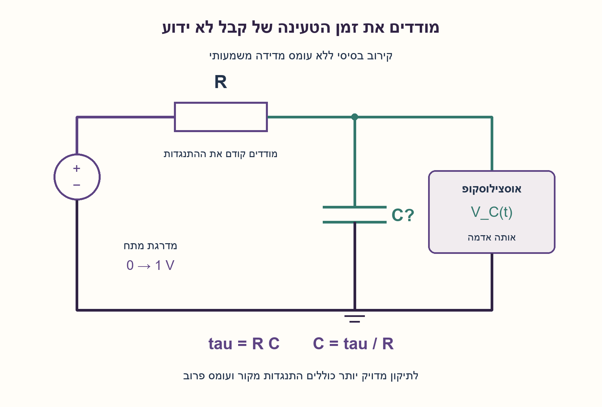
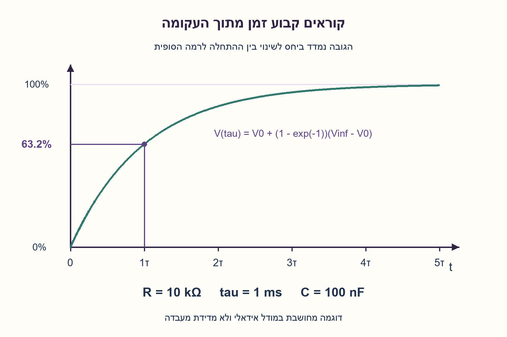
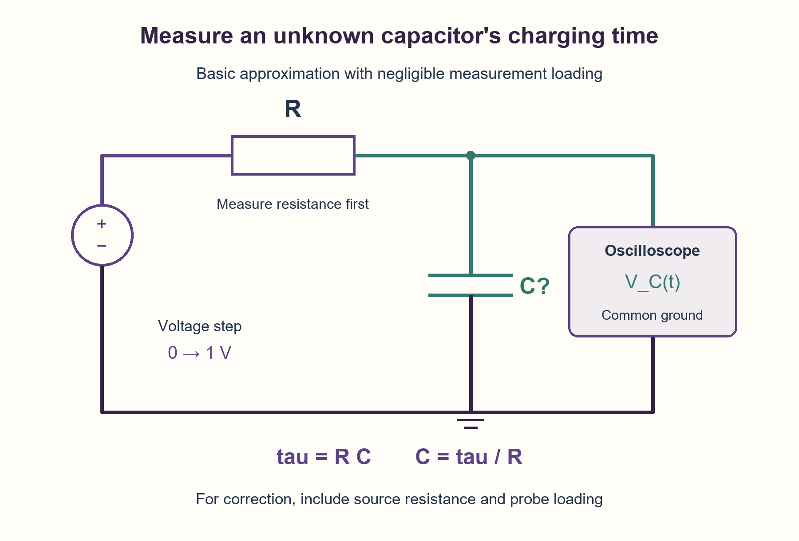
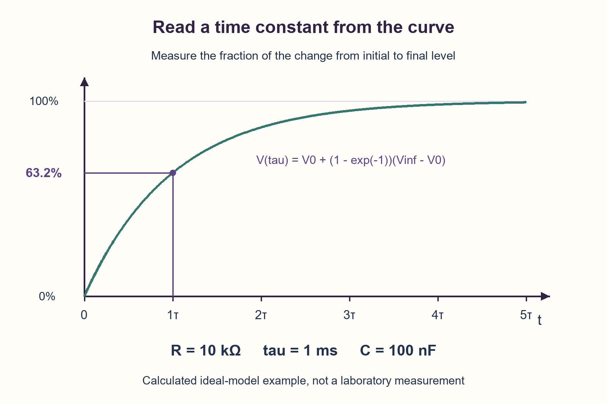

# PREP-099 — מדידת קיבול לא ידוע באמצעות תגובת RC

פתרון מוצע בסיוע AI; ביקורת מקצועית, תרגום וזכויות שימוש ממתינות. קושי אינו מכויל.

## מקור שמור ללא שינוי

[צילום מקור](../sources/2026-10-24-batch20-07.png)

איך ניתן למדוד קיבול של קבל? נתון: נגד עם ערך כלשהוא ואנו במעבדה עם כל מכשיר שנרצה

## עברית

ברשותכם קבל בעל קיבול לא ידוע, נגד שערכו טרם נמסר, ומעבדה שבה ניתן לבחור כל מכשיר מדידה מתאים. כיצד תמדדו את הקיבול? הציעו תחילה שיטה ישירה באמצעות מכשיר מתאים, ואז הסבירו שיטה שמשתמשת בנגד ובתגובה למדרגת מתח: חיבורים, מה מודדים ואיך מחשבים C.

הבהרות עריכה: הקבל מבודד ממעגל אחר, ומתח העבודה נבחר בתוך דירוגו. מותר למדוד את R במד התנגדות לפני הניסוי; אין להניח בשקט שערך הנגד ידוע. במודל הבסיסי הקבל ליניארי ואידאלי, המקור מהיר ובעל התנגדות זניחה, וכניסת האוסצילוסקופ אינה מעמיסה. הסבירו גם מה משתנה כאשר למקור התנגדות ולפרוב התנגדות וקיבול כניסה. ציינו הנחות, יחידות ומגבלות; אין דרישה לדיוק מספרי או למינימום מכשירים שלא הוגדרו במקור.

### רמזים

1. אם כל מכשיר מותר, חשבו תחילה על מד קיבול. כדי להסביר שיטה עם הנגד, איזה גודל ניתן למדוד בטעינת קבל שמשתנה כשמשנים C?
2. מדדו תחילה את R. חברו מקור מדרגה דרך R לקבל וצפו במתח על הקבל באוסצילוסקופ. מה הקשר בין זמן ההתקרבות למתח הסופי לבין RC?
3. בזמן τ מתח הקבל השלים 1−exp(−1), כלומר כ־63.2% מהשינוי בין המתח ההתחלתי לסופי. במודל הפשוט τ=RC. בעומס מדידה צריך את ההתנגדות שהקבל רואה ואת הקיבול שנוסף אליו.

### הצעה לפתרון

### הרעיון: הופכים קיבול לא ידוע לזמן שאפשר לראות
ככל שהקבל גדול יותר, דרוש יותר מטען כדי לשנות את מתחו באותה מידה. הנגד מגביל את הזרם, ולכן הטעינה אינה מיידית. כש־R כבר נמדד, זמן הטעינה מלמד אותנו את C.

### התשובה הישירה מותרת
המקור מתיר כל מכשיר, ולכן מד קיבול או מד LCR מתאים הוא פתרון תקף. מחברים קבל מבודד ופרוק בהתאם להוראות המכשיר, בוחרים תחום ותדר בדיקה מתאימים וקוראים את הקיבול. כדאי לציין את תדר המדידה ואת מודל המדידה, במיוחד ברכיב שאינו אידאלי. זו אינה התחמקות: הדרישה להשתמש בנגד דווקא לא כתובה במקור. השיטה הבאה מסבירה את העיקרון ומשתמשת בנגד הנתון.

### חיבורים ושלבי המדידה
1. מודדים את התנגדות הנגד במד התנגדות. לדוגמה, נניח שנמדדו 10 kΩ; זה נתון להמחשה, לא ערך שמופיע בצילום.
2. כשהקבל מבודד ופרוק, מחברים מקור מדרגת מתח דרך הנגד אל הקבל; הצד השני של הקבל מחובר לאדמת המקור. מחברים פרוב אוסצילוסקופ במקביל לקבל עם אדמה משותפת. מוודאים שהמתח מתאים לרכיב ולחיבורים; לדוגמה, אפשר להשתמש במדרגה של 0 ל־1 V ברכיב מתאים.
3. מציגים את המתח על הקבל ומפעילים טריגר על מדרגת הכניסה. מודדים את המתח ההתחלתי V0 ואת הרמה הסופית Vinf. בוחרים סקלת זמן שמציגה את המעבר. אם משתמשים בגל מרובע, כל חצי מחזור צריך לאפשר התקרבות מספקת לרמה הסופית; 5τ נותן כ־99.3%, לא 100% מדויק.
4. מוצאים את הזמן מתחילת המדרגה עד V0+0.63212×(Vinf−V0). הזמן הזה הוא τ. במודל הפשוט מחלקים ב־R ומקבלים C=τ/R.

### למה דווקא כ־63.2%?
במודל הבסיסי הזרם בנגד הוא (Vs−Vc)/R, ובקבל I=C·dVc/dt. השוואת הזרמים נותנת RC·dVc/dt=Vs−Vc. פתרון המשוואה אחרי מדרגה הוא:

```text
Vc(t) = Vinf + (V0 - Vinf) exp(-t / tau)
tau = R C
Vc(tau) = V0 + (1 - exp(-1)) (Vinf - V0)
C = tau / R
```

לא מחכים ש״הקבל ייטען לגמרי״: העקומה האידאלית מתקרבת לרמה הסופית בלי להגיע אליה בזמן סופי. מודדים חלק מוגדר מהשינוי. אם ההתחלה אינה אפס או שהמקור והעומס משנים את הרמה הסופית, 63.2% נמדדים מהשינוי Vinf−V0, ולא פשוט ממתח המחולל.

### דוגמה ויחידות
אם נמדדו R=10,000 Ω ו־τ=0.001 s, מתקבל C=0.001/10000=10⁻⁷ F, כלומר **100 nF**. זהו חישוב לדוגמה ולא מדידה שבוצעה. השניות מחולקות באוהם ומתקבלים פאראד. אין להציב מילישניות כאילו הן שניות או קילו־אוהם כאילו הם אוהם.

### מה משתנה כשמכשירי המדידה אינם שקופים?
נסמן התנגדות מקור Rs, התנגדות פרוב מקבילה Rp וקיבול פרוב/חיווט ידוע Cp. במודל שבו אין ESR או דליפה נוספים, הקבל רואה לאחר איפוס מקור המתח את:

```text
Rseries = R + Rs
Rth = Rseries || Rp
Ctotal = Cx + Cp
tau = Rth (Cx + Cp)
Cx = tau / Rth - Cp
```

אם Rp אינסופי ו־Cp זניח, נשאר Rth=R+Rs. אם גם Rs זניח, חוזרים ל־C=τ/R. התנגדות Rp סופית משנה גם את הרמה הסופית: עבור מדרגה מ־0, Vinf=Vs·Rp/(Rseries+Rp). לכן משתמשים ברמה הסופית שנמדדה. דליפה ידועה במקביל לקבל יכולה להיכלל ב־Rp השקול; דליפה לא ידועה מוסיפה פרמטר שאי אפשר להעלים בשקט.

נגד גדול מאוד מגביר את השפעת התנגדות הפרוב; קבל קטן מאוד מגביר את השפעת קיבול הפרוב והחיווט. גם התנגדות מוצא של המחולל אינה נעלמת בגלל מצב תצוגה מסוים שלו. זניחת Rs, Rp או Cp צריכה להיות מוצדקת לפי היחסים במעגל או מתוקנת במדידה. אין נוסחת RC יחידה שמבטיחה דיוק לכל קבל ולכל פרוב.

### חלופות וגבולות
אפשר למדוד פריקה: אחרי τ נותרים 36.8% מההפרש ההתחלתי מהרמה הסופית. אפשר גם להשתמש בסינוס, למדוד את מתח הנגד לקבלת I=Vr/R, ואת משרעת מתח הקבל Vc; בקבל אידאלי C=I/(2πfVc). במדידה ממשית יש להתייחס גם למופע ולמודל האימפדנס. מד LCR עושה מדידה ייעודית ואינו דורש לבחור ידנית זמן מעבר.

לצורך שיטת המדרגה דרושים קבל מבודד, מודל מסדר ראשון, שינוי כניסה מהיר יחסית ל־τ ויכולת למדוד את המעבר. ESR משמעותי, השראות, דליפה, קיבול תלוי מתח או חיבור למעגל נוסף עשויים לשנות את העקומה. אז צריך מודל מתאים, מדידות נוספות או מכשיר ייעודי. אין כאן ניסוי פיזי, כיול מכשירים, הבטחת שגיאה או טענת שיטה מיטבית.

### מה נבדק בהצעה?
קוד החישוב אומת ב־192 צירופי R,C,Rs,Rp,Cp, ב־960 השוואות עקומה בחשבון Decimal וב־48 אינטגרציות נפרדות של חוק הזרמים בקירכהוף באמצעות RK4. נבדקו גם דוגמת 100 nF, טעינה ופריקה ו־12 קלטים לא תקינים. אלו בדיקות מודל וחישוב, לא תוצאות מעבדה.

מקורות יצרן: [Pico Technology — ניסוי בקבל ותגובת RC](https://www.picotech.com/library/articles/application-note/capacitor), [Tektronix — השפעת פרובים על המעגל](https://www.tek.com/en/documents/whitepaper/abcs-probes-primer), [Keysight — שיטות מדידת קיבול](https://www.keysight.com/used/in/en/knowledge/guides/how-to-test-a-capacitor). הנוסח וההוכחה כאן נכתבו מחדש, והדוגמה המחושבת היא שלנו.





## English

You have a capacitor of unknown capacitance, a resistor whose value has not been supplied, and a laboratory with any suitable measurement instrument available. How would you measure the capacitance? First give a direct instrument-based method, then explain a method using the resistor and a voltage-step response: connections, observations and the calculation of C.

Editorial clarifications: isolate the capacitor from other circuitry and choose a stimulus within its ratings. You may measure R with an ohmmeter before the experiment; do not silently assume it is known. The basic model uses a linear ideal capacitor, a fast source with negligible output resistance, and negligible oscilloscope loading. Also explain the effect of source resistance and probe input resistance/capacitance. State assumptions, units and limitations; no numerical accuracy or minimum instrument count absent from the source is required.

### Hints

1. If every instrument is allowed, first consider a capacitance meter. To explain a resistor-based method, what observable part of capacitor charging changes when C changes?
2. Measure R first. Apply a step through R to the capacitor and observe its voltage with an oscilloscope. How is the approach time to the final level related to RC?
3. At time τ the voltage has completed 1−exp(−1), about 63.2%, of the initial-to-final change. In the basic model τ=RC. With loading, use the resistance seen by the capacitor and account for added capacitance.

### Proposed solution

### The idea: turn unknown capacitance into an observable time
A larger capacitor requires more charge for the same voltage change. The resistor limits current, so charging takes time. Once R has been measured, that time reveals C.

### The direct answer is allowed
The source permits any instrument, so a suitable capacitance meter or LCR meter is valid. Connect an isolated, discharged capacitor according to the instrument's instructions, select an appropriate range and test frequency, and read the capacitance. Report frequency and measurement model when nonideal behavior matters. This is not evasion: the source does not require using the supplied resistor. The following method explains the principle and uses it.

### Connections and measurement steps
1. Measure the resistor with an ohmmeter. For illustration, suppose it measures 10 kΩ; this number was not supplied in the screenshot.
2. With the capacitor isolated and discharged, connect a voltage-step source through the resistor to the capacitor. Connect the capacitor's other terminal to source ground. Probe across the capacitor with an oscilloscope sharing that ground. Choose a stimulus appropriate to the component and connections; for example, a 0-to-1 V step for a suitable capacitor.
3. Display capacitor voltage and trigger on the input step. Measure initial voltage V0 and final plateau Vinf. Set the time scale to show the transition. With a square wave, each half-cycle must allow adequate settling; 5τ reaches about 99.3%, not exactly 100%.
4. Find the elapsed time from the step to V0+0.63212×(Vinf−V0). This is τ. In the basic model, divide by R: C=τ/R.

### Why about 63.2%?
In the basic model, resistor current is (Vs−Vc)/R and capacitor current is I=C·dVc/dt. Equating them yields RC·dVc/dt=Vs−Vc. After a voltage step:

```text
Vc(t) = Vinf + (V0 - Vinf) exp(-t / tau)
tau = R C
Vc(tau) = V0 + (1 - exp(-1)) (Vinf - V0)
C = tau / R
```

Do not wait for a capacitor to become “fully charged”: the ideal curve approaches its plateau without reaching it at finite time. Measure a defined fraction of the transition. If initial voltage is nonzero or loading changes the final voltage, measure 63.2% of Vinf−V0, rather than simply taking 63.2% of the generator setting.

### Example and units
For measured R=10,000 Ω and τ=0.001 s, C=0.001/10000=10⁻⁷ F, or **100 nF**. This is a calculated example, not an experiment performed here. Seconds divided by ohms give farads. Do not substitute milliseconds as seconds or kilohms as ohms.

### What if the instruments change the circuit?
Let source resistance be Rs, shunt probe resistance Rp and known probe/wiring capacitance Cp. In a model without additional ESR or leakage, suppressing the ideal voltage source gives:

```text
Rseries = R + Rs
Rth = Rseries || Rp
Ctotal = Cx + Cp
tau = Rth (Cx + Cp)
Cx = tau / Rth - Cp
```

With infinite Rp and negligible Cp, Rth=R+Rs. If Rs is negligible too, this reduces to C=τ/R. A finite Rp also changes the final level: for a step starting at zero, Vinf=Vs·Rp/(Rseries+Rp). Use the measured plateau. Known capacitor leakage may be included in the equivalent shunt resistance; unknown leakage introduces another parameter rather than disappearing from the problem.

A very large resistor increases sensitivity to probe resistance; a very small DUT capacitance increases sensitivity to probe and wiring capacitance. A generator's output resistance does not vanish because of its display setting. Justify neglecting Rs,Rp,Cp by their relative effects or correct for them. One RC formula cannot guarantee accuracy for every capacitor and probe.

### Alternatives and limits
Measure discharge instead: after τ, 36.8% of the initial difference from the final plateau remains. Alternatively, apply a sine wave, obtain current from resistor voltage I=Vr/R and measure capacitor-voltage amplitude Vc; an ideal capacitor gives C=I/(2πfVc). A real impedance measurement also considers phase and the component model. An LCR meter provides dedicated measurement without manually choosing a transient time.

The step method needs an isolated capacitor, a first-order model, an input edge fast compared with τ, and sufficient measurement resolution. Significant ESR, inductance, leakage, voltage-dependent capacitance or other attached circuitry can change the curve. Use a suitable model, more observations or a dedicated instrument in those cases. No physical experiment, instrument calibration, error guarantee or universally optimal method is claimed.

### What was checked?
The calculation code passed 192 R,C,Rs,Rp,Cp networks, 960 Decimal transition comparisons and 48 independent Kirchhoff-current integrations using RK4. Checks also cover the 100 nF example, charging/discharging and 12 invalid-input cases. These are mathematical model checks, not laboratory measurements.

Manufacturer references: [Pico Technology — capacitor experiment and RC response](https://www.picotech.com/library/articles/application-note/capacitor), [Tektronix — how probes load a circuit](https://www.tek.com/en/documents/whitepaper/abcs-probes-primer), [Keysight — capacitance-measurement methods](https://www.keysight.com/used/in/en/knowledge/guides/how-to-test-a-capacitor). This explanation and derivation were independently written; the calculated example is ours.





## חומר משלים דו־לשוני / Bilingual material

```json
{
  "assumptions": {
    "he": [
      "מותר כל מכשיר מתאים, ולכן מד קיבול או LCR הם תשובה תקפה.",
      "R נמדד תחילה; המקור אינו מוסר ערך ידוע.",
      "הקבל מבודד ממעגל אחר ובמודל הבסיסי ליניארי ואידאלי.",
      "מדרגת הכניסה מהירה יחסית לקבוע הזמן, ואפשר למדוד את המתח ההתחלתי והסופי.",
      "הנוסחה המתוקנת מניחה Rs,Rp,Cp ידועים וללא פרזיטים נוספים מהותיים."
    ],
    "en": [
      "Any suitable instrument is allowed; a capacitance or LCR meter is valid.",
      "Measure R first; its numerical value is not supplied.",
      "The capacitor is isolated and, in the basic model, linear and ideal.",
      "The input edge is fast relative to the time constant, and initial/final levels can be measured.",
      "The corrected formula assumes known Rs,Rp,Cp and no other significant parasitics."
    ]
  },
  "optimality": {
    "he": {
      "criterion": "מדידה מנומקת, לא מינימום מכשירים או דיוק שלא הוגדר.",
      "result": "מד LCR/קיבול ישיר; או מדידת R וזמן τ לקבלת C, עם תיקון מודל עומס לפי הצורך.",
      "scope": "זמן התייצבות פיזי תלוי ב־RC ובדיוק המבוקש. חישוב הנוסחה הוא מספר קבוע של פעולות, אך אינו מבטל את זמן המדידה או את אי־הוודאות."
    },
    "en": {
      "criterion": "Justified measurement, not an unspecified minimum instrument count or accuracy.",
      "result": "Direct capacitance/LCR measurement, or measured R and τ with appropriate loading correction.",
      "scope": "Physical settling time depends on RC and desired precision. Formula evaluation uses constant arithmetic work but does not remove measurement time or uncertainty."
    }
  },
  "verification": {
    "he": "עברו 192 רשתות RC, 960 השוואות Decimal ו־48 אינטגרציות RK4 עצמאיות של KCL עם 8,000 צעדים למקרה, וכן 12 דחיות קלט. דוגמה מחושבת: 10 kΩ ו־1 ms נותנים 100 nF. אין ניסוי פיזי או כיול.",
    "en": "Passed 192 RC networks, 960 Decimal comparisons, 48 independent KCL/RK4 integrations with 8,000 steps each, and 12 invalid-input rejections. Calculated example: 10 kΩ and 1 ms give 100 nF. No physical experiment or calibration."
  },
  "edge_cases": {
    "he": [
      "R או C זעירים עלולים ליצור מעבר שהמכשיר אינו פותר בזמן; R גדול מגביר עומס התנגדותי.",
      "בקבל קטן קיבול הפרוב והחיווט עלול להשתוות לקבל הנבדק.",
      "מתח התחלתי שאינו אפס דורש יעד יחסי לשינוי המתח, לא 63.2% מ־Vs.",
      "טעינה ופריקה משתמשות בהתאמה ב־63.2% מהשינוי וב־36.8% מהשארית.",
      "דליפה, ESR והשראות משמעותיים מחייבים מודל נוסף; קבל במעגל עשוי להראות קיבול שקול אחר.",
      "קוד החישוב דוחה פרמטרים שאינם חיוביים/סופיים במקומות הנדרשים ותיקון שמחזיר קיבול לא חיובי."
    ],
    "en": [
      "Tiny R or C may create an unresolved transient; large R magnifies resistive loading.",
      "For a small DUT, probe and wiring capacitance can be comparable to its capacitance.",
      "Nonzero initial voltage requires a target relative to the full transition, not 63.2% of Vs.",
      "Charging uses 63.2% completed change; discharge retains 36.8% of the difference.",
      "Significant leakage, ESR or inductance needs an extended model; in-circuit tests may measure another equivalent capacitance.",
      "The calculation rejects required positive/finite parameters that violate the contract and corrections yielding nonpositive capacitance."
    ]
  },
  "common_mistakes": {
    "he": [
      "להניח ש־R ידוע אף שהמקור אינו מוסר ערך; יש למדוד אותו.",
      "לפסול מד קיבול אף שהמקור מתיר כל מכשיר.",
      "לחכות ל־100% מדויק או להתייחס ל־5τ כאילו אין בו שגיאת התייצבות.",
      "להשתמש ב־R בלבד כשהתנגדות מקור או עומס פרוב משמעותיים.",
      "להתעלם מ־Cp או להחליף בין מילישניות לשניות ובין קילו־אוהם לאוהם.",
      "להציג בדיקת Python כאילו בוצעו מדידת מעבדה וכיול."
    ],
    "en": [
      "Assuming R is known although the source supplies no value; measure it.",
      "Rejecting a capacitance meter although any instrument is allowed.",
      "Waiting for exact 100% or treating 5τ as error-free settling.",
      "Using only R despite significant source resistance or probe loading.",
      "Ignoring Cp or mixing milliseconds/seconds and kilohms/ohms.",
      "Presenting Python checks as a performed laboratory experiment and calibration."
    ]
  },
  "interview_answer": {
    "he": "אם כל מכשיר מותר, אשתמש במד קיבול או LCR. כדי להראות עיקרון עם הנגד, אמדוד את R, אחבר מקור מדרגה דרך R לקבל ואמדוד באוסצילוסקופ את הזמן עד 63.2% משינוי המתח. אז C=τ/R במודל הפשוט. במידת הצורך אכלול התנגדות מקור, עומס פרוב ופרזיטים; אין לי מדידת C מוחלטת אם R עדיין לא ידוע.",
    "en": "If any instrument is allowed, use a capacitance or LCR meter. To demonstrate the resistor method, measure R, drive the capacitor through it with a step and read the time to 63.2% of the voltage change on a scope. Then C=τ/R in the basic model. Include source resistance, probe loading and parasitics when material; unknown R does not yield an absolute C from τ alone."
  },
  "source_ambiguities": {
    "he": [
      "הנגד מתואר כבעל ערך כלשהו, בלי לציין שהערך ידוע; מדידת התנגדות מותרת כאן במפורש.",
      "כל מכשיר מותר, ולכן אין הצדקה לכפות רק אוסצילוסקופ ונגד.",
      "לא ניתנו טווח קיבול, דירוג מתח, דיוק, תדר או מודל פרזיטים; נוספו מודל בסיסי וגבולותיו בלי להמציא תוצאות מדידה."
    ],
    "en": [
      "The resistor has some value but is not explicitly known; resistance measurement is expressly permitted.",
      "Any instrument is allowed, so a resistor/scope-only restriction must not be invented.",
      "No capacitance range, voltage rating, accuracy, frequency or parasitic model is supplied; the edition declares a basic model and its limits without inventing measurements."
    ]
  },
  "solution_extensions": {
    "he": {
      "question": "מה אפשר להסיק אם גם R אינו ידוע ואפשר למדוד רק עקומת טעינה אחת?",
      "direction": "במודל אידאלי העקומה קובעת את המכפלה RC בלבד: הכפלת R ב־k וחלוקת C ב־k משאירות אותה τ. נדרשת מדידת R/זרם או התערבות נוספת כדי להפריד ביניהם.",
      "status": "מוכן בתוכן; אינו מחובר לתור שאלות המשך."
    },
    "en": {
      "question": "What if R is also unknown and only one charging curve is observable?",
      "direction": "The ideal curve determines only RC: multiplying R by k and dividing C by k preserves τ. Measure R/current or make another controlled intervention to separate them.",
      "status": "Prepared in content; not connected to the follow-up queue."
    }
  },
  "technical_references": {
    "he": [
      {
        "title": "Pico Technology — ניסוי בקבל",
        "url": "https://www.picotech.com/library/articles/application-note/capacitor",
        "note": "מקור יצרן לניסוי RC ולעומס כניסת האוסצילוסקופ; נבדק ב־2026-10-24."
      },
      {
        "title": "Tektronix — מבוא לפרובים",
        "url": "https://www.tek.com/en/documents/whitepaper/abcs-probes-primer",
        "note": "התנגדות וקיבול פרוב משנים את המעגל; פרוב אינו צופה אידאלי."
      },
      {
        "title": "Keysight — שיטות בדיקת קבל",
        "url": "https://www.keysight.com/used/in/en/knowledge/guides/how-to-test-a-capacitor",
        "note": "חלופת מד קיבול ושיטת קבוע הזמן; לא יוחס ליצרן אימות של הקוד שלנו."
      }
    ],
    "en": [
      {
        "title": "Pico Technology — capacitor experiment",
        "url": "https://www.picotech.com/library/articles/application-note/capacitor",
        "note": "Manufacturer RC experiment and oscilloscope input-loading discussion; checked 2026-10-24."
      },
      {
        "title": "Tektronix — ABCs of probes",
        "url": "https://www.tek.com/en/documents/whitepaper/abcs-probes-primer",
        "note": "Probe resistance and capacitance alter the measured circuit; a probe is not an ideal observer."
      },
      {
        "title": "Keysight — capacitor-testing methods",
        "url": "https://www.keysight.com/used/in/en/knowledge/guides/how-to-test-a-capacitor",
        "note": "Capacitance-meter and time-constant alternatives; not a manufacturer validation of our code."
      }
    ]
  },
  "relationship_note": {
    "he": "תרגיל מדידה אנלוגי חדש במאגר, להבדיל משאלות תזמון דיגיטלי. אין לייחס ל־NVIDIA את הפתרון או אימות מקצועי; השיוך מופיע בצילום בלבד.",
    "en": "A new analog-measurement exercise, distinct from digital timing questions. NVIDIA attribution is source-reported only, not authorship or professional validation of this solution."
  }
}
```
