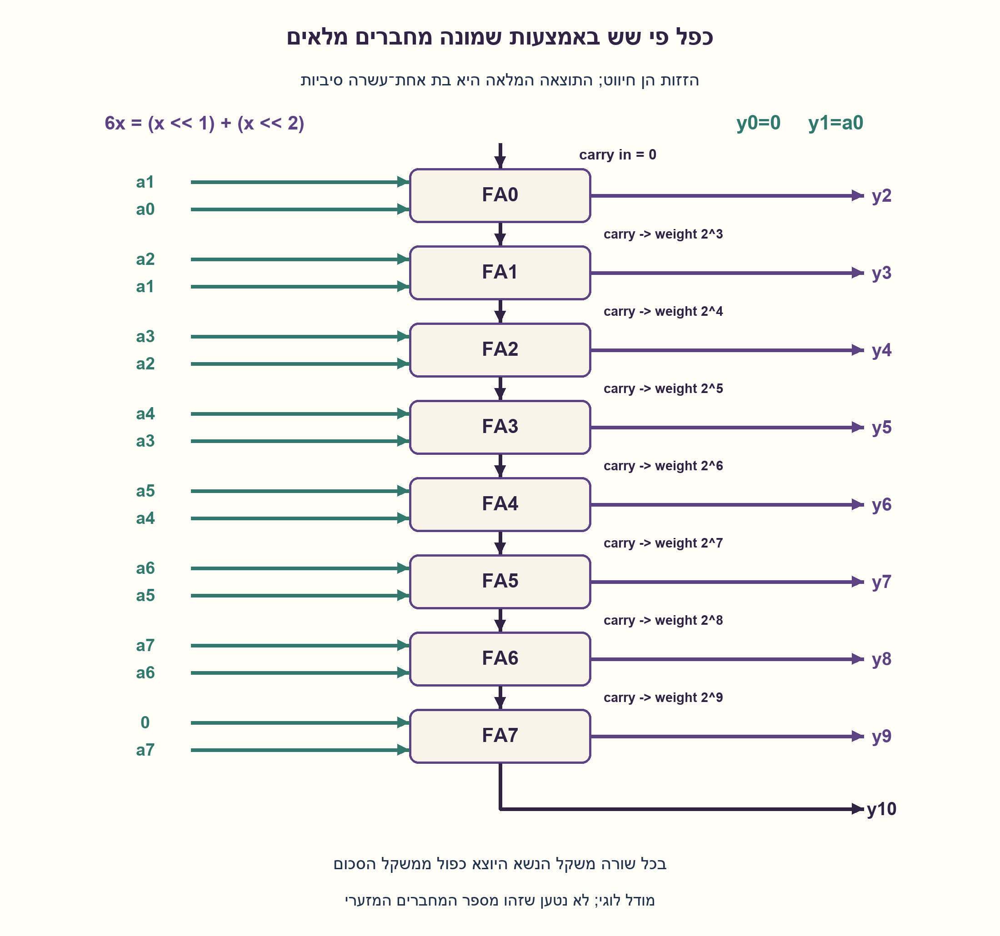
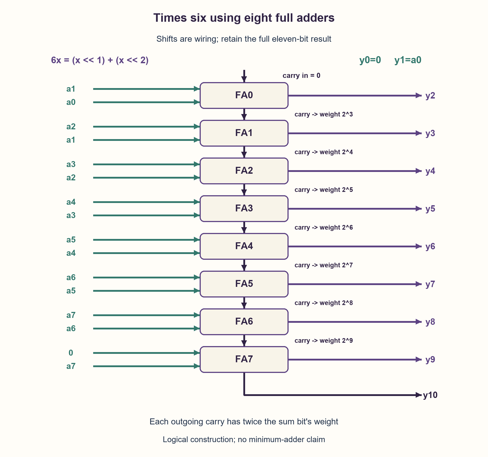

# PREP-100 — כפל פי שש של מספר בן שמונה ביטים — מחברים מלאים בלבד

פתרון מוצע בסיוע AI; ביקורת מקצועית אנושית ממתינה. הקושי לא כויל.

## מקור

[צילום המקור](../sources/2026-10-24-batch20-10.png)

נדרש לממש הכפלה ב־6 של מספר בן 8 סיביות בעזרת FA בלבד.

שיוכי החברות בצילום מדווחים ולא אומתו באופן עצמאי: Apple.

## נוסח ערוך

כפל פי שש של מספר בן שמונה ביטים — מחברים מלאים בלבד

ממשו מעגל קומבינטורי שמקבל x בן 8 ביטים ומחזיר 6x באמצעות רכיבי Full Adder בלבד. הציגו חיווט של כל המחברים וביטי הפלט, נמקו נכונות ואמתו מקרי קצה.

הבהרות עריכה: בנוסח הראשי x אינו מסומן, בטווח 0..255, ויש להחזיר תוצאה מדויקת בת 11 ביטים ללא חיתוך. מותר חיווט, פיצול אות וקבוע 0; הזזה קבועה היא חיבור לביטי פלט שונים, לא רכיב נוסף. לכל FA שלוש כניסות בעלות אותו משקל ופלטי Sum ו־Carry. אין Half Adder נפרד, שערים נוספים, רגיסטרים או רכיב כפל. מותר לחבר כניסה של FA לאפס. אין דרישה להוכחת מספר מחברים מזערי. דונו בקצרה בשינוי הדרוש עבור מספר מסומן או פלט בן שמונה ביטים.

### שלושה רמזים

1. איך אפשר לכתוב 6 כסכום חזקות של שתיים? האם כפל בחזקה של שתיים דורש רכיב חישוב?
2. כתבו את שני העותקים המוזזים בעמודות ביטים. בעמודות הנמוכות יש ביט יחיד או אפסים; רק עמודות חופפות צריכות מחבר.
3. השתמשו ב־6x=(x<<1)+(x<<2). חברו y0=0 ו־y1=a0. התחילו בעמודה 2 עם FA(a1,a0,0), והעבירו כל נשא לעמודה הבאה עד לביט העליון.

### הצעה לפתרון

### הרעיון: מכפילים קבועים באמצעות חיווט וחיבור
שש הוא שתיים ועוד ארבע, ולכן 6x=2x+4x. בכתיב בינארי, כפל בשתיים מזיז את החוטים מקום אחד שמאלה וכפל בארבע מזיז שני מקומות. אין כאן שימוש בשער הזזה או במכפיל: משאירים מקום לאפסים הנמוכים ומחברים את ביטי x לעמודות המתאימות.

למשל x=5 הוא 00000101. שני העותקים הם 00000001010 ו־00000010100, שסכומם 00000011110, כלומר 30.

### קודם בוחרים רוחב שלא מאבד את התוצאה
הקלט המרבי הוא 255 והתוצאה המרבית היא 1530. עשרה ביטים מגיעים רק עד 1023, ולכן נדרשים 11 ביטי פלט y10..y0. אסור לחבר בשמונה ביטים ואז להרחיב: נשאים שכבר נחתכו לא ישוחזרו.

### החיווט המדויק — שמונה Full Adders
נסמן x=a7..a0. בכל FA, פלט Sum נשאר בעמודה ופלט Carry עובר לעמודה שמשקלה כפול.

| רכיב | שלוש כניסות | פלט Sum | פלט Carry |
| --- | --- | --- | --- |
| חוט | קבוע 0 | y0=0 | — |
| חוט | a0 | y1=a0 | — |
| FA0 | a1,a0,0 | y2 | c3 |
| FA1 | a2,a1,c3 | y3 | c4 |
| FA2 | a3,a2,c4 | y4 | c5 |
| FA3 | a4,a3,c5 | y5 | c6 |
| FA4 | a5,a4,c6 | y6 | c7 |
| FA5 | a6,a5,c7 | y7 | c8 |
| FA6 | a7,a6,c8 | y8 | c9 |
| FA7 | 0,a7,c9 | y9 | y10 |

הראשון והאחרון מקבלים אפס באחת הכניסות, אך הם עדיין רכיבי FA מותרים; אין כאן Half Adder נפרד. הזוג a1,a0 בעמודה 2 אינו בעל משקלים מקוריים שונים: a1 הגיע מהעותק שהוזז מקום אחד, ו־a0 מהעותק שהוזז שניים, ולכן שניהם מייצגים משקל 4 כאן.

### למה כל התוצאה נכונה?
בעמודה k מחבר מלא משמר את הזהות a+b+c=s+2c_next. לאחר הכפלה במשקל 2^k, פלט הסכום שומר את משקל העמודה והנשא ממשיך במשקל 2^(k+1). מתחילים בסכום החוטים שמייצגים 2x ו־4x, משמרים אותו בכל עמודה, ולבסוף שומרים גם את הנשיאה העליונה. לכן מתקבל בדיוק 6x לכל קלט בתחום.

### עלות והחלופות שהמקור אינו מגדיר
המימוש משתמש בשמונה FA ובחיווט בלבד. במסלול נשיאה טורי עשויות להופיע שמונה דרגות מחבר; העיכוב הפיזי תלוי בתאים, בחיווט ובעומסים. לא הוכח ששמונה הוא מספר FA מזערי. אין כאן סינתזה או ניתוח STA.

אם רוצים רק שמונה ביטי פלט, זהו 6x modulo 256, ולא תוצאה מדויקת לכל הקלטים. עבור קלט מסומן במשלים לשתיים, התחום הוא ‎-128..127 והתוצאה ‎-768..762: גם אז 11 ביטים מספיקים, אבל יש להרחיב סימן לפני ההזזות והחיבור. החיווט הלא־מסומן המצורף אינו מפרש אוטומטית a7 כביט סימן. זו חלופה ולא שינוי שקט של החוזה הראשי.

### מה נבדק?
הקוד הוא מודל של שמונה רכיבי FA במצב יציב. כל 256 הקלטים הושוו לכפל שלם ולהוספה חוזרת; נבדקו כל שמונה שורות FA ו־2,048 שימורי משקל בעמודות. המודל אינו מעגל שסונתז או סימולציית HDL מתוזמנת.

```python
"""Eight-FA steady-state model for unsigned 8-bit input and full 11-bit output.

Shifts, fanout and constant-zero connections represent wiring, not extra gates.
The model is not an HDL simulation, synthesis result or physical timing result.
"""


def full_adder(a, b, carry_in):
    return a ^ b ^ carry_in, (a & b) | (a & carry_in) | (b & carry_in)


def times_six(value, *, with_trace=False):
    if type(value) is not int or not 0 <= value <= 255:
        raise ValueError("value must be an unsigned 8-bit integer")
    output = (value & 1) << 1  # y0=0, y1=a0: fixed wiring.
    carry = 0
    trace = []
    for column in range(2, 10):
        a = (value >> (column - 1)) & 1 if column <= 8 else 0
        b = (value >> (column - 2)) & 1
        bit, carry_out = full_adder(a, b, carry)
        trace.append({"column": column, "a": a, "b": b,
                      "carry_in": carry, "sum": bit, "carry_out": carry_out})
        output |= bit << column
        carry = carry_out
    output |= carry << 10
    return (output, trace) if with_trace else output
```



## English edition

Multiply an eight-bit number by six using only full adders

Build a combinational circuit receiving an eight-bit x and returning 6x using only full-adder primitives. Show every adder connection and output bit, justify correctness and check boundary inputs.

Editorial clarifications: the main contract is unsigned x in 0..255 with an exact eleven-bit output, without truncation. Wiring, fanout and constant zero are allowed; a fixed shift is a change of bit connections, not another component. Each FA has three equal-weight inputs and Sum/Carry outputs. No separate half adder, extra gates, registers or multiplier is available. Tying an FA input to zero is allowed. A minimum-adder proof is not required. Briefly discuss signed input or an eight-bit-only output.

### Three hints

1. How can six be expressed as a sum of powers of two? Does multiplication by a power of two need an arithmetic component?
2. Write the shifted copies in bit columns. The lowest columns contain zeros or one bit; only overlapping columns need an adder.
3. Use 6x=(x<<1)+(x<<2). Wire y0=0 and y1=a0. Start column 2 with FA(a1,a0,0), then carry into the next column through the top bit.

### Proposed solution

### Idea: a constant multiplier becomes wiring plus addition
Six is two plus four, so 6x=2x+4x. In binary, multiplying by two moves connections one bit left; multiplying by four moves them two bits left. No shifter gate or multiplier is hidden here: place zeros in low positions and connect x bits to their shifted columns.

For example x=5 is 00000101. The two copies are 00000001010 and 00000010100, summing to 00000011110, or 30.

### Choose a width that retains the answer
The largest input is 255 and its product is 1530. Ten bits reach only 1023, so retain eleven output bits y10..y0. Adding in eight bits and widening afterward cannot recover discarded carry bits.

### Exact connections: eight full adders
Write x=a7..a0. Each FA's Sum remains in its column; Carry advances to the next column, at twice the weight.

| Component | Three inputs | Sum output | Carry output |
| --- | --- | --- | --- |
| Wire | constant 0 | y0=0 | — |
| Wire | a0 | y1=a0 | — |
| FA0 | a1,a0,0 | y2 | c3 |
| FA1 | a2,a1,c3 | y3 | c4 |
| FA2 | a3,a2,c4 | y4 | c5 |
| FA3 | a4,a3,c5 | y5 | c6 |
| FA4 | a5,a4,c6 | y6 | c7 |
| FA5 | a6,a5,c7 | y7 | c8 |
| FA6 | a7,a6,c8 | y8 | c9 |
| FA7 | 0,a7,c9 | y9 | y10 |

The first and last have a zero input but remain permitted FA components, not separate half adders. In column 2, a1 and a0 have the same effective weight: a1 comes from the one-position-shifted copy, and a0 from the two-position-shifted copy. Both represent weight four there.

### Why does the whole result work?
At column k a full adder preserves a+b+c=s+2c_next. Multiplying by 2^k keeps Sum at the current weight and sends Carry to weight 2^(k+1). Starting with the wires representing 2x and 4x, each column preserves their total. Retaining the last carry therefore yields exactly 6x for every allowed input.

### Cost and contracts absent from the source
This construction uses eight FAs and wiring. Its serial carry path may cross eight adder stages; physical delay depends on cells, wires and loading. No minimum-FA claim is proved. No synthesis or static timing analysis was performed.

An eight-bit-only output instead represents 6x modulo 256, rather than an exact result for every input. For signed two's-complement input, the range is -128..127 and the product range is -768..762: eleven bits also suffice, but sign-extend before shifting and adding. The supplied unsigned connections do not automatically treat a7 as a sign bit. That is an alternative contract, not a silent change to the main problem.

### Verification
The code models eight steady-state FAs. All 256 inputs were compared with exact multiplication and repeated addition; eight FA truth rows and 2,048 weighted-column conservation checks passed. This is not synthesized circuitry or timed HDL simulation.

```python
"""Eight-FA steady-state model for unsigned 8-bit input and full 11-bit output.

Shifts, fanout and constant-zero connections represent wiring, not extra gates.
The model is not an HDL simulation, synthesis result or physical timing result.
"""


def full_adder(a, b, carry_in):
    return a ^ b ^ carry_in, (a & b) | (a & carry_in) | (b & carry_in)


def times_six(value, *, with_trace=False):
    if type(value) is not int or not 0 <= value <= 255:
        raise ValueError("value must be an unsigned 8-bit integer")
    output = (value & 1) << 1  # y0=0, y1=a0: fixed wiring.
    carry = 0
    trace = []
    for column in range(2, 10):
        a = (value >> (column - 1)) & 1 if column <= 8 else 0
        b = (value >> (column - 2)) & 1
        bit, carry_out = full_adder(a, b, carry)
        trace.append({"column": column, "a": a, "b": b,
                      "carry_in": carry, "sum": bit, "carry_out": carry_out})
        output |= bit << column
        carry = carry_out
    output |= carry << 10
    return (output, trace) if with_trace else output
```



## חומר משלים דו־לשוני / Bilingual supporting material

```json
{
  "assumptions": {
    "he": [
      "קלט לא־מסומן בן 8 ביטים; פלט מדויק בן 11 ביטים.",
      "מותר FA, חיווט, פיצול וקבוע אפס בלבד; אין Half Adder נפרד.",
      "ניתוח קומבינטורי לאחר התייצבות; לא נדרשה מינימליות."
    ],
    "en": [
      "Unsigned eight-bit input; exact eleven-bit output.",
      "Only FAs, wiring, fanout and constant zero; no separate half adder.",
      "Settled combinational analysis; minimum size was not required."
    ]
  },
  "optimality": {
    "he": {
      "result": "שמונה FA במבנה נשיאה טורי; 11 ביטי פלט נדרשים לתוצאה המלאה.",
      "scope": "רוחב הפלט מוצדק לפי 1530>1023; אין הוכחת מספר FA מזערי, שטח פיזי או השהיה מיטבית."
    },
    "en": {
      "result": "Eight FAs in a ripple construction; eleven output bits are required for the full result.",
      "scope": "Output width follows from 1530>1023; no proof of minimum FA count, physical area or optimal delay."
    }
  },
  "edge_cases": {
    "he": [
      "x=0 מחזיר 0.",
      "x=1 מחזיר 6; y0 תמיד אפס.",
      "x=255 מחזיר 1530 ודורש את הביט העליון.",
      "הרחבה אחרי חיתוך אינה מחזירה נשאים שאבדו.",
      "קלט מסומן מחייב הרחבת סימן וחיווט מתאים."
    ],
    "en": [
      "x=0 returns zero.",
      "x=1 returns six; y0 is always zero.",
      "x=255 returns 1530 and needs the highest bit.",
      "Widening after truncation cannot restore lost carry.",
      "Signed input requires sign extension and suitable connections."
    ]
  },
  "common_mistakes": {
    "he": [
      "חיבור בשמונה ביטים ושמירת תוצאה שגויה בגלל גלישה.",
      "שימוש ב־HA או שערים למרות מגבלת FA בלבד.",
      "חיבור נשא לעמודה באותו משקל במקום למשקל כפול.",
      "ספירת הזזה קבועה כרכיב חישוב.",
      "טענת מינימום שמונה מחברים על סמך מימוש אחד בלבד."
    ],
    "en": [
      "Adding in eight bits and losing overflow.",
      "Using a separate HA or gates despite the FA-only rule.",
      "Connecting a carry to the same weight instead of double weight.",
      "Counting fixed rewiring as an arithmetic component.",
      "Claiming eight adders are minimal solely because one construction uses eight."
    ]
  },
  "interview_answer": {
    "he": "אכתוב 6x=2x+4x, אזיז בחיווט ואחבר רק עמודות חופפות. y0=0 ו־y1=a0. שמונה FA מחברים את עמודות 2..9, והנשא האחרון הוא y10. כל מחבר משמר סכום משוקלל; הפלט בן 11 ביטים.",
    "en": "Write 6x=2x+4x, shift by wiring, and add only overlapping columns. Wire y0=0 and y1=a0. Eight FAs handle columns 2..9, with final carry y10. Every adder preserves weighted sum; the output has eleven bits."
  },
  "source_ambiguities": {
    "he": [
      "בצילום לא נקבעו סימן, רוחב פלט או היתר קבועים; החוזה הראשי מגדיר אותם במפורש.",
      "הצילום דורש FA בלבד, אך אינו דורש הוכחת מינימום.",
      "Apple היא חברה שמדווחת במקור בלבד; השיוך לא אומת."
    ],
    "en": [
      "The screenshot omits signedness, output width and permission for constants; the main contract states them explicitly.",
      "The source requires FAs only but no minimum-size proof.",
      "Apple is attributed only by the supplied source and is not independently verified."
    ]
  },
  "verification": {
    "he": "עברו 256 קלטים ממצים מול כפל שלם והוספה חוזרת, שמונה שורות אמת FA ו־2,048 בדיקות שימור משקל. חמש דחיות קלט לא חוקי. Python בלבד; ללא סינתזה, הידור HDL או תזמון פיזי.",
    "en": "Passed 256 exhaustive inputs against exact multiplication and repeated addition, eight FA truth rows and 2,048 weighted-column checks, plus five invalid-input rejections. Python only; no synthesis, HDL compilation or physical timing analysis."
  },
  "relationship_note": {
    "he": "קשורה ל־PREP-001 ול־PREP-034 דרך מחברים ומשקלי נשיאה. אינה כפילות של PREP-035, שבו מכפילים בעזרת הוראות יחידה וארבעה רגיסטרים.",
    "en": "Related to PREP-001 and PREP-034 through adders and carry weights. Not a duplicate of PREP-035, which multiplies using unit instructions and four registers."
  },
  "solution_extensions": {
    "he": {
      "question": "מה משתנה אם x מסומן במשלים לשתיים?",
      "direction": "מרחיבים סימן ל־11 ביטים לפני יצירת 2x ו־4x ומחזירים 11 ביטים מסומנים. יש לאמת בנפרד את ‎-128 ואת 127; חיווט הקלט הלא־מסומן אינו מספיק.",
      "status": "מוכן בתוכן; אינו מחובר לתור שאלות ההמשך."
    },
    "en": {
      "question": "What changes when x is signed two's complement?",
      "direction": "Sign-extend to eleven bits before forming 2x and 4x and retain an eleven-bit signed result. Separately check -128 and 127; the unsigned wiring is insufficient.",
      "status": "Prepared in content; not connected to the interactive follow-up queue."
    }
  }
}
```
