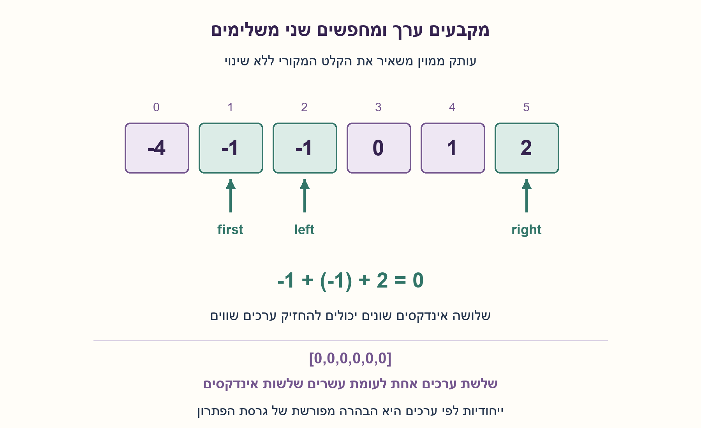
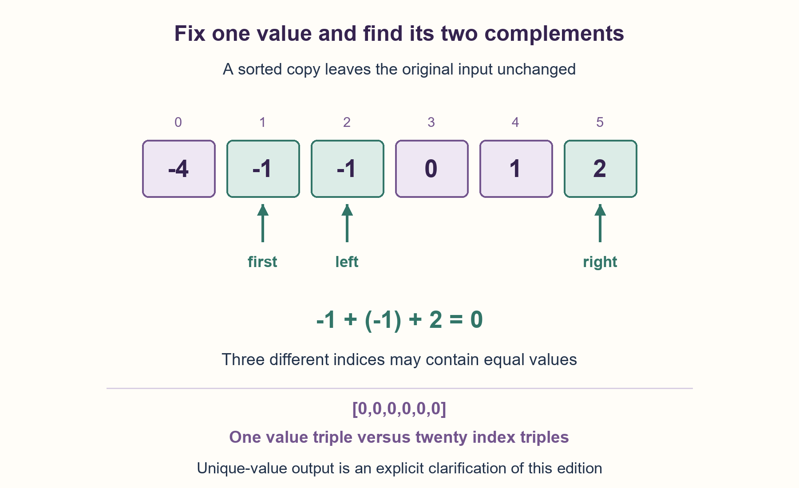

# PREP-101 — כל שלשות הערכים שסכומן S — ומה אם רוצים אינדקסים?

פתרון מוצע בסיוע AI; ביקורת מקצועית אנושית ממתינה. הקושי לא כויל.

## מקור

[צילום המקור](../sources/2026-10-24-batch20-12.png)

נתון מערך באורך N מלא במספרים. בנוסף, נתון S int. צריך להדפיס את כל השלשות (לאו דווקא רצפים) שסכומם שווה ל-S. סיבוכיות של פחות מ-n^3....

שיוכי החברות בצילום הם דיווח לא מאומת: Apple.

## כל שלשות הערכים שסכומן S — ומה אם רוצים אינדקסים?

נתון מערך שלמים באורך n ויעד שלם S. החזירו את כל שלשות הערכים הייחודיות (a,b,c), בסדר a≤b≤c, שסכומן S. כל שלשה משתמשת בשלוש הופעות שונות במערך; אינן חייבות להיות סמוכות. מותרות חזרות, אפסים ושליליים. אל תשנו את הקלט. החזירו את השלשות בסדר לקסיקוגרפי, כל שלשת ערכים פעם אחת, בזמן תת־קובי, למשל O(n²).

הבהרה מהותית שנוספה: המקור מבקש להדפיס “כל השלשות” ואינו מגדיר אם לפי ערכים או אינדקסים. כאן נבחרו שלשות ערכים ייחודיות כדי לאפשר זמן O(n²). בנוסף הסבירו מה משתנה אם באמת צריך להדפיס כל שלשת אינדקסים i<j<k עם ריבוי: הראו מדוע דרישה לזמן כולל תת־קובי אינה אפשרית תמיד. פחות משלוש הופעות מחזיר רשימה ריקה.

### שלושה רמזים

1. אם נקבע את הערך הראשון בשלשה, איזו בעיה נשארת עבור שני האחרים?
2. מיינו עותק. עבור ערך ראשון קבוע אפשר להציב מצביע שמאלי וימני ולנצל את הסכום כדי לפסול קצה.
3. סכום קטן מדי: קדמו שמאל; גדול מדי: הזיזו ימין שמאלה. בהתאמה הוסיפו שלשה ודלגו על חזרות בשני הקצוות. דלגו גם על ערך ראשון שכבר טופל; חשבו בנפרד על גודל הפלט אם סופרים אינדקסים.

### הצעה לפתרון

### קודם מגדירים מה בדיוק מדפיסים
במערך [0,0,0,0] וביעד 0 קיימת שלשת ערכים אחת, (0,0,0), אך ארבע שלשות אינדקסים שונות. אלו שני פלטים שונים. המקור לא מכריע ביניהם. הפתרון הראשי כאן מחזיר כל שלשת ערכים פעם אחת; ההגבלה לשלושה אינדקסים שונים עדיין מחייבת שיהיו מספיק מופעים של כל ערך.

### מקבעים אחד, ולשניים האחרים מצמצמים טווח
ממיינים עותק כדי לא לשנות את הקלט. עבור כל מיקום first, מציבים left=first+1 ו־right בסוף. אם הסכום קטן מ־S, גם בן הזוג הגדול ביותר לא עוזר לערך השמאלי הנוכחי, ולכן אפשר להגדיל left בלי לפספס פתרון. אם גדול מ־S, אפילו בן הזוג הקטן ביותר גדול מדי עבור הערך הימני הנוכחי, ולכן מקטינים right. בשוויון מצאנו שלושה מיקומים שונים, כי first<left<right.

אחרי התאמה מוסיפים שלשה ואז מדלגים על כל המופעים השווים לערך השמאלי ועל כל המופעים השווים לערך הימני שטופלו. פתרון נוסף עם אותם ערכי קצה יהיה אותה שלשת ערכים. מדלגים גם על ערך first שכבר טופל: ההופעה הראשונה שלו כבר השאירה אחריה את כל ההופעות המאוחרות האפשריות. כך נשמרת הייחודיות בלי set של פלטים.

### דוגמה
הקלט [-1,0,1,2,-1,-4] והיעד 0 הופכים בעותק ל־[-4,-1,-1,0,1,2]. עבור first שערכו ‎-1, הערכים ‎-1 ו־2 נותנים התאמה ראשונה. אחר כך 0 ו־1 נותנים שנייה. התוצאה היא [(-1,-1,2),(-1,0,1)]. שני מופעי ‎-1 דרושים לשלשה הראשונה; המערך [-1,2] אינו מספיק. [0,0,0] מפיק שלשה אחת, ואילו [0,0] לא מפיק דבר.

### נכונות וסדר הפלט
עבור first קבוע, פסילת קצה על סמך המיון מוציאה רק אפשרויות שסכומן אינו מתאים. כל אפשרות תקינה שנותרה נשארת בטווח עד למציאתה או עד לדילוג על ערכים זהים שכבר הפיקו אותה. הלולאה החיצונית מכסה את כל ערכי ההתחלה האפשריים. הסדר first עולה, ובתוכו left מתקדם, ולכן השלשות המוחזרות ממוינות לקסיקוגרפית. המצביעים מבטיחים שלוש הופעות נפרדות גם כאשר ערכי השלשה שווים.

### זמן וזיכרון — כולל הפלט
המיון O(n log n), ולכל first המצביעים נעים יחד O(n) צעדים. לכן הזמן O(n²) במודל פעולות מילה, כולל פלט K שלשות ערכים, שגודלו לכל היותר O(n²): שני ערכים כבר קובעים את השלישי. העותק והמיון בפייתון צורכים O(n) זיכרון נוסף, והפלט O(K). אין לטעון O(1) זיכרון כולל רק מפני שמשתמשים בשני מצביעים. אין הוכחה כאן שכל אלגוריתם לפתרון 3SUM חייב זמן ריבועי; זהו חסם לפתרון המוצע. שלמים ארוכים מוסיפים עלויות חשבון תלויות רוחב.

### החלופה: כל שלשות האינדקסים
במערך של n אפסים וביעד 0, כל בחירת שלושה אינדקסים מתאימה: K=n(n−1)(n−2)/6=Θ(n³). עצם ההדפסה עולה Ω(K), ולכן אין הבטחת זמן כולל קטן מ־n³ לכל קלט תחת פירוש זה. אין לפתור זאת בדילוג על חזרות — הוא ישמיט פלט שהחוזה דורש.

אם רוצים את האינדקסים בפועל, אפשר להכין מראש מילון ערך→רשימת מיקומים עולה. עוברים על כל i<j, מוצאים בחיפוש בינארי ברשימת S−a[i]−a[j] את המיקום הראשון הגדול מ־j, ומדפיסים את כל היתרה. כך כל i<j<k מודפס פעם אחת, בעלות O(n² log n+K) צפויה בהנחת גיבוב מתאים, O(n) אחסון למיפוי, ובלי הבטחת תת־קוביות כש־K קובי. זו חלופה מוסברת; הקוד המצורף מממש רק את חוזה הערכים הייחודיים.

```python
"""Return each sorted VALUE triple once, using three distinct occurrences.

The source's ALL-triples wording is ambiguous. This is the explicitly added
unique-value contract. Enumerating every index triple may require cubic output.
"""


def unique_target_triples(values, target):
    ordered = sorted(values)
    output = []
    for first in range(len(ordered) - 2):
        if first and ordered[first] == ordered[first - 1]:
            continue
        left, right = first + 1, len(ordered) - 1
        while left < right:
            total = ordered[first] + ordered[left] + ordered[right]
            if total < target:
                left += 1
            elif total > target:
                right -= 1
            else:
                output.append((ordered[first], ordered[left], ordered[right]))
                low, high = ordered[left], ordered[right]
                while left < right and ordered[left] == low:
                    left += 1
                while left < right and ordered[right] == high:
                    right -= 1
    return output
```



## All unique value triples summing to S — and the index alternative

Given an integer array of length n and integer target S, return every unique VALUE triple (a,b,c) with a≤b≤c and sum S. Each triple must use three distinct occurrences, not necessarily adjacent. Duplicates, zeros and negatives are allowed. Do not mutate input. Return triples in lexicographic order, each value triple once, in subcubic time.

Essential added clarification: the source asks to print “all triples” without distinguishing values from indices. This edition explicitly chooses unique value triples, allowing O(n²) time. Also explain the alternative of printing every index triple i<j<k with multiplicity: show why total subcubic time is not always possible. Fewer than three occurrences returns an empty list.

### Three hints

1. After fixing the first triple value, what problem remains for the other two?
2. Sort a copy. With the first value fixed, left and right pointers let the sum eliminate one endpoint.
3. If the sum is too small, advance left; if too large, retreat right. On a match emit the triple and skip repeated endpoint values. Skip repeated first values too. Analyze index-output size separately.

### Proposed solution

### Decide what is being printed first
For [0,0,0,0] and target zero there is one value triple, (0,0,0), but four different index triples. These are different outputs, and the source does not choose between them. The primary solution here emits each value triple once. Its three-distinct-occurrences requirement still needs enough occurrences of repeated values.

### Fix one value and shrink the other two's range
Sort a copy, preserving the input. For each first position set left=first+1 and right to the last position. If the sum is below S, even the largest remaining partner cannot help the current left value, so advance left safely. If the sum is above S, even the smallest remaining partner is too large for the current right value, so retreat right. Equality uses distinct positions because first<left<right.

After a match, append its triple and skip every occurrence equal to the handled left value, then those equal to the handled right value. Those endpoint values would reproduce the same triple. Skip repeated first values too: its earliest occurrence already left all possible later occurrences available. This enforces uniqueness without a set of output triples.

### Example
Input [-1,0,1,2,-1,-4] with target zero becomes [-4,-1,-1,0,1,2] in the copy. For first=-1, endpoints -1 and 2 give the first match; then 0 and 1 give the second. Return [(-1,-1,2),(-1,0,1)]. The first triple requires both -1 occurrences; [-1,2] is insufficient. [0,0,0] emits one triple, while [0,0] emits none.

### Correctness and output order
For a fixed first, the sorted-order elimination removes only endpoint choices that cannot reach the target. Every remaining valid possibility stays in range until found or skipped as equal values that already produced it. The outer loop covers all possible first values. First values increase, and within each one left advances, so the output is lexicographic. Strictly separated indices guarantee three occurrences even for equal values.

### Time and storage, including output
Sorting costs O(n log n), followed by O(n) pointer movement for each first. Total time is O(n²) in the word-operation model, including K unique value outputs, with K=O(n²): two values already determine the third. The Python copy and sort need O(n) additional storage; the output uses O(K). Two pointers do not imply O(1) total space. No universal quadratic lower bound for every possible 3SUM algorithm is claimed. Arbitrary-width integers add bit-dependent arithmetic costs.

### Alternative: every index triple
For n zeros and target zero every choice of three indices matches: K=n(n−1)(n−2)/6=Θ(n³). Printing itself costs Ω(K), making a total subcubic guarantee impossible for this interpretation. Skipping duplicate values would omit required outputs rather than resolve the bound.

To list actual indices, one possible alternative builds a dictionary from each value to its increasing positions. For every i<j, binary-search the positions of S−a[i]−a[j] for the first k>j, then emit all remaining k values. Every i<j<k appears once. This gives expected O(n² log n+K) time under suitable hashing and O(n) index storage; it cannot promise subcubic time when K is cubic. This alternative is explained, not implemented by the attached unique-value function.

```python
"""Return each sorted VALUE triple once, using three distinct occurrences.

The source's ALL-triples wording is ambiguous. This is the explicitly added
unique-value contract. Enumerating every index triple may require cubic output.
"""


def unique_target_triples(values, target):
    ordered = sorted(values)
    output = []
    for first in range(len(ordered) - 2):
        if first and ordered[first] == ordered[first - 1]:
            continue
        left, right = first + 1, len(ordered) - 1
        while left < right:
            total = ordered[first] + ordered[left] + ordered[right]
            if total < target:
                left += 1
            elif total > target:
                right -= 1
            else:
                output.append((ordered[first], ordered[left], ordered[right]))
                low, high = ordered[left], ordered[right]
                while left < right and ordered[left] == low:
                    left += 1
                while left < right and ordered[right] == high:
                    right -= 1
    return output
```



## חומר משלים / Supporting material

```json
{
  "assumptions": {
    "he": [
      "הפלט הראשי הוא שלשות ערכים ייחודיות בסדר לקסיקוגרפי, ולא כל שלשות האינדקסים.",
      "כל שלשה משתמשת בשלוש הופעות שונות; חזרות, אפסים ושליליים מותרים.",
      "מותר עותק ממוין ואחסון פלט; אין שינוי קלט."
    ],
    "en": [
      "Primary output is unique value triples in lexicographic order, not every index triple.",
      "Each uses three distinct occurrences; duplicates, zeros and negatives are allowed.",
      "A sorted copy and output storage are permitted; input is unchanged."
    ]
  },
  "optimality": {
    "he": "לפתרון המוצע O(n²) זמן במודל מילה, O(n) עזר ו־O(K) פלט. אין טענת חסם תחתון ריבועי כללי ל־3SUM. לפלט כל האינדקסים יש חסם Ω(K), ולעיתים K=Θ(n³).",
    "en": "Proposed algorithm: O(n²) word-operation time, O(n) auxiliary storage and O(K) output. No universal quadratic 3SUM lower bound is claimed. Listing all indices requires Ω(K), with K sometimes Θ(n³)."
  },
  "edge_cases": {
    "he": [
      "פחות משלושה איברים; שלושה אפסים; אפסים רבים מפיקים שלשת ערכים אחת.",
      "שלשה הדורשת שני מופעים של ערך אינה חוקית אם קיים רק מופע אחד.",
      "יעד שלילי, כל הערכים זהים, אין פתרון ושלמים גדולים."
    ],
    "en": [
      "Fewer than three items; three zeros; many zeros produce one value triple.",
      "A triple needing two copies of a value is invalid when only one exists.",
      "Negative target, all-equal input, no match and large integers."
    ]
  },
  "common_mistakes": {
    "he": [
      "להשתמש באותו אינדקס פעמיים או להחזיר שלשות ערכים כפולות.",
      "לדלג על חזרות בלי להבהיר שהפלט לפי ערכים ולא לפי אינדקסים.",
      "להבטיח הדפסת כל שלשות האינדקסים בזמן תת־קובי.",
      "למיין את הקלט המקורי למרות איסור שינוי או להתעלם מזיכרון המיון והפלט."
    ],
    "en": [
      "Reusing an index or emitting duplicate value triples.",
      "Skipping duplicates without stating value rather than index output.",
      "Promising total subcubic time for every index triple.",
      "Mutating the original via sorting or ignoring sort/output storage."
    ]
  },
  "interview_answer": {
    "he": "אברר תחילה אם שלשות ייחודיות לפי ערכים או אינדקסים. לערכים אמיין עותק, אקבע ערך ראשון ואחפש זוג משלים בשני מצביעים תוך דילוג על חזרות. זמן O(n²). לכל אינדקסים ייתכן פלט קובי, ולכן לא ניתן להבטיח זמן כולל קטן מ־n³.",
    "en": "Clarify value versus index output first. For unique values, sort a copy, fix the first value and use two pointers for the complement, skipping duplicates. Time is O(n²). All-index output can be cubic, preventing a total subcubic guarantee."
  },
  "source_ambiguities": {
    "he": "“כל השלשות” ו“פחות מ־n³” אינם תואמים תמיד אם שומרים ריבוי אינדקסים. העריכה בוחרת במפורש ערכים ייחודיים ומציגה את חלופת האינדקסים וחסם הפלט, בלי לייחס בחירה זו למקור. מקור השלמים, אי־שינוי הקלט וסדר הפלט הובהרו.",
    "en": "“All triples” and “less than n³” are not always compatible with index multiplicity. This edition explicitly selects unique values and presents the index alternative/output bound without attributing that choice to the source. Integer input, immutability and output order are clarified."
  },
  "verification": {
    "he": "הקוד בפועל עבר 22,960 מקרי מערך/יעד ממצים: אורכים 0..7 מעל ‎{-1,0,1}, יעדים ‎-3..3, מול אורקל המונה ישירות שלוש הופעות ומייחד ערכים. נבדקו ריבוי, סדר לקסיקוגרפי, אי־שינוי, 100 אפסים ושלמים גדולים. אין מבחן ביצועים או מימוש לאלטרנטיבת כל האינדקסים.",
    "en": "The actual code passed 22,960 exhaustive array/target cases: lengths 0..7 over {-1,0,1}, targets -3..3, against direct three-occurrence enumeration followed by value deduplication. Also checked multiplicity, lexicographic order, immutability, 100 zeros and large integers. No performance benchmark or implementation of the all-index alternative."
  },
  "relationship_note": {
    "he": "קשורה ל־PREP-040 ול־PREP-089, אך כאן בוחרים שלוש הופעות ומחזירים את כל שלשות הערכים. מציאת זוג או ספירת זוגות אינה ממלאת את החוזה.",
    "en": "Related to PREP-040 and PREP-089, but selects three occurrences and returns all value triples. Finding a pair or counting pairs does not satisfy this contract."
  },
  "solution_extensions": {
    "he": {
      "question": "מה אם מבקשים רק האם קיימת שלשה, בלי להחזיר את כולן?",
      "direction": "אפשר לעצור בהתאמה הראשונה, בלי אחסון O(K) לפלט. החסם הגרוע ביותר של אותו אלגוריתם נשאר O(n²); אין עוד חסם פלט קובי.",
      "status": "מוכן בתוכן, לא מחובר לתור המשך."
    },
    "en": {
      "question": "What if only the existence of a triple is required?",
      "direction": "Stop at the first match without O(K) output storage. The same algorithm remains O(n²) in the worst case; cubic output is no longer an obstacle.",
      "status": "Prepared in content, not connected to the follow-up queue."
    }
  }
}
```
