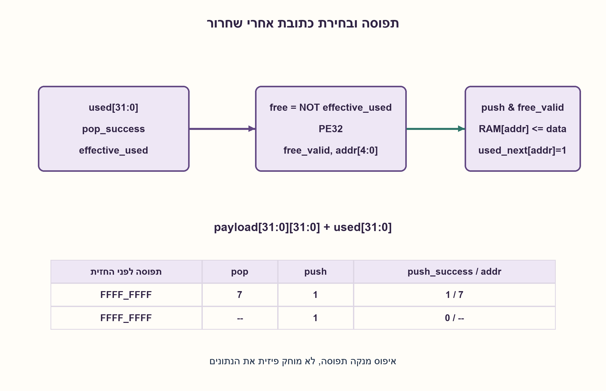
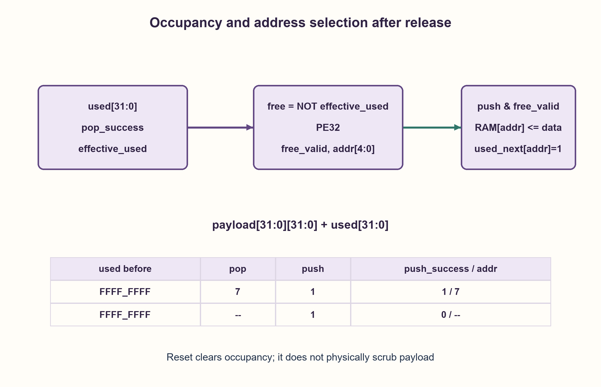

# PREP-102 — מקצה 32 תאי זיכרון בעזרת מפת תפוסה

פתרון מוצע בסיוע AI; ביקורת מקצועית אנושית ממתינה. הקושי אינו מכויל.

[צילום מקור פרטי](../sources/2026-10-31-batch21-06.png)

ממש רכיב זיכרון שבו ניתן לכתוב (push), כך שהזיכרון מחזיר את הכתובת שניתנה, ובמידה שיכול מחזיר push success. אם רוצים להחזיר את הכתובת ולמחוק אותה, נעשה pop ל־address הרלוונטית.

חברות לפי הדיווח בצילום בלבד: NVIDIA.

## עברית

### הרחבה: חומרה המקצה כתובת ב־push ומשחררת ב־pop(address)
תכננו זיכרון שבו push(data) מקצה תא פנוי, שומר נתון ומחזיר כתובת ו־push_success. pop(address) משחרר תא לפי כתובתו. זו אינה הוצאת ראש FIFO או מחסנית LIFO.

נבחרו 32 תאים של 32 סיביות, bitmap תפוסה והעדפה לכתובת הפנויה הנמוכה. כל הבקשות מתקבלות באותה עליית שעון. pop חוקי מוחל לפני push באותה חזית, כך שאפשר להקצות מיד תא ששוחרר, גם כשהזיכרון היה מלא. pop שגוי או כפול נכשל ללא שינוי. reset סינכרוני קודם לבקשות ומאפס תפוסה וסטטוס, ללא מחיקה פיזית של payload. המוצא הוא תגובת החזית, והכתובת תקפה רק כש־push_success=1.

1. הפרידו את נתוני הזיכרון מן המידע שאומר אילו תאים תפוסים.
2. איך מוצאים תא פנוי באמצעות bitmap ו־priority encoder, ומה מסמן שהזיכרון מלא?
3. חשבו תפוסה אפקטיבית אחרי pop חוקי, בחרו את האפס הראשון והקצו אותו ל־push. סדר זה מאפשר שחרור והקצאה מחדש באותה חזית.

### הזיכרון אינו חייב לדעת סדר כניסה
נשמור used[31:0], שבו אחד פירושו תא תפוס, ומערך payload של 32 מילים בנות 32 סיביות. אחרי reset כל used אפס. pop חוקי בדיוק כאשר הכתובת בטווח וסיבית used שלה הייתה אחת בתחילת החזית. במקרה כזה מנקים אותה בתפוסה האפקטיבית. pop אינו נדרש להחזיר נתון לפי המקור; אם רוצים readback יש להגדיר פורט ותזמון בנפרד.

free=NOT effective_used נכנס ל־priority encoder המפיק free_valid ואינדקס addr. אם push=1 וגם free_valid=1, מבצעים payload[addr]=data, מציבים used_next[addr]=1 ומחזירים push_success=1 יחד עם addr. אחרת push נכשל ללא כתיבה, והכתובת אינה תקפה. כל השינויים מתחייבים יחד בחזית; אין להקצות שתי כתובות לאותה בקשה או לשנות bitmap בהדרגה במהלך בחירה.

דוגמה: זיכרון מלא ו־pop(7) יחד עם push(new_data) משחררים את 7 ומקצים אותה שוב באותה חזית, עם pop_success=push_success=1. המידע הישן מוחלף. אם יש תא פנוי נמוך יותר, נבחר הוא. זו מדיניות מפורשת; מדיניות שאינה מאפשרת שימוש חוזר מיידי יכולה להיות תקפה תחת חוזה אחר.

האינווריאנט הוא שקבוצת הכתובות הפעילות שווה בדיוק לביטים המסומנים ב־used. שחרור חוקי מסיר רק כתובת פעילה; בחירה מתוך free מוסיפה רק כתובת שאינה פעילה אחרי השחרור. לכן אין הקצאה כפולה, וכל כתיבה מוצלחת שייכת לכתובת פעילה. payload שנשאר אחרי free או reset אינו מידע נגיש בבעלות חדשה עד כתיבה מוצלחת; שחרור לוגי אינו מחיקת אבטחה.

עבור N תאים ברוחב D נדרשים ND ביטי payload ועוד N ביטי תפוסה, לוגיקת עדכון ומקודד עדיפות. רשת מקודד היררכית יכולה לתת עומק O(log N); סריקת Python היא O(N) ואינה חסם זמן חומרה. פרוטוקול זה חד־לקוח ואינו כולל תורים למספר בקשות, backpressure או פיצוי על RAM macro בעל פורט מוגבל. כתובת ממוחזרת אינה handle בעל generation: pop מאוחר מאחזקת כתובת ישנה עלול לשחרר הקצאה חדשה, ולכן החוזה אוסר שימוש בכתובת לאחר שחרורה.

### מודל לוגי בפייתון שהורץ

```python
"""Address-indexed allocation, not a LIFO stack or FIFO queue."""


class AddressMemory:
    def __init__(self, depth=32, width=32):
        if depth < 1 or width < 1:
            raise ValueError("positive depth and payload width required")
        self.depth, self.width = depth, width
        self.occupied = set()
        self.payload = [None] * depth

    def tick(self, *, push=False, data=0, pop_address=None, reset=False):
        if not 0 <= data < 1 << self.width:
            raise ValueError("payload exceeds the declared width")
        if reset:
            self.occupied.clear()  # payload RAM is intentionally not scrubbed
            return {"push_success": False, "push_address": None, "pop_success": False}
        pop_success = pop_address in self.occupied
        if pop_success:
            self.occupied.remove(pop_address)
        free = next((a for a in range(self.depth) if a not in self.occupied), None)
        success = bool(push and free is not None)
        if success:
            self.payload[free] = data
            self.occupied.add(free)
        return {"push_success": success, "push_address": free if success else None,
                "pop_success": pop_success}
```




### assumptions

```json
[
  "push ו־pop נדגמים יחד; pop חוקי קודם לבחירת התא ל־push.",
  "תפוסה מתאפסת, payload אינו נשטף; כל נתון בטווח 32 ביטים.",
  "הכתובת ידית זמנית שאין להשתמש בה אחרי שחרור."
]
```

### optimality

32 ביטי ניהול ו־1024 ביטי payload במודל שנבחר, ועוד בקרים ומוצאים לפי הממשק. אין טענת מינימום שטח/השהיה או O(1) חומרתי לכל N.

### verification

448 צירופי חזית במודל עומק ארבע ו־10000 חזיתות מדגמיות בעומק 32 נבדקו מול אורקל קבוצת כתובות ומילון payload, כולל reset ושחרור לפני הקצאה. לא נבדק RAM פיזי.

### edge_cases

```json
[
  "מלא ללא pop: push נכשל.",
  "מלא עם pop חוקי: אפשר שימוש חוזר; pop כפול או כתובת מחוץ לטווח נכשלים."
]
```

### common_mistakes

```json
[
  "לפרש pop(address) כהוצאת האיבר האחרון.",
  "להחזיר כתובת בלי valid או להסתיר מדיניות push/pop סימולטניים.",
  "לחשוב ש־free מוחק את המידע או מונע בעיית כתובת ישנה."
]
```

### interview_answer

אפריד RAM ו־bitmap, אשחרר כתובת חוקית, ואז אבחר את הפנויה הנמוכה בעזרת priority encoder. אדווח success וכתובת תקפה רק אם הכתיבה בוצעה.

### source_ambiguities

המקור אינו מגדיר עומק, רוחב, reset, קריאה, פעולות בו־זמניות או כתובות שגויות. אלו הושלמו בגלוי; פתרון ה־malloc/free הישן נשמר.

### solution_extensions

```json
[
  {
    "question": "איך מגינים מפני pop של כתובת ששוחררה והוקצתה מחדש?",
    "answer_direction": "מוסיפים generation לכל תא ומחזירים handle המורכב מאינדקס ומדור. בודקים התאמה בשחרור ומגדירים טיפול בגלישת generation.",
    "principle": "כתובת פיזית אינה זהות קבועה של בעלות."
  }
]
```

## English

### Extension: hardware push allocates an address; pop(address) releases it
Design memory where push(data) allocates a free slot, stores data and returns its address with push_success. pop(address) releases the addressed slot. This is neither FIFO dequeue nor LIFO stack pop.

Choose thirty-two 32-bit slots, an occupancy bitmap and lowest-free-address priority. Requests are sampled on one rising clock. A valid pop is applied before a simultaneous push, allowing immediate reuse even when initially full. Invalid or duplicate pop fails without changes. Synchronous reset overrides requests and clears occupancy/status without physically scrubbing payload. Outputs describe the sampled operation; the returned address is valid only when push_success=1.

1. Separate payload storage from occupancy metadata.
2. How do a bitmap and priority encoder find a free slot, and how is full represented?
3. Compute effective occupancy after a valid pop, select its first zero, then allocate for push. This ordering permits release and reuse on the same edge.

### Allocation need not retain insertion order
Keep used[31:0], where one means occupied, plus thirty-two 32-bit payload words. Reset clears used. A pop succeeds exactly when its address is in range and was occupied at the start of the edge. Clear that bit in effective occupancy. The source does not require returning payload on pop; readback needs its own port and timing contract.

Feed free=NOT effective_used into a priority encoder producing free_valid and addr. If push and free_valid are both true, write payload[addr]=data, set used_next[addr] and return push_success with addr. Otherwise no write occurs and the address is invalid. All updates commit together; selection must not expose partially modified metadata.

Example: when full, simultaneous pop(7) and push(new_data) release and reallocate slot seven on the same edge, with both successes asserted and old data replaced. If another lower free slot exists, priority chooses it instead. This is an explicit policy; disallowing immediate reuse would be a different valid contract.

Invariant: live addresses are exactly the set bits of used. A valid release removes only a live address; allocation selects an address free after that release. Therefore duplicate allocation is impossible, and every successful write belongs to a live slot. Payload retained after free/reset does not constitute a new valid allocation; logical release is not secure erasure.

N slots of D bits need ND payload bits and N occupancy bits plus update/priority logic. A hierarchical encoder can have O(log N) depth; the Python scan is O(N) and is not a hardware-delay bound. This single-client protocol does not provide multiple-request queues, backpressure or a limited-port RAM-macro implementation. Recycled addresses are not generation-tagged handles: a stale later pop could free a new owner, so the contract forbids using an address after release.

### Executed Python logical model

```python
"""Address-indexed allocation, not a LIFO stack or FIFO queue."""


class AddressMemory:
    def __init__(self, depth=32, width=32):
        if depth < 1 or width < 1:
            raise ValueError("positive depth and payload width required")
        self.depth, self.width = depth, width
        self.occupied = set()
        self.payload = [None] * depth

    def tick(self, *, push=False, data=0, pop_address=None, reset=False):
        if not 0 <= data < 1 << self.width:
            raise ValueError("payload exceeds the declared width")
        if reset:
            self.occupied.clear()  # payload RAM is intentionally not scrubbed
            return {"push_success": False, "push_address": None, "pop_success": False}
        pop_success = pop_address in self.occupied
        if pop_success:
            self.occupied.remove(pop_address)
        free = next((a for a in range(self.depth) if a not in self.occupied), None)
        success = bool(push and free is not None)
        if success:
            self.payload[free] = data
            self.occupied.add(free)
        return {"push_success": success, "push_address": free if success else None,
                "pop_success": pop_success}
```




### assumptions

```json
[
  "Push/pop are sampled together, with valid pop preceding allocation.",
  "Reset clears occupancy, not payload; data fit thirty-two bits.",
  "An address is a temporary handle that must not be reused after release."
]
```

### optimality

Chosen storage is thirty-two metadata bits and 1024 payload bits, plus interface/control state. No global area/delay or constant-for-all-N hardware claim.

### verification

448 one-edge cases at depth four and ten thousand seeded depth-thirty-two edges matched independent live-address/payload oracles, including reset and pop-before-push. No physical RAM test.

### edge_cases

```json
[
  "Full without pop: push fails.",
  "Full with valid pop permits reuse; duplicate or out-of-range pop fails."
]
```

### common_mistakes

```json
[
  "Treating pop(address) as stack pop.",
  "Returning an address without validity or hiding simultaneous-request policy.",
  "Assuming release erases data or prevents stale-handle problems."
]
```

### interview_answer

Separate RAM from occupancy, release a valid address, then use a priority encoder to select the lowest free slot. Report success/address only for a committed allocation.

### source_ambiguities

Depth, width, reset, reading, simultaneous operations and invalid addresses are unspecified. These are explicit completions; the older malloc/free solution remains intact.

### solution_extensions

```json
[
  {
    "question": "How can a stale pop be rejected after an address was reallocated?",
    "answer_direction": "Add a per-slot generation and return an index/generation handle. Validate both on release and define generation wrap.",
    "principle": "A physical index is not a permanent ownership identity."
  }
]
```
