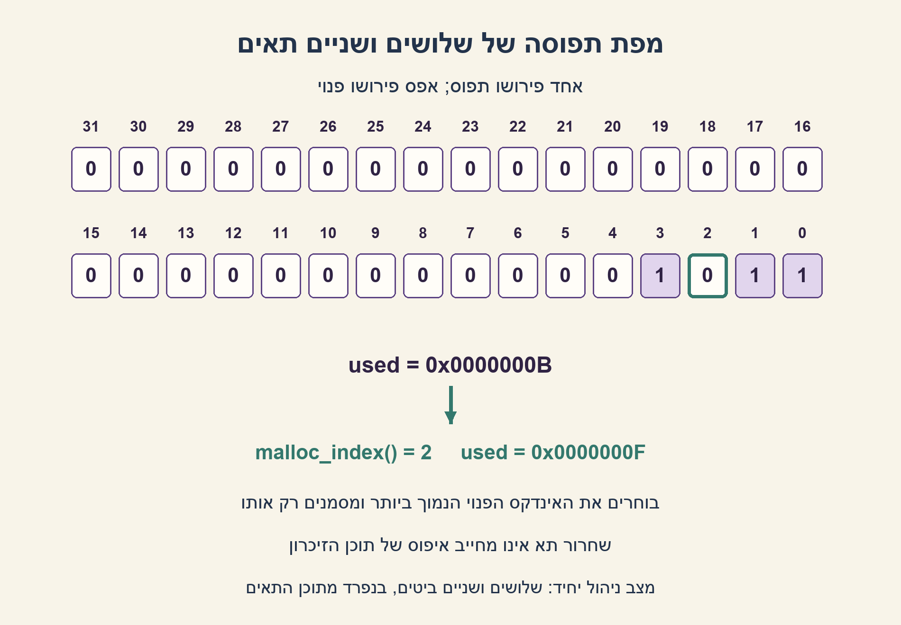
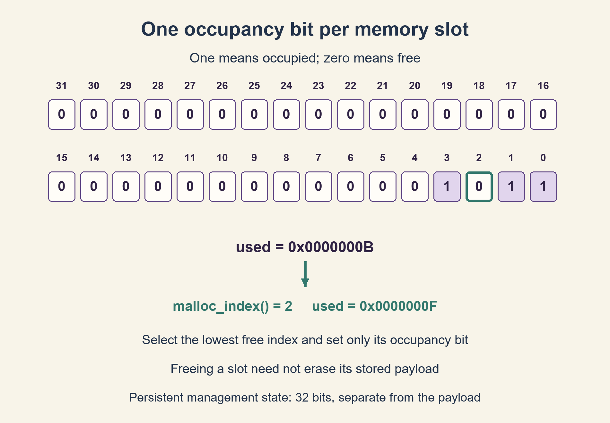

# PREP-102 — מקצה 32 תאי זיכרון בעזרת מפת תפוסה

פתרון מוצע בסיוע AI; אין אישור מקצועי אנושי חדש.

## מקור

[צילום המקור](../sources/2026-10-24-batch20-15.png)

ברשותך מרחב זכרון רציף של 32 כתובות כאשר כל כתובת היא בגודל 32 ביט. ממש malloc שמחזיר אינדקס של כתובת פנויה ו-free שמקבל מספר שורה ומשחרר את הזיכרון בה. בנוסף ברשותך זיכרון נוסף באורך 32 ביט לניהול הזיכרון.

דיווח החברה NVIDIA מופיע בצילום בלבד ולא אומת באופן עצמאי.

## מקצה 32 תאי זיכרון בעזרת מפת תפוסה

ברשותכם 32 תאי זיכרון רציפים, שכל אחד מהם בגודל 32 ביטים, ומילה נוספת אחת בת 32 ביטים לניהול ההקצאה. ממשו malloc שמחזיר אינדקס של תא פנוי ו־free שמקבל אינדקס ומשחרר את התא. הסבירו את מצב הניהול, דרך הבחירה, הנכונות והעלות.

הבהרות שנוספו למקור: האינדקסים הם 0..31, בתחילה הכול פנוי, וכל בקשה מקצה תא אחד. נבחר תמיד התא הפנוי בעל האינדקס הנמוך ביותר. אם אין תא פנוי, מוחזר ‎-1. free מחזירה false לאינדקס לא תקין או לתא שכבר פנוי, בלי לשנות מצב. הפעולות סדרתיות, ללא גישה מקבילית. מותר מספר קבוע של משתנים זמניים; רק מילת התפוסה נשמרת כמצב ניהול בין פעולות. אין צורך לאפס את תוכן התא בשחרור.

### שלושה רמזים

1. איך אפשר לתאר בנפרד עבור כל תא אם הוא פנוי או תפוס, בלי לשמור מספר שלם לכל תא?
2. השתמשו בביט אחד לכל אינדקס. כדי למצוא תא פנוי צריך לחפש אפס במפת התפוסה.
3. סרקו לכל היותר 32 ביטים, סמנו את האפס הראשון שמצאתם והחזירו את מיקומו. בשחרור נקו רק את ביט האינדקס, לאחר בדיקת תקינות.

### הצעה לפתרון

### ביט אחד לכל תא
מגדירים used: ביט i שווה 1 אם ורק אם התא i מוקצה. לכן 32 הביטים מתארים בדיוק את 32 מצבי התפוסה. תוכן התאים עצמם נשאר לשימוש הלקוח ואינו מאחסן רשימת ניהול.

### הקצאה ושחרור
1. הופכים את הביטים בתוך מילה של 32 ביטים: free_bits=~used. אחד במילה החדשה מציין תא פנוי.
2. אם התוצאה אפס, אין תא פנוי ומחזירים ‎-1 בלי לשנות דבר.
3. סורקים מהאינדקס 0 כלפי מעלה. כשמוצאים ביט 1 ב־free_bits, מדליקים את אותו ביט ב־used ומחזירים את האינדקס.
4. בשחרור בודקים תחילה שהאינדקס בטווח ושהביט דלוק. אם כן, מכבים אותו בלבד; אם לא, מחזירים false. אין קריאה או כתיבה של מטען המשתמש.

למשל used=0x0000000B פירושו שהתאים 0,1,3 תפוסים. ההקצאה הבאה מחזירה 2 ומשנה את המפה ל־0x0000000F. שחרור 1 מאפשר להקצאה הבאה להחזיר שוב 1.

### למה זה נכון?
בתחילה כל הביטים אפס וכל התאים פנויים. הקצאה בוחרת רק ביט שהיה אפס ומדליקה רק אותו, ולכן אינה מחזירה תא שכבר הוקצה. שחרור תקין מנקה רק את התא המבוקש. כך נשמרת אחרי כל פעולה ההתאמה בין הביטים לבין ההקצאות. כשהמפה מלאה אין ביט פנוי ולכן מוחזר כישלון.

### זמן וזיכרון
הקוד הנייד סורק לכל היותר 32 מקומות: זה O(1) עבור הקיבולת הקבועה. בהכללה ל־w תאים הסריקה היא O(w); הוראת איתור ביט זמינה יכולה לקצר את הסריקה כשכל המפה נכנסת למילת מכונה. יש לבדוק אפס לפני הוראת CTZ שאינה מוגדרת לאפס.

מצב הניהול הלוגי הוא בדיוק 32 ביטים, נוסף ל־32×32=1024 ביטי המטען. משתני הביניים הם מילים זמניות ואינם מצב נוסף שנשמר. מודל Python משתמש באובייקטים של השפה ולכן אינו טוען שצריכת ההיפ שלו היא ארבעה בתים; הוא מאמת את לוגיקת המפה. אין כאן טיפול בבקשות לרצף של כמה תאים, בסנכרון בין תהליכונים או בזיכרון דינמי כללי. מזהה ישן אחרי שחרור והקצאה מחדש אינו מזוהה: לכך דרוש מידע נוסף כגון דורות.

```cpp
// C++17 implementation. Only used_ is persistent allocation-management state.
#include <cstdint>

class Pool32 {
    std::uint32_t used_ = 0;
public:
    int malloc_index() {
        const std::uint32_t free_bits = ~used_;
        if (free_bits == 0) return -1;
        for (unsigned index = 0; index < 32; ++index) {
            const std::uint32_t bit = std::uint32_t{1} << index;
            if (free_bits & bit) {
                used_ |= bit;
                return static_cast<int>(index);
            }
        }
        return -1;
    }

    bool free_index(int index) {
        if (index < 0 || index >= 32) return false;
        const std::uint32_t bit = std::uint32_t{1} << index;
        if ((used_ & bit) == 0) return false;
        used_ &= ~bit;
        return true;
    }
};
```



## Allocate 32 memory slots using one occupancy bitmap

You have 32 contiguous memory slots, each holding 32 bits, plus one extra 32-bit management word. Implement malloc returning a free slot index and free accepting an index to release. Explain the management state, selection, correctness and cost.

Added clarifications: indices are 0..31; all slots start free; each request allocates one slot. Always choose the lowest free index. Return -1 when full. free returns false for an invalid index or an already-free slot without modifying state. Operations are sequential, with no concurrency. A constant number of temporary scalars is allowed; only the occupancy word persists between operations. Freeing a slot need not erase its payload.

### Three hints

1. How can each slot be marked free or occupied without storing a separate integer per slot?
2. Use one bit per index. Finding a free slot means finding a zero in the occupancy word.
3. Inspect at most 32 bits, set the first zero and return its index. On free, validate the index and clear only its occupancy bit.

### Proposed solution

### One bit per slot
Let bit i of used be one exactly when slot i is allocated. The 32 bits therefore represent the occupancy of all 32 slots. Payload cells remain available to the client; they do not hold a management list.

### Allocation and release
1. Complement the occupancy within a 32-bit word: free_bits=~used. A one now marks a free slot.
2. If the result is zero, return -1 without changing anything.
3. Scan indices upward from zero. At the first set bit in free_bits, set that bit in used and return its index.
4. On release, first check the index range and that its bit is set. Clear only that bit on success; otherwise return false. No client payload is read or written.

For example, used=0x0000000B marks slots 0,1,3 occupied. The next allocation returns 2 and changes the word to 0x0000000F. Releasing 1 lets the next allocation return 1 again.

### Correctness
Initially all bits are zero and all slots free. Allocation selects only a zero bit and changes only that bit, so an already-allocated slot cannot be returned. A valid release clears only the requested bit. Thus occupancy and live allocations remain consistent after every operation. A full bitmap contains no free bit, so allocation fails.

### Cost and scope
The portable code scans at most 32 positions: O(1) for this fixed capacity. Generalizing to w slots makes this scan O(w); an available bit-scan instruction may shorten it when the bitmap fits a machine word. Check zero before a CTZ intrinsic whose zero case is undefined.

Logical persistent management state is exactly 32 bits, separate from 32×32=1024 payload bits. Temporary scalars are not additional persistent state. The Python model uses language objects and does not claim a four-byte heap footprint; it verifies bitmap logic. This is not a general allocator, a contiguous-multiple-slot allocator or a concurrent implementation. A stale index after release and reallocation is not detectable without additional information such as generation counters.

```cpp
// C++17 implementation. Only used_ is persistent allocation-management state.
#include <cstdint>

class Pool32 {
    std::uint32_t used_ = 0;
public:
    int malloc_index() {
        const std::uint32_t free_bits = ~used_;
        if (free_bits == 0) return -1;
        for (unsigned index = 0; index < 32; ++index) {
            const std::uint32_t bit = std::uint32_t{1} << index;
            if (free_bits & bit) {
                used_ |= bit;
                return static_cast<int>(index);
            }
        }
        return -1;
    }

    bool free_index(int index) {
        if (index < 0 || index >= 32) return false;
        const std::uint32_t bit = std::uint32_t{1} << index;
        if ((used_ & bit) == 0) return false;
        used_ &= ~bit;
        return true;
    }
};
```



## חומר משלים / Supporting material

```json
{
  "assumptions": {
    "he": [
      "32 תאים נפרדים, אינדקסים 0..31, הקצאת תא יחיד ותחילה כולם פנויים.",
      "סביבה סדרתית; רק מפת התפוסה נשמרת כמצב ניהול.",
      "כישלון הקצאה מחזיר ‎-1; שחרור שגוי או כפול מחזיר false בלי שינוי."
    ],
    "en": [
      "32 individual slots indexed 0..31, one slot per request, initially all free.",
      "Sequential operation; only the occupancy bitmap is persistent management state.",
      "Allocation failure returns -1; invalid or repeated release returns false without change."
    ]
  },
  "optimality": {
    "he": "נדרשים לפחות 32 ביטים לתיאור שרירותי של 2^32 קבוצות תפוסה, אם כל קבוצת תאים יכולה להיות מוקצית ואין מידע ניהול חיצוני. המפה משיגה חסם מצב זה. אין טענה למספר הוראות מכונה מינימלי.",
    "en": "Arbitrary occupancy has 2^32 possible subsets, requiring at least 32 bits when every subset is allowed and no external management information exists. The bitmap meets this state bound; no minimum instruction-count claim is made."
  },
  "edge_cases": {
    "he": [
      "תחילה ריק; לאחר 32 הקצאות כל בקשה נכשלת.",
      "התא 31 משתמש בביט הגבוה; אין להזיז במספר שלילי או ב־32.",
      "שחרור כפול, אינדקס שגוי, ומחזור שחרור והקצאה מחדש."
    ],
    "en": [
      "Initially empty; after 32 allocations every request fails.",
      "Slot 31 uses the highest bit; never shift by a negative count or by 32.",
      "Double free, invalid index, and release followed by reallocation."
    ]
  },
  "common_mistakes": {
    "he": [
      "להשתמש ב־~used של Python ללא מסכת 32 ביטים.",
      "להחזיר אותו תא בלי לסמן תפוסה או לנקות את כל המפה בשחרור.",
      "לטעון ש־O(1) פעולות מחייב אפס אתחול, או שמודל Python צורך פיזית רק 32 ביטים."
    ],
    "en": [
      "Using Python ~used without a 32-bit mask.",
      "Returning a slot without marking it or clearing the entire map on release.",
      "Confusing constant-time operations with zero initialization, or claiming a Python object physically occupies 32 bits."
    ]
  },
  "interview_answer": {
    "he": "מילה בת 32 ביטים היא מפת תפוסה. מקצים על ידי חיפוש ביט אפס והדלקתו, ומשחררים על ידי ניקוי הביט המתאים. סריקה של 32 ביטים היא זמן קבוע בקיבולת הנתונה; כל המטען נשאר מחוץ למצב הניהול.",
    "en": "Use the 32-bit word as an occupancy bitmap. Allocate by finding and setting a zero bit; release by clearing the indexed bit. Scanning 32 bits is constant time for the fixed capacity, and payload stays separate from management state."
  },
  "source_ambiguities": {
    "he": "המקור אינו מגדיר תחילת מצב, כישלון, מספור, שחרור שגוי, מקביליות או מדיניות בחירה. החוזה המפורש נוסף בעריכה, אינו ציטוט מהמקור.",
    "en": "The source omits initialization, failure behavior, indexing, invalid frees, concurrency and selection policy. The explicit contract is an editorial addition, not a source quotation."
  },
  "verification": {
    "he": "הקוד בפייתון הורץ מול אורקל קבוצות נפרד: כל 65,536 מצבי תפוסת 16 התאים הנמוכים כאשר העליונים תפוסים, 50,000 פעולות אקראיות, מלא/ריק ושחרורים לא תקינים. C++ נכתב אך לא קומפל; אין בדיקת מקביליות.",
    "en": "The actual Python model was checked against an independent set oracle: all 65,536 lower-16 occupancy states with upper slots occupied, 50,000 random operations, full/empty cases and invalid frees. C++ was authored but not compiled; concurrency was not tested."
  },
  "solution_extensions": {
    "he": {
      "question": "מה משתנה אם שתי יחידות מבקשות להקצות במקביל?",
      "direction": "עדכון של קריאה-שינוי-כתיבה יכול להחזיר אותו תא פעמיים. נדרש מנעול או לולאת פעולה אטומית; מפת ביטים לבדה אינה מספקת סנכרון."
    },
    "en": {
      "question": "What changes if two units allocate concurrently?",
      "direction": "A read-modify-write race can return the same slot twice. Use synchronization such as a lock or an atomic update loop; a bitmap alone does not synchronize."
    }
  }
}
```


## מקור נוסף — 25.10.2026

צילום נוסף של מקצה 32 תאים באמצעות רגיסטר int32 יחיד. רוחב התא לא נמסר בצילום החדש ואינו משנה את מפת הסיביות. ללא הרחבה לגרסת64 התאים PREP-107.
