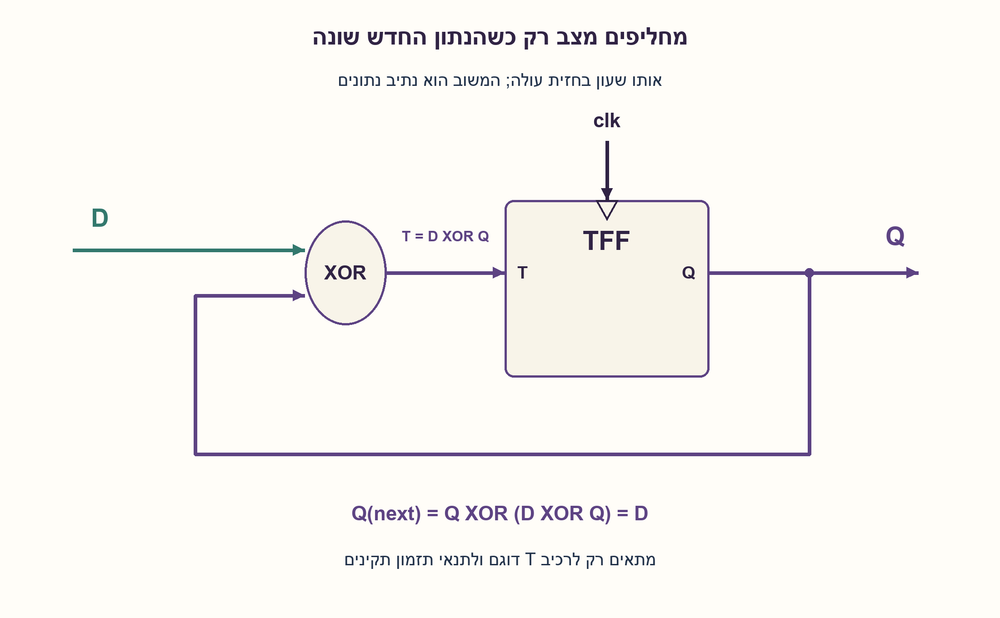
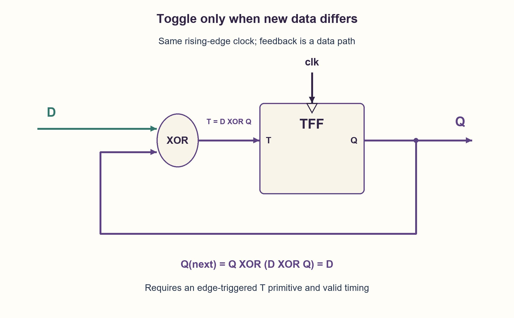

# PREP-103 — מימוש D Flip-Flop באמצעות T Flip-Flop

פתרון מוצע בסיוע AI; ביקורת מקצועית אנושית ממתינה. הקושי לא כויל.

## מקור

[צילום המקור](../sources/2026-10-24-batch20-17.png)

ממש DFF בעזרת TFF

שיוכי החברות בצילום מדווחים ולא אומתו באופן עצמאי: Sandisk.

## נוסח ערוך

מימוש D Flip-Flop באמצעות T Flip-Flop

נתון T Flip-Flop. הוסיפו לוגיקה קומבינטורית כך שהרכיב הכולל יתנהג כמו D Flip-Flop: בכל חזית שעון פעילה ישמור את D, ובין חזיתות יחזיק את המצב. הציגו חיבור, טבלת מעבר והסבר.

הבהרות: רכיב T הוא דוגם בחזית עולה, T=0 מחזיק ו־T=1 הופך את Q באותה חזית. מותר שער XOR וגישה למשוב Q; משתמשים בשעון המקורי ללא שער על נתיב השעון. אין דרישת reset או מצב התחלתי קבוע. מניחים מצבים בינאריים יציבים ותנאי setup/hold תקינים גם ל־D וגם למשוב. אין מדובר בנועל T שקוף או בהדק אסינכרוני.

### שלושה רמזים

1. אם הנתון החדש שווה למצב הקיים, האם צריך להחזיק או להפוך? ומה אם הוא שונה?
2. כניסת T צריכה להיות 1 בדיוק כאשר D שונה מ־Q. איזה שער מזהה שוני בין שני ביטים?
3. חברו T=D XOR Q. הציבו במשוואת TFF: Q_next=Q XOR T. הוכיחו שהביט Q מתבטל ונותר D.

### הצעה לפתרון

### השאלה שכניסת T שואלת
כניסת D אומרת איזה ערך רוצים לשמור. כניסת T אומרת אם לשנות את הערך שכבר שמור. לכן צריך לתרגם בקשת ערך לבקשת שינוי: אם D=Q לא משנים, ואם D שונה מ־Q הופכים.

שער XOR מחזיר 1 בדיוק כשהכניסות שונות. לכן מחברים את D ואת Q לשער XOR, ואת פלט השער לכניסת T. פלט Q ממשיך גם למוצא החיצוני וגם לענף המשוב. מחברים את השעון המקורי ישירות לשעון ה־TFF.

```text
T = D XOR Q
Q_next = Q XOR T
       = Q XOR (D XOR Q)
       = D
```

### כל ארבעת המקרים
| Q לפני החזית | D שנדגם | T | פעולת TFF | Q אחרי החזית |
| --- | --- | --- | --- | --- |
| 0 | 0 | 0 | החזקה | 0 |
| 0 | 1 | 1 | היפוך | 1 |
| 1 | 0 | 1 | היפוך | 0 |
| 1 | 1 | 0 | החזקה | 1 |

למשל, אם Q=1 ורוצים לשמור D=0, ה־XOR מפיק T=1 והחזית הבאה הופכת את Q לאפס. אם Q כבר אפס, אותו D מפיק T=0, ולכן האפס נשמר. בשני המקרים מקבלים את הנתון הרצוי בחזית אחת, בלי מחזור נוסף.

### למה המשוב לא יוצר תנודות בין חזיתות?
אחרי שה־TFF שינה את Q, ה־XOR עשוי לשנות את T. זה מכין את ערך הבקרה לחזית הבאה בלבד: רכיב דוגם אינו מגיב לשינוי T בין חזיתות. אם משתמשים בנועל שקוף במקום ב־TFF דוגם, הטיעון הזה אינו תקף ויש לנתח מבנה אחר.

### תנאי תזמון ואתחול
המסלול Q→XOR→T חייב לעמוד ב־setup לחזית הבאה וב־hold סביב אותה חזית. גם ל־D יש נתיב דרך XOR ל־T. עבור skew אפס ואי־ודאות אפס, למשל, מסלול המשוב דורש Tclk>=tCQ(max)+tXOR/wire(max)+tSetup ו־tCQ(min)+tXOR/wire(min)>=tHold. אין להסיק חסינות לגליצ׳ים או תזמון תקין מהזהות הבוליאנית בלבד.

לא נדרש לדעת מראש אם המצב היציב הקיים הוא 0 או 1 כדי להוכיח את ארבע השורות. אין בכך הבטחת אתחול אנלוגי, יציאה ממטא־יציבות או התכנסות בסימולציית ארבעה מצבים: X XOR X אינו מתבטל אוטומטית ל־0 במודל כזה. בדיקות הקוד מתחילות מכל אחד משני המצבים הבינאריים בנפרד.

### עלות ואימות
TFF אחד ושער XOR אחד מספיקים במודל שהוגדר. אין תוספת מחזור השהיה ואין שינוי שעון. אין טענת מינימום שטח או עיכוב בספריית תאים מסוימת. נבדקו ארבע שורות Q,D, החזקה ללא חזית, ו־4,094 רצפי קלט מאורך אפס עד עשר משני מצבי התחלה, בסך 36,868 חזיתות. אורקל נפרד פשוט שומר D בכל חזית. זהו מודל לוגי בפייתון, לא סימולציית HDL או בדיקת חומרה.

```python
"""Two-state, rising-edge TFF model; the added XOR computes T=D XOR Q.

Clock, data and the feedback path must satisfy the primitive's timing contract.
No reset, initialized power-up state or physical metastability model is implied.
"""


def bit(value):
    if type(value) is not int or value not in (0, 1):
        raise ValueError("expected integer bit 0 or 1")
    return value


def tff(q, toggle, *, rising_edge=True):
    q, toggle = bit(q), bit(toggle)
    if type(rising_edge) is not bool:
        raise ValueError("rising_edge must be Boolean")
    return q ^ toggle if rising_edge else q


def dff_from_tff(q, data, *, rising_edge=True):
    q, data = bit(q), bit(data)
    toggle = data ^ q
    return tff(q, toggle, rising_edge=rising_edge)


def trace(data_samples, *, initial):
    q = bit(initial)
    states = []
    for data in data_samples:
        q = dff_from_tff(q, data)
        states.append(q)
    return states
```



## English edition

Implement a D flip-flop using a T flip-flop

Given a T flip-flop, add combinational logic so that the complete component behaves as a D flip-flop: store D on each active clock edge and hold state between edges. Show connections, a transition table and reasoning.

Clarifications: the T primitive is rising-edge triggered; T=0 holds Q and T=1 complements it at that edge. XOR logic and Q feedback are allowed. Keep the original clock without gating it. No reset or fixed initial value is required. Assume stable binary states and valid setup/hold for both data and feedback. This is not a transparent T latch or an asynchronous control pin.

### Three hints

1. If the desired data matches current state, should the TFF hold or toggle? What if they differ?
2. T must be one exactly when D differs from Q. Which gate detects a difference between two bits?
3. Connect T=D XOR Q. Substitute into the TFF equation Q_next=Q XOR T and show that Q cancels, leaving D.

### Proposed solution

### The question asked by T
D states which value we want to store. T states whether to change the value already stored. Translate a requested value into a requested change: hold if D=Q, toggle if D differs from Q.

XOR is one exactly when its inputs differ. Connect D and Q to an XOR, then connect its output to T. Q also remains the external output. Connect the original clock directly to the TFF clock pin.

```text
T = D XOR Q
Q_next = Q XOR T
       = Q XOR (D XOR Q)
       = D
```

### Every binary case
| Q before edge | Sampled D | T | TFF action | Q after edge |
| --- | --- | --- | --- | --- |
| 0 | 0 | 0 | hold | 0 |
| 0 | 1 | 1 | toggle | 1 |
| 1 | 0 | 1 | toggle | 0 |
| 1 | 1 | 0 | hold | 1 |

For example, if Q=1 and we want D=0, XOR produces T=1, so the next edge toggles Q to zero. If Q is already zero, the same D produces T=0 and zero is retained. Both cases capture the desired data in one edge, without an added cycle.

### Why does feedback not oscillate between edges?
After the TFF changes Q, the XOR may change T. That only prepares the control value for the next edge: an edge-triggered primitive ignores T changes between edges. This reasoning does not apply to a transparent latch substituted for the declared TFF.

### Timing and initialization
The Q→XOR→T path must meet next-edge setup and same-edge hold. D also has an input path through XOR to T. With zero skew and uncertainty, for example, feedback requires Tclk>=tCQ(max)+tXOR/wire(max)+tSetup and tCQ(min)+tXOR/wire(min)>=tHold. A Boolean identity alone establishes neither glitch freedom nor valid timing.

The four truth rows work for either stable binary initial Q, without needing to know which one it is. This does not guarantee analog initialization, recovery from metastability or convergence of a four-state simulation: X XOR X does not automatically cancel to zero in that model. Code checks start separately from each concrete binary state.

### Cost and verification
One TFF and one XOR suffice under the declared model. There is no extra cycle and no clock modification. No minimum cell area or technology-specific delay is claimed. Four Q,D rows, holding without an edge, and 4,094 input streams of lengths zero through ten from both initial states passed, totaling 36,868 edges. A separate oracle simply stores D at every edge. This is a Python logical model, not HDL simulation or a hardware experiment.

```python
"""Two-state, rising-edge TFF model; the added XOR computes T=D XOR Q.

Clock, data and the feedback path must satisfy the primitive's timing contract.
No reset, initialized power-up state or physical metastability model is implied.
"""


def bit(value):
    if type(value) is not int or value not in (0, 1):
        raise ValueError("expected integer bit 0 or 1")
    return value


def tff(q, toggle, *, rising_edge=True):
    q, toggle = bit(q), bit(toggle)
    if type(rising_edge) is not bool:
        raise ValueError("rising_edge must be Boolean")
    return q ^ toggle if rising_edge else q


def dff_from_tff(q, data, *, rising_edge=True):
    q, data = bit(q), bit(data)
    toggle = data ^ q
    return tff(q, toggle, rising_edge=rising_edge)


def trace(data_samples, *, initial):
    q = bit(initial)
    states = []
    for data in data_samples:
        q = dff_from_tff(q, data)
        states.append(q)
    return states
```



## חומר משלים דו־לשוני / Bilingual supporting material

```json
{
  "assumptions": {
    "he": [
      "TFF דוגם בחזית עולה: T=0 מחזיק ו־T=1 הופך.",
      "מותר XOR ומשוב Q; השעון המקורי אינו משתנה.",
      "מצב בינארי יציב ותנאי setup/hold תקינים; אין reset מוגדר."
    ],
    "en": [
      "Rising-edge TFF: T=0 holds and T=1 toggles.",
      "XOR and Q feedback are allowed; the original clock is unchanged.",
      "Stable binary state and valid setup/hold; no reset is specified."
    ]
  },
  "optimality": {
    "he": {
      "construction": "TFF אחד ושער XOR אחד; אגירה בחזית אחת בלי מחזור נוסף.",
      "scope": "אין טענת מינימום שטח, מספר טרנזיסטורים או השהיה פיזית."
    },
    "en": {
      "construction": "One TFF plus one XOR; one-edge capture without an added cycle.",
      "scope": "No minimum area, transistor-count or physical-delay claim."
    }
  },
  "edge_cases": {
    "he": [
      "D שווה ל־Q: מחזיקים.",
      "D שונה מ־Q: הופכים.",
      "שינוי D בין חזיתות אינו מעדכן את Q מיד.",
      "אין להסיק מצב Q לפני החזית הראשונה ללא אתחול.",
      "מודל ארבעה מצבים יכול להישאר X למרות זהות בינארית תקינה."
    ],
    "en": [
      "D=Q holds.",
      "D differs from Q: toggle.",
      "Changing D between edges does not immediately change Q.",
      "Do not assume Q before the first edge without initialization.",
      "A four-state model may remain X despite a valid binary identity."
    ]
  },
  "common_mistakes": {
    "he": [
      "חיבור T=D ישירות: D=1 יהפוך שוב ושוב במקום לשמור 1.",
      "בלבול בין TFF דוגם לנועל שקוף.",
      "שינוי נתיב השעון כדי לחקות החזקה.",
      "הנחת אפס התחלתי או התעלמות מתזמון מסלול המשוב.",
      "הסקת התנהגות אנלוגית או התאוששות מ־X מאלגברה בינארית."
    ],
    "en": [
      "Wiring T=D directly: D=1 repeatedly toggles instead of storing one.",
      "Confusing an edge-triggered TFF with a transparent latch.",
      "Changing the clock path to imitate holding.",
      "Assuming initial zero or overlooking feedback timing.",
      "Inferring analog behavior or X recovery from two-state algebra."
    ]
  },
  "interview_answer": {
    "he": "אחבר T=D XOR Q. כשהנתון כבר שמור T=0, וכשהוא שונה T=1 וה־TFF הופך. לכן Q_next=Q XOR D XOR Q=D בכל חזית. השעון נשאר זהה, ובין חזיתות Q מוחזק.",
    "en": "Connect T=D XOR Q. T=0 when data is already stored, and T=1 when a toggle is needed. Thus Q_next=Q XOR D XOR Q=D at each edge. Keep the same clock; Q holds between edges."
  },
  "source_ambiguities": {
    "he": [
      "המקור הקצר אינו מגדיר קוטביות חזית, לוגיקה מותרת או אתחול; הנחות אלה נוספו במפורש.",
      "Sandisk מופיעה במקור בלבד, ללא אימות שיוך עצמאי."
    ],
    "en": [
      "The short source does not define edge polarity, allowed logic or initialization; those assumptions are explicitly added.",
      "Sandisk appears only in the source and is not independently verified."
    ]
  },
  "verification": {
    "he": "ארבע שורות Q,D, ארבע החזקות ללא חזית ו־4,094 רצפים משני מצבי התחלה עברו מול אורקל DFF עצמאי, בסך 36,868 חזיתות. Python בשני מצבים בלבד; ללא HDL, תזמון פיזי או מטא־יציבות.",
    "en": "Four Q,D rows, four no-edge holds and 4,094 streams from both initial states passed against an independent DFF oracle, totaling 36,868 edges. Two-state Python only; no HDL, physical timing or metastability simulation."
  },
  "relationship_note": {
    "he": "PREP-074 מממש TFF מ־DFF ו־XOR; כאן כיוון ההמרה הפוך. PREP-065 מממש DFF מרכיב SR, שהוא פרימיטיב אחר.",
    "en": "PREP-074 constructs a TFF from a DFF and XOR; this reverses that conversion. PREP-065 uses an SR primitive instead."
  },
  "solution_extensions": {
    "he": {
      "question": "איך מוסיפים enable בעזרת אותו TFF?",
      "direction": "משנים מצב רק כאשר enable=1 וגם D שונה מ־Q, לכן T=enable AND (D XOR Q). מוכיחים החזקה כש־enable=0 בלי לשער את השעון.",
      "status": "מוכן בתוכן; אינו מחובר לתור שאלות ההמשך."
    },
    "en": {
      "question": "How can enable be added using the same TFF?",
      "direction": "Toggle only if enable=1 and D differs from Q, so T=enable AND (D XOR Q). Prove holding for enable=0 without gating the clock.",
      "status": "Prepared in content; not connected to the interactive follow-up queue."
    }
  }
}
```
