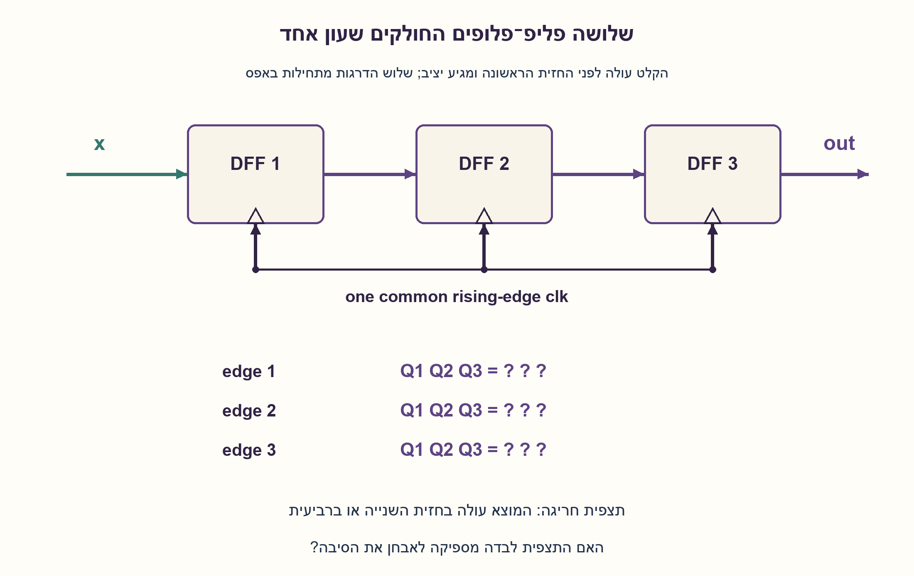
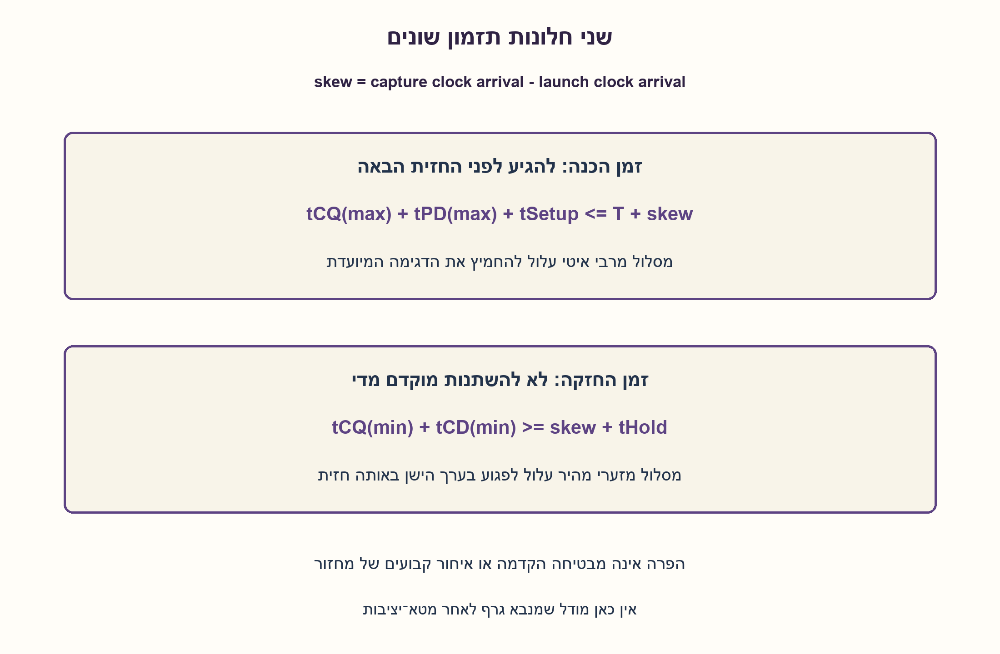
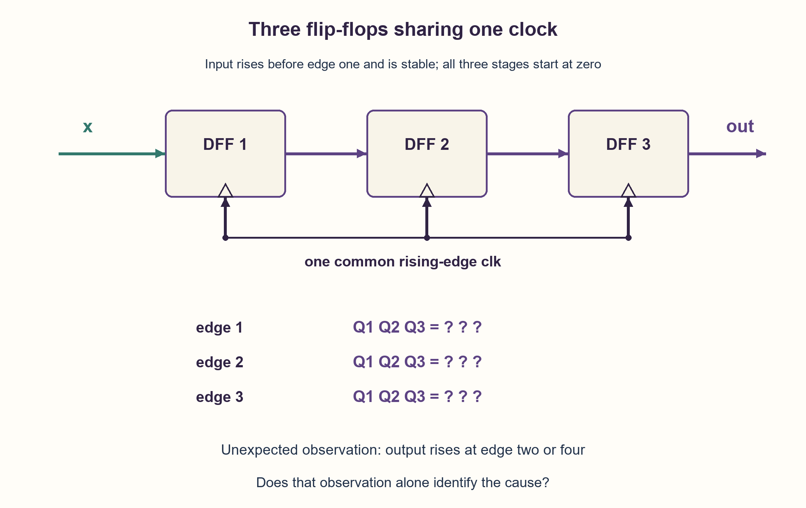
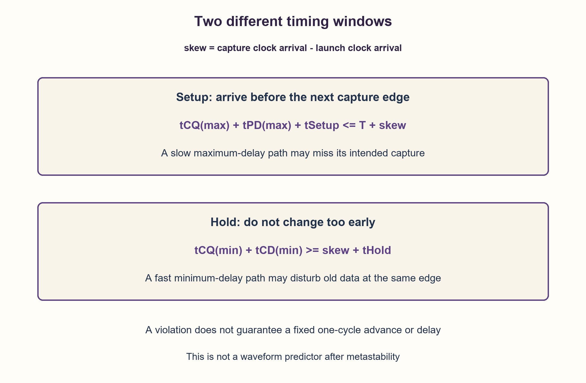

# PREP-104 — שרשרת שלושה FF — יציאה מוקדמת או מאוחרת ואבחון תזמון

פתרון מוצע בסיוע AI; ביקורת מקצועית אנושית ממתינה. הקושי לא כויל.

## מקור

[צילום המקור](../sources/2026-10-24-batch20-19.png)

יצרת מעגל פשוט בו שרשרת שלושה רכיבי FF אחד אחרי השני. הכניסה הייתה קבועה על 0 ועולה ברגע t=0 ל־1 ונשארת גבוהה. הציפייה היא שלאחר שלושה מחזורי שעון היציאה תעלה ל־1. היציאה עולה לאחר שני מחזורי שעון, איזה תנאי לא התקיים? תנאי setup או תנאי hold? היציאה עולה לאחר ארבעה מחזורי שעון, איזה תנאי לא התקיים כעת?

שיוכי החברות בצילום מדווחים ולא אומתו באופן עצמאי: Apple.

## נוסח ערוך

שרשרת שלושה FF — יציאה מוקדמת או מאוחרת ואבחון תזמון

שלושה D Flip-Flops מחוברים בטור לשעון משותף בחזית עולה: D1=x, D2=Q1, D3=Q2, והמוצא הוא Q3. בתחילה x=0 וגם Q1Q2Q3=000. x עולה ל־1 ונשאר גבוה. תחת תזמון תקין מצפים לעלייה במוצא אחרי שלוש חזיתות דגימה.

א. תצפית מראה שהמוצא עלה כבר בחזית השנייה. איזה כשל תזמון עשוי להתאים לכך, ולמה? ב. תצפית אחרת מראה עלייה רק בחזית הרביעית. איזה כשל עשוי להתאים? ג. האם כל אחת מהתצפיות מוכיחה לבדה הפרת setup או hold? הגדירו את מוסכמת ספירת החזיתות, הציגו עקבה תקינה, משוואות תזמון ומה עוד צריך לבדוק.

הבהרה: המקור מציין שינוי ב־t=0 בלי להגדיר את פאזת השעון. לצורך עקבת הייחוס בלבד, החזית הראשונה היא הראשונה שלפניה x כבר התייצב ל־1 למשך זמן setup הנדרש, ונשאר יציב גם בחלון hold; כלומר x זמין לדגימה בה, ולא משתנה בדיוק בחלון הדגימה. הערכים מוצגים אחרי התייצבות clock-to-Q. אין לאבחן בוודאות תקלה מתצפית השהיה בלבד, ואין מודל דטרמיניסטי של תוצאת הפרת תזמון.

### שלושה רמזים

1. עקבו אחרי הערכים שהיו לפני כל חזית. האם הפליפ־פלופ השני אמור לראות את Q1 החדש מאותה חזית או את ערכו הישן?
2. הפרידו בין שני סיכונים: נתון חדש שמגיע מוקדם מדי ומפריע לדגימה של הערך הישן, ונתון שמגיע מאוחר מדי עבור החזית הבאה.
3. הקדמה מתיישבת עם hold או מרוץ בגלל skew; איחור מתיישב עם setup. אבל בדקו גם ספירת חזיתות, חיווט, enable ומודל HDL לפני הסקת אבחנה. כתבו תנאי השהיה מזערית ומרבית בנפרד.

### הצעה לפתרון

### מתחילים ממה שמעגל תקין אמור לעשות
כל דרגה דוגמת באותה חזית את הנתון שהיה בכניסה שלה לפני החזית. השינוי של Q1 שיוצא בעקבות החזית אינו אמור להפוך אוטומטית לנתון החדש שנדגם ב־Q2 באותה חזית. דרישות התזמון נועדו, בין היתר, לשמור על ההפרדה הזאת.

נמנה את החזית הראשונה שבה x=1 זמין כדין בתור חזית 1. תחת תזמון תקין:

| אחרי חזית | Q1 | Q2 | Q3 |
| --- | --- | --- | --- |
| מצב התחלתי | 0 | 0 | 0 |
| 1 | 1 | 0 | 0 |
| 2 | 1 | 1 | 0 |
| 3 | 1 | 1 | 1 |

אם קוראים לחזית הראשונה זמן 0, המוצא עולה אחרי שתי תקופות T ממנה, אף שעבר שלוש חזיתות דגימה כולל הראשונה. לכן קודם מסכימים אם סופרים חזיתות כולל הראשונה או זמן שחלף ממנה. שינוי x בדיוק בחזית בלי setup/hold תקינים אינו נקודת התחלה לעקבת ייחוס מובטחת.

### היציאה הקדימה: מה הקשר ל־hold?
Hold מחייב שהערך הישן בכניסת דרגת הקליטה לא ישתנה מהר מדי סביב אותה חזית. אם מסלול מינימום מהיר מדי או שעון הקליטה מאחר מספיק ביחס לשיגור, נתון חדש עשוי להשפיע על אותה דגימה במקום לחכות לחזית הבאה. זה עשוי להתבטא בדילוג לכאורה על דרגה ולכן בהקדמה.

זו הסיבה שהאינטואיציה ״מוקדם מדי → לבדוק hold״ מועילה. אבל היא אינה הוכחה: חיווט שעוקף דרגה, מוסכמת זמן אחרת או שגיאת סימולציה יכולים גם הם להראות שתי חזיתות בלי שזו תוצאה של הפרת hold. הפרה אמיתית אינה מבטיחה הקדמה קבועה של מחזור אחד.

### היציאה איחרה: מה הקשר ל־setup?
Setup דורש מהנתון החדש להגיע ולהתייצב לפני חזית הקליטה המיועדת. אם נתיב מרבי ארוך מדי, הדרגה עשויה לא לדגום בה את הנתון החדש; תוצאה שנראית כפספוס חזית עשויה ליצור איחור. לכן ״מאוחר מדי → לבדוק setup״ הוא כיוון אבחון.

גם כאן אין ודאות מהתצפית לבדה. enable שלא אפשר את הדגימה הראשונה, שינוי קלט אחרי חזית במקום לפניה, דרגה נוספת או התנהגות reset יכולים ליצור איחור גם בלי ההפרה הזאת. נתון שמפר תזמון עשוי להידגם ישן, חדש או להביא למטא־יציבות; אי אפשר לצייר מכך גל קבוע מובטח.

### משוואות שמכריעות לפי נתוני תזמון
נגדיר skew כזמן הגעת שעון הקליטה פחות זמן הגעת שעון השיגור. עבור מסלול רשום אחד, ללא jitter ואי־ודאות נוספים:

```text
setup: tCQ(max) + tPD(max) + tSetup <= T + skew
hold:  tCQ(min) + tCD(min) >= skew + tHold
```

tPD הוא עיכוב התפשטות מרבי ו־tCD עיכוב זיהום מזערי. צריך גם לבדוק את דרישות הקלט החיצוני ב־FF1. skew חיובי עוזר ל־setup אך מקשה על hold במודל הזה. הארכת T מספקת יותר זמן ל־setup, אך אינה משנה כשלעצמה את אילוץ hold סביב אותה חזית כשהשאר קבוע.

### איך ממשיכים לאבחון בפועל?
מודדים את פאזת הקלט ואת זמני השעון בכל דרגה, מאמתים מספר דרגות וחיבורי D/Q, reset ו־enable, ומשווים לנתוני min/max ולדוח STA. בסימולציה מגדירים מתי משנים קלט ומתי צופים בפלט, ומשתמשים בסמנטיקת אגירה תקינה; השמות חוסמות או תהליך בדיקה שרץ באותה חזית עלולים להטעות. רק אז משייכים את הכשל לאילוץ שהופר.

### גבולות המודל והאימות
הקוד מדגים את העקבה האידאלית ומחשב מרווחי setup/hold סקלריים. הוא אינו מדמה התנהגות אחרי הפרה. 4,088 רצפים מכל שמונת מצבי ההתחלה, 28,688 חזיתות ו־216 מקרי תזמון רציונליים מדויקים הושוו לאורקלים עצמאיים. דוגמאות נגדיות מדגימות שאיחור או הקדמה לבדם אינם אבחנה. לא בוצעו סימולציית HDL, STA פיזי או ניסוי מטא־יציבות.

```python
"""Ideal capture traces and scalar timing margins, not failure prediction.

An early or late observed transition alone cannot diagnose a timing violation.
skew means capture-clock arrival minus launch-clock arrival. Delays are supplied
in consistent units; maximum and minimum path values must describe one path.
"""


def pipeline(samples, *, initial=(0, 0, 0)):
    state = tuple(initial)
    if len(state) != 3 or any(type(x) is not int or x not in (0, 1) for x in state):
        raise ValueError("initial must contain three integer bits")
    states = []
    for value in samples:
        if type(value) is not int or value not in (0, 1):
            raise ValueError("samples must be integer bits")
        state = value, state[0], state[1]
        states.append(state)
    return states


def timing_slacks(*, period, cq_max, logic_max, setup,
                  cq_min, logic_min, hold, skew=0):
    nonnegative = (cq_max, logic_max, setup, cq_min, logic_min, hold)
    if period <= 0 or any(value < 0 for value in nonnegative):
        raise ValueError("positive period and nonnegative delays are required")
    if cq_min > cq_max or logic_min > logic_max:
        raise ValueError("minimum delay must not exceed maximum delay")
    return {
        "setup": period + skew - cq_max - logic_max - setup,
        "hold": cq_min + logic_min - skew - hold,
    }
```





## English edition

Three flip-flop stages: early or late output and timing diagnosis

Three D flip-flops share a rising-edge clock: D1=x, D2=Q1, D3=Q2, with output Q3. Initially x=0 and Q1Q2Q3=000. x rises to one and remains high. Under valid timing, output is expected to rise after three capture edges.

A. One observation shows output rising already at edge two. Which timing failure could be consistent with that, and why? B. Another shows output rising only at edge four. Which failure could be consistent? C. Does either observation alone prove a setup or hold violation? Define edge counting, show a valid trace and timing equations, and state what else must be checked.

Clarification: the source changes x at t=0 without defining clock phase. For the reference trace only, edge one is the first edge for which x has already been stable with sufficient setup/hold: x is available for that capture, rather than changing inside the sampling window. Values are observed after clock-to-Q settling. Output latency alone is not a certain fault diagnosis, and no deterministic post-violation waveform is assumed.

### Three hints

1. Track pre-edge values. Should stage two see the new Q1 launched at that same edge, or its old value?
2. Separate two risks: new data arriving too early and disturbing capture of old data, versus data arriving too late for the next edge.
3. Early propagation can be consistent with hold or a skew-related race; late propagation with setup. Also inspect edge counting, wiring, enables and HDL scheduling before diagnosing. Write separate minimum- and maximum-delay constraints.

### Proposed solution

### Start with valid behavior
Each stage samples the value present at its input before that edge. Q1 changing as a consequence of an edge should not automatically become the new value captured by Q2 at that same edge. Timing constraints help preserve that separation.

Call the first edge where x=1 is validly available edge one. Under valid timing:

| After edge | Q1 | Q2 | Q3 |
| --- | --- | --- | --- |
| Initial | 0 | 0 | 0 |
| 1 | 1 | 0 | 0 |
| 2 | 1 | 1 | 0 |
| 3 | 1 | 1 | 1 |

If the first capture is called time zero, output rises two periods T after it, despite having crossed three capture edges including the first. Agree whether you count capture edges inclusively or elapsed time from the first. Changing x exactly at an edge without valid setup/hold cannot establish a guaranteed reference trace.

### Early output: why inspect hold?
Hold requires old data at the receiver not to change too soon around that same capture edge. If the minimum path is too fast, or the capture clock sufficiently later than the launching clock, freshly launched data may affect that capture instead of waiting until the next one. This can look like a stage was skipped, producing an early output.

That makes “too early → inspect hold” useful intuition, but not proof. A bypassed stage, another timing convention or a simulation bug can also yield two capture edges without a hold violation causing it. An actual violation does not guarantee a fixed one-cycle advance.

### Late output: why inspect setup?
Setup requires the new data to arrive and settle before its intended capture edge. If the maximum path is too slow, the receiver may fail to capture the new data there; an apparent missed edge can delay output. Thus “too late → inspect setup” is a diagnostic direction.

Again the observation is not conclusive. An enable suppressing the first capture, input changing after rather than before an edge, an extra stage or reset behavior can delay output without that violation. Timing-violating data may be captured as old or new, or lead to metastability; it does not imply one guaranteed waveform.

### Timing equations decide using actual path data
Define skew as capture-clock arrival minus launch-clock arrival. For one register-to-register path, without extra jitter or uncertainty:

```text
setup: tCQ(max) + tPD(max) + tSetup <= T + skew
hold:  tCQ(min) + tCD(min) >= skew + tHold
```

tPD is maximum propagation delay; tCD is minimum contamination delay. Also check the external input requirements at FF1. Positive skew helps setup but hurts hold in this model. Increasing T gives setup more time, but does not by itself change same-edge hold when everything else is fixed.

### How to diagnose the real circuit
Establish input phase and clock arrival at every stage; check stage count, D/Q wiring, reset and enables; compare min/max path data and the STA report. In simulation, define input-drive and output-observation phases and use correct storage semantics: blocking assignments or a test process racing at the edge can mislead. Only then attribute failure to a violated constraint.

### Model and verification limits
The code produces an ideal capture trace and scalar setup/hold margins, not post-violation behavior. Independent oracles checked 4,088 streams from all eight initial states, 28,688 edges and 216 exact rational timing cases. Counterexamples show that early or late latency alone is not diagnostic. No HDL simulation, physical STA or metastability experiment was performed.

```python
"""Ideal capture traces and scalar timing margins, not failure prediction.

An early or late observed transition alone cannot diagnose a timing violation.
skew means capture-clock arrival minus launch-clock arrival. Delays are supplied
in consistent units; maximum and minimum path values must describe one path.
"""


def pipeline(samples, *, initial=(0, 0, 0)):
    state = tuple(initial)
    if len(state) != 3 or any(type(x) is not int or x not in (0, 1) for x in state):
        raise ValueError("initial must contain three integer bits")
    states = []
    for value in samples:
        if type(value) is not int or value not in (0, 1):
            raise ValueError("samples must be integer bits")
        state = value, state[0], state[1]
        states.append(state)
    return states


def timing_slacks(*, period, cq_max, logic_max, setup,
                  cq_min, logic_min, hold, skew=0):
    nonnegative = (cq_max, logic_max, setup, cq_min, logic_min, hold)
    if period <= 0 or any(value < 0 for value in nonnegative):
        raise ValueError("positive period and nonnegative delays are required")
    if cq_min > cq_max or logic_min > logic_max:
        raise ValueError("minimum delay must not exceed maximum delay")
    return {
        "setup": period + skew - cq_max - logic_max - setup,
        "hold": cq_min + logic_min - skew - hold,
    }
```





## חומר משלים דו־לשוני / Bilingual supporting material

```json
{
  "assumptions": {
    "he": [
      "שלוש דרגות DFF בחזית עולה משותפת, ללא enable או reset פעילים בעקבת הייחוס.",
      "מתחילים ב־000; מונים חזיתות מהראשונה שבה x=1 עומד בתנאי הדגימה.",
      "תזמון תקין בעקבת הייחוס בלבד; התצפיות החריגות אינן מניחות סיבת כשל ידועה.",
      "skew מוגדר כהגעת קליטה פחות הגעת שיגור; יחידות הזמנים עקביות."
    ],
    "en": [
      "Three DFF stages on a common rising-edge clock, with no active enable/reset in the reference trace.",
      "Start at 000; count from the first edge where x=1 satisfies sampling requirements.",
      "The reference trace alone assumes valid timing; anomalous observations do not assume a known cause.",
      "Skew means capture arrival minus launch arrival; use consistent time units."
    ]
  },
  "optimality": {
    "he": {
      "purpose": "אבחון חוזה ותזמון, לא אופטימיזציית מספר רכיבים.",
      "scope": "המודל מחשב עקבה תקינה ומרווחים בלבד; אינו מנבא תוצאות הפרה או תזמון פיזי."
    },
    "en": {
      "purpose": "Contract and timing diagnosis, not component-count optimization.",
      "scope": "The model computes valid traces and margins only, not violation outcomes or physical timing."
    }
  },
  "edge_cases": {
    "he": [
      "חזית ראשונה בזמן 0 לעומת שינוי קלט בזמן 0 משנים את ספירת התקופות.",
      "הפרת תזמון אינה מבטיחה טעות במחזור שלם או אפילו טעות שנצפית.",
      "מצב התחלתי לא ידוע אינו מאפשר להניח גל 000→100.",
      "נתיב קלט חיצוני ל־FF1 חייב לעמוד בתזמון בפני עצמו.",
      "skew חיובי משפיע בכיוונים הפוכים על setup ועל hold."
    ],
    "en": [
      "A first capture at time zero differs from an input change at time zero when counting periods.",
      "A violation need not produce a full-cycle error or even an observed error.",
      "Unknown initialization cannot justify a 000→100 trace.",
      "The external input path to FF1 needs its own timing checks.",
      "Positive skew affects setup and hold in opposite directions."
    ]
  },
  "common_mistakes": {
    "he": [
      "קביעה שהקדמה מוכיחה hold או שאיחור מוכיח setup בלי נתונים נוספים.",
      "העברת הערך החדש דרך כל הדרגות באותה חזית במודל סינכרוני תקין.",
      "ערבוב בין מספר חזיתות כולל הראשונה לבין תקופות זמן שחלפו.",
      "שימוש בעיכובים מרביים לבדיקת hold במקום מזעריים.",
      "ניבוי גל ודאי לאחר מטא־יציבות או הנחה ששעון איטי פותר hold."
    ],
    "en": [
      "Claiming an early output proves hold or a late output proves setup without further evidence.",
      "Propagating fresh data through every stage at the same edge in a valid synchronous model.",
      "Mixing inclusive capture-edge counting with elapsed periods.",
      "Using maximum rather than minimum delays for hold.",
      "Predicting a certain post-metastability waveform or assuming a slower clock fixes hold."
    ]
  },
  "interview_answer": {
    "he": "בעקבה תקינה נקבל 100,110,111 בשלוש חזיתות דגימה. הקדמה מכוונת לבדוק hold ומרוץ של נתון חדש סביב אותה חזית; איחור מכוון לבדוק setup ופספוס דגימה. זהו כיוון בלבד: צריך מוסכמת זמן, חיווט, enable ונתוני min/max עם skew כדי לאבחן.",
    "en": "A valid trace is 100,110,111 across three capture edges. Early output suggests inspecting hold and same-edge races; late output suggests setup and a missed capture. Those are only leads: establish timing convention, wiring, enables and min/max path data with skew before diagnosis."
  },
  "source_ambiguities": {
    "he": [
      "המקור מציין t=0 בלי פאזת שעון, סוג FF או מצב התחלתי מפורש של הדרגות; הייחוס מגדיר אותם.",
      "המקור מבקש לבחור הפרה אחת בכל תצפית, אך תצפית השהיה לבדה אינה מספיקה להוכחת הסיבה.",
      "Apple מדווחת במקור בלבד ולא אומתה עצמאית."
    ],
    "en": [
      "The source gives t=0 without clock phase, FF type or explicit stage initialization; the reference defines them.",
      "The source asks for one violation per observation, but latency alone cannot prove causation.",
      "Apple is source-reported only, not independently verified."
    ]
  },
  "verification": {
    "he": "נבדקו 4,088 רצפי קלט מאורך אפס עד שמונה מכל שמונת מצבי ההתחלה, 28,688 חזיתות מול תור עצמאי, ו־216 מקרי תזמון עם שברים מדויקים מול זמני הגעה מוחלטים. נבדקו דוגמאות נגדיות לאבחון ודאי מהשהיה בלבד. ללא HDL או מודל כשל אנלוגי.",
    "en": "Checked 4,088 streams of lengths zero through eight from all eight initial states, 28,688 edges against an independent queue, and 216 exact-rational timing cases against absolute arrival deadlines. Counterexamples reject certain diagnosis from latency alone. No HDL or analog failure model."
  },
  "relationship_note": {
    "he": "קשורה לדוגמאות setup/hold ועקבת nonblocking, אך כאן נדרש להסביר מדוע הקדמה או איחור אינם אבחנה מספקת ולספור חזיתות במפורש. PREP-074 דן בתזמון משוב ולא בשרשרת זו.",
    "en": "Related to setup/hold and nonblocking-trace examples, but this problem explicitly tests why early/late latency is not a sufficient diagnosis and requires an edge-counting convention. PREP-074 concerns feedback rather than this chain."
  },
  "solution_extensions": {
    "he": {
      "question": "כיצד skew חיובי משפיע על שני האילוצים, והאם הארכת המחזור מתקנת את שניהם?",
      "direction": "skew חיובי מוסיף זמן ל־setup אך מגדיל את דרישת ההחזקה. הארכת המחזור משפיעה על setup, לא על hold באותו מבנה שעון ומסלול. יש לאמת מחדש פינות min/max.",
      "status": "מוכן בתוכן; אינו מחובר לתור שאלות ההמשך."
    },
    "en": {
      "question": "How does positive skew affect the two constraints, and does a longer period repair both?",
      "direction": "Positive skew helps setup but increases the hold requirement. A longer period changes setup, not hold with fixed clock/path structure. Recheck min/max corners.",
      "status": "Prepared in content; not connected to the interactive follow-up queue."
    }
  }
}
```
