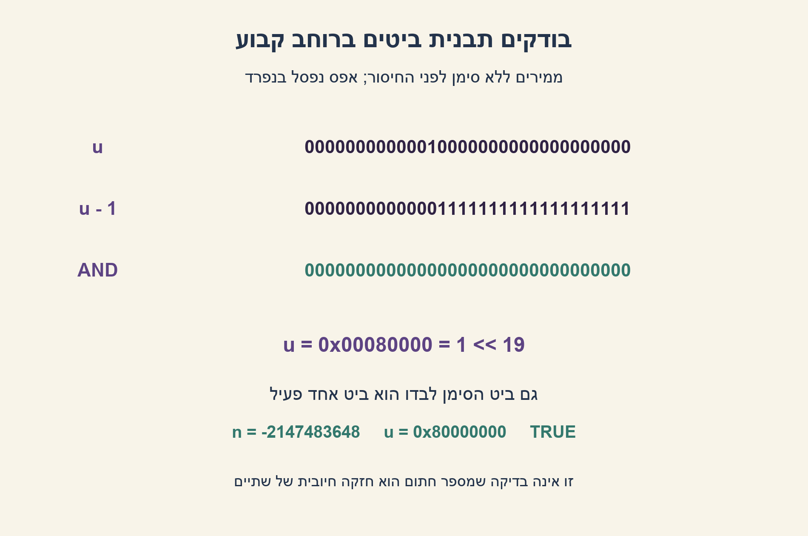
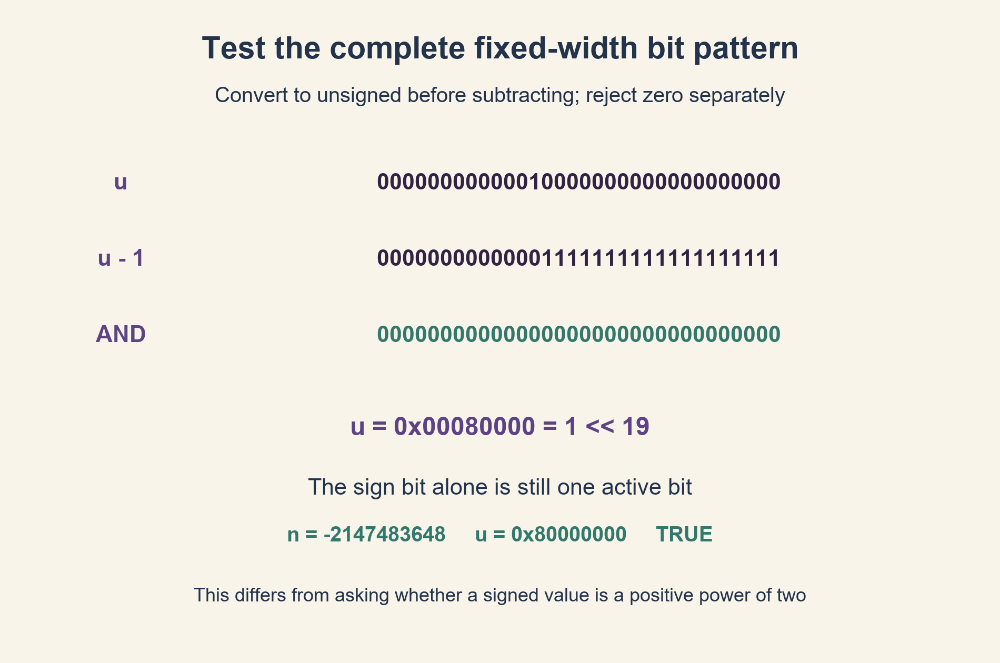

# PREP-105 — ביט פעיל יחיד בתבנית int32 — כולל ביט הסימן

פתרון מוצע בסיוע AI; אין אישור מקצועי אנושי חדש.

## מקור

[צילום המקור](../sources/2026-10-24-batch20-20.png)

Implement the following function:
BOOLEAN is_one_bit_active(int32 n)
That receives a 32bit integer and returns TRUE if only one bit is active, and FALSE otherwise.
For example:
0x00080000: returns TRUE. 100000000 ?
0x000C0000 returns FALSE. 110000000 ?
b) can it be done more efficiently?

דיווח החברה NVIDIA מופיע בצילום בלבד ולא אומת באופן עצמאי.

## ביט פעיל יחיד בתבנית int32 — כולל ביט הסימן

ממשו BOOLEAN is_one_bit_active(int32 n), שמחזירה true אם בדיוק אחד מכל 32 הביטים של הקלט הוא 1, ו־false אחרת. הציעו תחילה פתרון פשוט ואז פתרון עם פחות פעולות.

הבהרה: בודקים תבנית משלים ל־2 ברוחב 32 ביטים, כולל ביט הסימן. לכן INT32_MIN, שערכו ‎-2147483648 ותבניתו 0x80000000, חייב להחזיר true; אפס מחזיר false. אין זו בדיקת חזקה חיובית של שתיים במובן המספרי. אין לחתוך בשקט קלט שאינו int32.

דוגמאות מהמקור: 0x00080000 מחזיר true, ו־0x000C0000 מחזיר false. ההערות הבינאריות בצילום אינן תצוגת 32 ביטים ברורה; בעריכה מציינים במדויק שמדובר בהתאמה לביטים 19 ו־18.

### שלושה רמזים

1. איך אפשר לספור אחדים בסריקה של 32 מיקומים, ולהפסיק ברגע שנמצאו שניים?
2. חשבו מה חיסור 1 עושה לביט הדלוק הנמוך ביותר ולביטים שמתחתיו.
3. המירו ל־uint32 לפני החיסור. הביטוי u & (u-1) מוחק את ה־1 הנמוך ביותר; דרשו גם u!=0 כדי שאפס לא יתקבל.

### הצעה לפתרון

### קודם קובעים מה נחשב ביט פעיל
הטיפוס החתום אינו משנה את מספר האחדים בייצוג. למשל ‎-2147483648 מיוצג על ידי אחד ואחריו 31 אפסים. הוא שלילי אך מכיל בדיוק ביט פעיל אחד. התנאי n>0 של בדיקת חזקה חיובית של שתיים אינו מתאים לחוזה הזה.

### פתרון ישיר
ממירים לתבנית לא־מסומנת בת 32 ביטים וסורקים 32 מיקומים. סופרים אחדים; אם מגיעים לשניים מחזירים false. בסוף מחזירים אם המונה בדיוק אחד. זו דרך פשוטה ונכונה, עם עד 32 בדיקות.

### מוחקים את ה־1 הנמוך ביותר
במספר לא־אפס, חיסור 1 מכבה את ה־1 הנמוך ביותר ומדליק את כל האפסים שמתחתיו. הביטים הגבוהים ממנו נשארים כפי שהיו. ביצוע AND בין u לבין u-1 מוחק לכן בדיוק את ה־1 הנמוך ביותר. אם לא נשאר אף ביט, במקור היה אחד בלבד.

הבדיקה היא u!=0 && (u & (u-1))==0. החלק הראשון חיוני: גם עבור אפס תוצאת ה־AND היא אפס, אבל אפס אינו מכיל ביט פעיל. לדוגמה u=0x00080000 ו־u-1=0x0007FFFF; אין ביניהם ביט דלוק משותף. לעומת זאת 0x000C0000 כולל גם את ביט 18 וגם את ביט 19, ולכן נשאר בו אחד אחרי מחיקת הראשון.

### חיסור ללא גלישה חתומה
ב־C++ ממירים את n ל־uint32_t לפני החיסור. ההמרה מגדירה את הערך מודולו 2^32, והחיסור נעשה ללא סימן. אין לבצע n-1 כפעולה חתומה כאשר n=INT32_MIN: זה עלול לחרוג מתחום הטיפוס וליצור התנהגות לא מוגדרת. הקוד אינו מסתמך על הזזה ימינה של מספר שלילי.

### נכונות ועלות
אם יש ביט אחד, מחיקתו משאירה אפס; אם יש שניים או יותר, לפחות אחד נשאר. בשילוב פסילת אפס מתקבלת שקילות מלאה לחוזה. עבור מילת מכונה קבועה בת 32 ביטים מדובר במספר קבוע קטן של פעולות וב־O(1) מילים זמניות. גם סריקת 32 ביטים היא O(1) במודל הקבוע, אך היא מבצעת יותר בדיקות. עבור מספרים רחבים שרירותית אין להסיק שפעולות Python על שלמים הן זמן קבוע; העלות תלויה במספר המילים הפנימיות.

```cpp
// C++17: cast BEFORE subtraction, avoiding signed overflow at INT32_MIN.
#include <cstdint>

bool is_one_bit_active(std::int32_t n) {
    const std::uint32_t u = static_cast<std::uint32_t>(n);
    return u != 0 && (u & (u - std::uint32_t{1})) == 0;
}
```



## One active bit in an int32 pattern, including the sign bit

Implement BOOLEAN is_one_bit_active(int32 n), returning true exactly when one of all 32 input bits is one, and false otherwise. Give a straightforward solution and then one using fewer operations.

Clarification: inspect the complete 32-bit two's-complement pattern, including its sign bit. INT32_MIN, value -2147483648 and pattern 0x80000000, must therefore return true; zero returns false. This is not a test for a numerically positive power of two. Do not silently truncate inputs outside int32.

Source examples: 0x00080000 returns true; 0x000C0000 returns false. The binary annotations in the screenshot are not a clear full-width representation; this edition precisely identifies bits 19 and 18.

### Three hints

1. How can you count ones over 32 positions, stopping once a second one appears?
2. Consider what subtracting one does to the lowest set bit and the positions beneath it.
3. Convert to uint32 before subtraction. u & (u-1) removes the lowest set bit; also require u!=0 so zero is rejected.

### Proposed solution

### Decide what counts as an active bit
Signedness does not change the number of ones in the representation. The value -2147483648 is one followed by 31 zeros. It is negative yet has exactly one active bit. The n>0 condition used by a positive-power-of-two test therefore does not fit this contract.

### Straightforward solution
Convert to an unsigned 32-bit pattern and inspect 32 positions. Count ones, returning false once a second is found. At the end return whether the count is exactly one. This is correct and uses at most 32 bit inspections.

### Remove the lowest set bit
For nonzero u, subtracting one clears its lowest set bit and sets every lower zero bit. Higher positions are unchanged. ANDing u with u-1 therefore removes exactly the lowest set bit. If none remains, the original had exactly one.

Test u!=0 && (u & (u-1))==0. The first condition matters: zero also produces zero after the AND but has no active bits. For u=0x00080000, u-1=0x0007FFFF, with no shared set bit. By contrast 0x000C0000 has both bits 18 and 19, leaving one after the lower is removed.

### Avoid signed overflow
In C++, convert n to uint32_t before subtracting. Conversion gives its value modulo 2^32 and subtraction is unsigned. Do not evaluate signed n-1 at INT32_MIN: it can exceed the signed type range and invoke undefined behavior. No signed negative right shift is needed.

### Correctness and cost
If there is one set bit, removing it leaves zero. If there are two or more, at least one remains. Together with rejecting zero, this exactly characterizes the contract. A fixed 32-bit machine word needs a small constant number of operations and O(1) temporary words. Scanning 32 bits is also O(1) at this fixed width but performs more inspections. This does not establish constant time for arbitrary-width Python integers, whose operations depend on their internal word count.

```cpp
// C++17: cast BEFORE subtraction, avoiding signed overflow at INT32_MIN.
#include <cstdint>

bool is_one_bit_active(std::int32_t n) {
    const std::uint32_t u = static_cast<std::uint32_t>(n);
    return u != 0 && (u & (u - std::uint32_t{1})) == 0;
}
```



## חומר משלים / Supporting material

```json
{
  "assumptions": {
    "he": [
      "קלט int32 תקין; בודקים את כל תבנית משלים ל־2, כולל ביט הסימן.",
      "אפס אינו מתקבל; INT32_MIN מתקבל; אין דרישת חיוביות מספרית.",
      "לניתוח זמן קבוע מניחים מילה של 32 ביטים ופעולות מכונה עליה."
    ],
    "en": [
      "Valid int32 input; inspect all two's-complement bits including the sign bit.",
      "Zero is rejected; INT32_MIN is accepted; numeric positivity is not required.",
      "Constant-time analysis assumes a 32-bit machine word with machine-word operations."
    ]
  },
  "optimality": {
    "he": "הפתרון מפחית סריקה של עד 32 בדיקות למספר קטן וקבוע של פעולות על מילה. שניהם O(1) לרוחב קבוע; לא נטען שמספר ההוראות הוא המינימלי לכל מעבד.",
    "en": "The solution replaces up to 32 inspections with a small fixed number of word operations. Both are O(1) at fixed width; no universal minimum instruction count is claimed."
  },
  "edge_cases": {
    "he": [
      "0 ו־‎-1 מחזירים false.",
      "כל 32 התבניות עם אחד יחיד מתקבלות, כולל 0x80000000.",
      "0x00080000 מתקבל; 0x000C0000 מכיל שני אחדים ונפסל."
    ],
    "en": [
      "0 and -1 return false.",
      "All 32 one-hot patterns are accepted, including 0x80000000.",
      "0x00080000 is accepted; 0x000C0000 has two ones and is rejected."
    ]
  },
  "common_mistakes": {
    "he": [
      "לדרוש n>0 ולפסול בטעות את ביט הסימן היחיד.",
      "לשכוח לפסול אפס.",
      "לבצע חיסור חתום לפני ההמרה או להניח שעלויות שלמים רחבים הן קבועות."
    ],
    "en": [
      "Requiring n>0 and incorrectly rejecting the lone sign bit.",
      "Forgetting to reject zero.",
      "Subtracting in the signed type before conversion or assuming arbitrary-width operations have fixed cost."
    ]
  },
  "interview_answer": {
    "he": "אמיר קודם ל־uint32_t. אם u אינו אפס ו־u&(u-1) הוא אפס, היה בו בדיוק אחד יחיד: החיסור וה־AND מוחקים את האחד הנמוך ביותר. ההמרה לפני החיסור גם מטפלת בביט הסימן בלי גלישה חתומה.",
    "en": "Convert to uint32_t first. Nonzero u has exactly one set bit iff u&(u-1) is zero, because this clears the lowest set bit. Converting before subtraction also handles the sign bit without signed overflow."
  },
  "source_ambiguities": {
    "he": "המקור משתמש ב־int32 אך אינו דן בביט הסימן. בעריכה הוגדר במפורש ש״ביט אחד פעיל״ מתייחס לתבנית כולה. ההערות הבינאריות הלא ברורות בצילום נשמרו במקור, ובדוגמאות הערוכות משתמשים בהקס ובמיקומי ביט מדויקים.",
    "en": "The source uses int32 without discussing the sign bit. This edition explicitly interprets one active bit over the complete pattern. Unclear binary annotations remain in the archived source; edited examples use exact hexadecimal values and bit positions."
  },
  "verification": {
    "he": "הפונקציה בפייתון הורצה מול ספירת ספרות עצמאית: כל 65,536 תבניות 16 הביטים הנמוכים, 32 תבניות one-hot, כל 496 זוגות ביטים, 10,000 תבניות מלאות אקראיות, ביט הסימן ואפס. C++ סופק אך לא קומפל בסביבה הזאת.",
    "en": "The actual Python function was compared with independent digit counting: all 65,536 low-16 patterns, 32 one-hot patterns, all 496 two-bit pairs, 10,000 random full-width patterns, the sign bit and zero. C++ was supplied but not compiled in this environment."
  },
  "relationship_note": {
    "he": "וריאציה מקושרת ל־PREP-023: שם בודקים חזקה חיובית של שתיים, ולכן שליליים נפסלים; כאן נבדק ייצוג int32 והביט הגבוה היחיד מתקבל. המזהים וההיסטוריה של השאלה המקורית אינם מוחלפים.",
    "en": "Linked variant of PREP-023: that question checks a positive numeric power of two and rejects negatives; this one checks an int32 representation and accepts the lone high bit. The original identity and history remain unchanged."
  },
  "solution_extensions": {
    "he": {
      "question": "איך סופרים את כל הביטים הפעילים בעזרת אותה פעולה?",
      "direction": "כל עוד u אינו אפס, החליפו אותו ב־u&(u-1) והגדילו מונה. כל איטרציה מוחקת אחד אחד; הזמן תלוי במספר האחדים במילת הקלט."
    },
    "en": {
      "question": "How can the same operation count all active bits?",
      "direction": "While u is nonzero, replace it by u&(u-1) and increment a counter. Each iteration clears one set bit, so iterations equal the input word's set-bit count."
    }
  }
}
```
