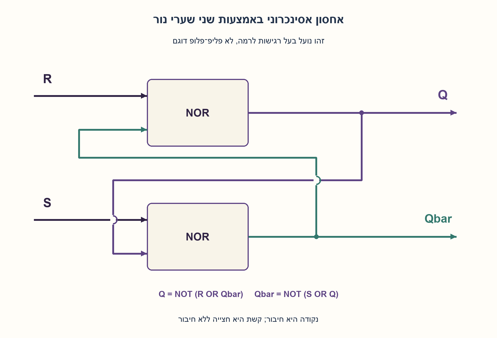
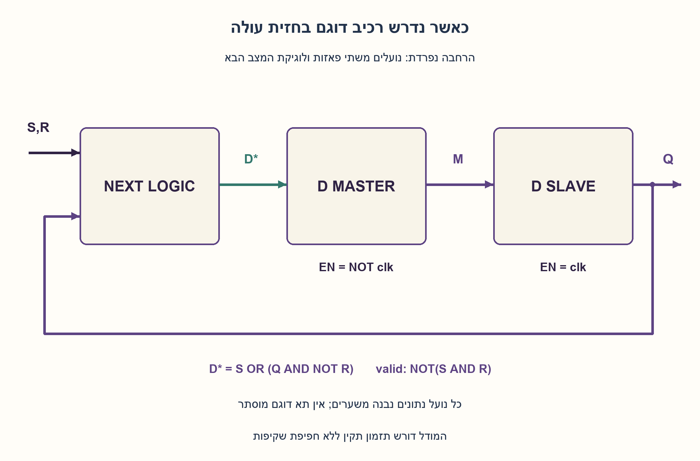
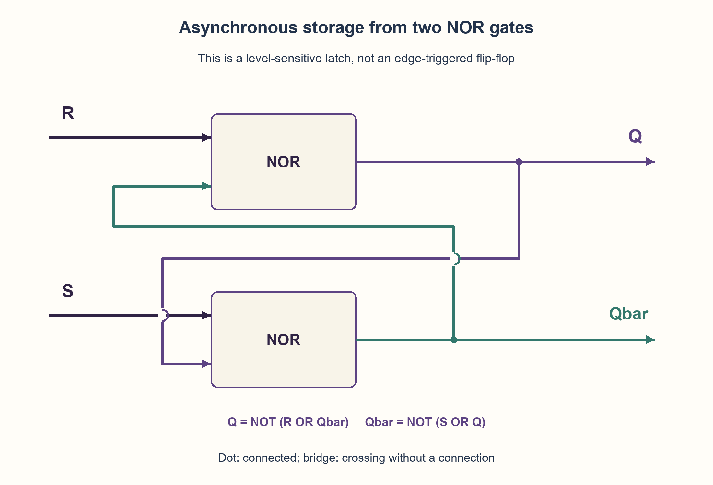

# PREP-106 — רכיב SR משערים — נועל, אפשור ורכיב דוגם

פתרון מוצע בסיוע AI; ביקורת מקצועית אנושית ממתינה. הקושי לא כויל.

## מקור

[צילום המקור](../sources/2026-10-24-batch10-01.png)

לבנות SR FF תוך שימוש בשערים לוגיים.

שיוכי החברות בצילום מדווחים ולא אומתו באופן עצמאי: Mellanox, NVIDIA.

## נוסח ערוך

רכיב SR משערים — נועל, אפשור ורכיב דוגם

בנו רכיב אחסון SR באמצעות שערים לוגיים והסבירו את החיבורים ואת טבלת הפעולה.

המקור מכנה את הרכיב SR FF אך אינו מציין שעון או סוג רגישות. לכן יש להציג את ההבחנה במפורש: א. התחילו מנועל SR אסינכרוני באמצעות שערי NOR, עם S ו־R פעילים ב־1. ב. הוסיפו אפשור רמה EN והסבירו מדוע עדיין אין דגימה בחזית. ג. אם נדרש באמת SR Flip-Flop בחזית עולה, תארו הרחבה ממשערים שמקיימת את התנהגות החזית.

הבהרות: משוב ופיצול חוטים מותרים. S=R=0 פירושו החזקה, 10 קביעה ל־1 ו־01 איפוס. S=R=1 אינו בקשת זיכרון חוקית; אין להגדיר לו עדיפות או לנבא את התוצאה לאחר שחרורו. אין מצב הפעלה ראשוני מובטח. בחלופת החזית מניחים קלט יציב בחלון הדגימה ופאזות שעון תקינות ללא שקיפות חופפת. מפרידים מודל בינארי יציב מתזמון, מטא־יציבות ומימוש פיזי.

### שלושה רמזים

1. כדי לשמור מידע צריך שהפלט ישפיע בחזרה על המעגל. האם רשת שערים ללא משוב יכולה להחזיק את הערך הקודם?
2. חברו שני שערי NOR בהצלבה: כל פלט נכנס לשער האחר. חברו R לשער שמוציא Q ו־S לשער שמוציא את בן זוגו.
3. כתבו Q=NOT(R OR Qbar) ו־Qbar=NOT(S OR Q). בדקו 10,01 ואז שחרור ל־00. לאפשור רמה אפשר למסך S ו־R ב־EN; לחזית אמיתית נדרשת הפרדה בין שתי פאזות אגירה.

### הצעה לפתרון

### לפני השרטוט: נועל ורכיב דוגם אינם אותו דבר
שני שערים בהצלבה יוצרים נועל SR: שינוי בכניסת set או reset יכול לשנות את המצב בלי לחכות לשעון. המילה FF בצילום אינה מספיקה כדי לקבוע דרישת חזית. לכן נבנה קודם את ליבת האחסון, ואז נפריד בין אפשור רמה לבין חלופת חזית.

### שני שערי NOR שזוכרים זה את זה
החיבורים הם:

```text
Q    = NOR(R, Qbar)
Qbar = NOR(S, Q)
```

Q מתפצל למוצא החיצוני ולכניסת השער השני. Qbar חוזר לשער הראשון. זהו משוב נתונים מכוון. במצבי זיכרון תקינים Qbar הוא היפוכו של Q; זה אינו נכון לכל צירוף כניסות אסור או במהלך מעבר פיזי.

אם S=1,R=0, השער השני מוריד את Qbar ל־0, ואז השער הראשון מוציא Q=1. כאשר משחררים את S בחזרה לאפס, Q=1 ממשיך להחזיק את Qbar באפס, שמחזיק בתורו את Q באחד. כך נשמרת הידיעה ״כבר נקבעתי״ גם אחרי שהבקשה הסתיימה. איפוס ב־R פועל באופן סימטרי.

| S | R | התנהגות תקינה אחרי התייצבות |
| --- | --- | --- |
| 0 | 0 | Q שומר את הערך הקודם |
| 1 | 0 | Q=1 |
| 0 | 1 | Q=0 |
| 1 | 1 | בקשת זיכרון אסורה; אין תוצאת שחרור מוגדרת |

ב־00 קיימים שני מצבים בינאריים יציבים, 10 ו־01 עבור Q,Qbar. ההיסטוריה בוחרת באיזה מהם נמצאים. אין מכאן הבטחה לאפס בהדלקה. אם מפעילים את שתי הבקשות ומשחררים אותן, זמני המעבר עלולים לקבוע מצב לא מובטח או להביא למטא־יציבות. טבלת הזיכרון אינה מעניקה עדיפות לאחד הקלטים. מודל הבדיקה דוחה 11 ואינו מנסה לנבא פיזיקה.

### הוספת EN יוצרת נועל מאופשר
מחשבים Sg=EN AND S ו־Rg=EN AND R, ומכניסים אותם לליבת NOR. כאשר EN=0, הליבה רואה 00 ושומרת. כאשר EN=1, היא רגישה לבקשות לאורך כל משך הרמה הגבוהה. לכן זו אינה דגימה בחזית. בקשות 11 חסומות כאשר EN=0, אך אסורות כשהליבה מופעלת.

בחלופה של ליבת NAND פעילת־נמוך יש טבלה אחרת: 11 מחזיק, 01 קובע ו־10 מאפס, ו־00 אסור. אין להעתיק את הטבלה הזאת לליבת NOR פעילת־גבוה.

### אם הדרישה היא באמת חזית עולה
אפשר לבנות הרחבה מדויקת במודל שתי פאזות:
1. עבור בקשות חוקיות בלבד, מחשבים D*=S OR (Q AND NOT R). זו לוגיקת שערים: ב־00 היא Q, ב־10 היא 1 וב־01 היא 0.
2. בונים משערים שני נועלי D בטור. כל נועל D אפשר לבנות מליבת NOR, מהפך ל־D ושני AND: S_D=EN AND D, R_D=EN AND NOT D.
3. הראשון, Master, שקוף כש־clk=0; השני, Slave, שקוף כש־clk=1. D* נכנס ל־Master, פלטו M נכנס ל־Slave, והפלט הסופי Q חוזר ללוגיקת D*.

בחזית עולה Master נסגר ושומר את D* שהיה מוכן לפני החזית; Slave נפתח ומעביר אותו. שינוי S או R ברמה הגבוהה אינו יכול לעבור דרך Master הסגור. ברמה הנמוכה Slave שומר, ולכן גם משוב Q יציב בזמן ש־Master מכין את הערך הבא. ב־00 מתקבל Q הבא שווה ל־Q הקודם, בלי להניח ש־Master ו־Slave התחילו באותו מצב. האלגברה אינה מגדירה 11 כחוקי.

זהו מבנה היררכי שכולו ניתן לפירוק לשערים; אין בו FF מוכן מוסתר. שימוש ב־clk ובהיפוכו בלבד אינו מוכיח שבמימוש אמיתי לא תהיה חפיפת שקיפות. יש לבדוק setup, hold, רוחב פולס והפצת שעון, ולהשתמש בתאים ובתיאורי אחסון נתמכים.

### עלות ומה הוכח
ליבת הנועל משתמשת בשני NOR. אפשור רמה מוסיף שני AND; חלופת החזית מוסיפה לוגיקת מצב ושתי דרגות נועל. לא נטען למינימום שטח או השהיה. נבדקו שש שורות חוקיות של Q,S,R, שמונה מקרי החזקה באפשור כבוי, 6,560 רצפים חוקיים עם 42,648 עדכונים, ו־36 מקרי פאזות Master/Slave. אורקל עצמאי פתר את משוואות NOR ובדק set/reset/hold. זו בדיקת מודל יציב, לא HDL, מטא־יציבות או ניסוי חומרה.

```python
"""Ideal settled-state SR storage; invalid requests are rejected, not predicted.

The basic cross-coupled NOR circuit is a level-sensitive latch, not an edge FF.
The gate-built master/slave extension below uses a next-state equation followed
by opposite-phase D latches. Analog power-up, races and metastability are absent.
"""


def require_bit(value):
    if type(value) is not int or value not in (0, 1):
        raise ValueError("expected integer bit 0 or 1")
    return value


def sr_latch(q, set_bit, reset_bit):
    q, s, r = map(require_bit, (q, set_bit, reset_bit))
    if s and r:
        raise ValueError("S=R=1 is outside the NOR latch's valid memory contract")
    return s | (q & (r ^ 1))


def gated_sr_latch(q, set_bit, reset_bit, enable):
    q, s, r, en = map(require_bit, (q, set_bit, reset_bit, enable))
    return sr_latch(q, s & en, r & en)


def master_slave_phase(master, q, set_bit, reset_bit, clock):
    """Conceptual gate-built D-master/D-slave extension for rising-edge SR.

    S,R must be valid at active capture; rejecting 11 in either phase is this
    harness's deliberately stronger legal-input convention, not analog behavior.
    The master is transparent low; slave transparent high. No overlap is modeled.
    """
    master, q, s, r, clk = map(require_bit, (master, q, set_bit, reset_bit, clock))
    desired = sr_latch(q, s, r)  # Gate function S OR (Q AND NOT R).
    if clk == 0:
        master = desired
    else:
        q = master
    return master, q
```





## English edition

SR storage from gates: latch, enable and edge-triggered behavior

Build SR storage from logic gates, explaining connections and the operation table.

The source calls it an SR FF but supplies neither a clock nor a sensitivity type. Make that distinction explicit: A. Start with an asynchronous NOR-based SR latch, using active-high S and R. B. Add a level enable EN and explain why it still does not sample an edge. C. If an actual rising-edge SR flip-flop is required, describe a gate-built extension that provides edge behavior.

Clarifications: feedback and wire fanout are allowed. S,R=00 holds, 10 sets one, and 01 resets zero. S=R=1 is not a legal memory request; assign neither a priority nor a predicted release outcome. No power-up value is guaranteed. The edge extension assumes inputs stable around capture and valid clock phases without overlapping transparency. Separate settled binary behavior from physical timing and metastability.

### Three hints

1. Storage requires output to affect the circuit again. Can a feed-forward gate network retain its previous result?
2. Cross-couple two NOR gates: each output feeds the other gate. R enters the gate producing Q; S enters the one producing its partner.
3. Write Q=NOT(R OR Qbar) and Qbar=NOT(S OR Q). Check 10,01 and release to 00. Masking S,R with EN gives level enable; true edge behavior needs two separated storage phases.

### Proposed solution

### A latch and an edge-triggered component differ
Two cross-coupled gates form an SR latch: set or reset can change state without waiting for a clock. The source's FF label does not establish edge sensitivity. Build the storage core first, then distinguish level enable from a genuine edge extension.

### Two NOR gates retaining each other's state
Connect:

```text
Q    = NOR(R, Qbar)
Qbar = NOR(S, Q)
```

Q fans out to the external output and the second gate; Qbar returns to the first. This is intentional data feedback. Qbar complements Q in valid settled memory states, not necessarily under forbidden inputs or during physical transitions.

For S=1,R=0, the second gate drives Qbar low, making the first drive Q high. Releasing S back to zero does not erase that state: Q=1 keeps Qbar low, and Qbar=0 keeps Q high. Reset through R works symmetrically.

| S | R | Valid settled behavior |
| --- | --- | --- |
| 0 | 0 | retain previous Q |
| 1 | 0 | Q=1 |
| 0 | 1 | Q=0 |
| 1 | 1 | forbidden memory request; release outcome unspecified |

For 00, both complementary states 10 and 01 for Q,Qbar are stable. History determines which applies; this does not guarantee power-up zero. Asserting both requests and releasing them can produce an unspecified state or metastability depending on real transition timing. The memory contract grants neither input priority. The test model rejects 11 rather than predicting analog behavior.

### EN creates a gated latch
Compute Sg=EN AND S and Rg=EN AND R before the NOR core. At EN=0, the core sees 00 and holds. At EN=1, requests affect it throughout the high level, so it still does not sample an edge. External 11 is blocked when EN=0 but invalid when the core is enabled.

An active-low NAND core instead holds for 11, sets for 01, resets for 10 and forbids 00. Do not reuse that table for an active-high NOR core.

### If a rising edge really is required
A precise two-phase extension is:
1. For legal requests, compute D*=S OR (Q AND NOT R). This gate function equals Q for 00, one for 10 and zero for 01.
2. Build two D latches in series from gates. Each D latch can use a NOR core, a data inverter and two ANDs: S_D=EN AND D, R_D=EN AND NOT D.
3. Open Master at clk=0 and Slave at clk=1. Feed D* into Master, its output M into Slave, and final Q back into the D* logic.

At a rising edge Master closes with the prepared D*, then Slave opens and transfers it. High-phase changes of S,R cannot pass the closed Master. While clock is low, Slave holds, keeping feedback Q stable as Master prepares the next value. Thus 00 holds old Q without requiring Master and Slave to have identical initial states. The equation does not make 11 legal.

This hierarchy can be expanded entirely into gates; no existing FF is hidden. Merely inverting clk does not prove physical transparency never overlaps. Check setup, hold, pulse widths and clock distribution, using supported storage cells/descriptions.

### Cost and evidence
The core uses two NORs. Level enable adds two ANDs; the edge extension adds next-state logic and two latch stages. No minimum physical area or delay is claimed. Checks covered six valid Q,S,R rows, eight disabled holds, 6,560 legal streams with 42,648 updates, and 36 Master/Slave phase cases. An independent oracle solved the NOR equations and checked set/reset/hold. This is settled-state modeling, not HDL, metastability simulation or a hardware experiment.

```python
"""Ideal settled-state SR storage; invalid requests are rejected, not predicted.

The basic cross-coupled NOR circuit is a level-sensitive latch, not an edge FF.
The gate-built master/slave extension below uses a next-state equation followed
by opposite-phase D latches. Analog power-up, races and metastability are absent.
"""


def require_bit(value):
    if type(value) is not int or value not in (0, 1):
        raise ValueError("expected integer bit 0 or 1")
    return value


def sr_latch(q, set_bit, reset_bit):
    q, s, r = map(require_bit, (q, set_bit, reset_bit))
    if s and r:
        raise ValueError("S=R=1 is outside the NOR latch's valid memory contract")
    return s | (q & (r ^ 1))


def gated_sr_latch(q, set_bit, reset_bit, enable):
    q, s, r, en = map(require_bit, (q, set_bit, reset_bit, enable))
    return sr_latch(q, s & en, r & en)


def master_slave_phase(master, q, set_bit, reset_bit, clock):
    """Conceptual gate-built D-master/D-slave extension for rising-edge SR.

    S,R must be valid at active capture; rejecting 11 in either phase is this
    harness's deliberately stronger legal-input convention, not analog behavior.
    The master is transparent low; slave transparent high. No overlap is modeled.
    """
    master, q, s, r, clk = map(require_bit, (master, q, set_bit, reset_bit, clock))
    desired = sr_latch(q, s, r)  # Gate function S OR (Q AND NOT R).
    if clk == 0:
        master = desired
    else:
        q = master
    return master, q
```




## חומר משלים דו־לשוני / Bilingual supporting material

```json
{
  "assumptions": {
    "he": [
      "ליבה אסינכרונית עם NOR ו־S,R פעילים ב־1; אין שעון מוסתר.",
      "11 אסור כאשר הליבה פעילה; אין הבטחת מצב הפעלה התחלתי.",
      "חלופת חזית משתמשת בנועלי D ממשערים ובפאזות תקינות; המודל אינו מנבא התנהגות אנלוגית."
    ],
    "en": [
      "Asynchronous NOR core with active-high S,R; no hidden clock.",
      "11 is forbidden while enabled; no power-up value is guaranteed.",
      "The edge extension uses gate-built D latches and valid phases; the model does not predict analog behavior."
    ]
  },
  "optimality": {
    "he": {
      "construction": "שני NOR לליבה; שני AND נוספים לאפשור רמה. חלופת חזית היא מבנה אחר עם שתי דרגות נועל.",
      "scope": "אין טענת מינימום שטח, עיכוב או חסינות למרוץ פיזי."
    },
    "en": {
      "construction": "Two NORs for the core; two extra ANDs for level enable. The edge extension is a different two-latch-stage construction.",
      "scope": "No minimum-area, minimum-delay or physical race-freedom claim."
    }
  },
  "edge_cases": {
    "he": [
      "00 מחזיק את ההיסטוריה, לאו דווקא אפס.",
      "11 אינו זוכה לעדיפות ולא לתוצאת שחרור מוגדרת.",
      "EN=0 חוסם את הבקשות; EN=1 רגיש לכל הרמה.",
      "טבלת NAND פעיל־נמוך שונה מזו של NOR פעיל־גבוה.",
      "מצב אנלוגי או תזמון לא תקין אינם תחום מודל הבדיקה."
    ],
    "en": [
      "00 retains history, not necessarily zero.",
      "11 has neither an assigned priority nor a defined release result.",
      "EN=0 blocks requests; EN=1 remains sensitive throughout the level.",
      "Active-low NAND and active-high NOR use different tables.",
      "Analog state and invalid timing are outside the test model."
    ]
  },
  "common_mistakes": {
    "he": [
      "כינוי ליבת שני NOR כרכיב דוגם בחזית.",
      "קביעה שמצב התחלתי הוא אפס בלי אתחול.",
      "ערבוב קוטביות NAND ו־NOR או הענקת עדיפות ל־11.",
      "הנחה שמהפך שעון לבדו מונע חפיפת נועלים פיזית.",
      "הסתרת FF מוכן בתוך פתרון שאמור להשתמש בשערים."
    ],
    "en": [
      "Calling a two-NOR core edge triggered.",
      "Assuming initial zero without initialization.",
      "Mixing NAND/NOR polarity or granting priority to 11.",
      "Assuming clock inversion alone prevents physical latch overlap.",
      "Hiding a prebuilt FF in a gates-only construction."
    ]
  },
  "interview_answer": {
    "he": "אחבר Q=NOR(R,Qbar) ו־Qbar=NOR(S,Q): 00 מחזיק, 10 קובע ו־01 מאפס; 11 אסור. זו ליבת נועל. AND על שתי הכניסות נותן אפשור רמה; ל־FF אמיתי צריך מבנה שתי פאזות נפרד ותנאי תזמון.",
    "en": "Connect Q=NOR(R,Qbar) and Qbar=NOR(S,Q): 00 holds, 10 sets, 01 resets, 11 is invalid. This is a latch core. AND-masking requests adds level enable; a true FF requires a separate two-phase construction and valid timing."
  },
  "source_ambiguities": {
    "he": [
      "המקור אומר SR FF אך אינו מגדיר שעון, קוטביות או נועל לעומת דוגם; הנוסח מפריד בין החלופות.",
      "Mellanox ו־NVIDIA מדווחות במקור בלבד, ללא אימות עצמאי."
    ],
    "en": [
      "The source says SR FF without defining a clock, polarity or latch versus edge behavior; the edition separates those contracts.",
      "Mellanox and NVIDIA are source-reported only, not independently verified."
    ]
  },
  "verification": {
    "he": "שש שורות חוקיות, שמונה החזקות באפשור כבוי, 6,560 רצפים ו־42,648 עדכוני נועל, ועוד 36 מקרי פאזות, עברו מול משוואות NOR ואורקל SR נפרדים. בקשות אסורות נדחות במודל. Python בלבד; ללא HDL, בדיקת פיזיקה או אישור אנושי.",
    "en": "Six valid rows, eight disabled holds, 6,560 streams and 42,648 latch updates, plus 36 phase cases, passed against separate NOR equations and an SR oracle. Forbidden requests are rejected. Python only; no HDL, physical verification or human approval."
  },
  "relationship_note": {
    "he": "PREP-065 מניח רכיב SR נתון ומשתמש בו לבניית DFF. כאן בונים את ליבת SR ממשערים ומפרידים רמה מחזית. PREP-083 עוסק בנועלי MUX ולא בליבת NOR.",
    "en": "PREP-065 assumes an existing SR primitive to build a DFF. This constructs SR storage from gates and distinguishes level/edge behavior. PREP-083 concerns MUX latches rather than the NOR core."
  },
  "solution_extensions": {
    "he": {
      "question": "איך משתנה טבלת הפעולה אם משתמשים בליבת NAND במקום NOR?",
      "direction": "קלטים פעילים־נמוך: 11 מחזיק, 01 קובע, 10 מאפס ו־00 אסור. יש לסמן את הקוטביות ואת מה שקורה בשחרור בקשה אסורה, בלי לנבא תוצאה ודאית.",
      "status": "מוכן בתוכן; אינו מחובר לתור שאלות ההמשך."
    },
    "en": {
      "question": "How does the operation table change for a NAND core?",
      "direction": "Use active-low inputs: 11 holds, 01 sets, 10 resets and 00 is forbidden. Mark polarity and leave forbidden-release outcomes unspecified.",
      "status": "Prepared in content; not connected to the interactive follow-up queue."
    }
  }
}
```
