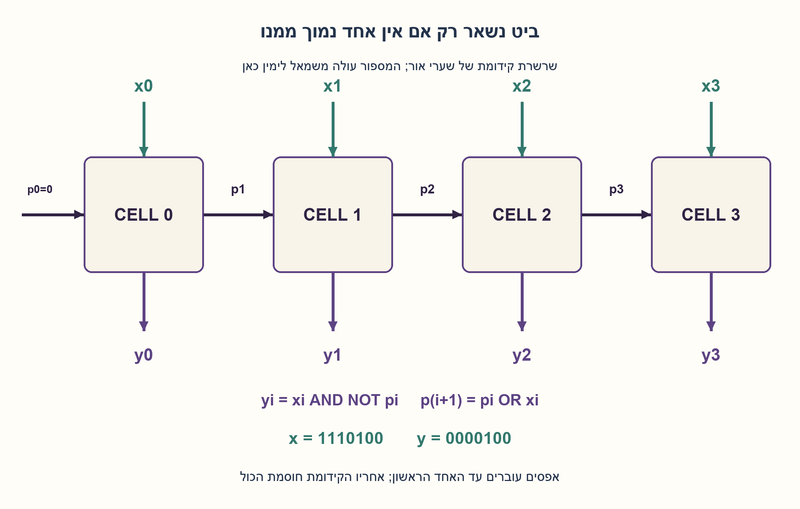
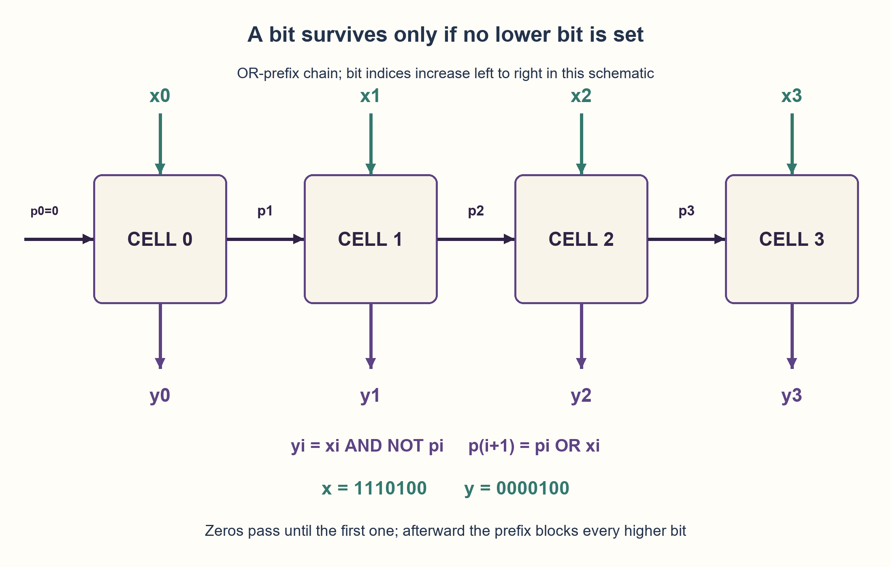

# PREP-107 — בידוד הביט הדלוק הנמוך ביותר באמצעות שערים

פתרון מוצע בסיוע AI; ביקורת מקצועית אנושית ממתינה. הקושי לא כויל.

## מקור

[צילום המקור](../sources/2026-10-24-batch10-02.png)

יש n ביטים בכניסה, n ביטים ביציאה, רוצים לבנות עם שערים לוגיים בסיסיים קופסא אשר תחזיר את ה־1 הראשון שהכי קרוב ל־LSB ואחריו רק אפסים. למשל אם הקלט הוא 1110100 הפלט יהיה 000100.

שיוכי החברות בצילום מדווחים ולא אומתו באופן עצמאי: Mellanox.

## נוסח ערוך

בידוד הביט הדלוק הנמוך ביותר באמצעות שערים

נתון וקטור בינארי x[n−1:0], כאשר n>=1 וביט 0 הוא LSB. בנו מעגל קומבינטורי משערי NOT,AND,OR שמחזיר וקטור y באותו רוחב: רק הביט הדלוק הנמוך ביותר של x נשאר 1 וכל היתר 0. אם x=0 גם y=0. הציגו נוסחאות ביט, חיבור בר־הרחבה, הסבר נכונות ועלות.

הבהרות: מותר חיווט, פיצול וקבוע 0; אין מחבר, מחסר, מקודד עדיפויות או רכיב אריתמטי מוכן. המוצא הוא וקטור one-hot או אפס, לא אינדקס בינארי. הדוגמה בצילום השמיטה אפס מוביל: עבור שבעה ביטים התוצאה המלאה היא 1110100→0000100. נתייחס לערכים יציבים, ללא הבטחת תזמון פיזי או מספר שערים מזערי.

### שלושה רמזים

1. איזה מידע על הביטים שמתחת לביט i צריך לדעת כדי להחליט אם הוא רשאי להישאר דלוק?
2. ביט i נשמר רק אם x[i]=1 וכל הביטים 0..i−1 שווים אפס. אפשר לסכם אותם באות OR יחיד.
3. הגדירו p0=0, אחר כך y[i]=x[i] AND NOT p[i] ו־p[i+1]=p[i] OR x[i]. חישבו למה הקידומת נשארת 1 אחרי האחד הראשון.

### הצעה לפתרון

### הרעיון: דגל שאומר שכבר מצאנו אחד נמוך יותר
עוברים רעיונית מ־LSB כלפי מעלה. עד שמוצאים אחד, אין סיבה לחסום ביט. אחרי האחד הראשון חייבים לחסום כל ביט גבוה ממנו, גם אם גם הוא דלוק. המידע הדרוש אינו המספר של הביט שנמצא, אלא רק ״האם יש כבר אחד מתחתיי?״.

נסמן p[i] כ־OR של כל הביטים שמתחת ל־i. אין ביטים מתחת לביט 0, ולכן p[0]=0. לכל מיקום:

```text
p[0] = 0
y[i] = x[i] AND NOT p[i]
p[i+1] = p[i] OR x[i]
```

אלה חוטים ושערים קומבינטוריים הפועלים במקביל לפי תלות האותות, לא לולאת תוכנה ולא רגיסטר. OR מפיץ את המידע על אחד נמוך, ו־NOT/AND מאפשרים לביט המקומי לשרוד רק כשאין כזה.

### דוגמה מהצילום, בלי לאבד רוחב
ב־1110100, כאשר סופרים מהימין, ביטים 0 ו־1 אפס וביט 2 הוא האחד הראשון. לכן y2=1. כל ביט מעליו רואה p=1 ונחסם, ונקבל 0000100. הצילום כתב 000100, שהוא אותו ערך מספרי אבל חסר אפס מוביל ביחס לקלט בן שבעה ביטים.

### הוכחה לפי מיקום האחד הראשון
אם כל הקלט אפס, כל x[i]=0 ולכן כל y[i]=0. אחרת נסמן k כאינדקס האחד הנמוך ביותר. לכל i<k הביט עצמו אפס. במיקום k כל הביטים הנמוכים אפס, לכן p[k]=0 ו־y[k]=1. לכל i>k הקידומת כבר מכילה x[k]=1, ולכן p[i]=1 ו־y[i]=0. בדיוק הביט הנדרש נשאר.

### עלות ואפשרות למקבול
בשרשרת הקידומת, כל מיקום מוסיף מספר קבוע של שערים, ולכן הגודל O(n). מסלול הקידומת הגבוה עשוי לחצות O(n) שערי OR, ועוד שלבי המסיכה; אין הבטחת השהיה קבועה כשהרוחב גדל.

אפשר לצמצם עומק לוגי בעזרת קידומת מקבילית: מתחילים ב־v[i]=x[i], ובכל רמה עם מרחק d=1,2,4,... משלבים את v[i] עם v[i−d] מהרמה הקודמת כאשר i>=d. אחרי ceil(log2(n)) רמות יש קידומות OR כוללות; p[i] נלקח מקידומת i−1. במבנה ההכפלה הישיר הזה יש O(n log n) שערי OR ועומק O(log n), ואחריהם NOT/AND. זו חלופה מפורשת, לא טענה למינימום שטח או לדחיית חיווט קבועה. גם אין צורך לחשב p[n] אם לא משתמשים בו.

הזהות האריתמטית x AND (−x) אכן מבודדת את אותו ביט בחשבון לא־מסומן מתאים, אבל מחסר מוכן לא הותר. כאן ציינו את השערים ולא הסתפקנו בטריק חשבוני שמסתיר את המימוש.

### אימות ותחום
נבדקו כל 8,190 הווקטורים ברוחבים 1..12 ו־600 וקטורים מדגמיים עד רוחב 257 מול סריקת אינדקסים מספרית עצמאית. נבדקו אפס, תת־קבוצה של ביטי הקלט, פלט בעל לכל היותר אחד אחד, הדוגמה ושש דחיות קלט. הזזות ואינדקסים בקוד רק מייצגים חיבורים בין ביטים; אין יחידת הזזה או חשבון במעגל המוצע. לא בוצע HDL או ניתוח תזמון פיזי.

```python
"""Basic-gate prefix mask; shifts/indexes only describe bit wiring in this model.

The proposed datapath has NOT, AND and OR, with no arithmetic component. Python
integer representation is a simulation convenience, not a physical gate count.
"""


def lowest_onehot(value, width):
    if type(width) is not int or width < 1:
        raise ValueError("width must be a positive integer")
    if type(value) is not int or not 0 <= value < (1 << width):
        raise ValueError("value must fit the declared unsigned width")
    lower_any = 0
    output = 0
    for index in range(width):
        input_bit = (value >> index) & 1
        output_bit = input_bit & (lower_any ^ 1)
        output |= output_bit << index
        lower_any |= input_bit
    return output
```



## English edition

Isolate the lowest set bit using basic logic gates

Given binary vector x[n−1:0], n>=1 and bit zero the LSB, build a combinational NOT/AND/OR circuit returning a same-width y: retain only the lowest set bit of x and clear all others. Zero input gives zero output. Give bit equations, a scalable connection scheme, correctness reasoning and cost.

Clarifications: wiring, fanout and constant zero are allowed. No prebuilt adder, subtractor, priority encoder or arithmetic unit is available. Output is a one-hot vector or zero, not a binary index. The screenshot omits one leading zero: the full seven-bit example is 1110100→0000100. Analyze settled values, without claiming physical timing or minimum gate count.

### Three hints

1. What information about positions below bit i decides whether that bit may remain set?
2. Bit i survives only if x[i]=1 and every bit 0..i−1 is zero. Summarize those lower bits with one OR signal.
3. Set p0=0, then y[i]=x[i] AND NOT p[i] and p[i+1]=p[i] OR x[i]. Explain why the prefix stays one after the first set bit.

### Proposed solution

### Idea: a flag saying a lower one was already found
Reason from LSB upward. Until the first one, no earlier bit blocks the position. After it, every higher position must be blocked, including other ones. We need only “is any lower bit set?”, not the numeric index of that bit.

Let p[i] be the OR of bits below i. No bit lies below bit zero, so p[0]=0. For each position:

```text
p[0] = 0
y[i] = x[i] AND NOT p[i]
p[i+1] = p[i] OR x[i]
```

These are combinational wires and gates following signal dependencies, not a software loop or register. OR propagates knowledge of a lower one, while NOT/AND allow the local bit through only when none exists.

### Preserve the source example's width
For 1110100, counting from the right, bits zero and one are zero and bit two is the first one. Thus y2=1. Higher positions see p=1 and are blocked, yielding 0000100. The screenshot's 000100 has the same numeric value but lacks a leading zero relative to its seven-bit input.

### Proof by the lowest active index
For zero input, every x[i]=0, so every y[i]=0. Otherwise let k be the lowest set index. For i<k the input bit itself is zero. At k, all lower bits are zero, so p[k]=0 and y[k]=1. For every i>k the prefix contains x[k]=1, making p[i]=1 and y[i]=0. Exactly the required bit remains.

### Cost and a parallel alternative
The serial prefix adds a constant number of gates per position, giving O(n) size. Its high-index prefix path can cross O(n) OR gates plus mask stages; increasing width does not preserve a fixed logical delay.

A parallel prefix can reduce logical depth: start v[i]=x[i], then at distances d=1,2,4,... combine v[i] with v[i−d] from the preceding level whenever i>=d. After ceil(log2(n)) levels these are inclusive OR prefixes; obtain p[i] from prefix i−1. This explicit doubling construction uses O(n log n) OR gates at O(log n) depth, followed by NOT/AND. It is an alternative, not minimum area or constant physical-wire delay. Unused p[n] need not be built.

The arithmetic identity x AND (−x) also isolates the same bit under suitable unsigned arithmetic, but a prebuilt subtractor is forbidden. This solution specifies actual basic-gate logic rather than hiding that implementation inside an arithmetic trick.

### Verification and scope
All 8,190 vectors of widths 1..12 and 600 seeded vectors through width 257 passed against an independent numerical index scan. Checks include zero, subset/one-hot output, the source example and six rejected invalid inputs. Code shifts/indexes represent connections between bits, not shifter or arithmetic units in the proposed circuit. No HDL or physical timing analysis was performed.

```python
"""Basic-gate prefix mask; shifts/indexes only describe bit wiring in this model.

The proposed datapath has NOT, AND and OR, with no arithmetic component. Python
integer representation is a simulation convenience, not a physical gate count.
"""


def lowest_onehot(value, width):
    if type(width) is not int or width < 1:
        raise ValueError("width must be a positive integer")
    if type(value) is not int or not 0 <= value < (1 << width):
        raise ValueError("value must fit the declared unsigned width")
    lower_any = 0
    output = 0
    for index in range(width):
        input_bit = (value >> index) & 1
        output_bit = input_bit & (lower_any ^ 1)
        output |= output_bit << index
        lower_any |= input_bit
    return output
```



## חומר משלים דו־לשוני / Bilingual supporting material

```json
{
  "assumptions": {
    "he": [
      "n>=1, ביט 0 הוא LSB, קלט ופלט באותו רוחב.",
      "מותרות רשתות קומבינטוריות משערים בסיסיים; אין רכיב אריתמטי מוכן.",
      "אפס מחזיר אפס; ערכים יציבים בלבד."
    ],
    "en": [
      "n>=1, bit zero is LSB, and input/output widths match.",
      "Combinational basic-gate networks are allowed; no prebuilt arithmetic unit.",
      "Zero gives zero; settled-value behavior only."
    ]
  },
  "optimality": {
    "he": {
      "chain": "O(n) שערים ועומק לוגי O(n) בשרשרת.",
      "parallel_alternative": "הכפלת קידומות מפורשת: O(n log n) שערי OR ועומק O(log n), ועוד מסיכות.",
      "scope": "אין טענת מספר שערים מזערי או השהיה פיזית חסומה שאינה תלויה ברוחב."
    },
    "en": {
      "chain": "O(n) gates and O(n) logical depth for the chain.",
      "parallel_alternative": "Explicit prefix doubling: O(n log n) OR gates at O(log n) depth, plus masks.",
      "scope": "No minimum-gate or width-independent physical-delay claim."
    }
  },
  "edge_cases": {
    "he": [
      "אפס מוחלט מחזיר אפס.",
      "n=1 נותן y0=x0.",
      "אם רק הביט העליון דלוק הוא נשמר.",
      "כל האחדים נותנים רק y0=1.",
      "מספר אפסים מובילים אינו משנה את האינדקס אך נשמר ברוחב הפלט."
    ],
    "en": [
      "All-zero input gives zero.",
      "n=1 gives y0=x0.",
      "A lone highest bit survives.",
      "All ones leave only y0=1.",
      "Leading zeros preserve output width without changing the selected index."
    ]
  },
  "common_mistakes": {
    "he": [
      "בחירת האחד הגבוה במקום הנמוך.",
      "החזרת אינדקס במקום וקטור באותו רוחב.",
      "OR של ביטים גבוהים במקום נמוכים.",
      "שימוש ב־x AND (−x) בלי לממש את החשבון המותר.",
      "טענה ששרשרת של n שערים היא בעומק קבוע."
    ],
    "en": [
      "Selecting the highest instead of lowest one.",
      "Returning an index instead of a same-width vector.",
      "ORing higher rather than lower bits.",
      "Using x AND (−x) without addressing the allowed gate implementation.",
      "Claiming a chain of n gates has constant depth."
    ]
  },
  "interview_answer": {
    "he": "לכל ביט i אחשב p[i], OR של הביטים הנמוכים ממנו, ואוציא y[i]=x[i] AND NOT p[i]. קידומת מתחילה באפס ומתעדכנת ב־p[i+1]=p[i] OR x[i]. האחד הראשון עובר ומדליק חסימה לכל הגבוהים. שרשרת בגודל ובעומק O(n).",
    "en": "For bit i compute p[i], OR of lower bits, then y[i]=x[i] AND NOT p[i]. Start p0=0 and update p[i+1]=p[i] OR x[i]. The first one passes and blocks higher positions. The chain has O(n) size and depth."
  },
  "source_ambiguities": {
    "he": [
      "בצילום חסר אפס מוביל בפלט הדוגמה; נשמר רוחב n במפורש.",
      "תגובה לקלט אפס ומודל שערים הוגדרו בעריכה.",
      "Mellanox מופיעה במקור בלבד ולא אומתה עצמאית."
    ],
    "en": [
      "The source example omits one leading output zero; the edition explicitly retains n bits.",
      "Zero behavior and the gate model are editorial clarifications.",
      "Mellanox appears in the source only, without independent verification."
    ]
  },
  "verification": {
    "he": "8,190 וקטורים ממצים ברוחבים 1..12 ו־600 מדגמים עד 257 ביטים הושוו לסריקת אינדקסים עצמאית. הדוגמה, אפס, one-hot, תת־קבוצה ושש דחיות קלט עברו. מודל Python בלבד; לא HDL או בדיקת חומרה.",
    "en": "8,190 exhaustive vectors of widths 1..12 and 600 seeded cases through 257 bits matched an independent index scan. Example, zero, one-hot/subset properties and six invalid-input rejections passed. Python model only; no HDL or hardware experiment."
  },
  "relationship_note": {
    "he": "PREP-014 ו־PREP-086 בוחרות את האחד הגבוה ביותר. כאן הכיוון הפוך והמסיכה תלויה רק בביטים הנמוכים. אין החלפת מזהה של התרגילים הקיימים.",
    "en": "PREP-014 and PREP-086 retain the highest one. Here priority is reversed and each mask depends only on lower bits. Existing exercise identities remain unchanged."
  },
  "solution_extensions": {
    "he": {
      "question": "איך מצמצמים עומק כש־n גדול?",
      "direction": "מחשבים קידומות OR במבנה הכפלה מקבילי. בכל רמה משתמשים רק באותות מהרמה הקודמת במרחק 1,2,4 וכן הלאה; המסיכה נשארת על הביטים הנמוכים בלבד.",
      "status": "מוכן בתוכן; אינו מחובר לתור שאלות ההמשך."
    },
    "en": {
      "question": "How can depth be reduced for large n?",
      "direction": "Compute OR prefixes using parallel doubling. Each level reads the preceding level at distances 1,2,4,...; the output mask still covers only lower bits.",
      "status": "Prepared in content; not connected to the interactive follow-up queue."
    }
  }
}
```

## קליטה נוספת — 31.10.2026 / Additional intake

- מקור 5: [sources/2026-10-31-batch20-05.png](../sources/2026-10-31-batch20-05.png)

לממש מעגל שמקבל מחרוזת כלשהי בעלת 20 ביטים. ומחזיר מחרוזת שבה מופיע רק ה1בימני lsb וכל השאר מאופס. מותר רק שערים לוגיים בסיסיים שלב א? מימוש ראשוני שלב ב? מימוש בדילאיי של 20 ננו שלב ג? מימוש בדילאיי של 10 ננו

התוכן הבא הוא הרחבה מוצעת בסיוע AI; הוא אינו אישור אנושי לפתרון המקורי או החדש.

### he — הרחבה / Extension


וריאציית מקור נוספת, 31.10.2026: קלט ופלט בני 20 סיביות. השאירו בפלט רק את האחד הקרוב ביותר ל־LSB, ואת כל השאר אפס. תנו מימוש בסיסי, מימוש שהשהייתו 20 ns, ומימוש שעומד בתקציב 10 ns. לצורך תזמון נשתמש רק ב־NOT בעל כניסה אחת ו־AND/OR בעלי שתי כניסות, עם 1 ns לכל שער; לחוטים ולפיצול אות אין השהיה במודל. אפס מוחזר לאפס. אין שימוש ביחידת חשבון מוכנה.

#### רמזים להרחבה / Variant hints

1. בגרסת 20 הסיביות, סיבית נשארת רק אם היא אחת ואין אף אחד מתחתיה.
2. צרו לכל i את OR של הסיביות הנמוכות ממנו. חישבו את עומק הרשת אם OR זה בנוי כשרשרת.
3. ל־y19 צריך OR של 19 כניסות. עץ OR מאוזן מוסיף חמישה מפלסים, ולאחריו NOT ו־AND; השוו לסף 10 ns.

#### הצעה לפתרון / Proposed solution


### הצעה לפתרון לגרסת 20/10 ns
נגדיר P_i=x0 OR ... OR x(i−1), עם P0=0. אז y_i=x_i AND NOT P_i, ובפרט y0=x0 בחוט ישיר. אם i הוא מיקום האחד הנמוך ביותר, כל הביטים שמתחתיו אפס ולכן y_i=1; לכל אחד גבוה יותר P_i=1 ולכן הוא נחסם. אם אין אחד בקלט כל y_i אפס. למשל x=101100 מפיק 000100 ברוחב קבוע.

שרשרת פשוטה מתחילה ב־P1=x0, וכל שלב מוסיף OR עם הסיבית הבאה. עבור y19, ה־OR של 19 כניסות דורש 18 שערים בטור, ואז NOT ו־AND: 18+1+1=20 ns. במודל המתואר זהו מימוש שעומד בדיוק ב־20 ns; אין צורך בשער ל־y0.

כדי לעמוד ב־10 ns אין צורך להוכיח מינימום. בונים את OR של כל קידומת כעץ בעל שתי כניסות, או משתפים קידומות ברשת מאוזנת מתאימה. OR של i כניסות בעץ מאוזן עומקו לכל היותר ceil(log2 i). לכן מסלול לכל פלט הוא לכל היותר ceil(log2 19)+1+1=7 ns, ובפרט עומד ב־10 ns. תיאור פשוט שאינו משתף עצים עולה O(n²) שערי OR לכל הפלטים יחד, אך שומר O(log n) עומק; רשת קידומות מקבילית יכולה לשתף צמתי OR בעלות O(n log n). אלה חלופות בנייה, לא טענת אופטימום שטח/השהיה. בנוסחת x AND (−x) יש אותה פונקציה, אבל היא אינה שרטוט שערים העומד אוטומטית במגבלות התרגיל.

הבדיקה עברה על כל 1,048,576 מילות 20 הסיביות בכל אחד משני המודלים, מול סריקת מחרוזת עצמאית מה־LSB. נבדקו גם זמני כל 20 הפלטים מול ספירת מפלסי עץ עצמאית. חוטים ופיצול חופשיים הם הנחה מופשטת; לא בוצעה סינתזה, בדיקת hazards או הוכחת זמן פיזי אופטימלי.

#### assumptions

[
  "גרסת התזמון: רוחב 20; NOT בעל כניסה אחת ו־AND/OR בעלי שתי כניסות, כל שער 1 ns; חוטים ופיצול חופשיים."
]

#### optimality

"שרשרת: 20 ns; עץ קידומות מוגדר: לכל היותר 7 ns ולכן עומד ב־10 ns. לא נטען מינימום פיזי. עצים נפרדים O(n²) שערים, רשת שיתוף O(n log n) בבנייה ישירה."

#### verification

"שתי הרשתות עברו כל 1,048,576 מילות 20 הסיביות. זמני 20 הפלטים הושוו לספירת מפלסים עצמאית; אין בדיקת חומרה."

#### edge_cases

[
  "אפס; אחד יחיד ב־LSB; אחד יחיד ב־MSB; כל הביטים אחד; כמה אחדות סמוכות."
]

#### common_mistakes

[
  "OR של כל הביטים כולל x_i יחסום גם את האחד הרצוי; צריך רק את הביטים הנמוכים.",
  "אין להניח שער OR בן 19 כניסות של 1 ns כשהותרו רק שתי כניסות.",
  "עמידה ב־10 ns אינה הוכחת השהיה מינימלית."
]

#### interview_answer

"אשאיר x_i רק אם כל הנמוכים אפס. שרשרת OR נותנת 20 ns; OR מאוזן עד חמישה מפלסים ועוד NOT ו־AND נותן 7 ns במודל ולכן עומד ב־10."

#### source_ambiguities

[
  "צילום 5 נותן תקציבי זמן אך לא מפרט השהיית שער או fan-in. מודל שתי כניסות ו־1 ns הוא הבהרת עריכה מפורשת."
]

#### solution_extensions

{
  "question": "אם המוצא צריך להיות האינדקס של האחד הנמוך במקום וקטור one-hot, מה נוסף?",
  "direction": "מקודד על הווקטור one-hot וסיבית valid נפרדת. ב־20 כניסות צריך חמישה ביטי אינדקס, ו־valid מבדיל בין קלט אפס לבין אינדקס אפס.",
  "integration": "מוכן בתוכן; אינו מחובר לתור המשך אינטראקטיבי."
}

### en — הרחבה / Extension


Additional source variant, 31 October 2026: use twenty-bit input/output words and retain only the one nearest the LSB. Give a basic construction, a 20 ns design and one meeting a 10 ns budget. For timing, use only unary NOT and two-input AND/OR gates with 1 ns per gate and zero wire/fanout delay in the model. Zero maps to zero. Do not use a prebuilt arithmetic unit.

#### רמזים להרחבה / Variant hints

1. In the twenty-bit variant, a bit survives only if it is one and every lower bit is zero.
2. Build each lower-prefix OR. What is the depth when that prefix is a serial chain?
3. y19 needs an OR of nineteen inputs. A balanced OR tree has five levels, followed by NOT and AND; compare with ten ns.

#### הצעה לפתרון / Proposed solution


### Proposed solution for the 20/10 ns variant
Let P_i=x0 OR ... OR x(i−1), with P0=0. Then y_i=x_i AND NOT P_i; in particular y0=x0 is a wire. If i is the least-significant one, all lower bits are zero and y_i=1. Every higher one sees P_i=1 and is blocked. An all-zero input gives all-zero output. For example 101100 maps to 000100 with width preserved.

The simple chain begins P1=x0 and adds one OR with each next bit. For y19, OR over nineteen inputs takes eighteen serial gates, then NOT and AND: 18+1+1=20 ns. This meets exactly 20 ns in the declared model; y0 needs no gate.

Meeting 10 ns does not require proving a minimum. Build each lower-prefix OR as a fan-in-two balanced tree, or share prefixes in an appropriate balanced network. An i-input OR tree has depth at most ceil(log2 i), so every output arrives within ceil(log2 19)+1+1=7 ns, satisfying the 10 ns budget. Separate trees use O(n²) total OR gates with O(log n) depth; a parallel-prefix network can share OR nodes using O(n log n) area. These are constructions, not area/delay optimality claims. The formula x AND (−x) computes the same function but does not itself provide a gate network satisfying this exercise.

All 1,048,576 twenty-bit words passed for each of the two models against an independent LSB-first string scan. All twenty output arrival bounds were also checked against independent tree-level counting. Free wires/fanout are abstract assumptions; no synthesis, hazard test or optimal physical timing proof was performed.

#### assumptions

[
  "Timing variant: width twenty; unary NOT and two-input AND/OR, 1 ns each; wires/fanout are free."
]

#### optimality

"Serial chain: 20 ns; declared balanced-prefix construction: at most 7 ns, meeting ten ns. No physical minimum claim. Separate trees take O(n²) gates; a direct shared prefix network uses O(n log n)."

#### verification

"Both networks passed every one of 1,048,576 twenty-bit words. All twenty arrival bounds matched independent level counting; no hardware test."

#### edge_cases

[
  "Zero; a lone LSB; a lone MSB; all ones; several adjacent ones."
]

#### common_mistakes

[
  "Including x_i in its own blocking OR suppresses the desired bit; include lower bits only.",
  "Do not assume a nineteen-input OR takes 1 ns when only fan-in two is allowed.",
  "Meeting ten ns does not prove minimum delay."
]

#### interview_answer

"Keep x_i only when all lower bits are zero. Serial OR gives twenty ns; a balanced five-level OR plus NOT and AND gives seven ns in the model and meets ten."

#### source_ambiguities

[
  "Screenshot five gives time budgets without gate-delay or fan-in details. The fan-in-two, 1 ns model is an explicit editorial assumption."
]

#### solution_extensions

{
  "question": "If the output must be the lowest-one index rather than a one-hot word, what must be added?",
  "direction": "Encode the one-hot result and provide a separate valid bit. Twenty inputs require five index bits; valid distinguishes zero input from index zero.",
  "integration": "Prepared in content; not connected to an interactive follow-up queue."
}

- [solutions/prep_batch20_combinational.py](../solutions/prep_batch20_combinational.py)
- [diagrams/prep-107-combinational-batch20-he.png](../diagrams/prep-107-combinational-batch20-he.png)
- [diagrams/prep-107-combinational-batch20-en.png](../diagrams/prep-107-combinational-batch20-en.png)
