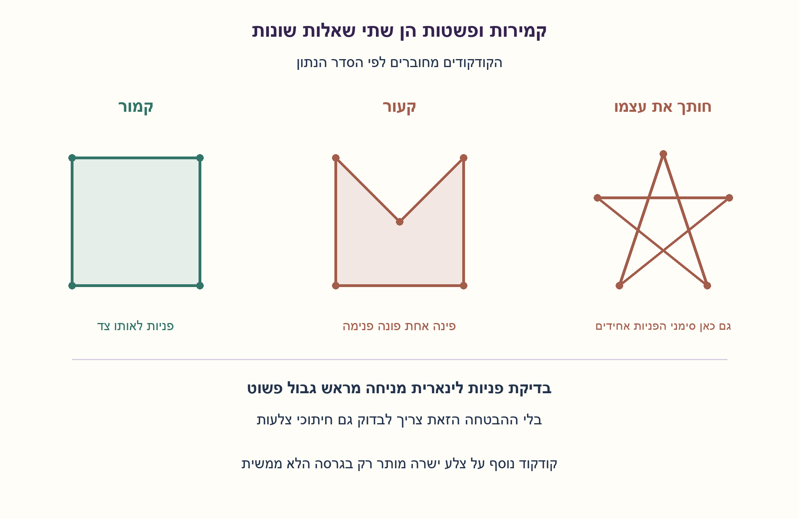
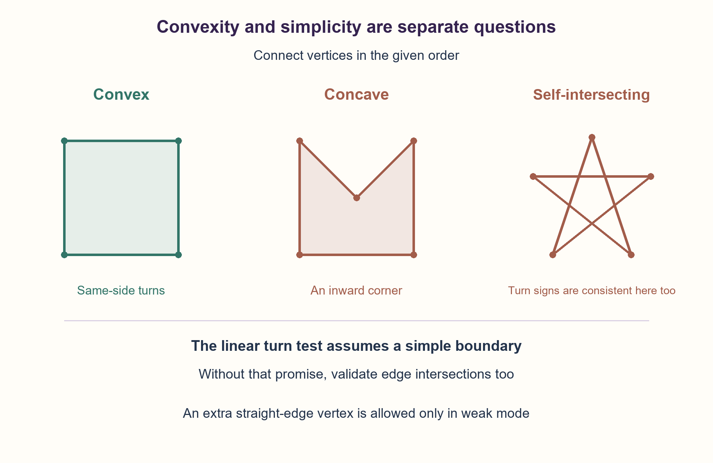

# PREP-108 — בדיקת קמירות — סדר הנקודות והנחת הפשטות חשובים

פתרון מוצע בסיוע AI; ביקורת מקצועית אנושית ממתינה. הקושי לא כויל.

## מקור

[צילום המקור](../sources/2026-10-24-batch10-03.png)

נתונות n נקודות במישור, כתוב אלגוריתם הבודק האם הצורה המתקבלת מהנקודות הללו היא קמורה.

שיוכי החברות בצילום הם דיווח לא מאומת: Apple.

## בדיקת קמירות — סדר הנקודות והנחת הפשטות חשובים

נתונים n קודקודים במישור, לפי סדר היקף מצולע. מחברים כל זוג עוקב ואת האחרון לראשון. בדקו האם המצולע קמור בזמן O(n), כאשר מובטח שהגבול פשוט: ללא חיתוך עצמי, נגיעה עצמית או חפיפת צלעות. הסבירו קוד, נכונות ועלות.

הבהרות שנוספו למקור: הקואורדינטות שלמות ומדויקות, הקודקודים שונים ואין לחזור על הראשון בסוף. ברירת המחדל היא קמירות לא־ממש: קודקוד על קטע ישר מותר, אך הצורה חייבת להכיל שטח חיובי; פחות משלוש נקודות או כולן על ישר אינם מצולע קמור כאן. הסבירו גם קמירות ממש, שבה זוויות 180° אינן מותרות.

המקור אינו מציין סדר או פשטות. הציגו בנפרד מה צריך לבדוק אם אין הבטחת גבול פשוט, ומדוע סימני פניות לבדם אינם מספיקים. הבדילו גם בין בדיקת הסדר הנתון לבין קבוצת נקודות לא מסודרת שאפשר לחבר מחדש.

### שלושה רמזים

1. כשמקיפים צורה קמורה, האם כיוון הפנייה יכול להשתנות משמאלה לימינה?
2. מכפלה וקטורית של שתי צלעות עוקבות מבחינה בין פנייה שמאלה, ימינה והמשך על ישר. בדקו גם את הפניות שסוגרות את הרשימה.
3. בגבול פשוט כל הפניות הלא־אפסיות צריכות להיות באותו סימן, ולפחות אחת אינה אפס. במצב ממש כל פנייה חייבת להיות לא־אפסית. בלי הבטחת פשטות צריך בדיקת חיתוכים נוספת.

### הצעה לפתרון

### הרעיון: צורה קמורה אינה מכניסה פנימה פינה
דמיינו הליכה סביב הגדר. סביב מצולע קמור פונים תמיד לאותו צד, גם אם בוחרים להתחיל בקודקוד אחר או להקיף בכיוון ההפוך. בפינה קעורה קיימת זווית פנימית גדולה מ־180°, ולכן כיוון הפנייה שם מתהפך. קודקוד נוסף על צלע ישרה אינו יוצר שקיעה; הוא רק נותן פנייה אפס.

### איך מודדים פנייה בלי לחשב זווית?
לשלושה קודקודים עוקבים A,B,C מחשבים:
```text
turn = (Bx−Ax)*(Cy−By) − (By−Ay)*(Cx−Bx)
```
בקואורדינטות רגילות שבהן y עולה למעלה: חיובי הוא שמאלה, שלילי ימינה ואפס פירושו שהנקודות על ישר. אין צורך ב־atan, בשיפועים או בחילוק, ולכן צלע אנכית אינה מקרה מיוחד. שלמים מדויקים מאפשרים בדיקת אפס מדויקת; בטיפוסים ברוחב קבוע צריך למנוע גלישה במכפלות ובהפרשים.

שומרים את סימן הפנייה הראשונה שאינה אפס. פנייה לא־אפסית בסימן ההפוך פוסלת. פנייה אפס מותרת בגרסה הלא־ממשית ונפסלת בגרסה הממשית. אם כל הפניות אפס, אין פנים בעל שטח ולכן מחזירים false. בודקים את כל n הפינות, כולל זו שבין שני הקודקודים האחרונים לראשון ובין האחרון לראשון ולשני.

### למה הנחת הפשטות חיונית?
אותו סימן בכל פינה אינו מוכיח שהצלעות אינן חוצות זו את זו. למשל קחו את הקודקודים [(0,3),(3,1),(2,-3),(-2,-3),(-3,1)] סביב מחומש, אך חברו אותם בסדר האינדקסים [0,2,4,1,3]. מתקבל כוכב החותך את עצמו, עם פניות שכולן באותו סימן. הפונקציה המהירה עשויה להחזיר true עליו, כי הוא מחוץ לחוזה הפשוט שלה; זו אינה בדיקת מצולע כללית.

לכן הקוד מספק שני נתיבים נפרדים: is_convex_simple_polygon היא הבדיקה הלינארית תחת ההבטחה; is_convex_polygon היא מעטפת שבודקת קודם פשטות. בדיקת הפשטות פוסלת קודקודים חוזרים, חזרה לאחור על צלע, וכל מפגש בין צלעות שאינן סמוכות, כולל נגיעה. שתי צלעות סמוכות רשאיות לחלוק רק את הקודקוד המשותף. במעטפת זו הכוכב נפסל.

### נכונות ועלות
במצולע פשוט בעל פנים לא ריק, קמירות שקולה לכך שאין זווית פנימית גדולה מ־180°. סימן פנייה אחיד בדיוק שולל פינה קעורה; פניות אפס רק מוסיפות נקודות על גבול ישר. כיוון ההקפה משנה את כל הסימנים יחד ולכן אינו משנה את התוצאה. תנאי הפנייה הלא־אפסית פוסל את המקרה המנוון. בקמירות ממש גם קודקוד קולינארי בזווית 180° נפסל.

הבדיקה המהירה עוברת פעם אחת: O(n) פעולות ו־O(1) מילות עזר, בלי למיין או להעתיק. בדיקת כל זוגות הצלעות וקודקודים במעטפת עולה O(n²) ובאותו מספר קבוע של משתנים. אין להבטיח זמן לינארי ובו בזמן לבצע את בדיקת כל הזוגות. בשלמים ארוכים העלות תלויה גם ברוחב הביטים; אין טענת מספר פעולות מכונה מינימלי.

### ואם הנקודות אינן מסודרות?
אין אז מצולע יחיד לבדיקה: ארבע פינות של ריבוע יכולות להופיע בסדר היקפי קמור או בסדר שיוצר עניבת פרפר. מיון מחדש משנה את השאלה. אם נשאל האם אפשר להשתמש בכל הנקודות כקודקודי מצולע קמור ממש, אפשר לחשב מעטפת קמורה בזמן O(n log n) ולדרוש שכל הנקודות השונות יהיו קודקודים קיצוניים שלה. בגרסה לא־ממשית גם נקודות על צלעות המעטפת מותרות, אך נקודה פנימית וכולן על ישר אינן מתאימות. עצם חישוב המעטפת אינו מוכיח שכל נקודות הקלט נכללות בגבולה.

```python
"""Exact convexity for ordered polygon vertices; distinguish the simple promise.

Coordinates are exact integer pairs. The O(n) function requires a simple
boundary with distinct vertices and no repeated closing vertex. The checked
wrapper validates simplicity in O(n^2); neither function sorts the vertices.
"""


def cross(a, b, c):
    return (b[0] - a[0]) * (c[1] - b[1]) - (b[1] - a[1]) * (c[0] - b[0])


def is_convex_simple_polygon(vertices, *, strict=False):
    """O(n) time/O(1) words, conditional on a simple ordered boundary."""
    if len(vertices) < 3:
        return False
    direction = 0
    for index in range(len(vertices)):
        turn = cross(vertices[index - 1], vertices[index], vertices[(index + 1) % len(vertices)])
        if turn == 0:
            if strict:
                return False
        elif direction == 0:
            direction = 1 if turn > 0 else -1
        elif (turn > 0) != (direction > 0):
            return False
    return direction != 0


def on_segment(a, b, point):
    return (cross(a, b, point) == 0
            and min(a[0], b[0]) <= point[0] <= max(a[0], b[0])
            and min(a[1], b[1]) <= point[1] <= max(a[1], b[1]))


def segments_intersect(a, b, c, d):
    turns = cross(a, b, c), cross(a, b, d), cross(c, d, a), cross(c, d, b)
    if (turns[0] > 0 > turns[1] or turns[1] > 0 > turns[0]) and (
            turns[2] > 0 > turns[3] or turns[3] > 0 > turns[2]):
        return True
    return ((turns[0] == 0 and on_segment(a, b, c))
            or (turns[1] == 0 and on_segment(a, b, d))
            or (turns[2] == 0 and on_segment(c, d, a))
            or (turns[3] == 0 and on_segment(c, d, b)))


def is_simple_polygon(vertices):
    """Reject repeated vertices, crossings, touches and backtracking overlaps."""
    count = len(vertices)
    if count < 3:
        return False
    for i in range(count):
        for j in range(i + 1, count):
            if vertices[i] == vertices[j]:
                return False
        previous, current, following = vertices[i - 1], vertices[i], vertices[(i + 1) % count]
        if cross(previous, current, following) == 0:
            overlap = ((previous[0] - current[0]) * (following[0] - current[0])
                       + (previous[1] - current[1]) * (following[1] - current[1]))
            if overlap > 0:
                return False
        for j in range(i + 1, count):
            if j == i + 1 or (i == 0 and j == count - 1):
                continue
            if segments_intersect(vertices[i], vertices[(i + 1) % count],
                                  vertices[j], vertices[(j + 1) % count]):
                return False
    return True


def is_convex_polygon(vertices, *, strict=False):
    """Checked O(n^2) wrapper when simple boundary is not already promised."""
    return is_simple_polygon(vertices) and is_convex_simple_polygon(vertices, strict=strict)
```



## Polygon convexity — vertex order and simplicity matter

Given n planar vertices in polygon boundary order, join consecutive vertices and close the last to the first. Determine convexity in O(n) time under a SIMPLE boundary promise: no self-intersections, self-touching or overlapping edges. Explain code, correctness and cost.

Added clarifications: coordinates are exact integers; vertices are distinct and the first is not repeated at the end. The default is weak convexity: a vertex on a straight edge is allowed, but the polygon must enclose positive area. Fewer than three vertices or wholly collinear input is not convex here. Also explain strict convexity, which forbids 180-degree vertices.

The source does not specify ordering or simplicity. Separately explain validation without the simple-boundary promise and why turn signs alone are insufficient. Distinguish checking the given order from an unordered point set that may be reconnected.

### Three hints

1. While walking around a convex boundary, can turns switch between left and right?
2. The cross product of consecutive edge vectors distinguishes left turns, right turns and collinearity. Include the wraparound corners too.
3. For a simple boundary, every nonzero turn must share a sign, and at least one must be nonzero. Strict mode forbids zero turns. Without simplicity, add intersection validation.

### Proposed solution

### Intuition: a convex outline has no inward corner
Imagine walking along a fence. Around a convex polygon you always turn to the same side, even if you start elsewhere or walk in reverse. A concave corner has an interior angle greater than 180 degrees, so its turn reverses direction. An extra vertex on a straight edge adds no inward dent: its turn is zero.

### Measure turns without angles
For consecutive A,B,C compute:
```text
turn = (Bx−Ax)*(Cy−By) − (By−Ay)*(Cx−Bx)
```
With conventional upward-increasing y, positive means left, negative right and zero collinear. No atan, slope or division is needed, so vertical edges require no special case. Exact integers allow exact zero tests; fixed-width code must prevent overflow in differences and products.

Remember the first nonzero turn's sign. Reject any later nonzero turn with the opposite sign. Zero is allowed in weak mode and rejected in strict mode. If all turns are zero, there is no positive-area interior, so return false. Check all n corners, including both wraparound triples.

### Why simplicity matters
Equal turn signs do not prove that edges never cross. Take the boundary pentagon [(0,3),(3,1),(2,-3),(-2,-3),(-3,1)] but connect indices [0,2,4,1,3]. This creates a self-intersecting star with all turns sharing a sign. The fast function can return true for it because that input violates its simple-boundary precondition; it is not a general polygon validator.

The code therefore exposes separate paths. is_convex_simple_polygon is the linear check under the promise. is_convex_polygon first validates simplicity. Validation rejects repeated vertices, adjacent backtracking overlap, and every intersection or touch between nonadjacent edges. Adjacent edges may share only their common endpoint. The checked wrapper rejects the star.

### Correctness and cost
For a simple polygon with nonempty interior, convexity is equivalent to having no interior angle greater than 180 degrees. Consistent turn signs exclude reflex corners; zero turns merely add points on straight boundary edges. Reversing traversal flips all nonzero signs together and leaves the result unchanged. Requiring a nonzero turn rejects degeneration. Strict mode also rejects straight corners.

The fast scan uses O(n) operations and O(1) auxiliary machine words without sorting or copying. The supplied all-pairs simplicity wrapper takes O(n²) time with constant auxiliary state. Do not claim a linear total while also performing all-pairs validation. Arbitrary-width integers add bit-dependent costs; no minimum machine-instruction claim is made.

### What if the points are unordered?
There is no unique polygon: the same four square corners can describe a convex boundary or a bow-tie depending on order. Reordering changes the question. To ask whether all points can form a strictly convex polygon, compute a convex hull in O(n log n) and require all distinct input points to be its extreme vertices. Weak convexity can also include points on hull edges, but not interior points or wholly collinear input. Merely computing a hull does not prove that all input points belong to its boundary.

```python
"""Exact convexity for ordered polygon vertices; distinguish the simple promise.

Coordinates are exact integer pairs. The O(n) function requires a simple
boundary with distinct vertices and no repeated closing vertex. The checked
wrapper validates simplicity in O(n^2); neither function sorts the vertices.
"""


def cross(a, b, c):
    return (b[0] - a[0]) * (c[1] - b[1]) - (b[1] - a[1]) * (c[0] - b[0])


def is_convex_simple_polygon(vertices, *, strict=False):
    """O(n) time/O(1) words, conditional on a simple ordered boundary."""
    if len(vertices) < 3:
        return False
    direction = 0
    for index in range(len(vertices)):
        turn = cross(vertices[index - 1], vertices[index], vertices[(index + 1) % len(vertices)])
        if turn == 0:
            if strict:
                return False
        elif direction == 0:
            direction = 1 if turn > 0 else -1
        elif (turn > 0) != (direction > 0):
            return False
    return direction != 0


def on_segment(a, b, point):
    return (cross(a, b, point) == 0
            and min(a[0], b[0]) <= point[0] <= max(a[0], b[0])
            and min(a[1], b[1]) <= point[1] <= max(a[1], b[1]))


def segments_intersect(a, b, c, d):
    turns = cross(a, b, c), cross(a, b, d), cross(c, d, a), cross(c, d, b)
    if (turns[0] > 0 > turns[1] or turns[1] > 0 > turns[0]) and (
            turns[2] > 0 > turns[3] or turns[3] > 0 > turns[2]):
        return True
    return ((turns[0] == 0 and on_segment(a, b, c))
            or (turns[1] == 0 and on_segment(a, b, d))
            or (turns[2] == 0 and on_segment(c, d, a))
            or (turns[3] == 0 and on_segment(c, d, b)))


def is_simple_polygon(vertices):
    """Reject repeated vertices, crossings, touches and backtracking overlaps."""
    count = len(vertices)
    if count < 3:
        return False
    for i in range(count):
        for j in range(i + 1, count):
            if vertices[i] == vertices[j]:
                return False
        previous, current, following = vertices[i - 1], vertices[i], vertices[(i + 1) % count]
        if cross(previous, current, following) == 0:
            overlap = ((previous[0] - current[0]) * (following[0] - current[0])
                       + (previous[1] - current[1]) * (following[1] - current[1]))
            if overlap > 0:
                return False
        for j in range(i + 1, count):
            if j == i + 1 or (i == 0 and j == count - 1):
                continue
            if segments_intersect(vertices[i], vertices[(i + 1) % count],
                                  vertices[j], vertices[(j + 1) % count]):
                return False
    return True


def is_convex_polygon(vertices, *, strict=False):
    """Checked O(n^2) wrapper when simple boundary is not already promised."""
    return is_simple_polygon(vertices) and is_convex_simple_polygon(vertices, strict=strict)
```



## חומר משלים / Supporting material

```json
{
  "assumptions": {
    "he": [
      "הנתיב הלינארי מקבל גבול פשוט מסודר, קודקודים שונים וללא חזרה על הראשון.",
      "קואורדינטות שלמות מדויקות; צורה מנוונת אינה קמורה.",
      "קמירות לא־ממשית היא ברירת המחדל; strict פוסל פניות אפס."
    ],
    "en": [
      "The linear path assumes a simple ordered boundary with distinct vertices and no repeated first vertex.",
      "Exact integer coordinates; degenerate input is not convex.",
      "Weak convexity is default; strict rejects zero turns."
    ]
  },
  "optimality": {
    "he": "O(n) זמן ו־O(1) מילים לבדיקת הפניות תחת הבטחת פשטות. במעטפת המסופקת, בדיקת פשטות מוסיפה O(n²). לא נטען שזו בדיקת הפשטות המהירה האפשרית או חסם קבוע לחשבון שלמים ארוכים.",
    "en": "O(n) time/O(1) words for promised-simple turn checking. Supplied simplicity validation makes the wrapper O(n²). No fastest-possible simplicity algorithm or constant-cost unbounded-integer claim."
  },
  "edge_cases": {
    "he": [
      "n<3, קודקודים כפולים, כל הנקודות על ישר ופניות הסגירה.",
      "צורה קמורה בשני כיווני ההקפה; קודקוד נוסף על צלע ישרה.",
      "כוכב ועניבת פרפר אינם קלטים חוקיים לנתיב המובטח; המעטפת פוסלת אותם."
    ],
    "en": [
      "n<3, repeated vertices, wholly collinear input and wraparound turns.",
      "Convex boundaries in either orientation; an extra collinear boundary vertex.",
      "Star and bow-tie violate the fast-path promise; the checked wrapper rejects them."
    ]
  },
  "common_mistakes": {
    "he": [
      "לבדוק רק פניות פנימיות ברשימה ולשכוח את הסגירה.",
      "לדרוש סימן חיובי דווקא ולפסול הקפה בכיוון השני.",
      "לקבל כוכב על סמך פניות בלבד או להציג את הפונקציה המותנית כמאמתת פשטות.",
      "לחשב מעטפת ולהחזיר תמיד true לקבוצת נקודות לא מסודרת."
    ],
    "en": [
      "Forgetting wraparound corners.",
      "Requiring positive turns and rejecting reverse traversal.",
      "Accepting a star from turn signs alone or claiming the conditional scan validates simplicity.",
      "Computing a hull and always accepting an unordered point set."
    ]
  },
  "interview_answer": {
    "he": "אברר סדר קודקודים, פשטות ומדיניות קודקודים קולינאריים בזווית 180°. עבור גבול פשוט אשווה סימני מכפלות וקטוריות בכל הפינות, כולל סגירה. סימן אחיד ולפחות פנייה אחת לא־אפסית נותנים קמירות לא־ממשית. ללא הבטחת פשטות אוסיף בדיקת חיתוכים ואעדכן את העלות.",
    "en": "Clarify ordering, simplicity and straight-corner policy. For a simple boundary compare cross-product signs at all corners, including closure. One consistent nonzero sign gives weak convexity. Without simplicity add intersection validation and revise the cost."
  },
  "source_ambiguities": {
    "he": "המקור אומר רק n נקודות וצורה קמורה. סדר היקפי, הבטחת פשטות, טיפוס שלם, קמירות לא־ממשית ופסילת ניוון נוספו במפורש. אין להציג אותן כנתוני מקור או למיין את הנקודות בשקט.",
    "en": "The source only specifies n points and convexity. Boundary order, simplicity, integer coordinates, weak convexity and degenerate rejection are explicit additions, not source facts. Do not silently sort the points."
  },
  "verification": {
    "he": "3,840 מקרי סדר קודקודים ומצב ממש/לא־ממש מעל רשת 3×2 נבדקו מול אישור גאומטרי גלובלי בלתי תלוי: כל הקודקודים באותו חצי־מישור לכל צלע. נבדקו גם כוכב עם פניות אחידות, עניבת פרפר, ישר, כפילויות, היפוך סדר והזזה ב־10^100. הורץ Python, לא קוד נקודה צפה או C.",
    "en": "3,840 ordered-vertex/strict-mode cases on a 3×2 grid matched an independent global half-plane certificate. Also tested the same-turn star, bow-tie, collinearity, duplicates, reversal and translation by 10^100. Python executed; no floating-point or C compilation."
  },
  "relationship_note": {
    "he": "מקושרת ל־PREP-087 באמצעות מכפלות וקטוריות וגבול מסודר, אך שם בודקים נקודה בתוך מצולע ולא קמירות. זו שאלה חדשה.",
    "en": "Related to PREP-087 through cross products and boundary order, but that task classifies a point relative to a polygon rather than convexity. This is a new question."
  },
  "solution_extensions": {
    "he": {
      "question": "מה משתנה בקואורדינטות נקודה צפה?",
      "direction": "סימן קרוב לאפס עלול להיות שגוי. יש להגדיר מדיניות דיוק וגאומטריה עמידה; epsilon שרירותי אינו תחליף אוטומטי להוכחת הנכונות המדויקת.",
      "status": "מוכן בתוכן; לא מחובר לתור המשך."
    },
    "en": {
      "question": "What changes for floating-point coordinates?",
      "direction": "A near-zero sign can be unreliable. Define precision policy and robust geometry; an arbitrary epsilon does not automatically inherit the exact-arithmetic proof.",
      "status": "Prepared in content; not connected to the follow-up queue."
    }
  }
}
```
