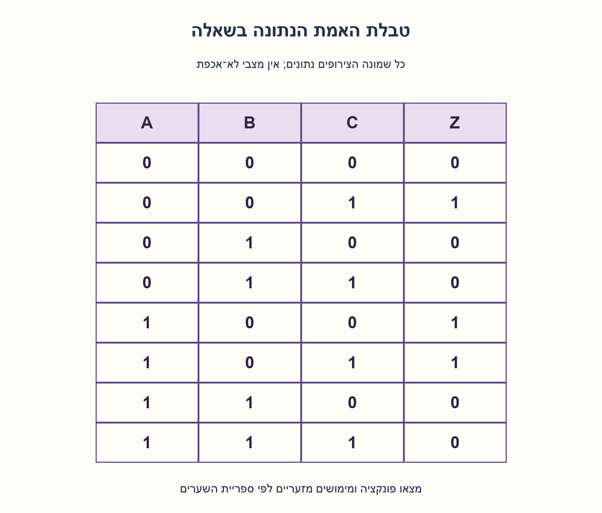
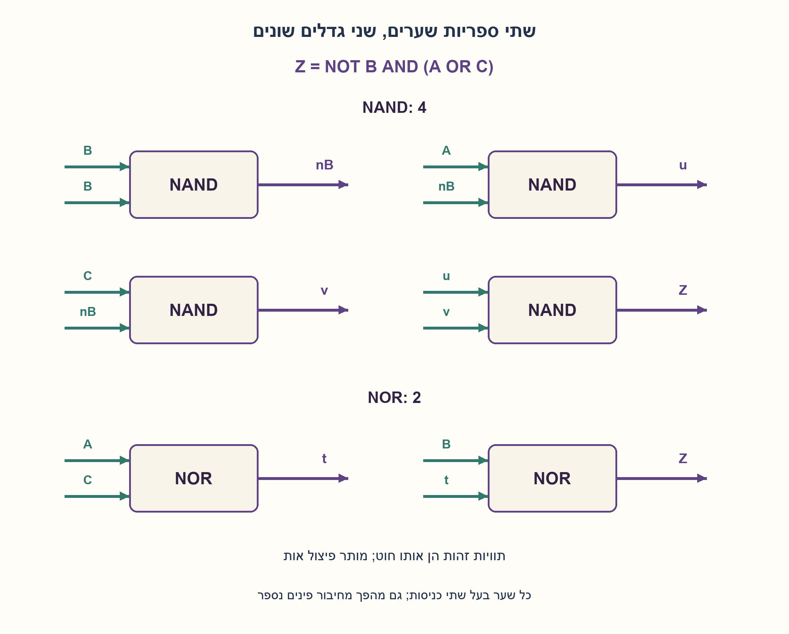
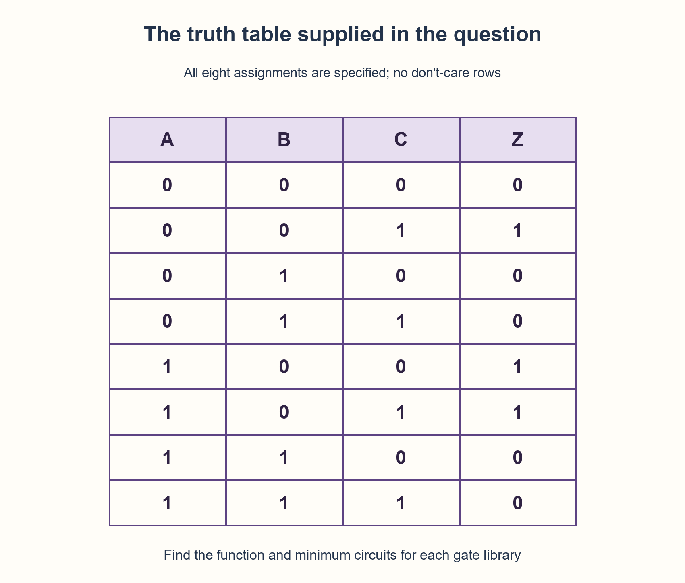
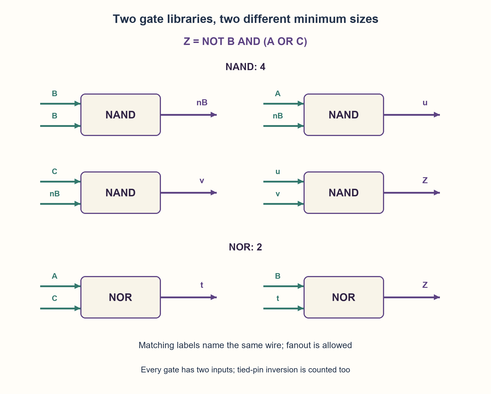

# PREP-109 — מטבלת אמת למימוש מזערי בשערי NAND או NOR

פתרון מוצע בסיוע AI; ביקורת מקצועית אנושית ממתינה. הקושי לא כויל.

## מקור

[צילום המקור](../sources/2026-10-24-batch10-04.png)

נתונה טבלת האמת: ABC=000,001,010,011,100,101,110,111; Z=0,1,0,0,1,1,0,0. א. מה הפונקציה הלוגית שמתארת הטבלה? ב. ממש את הפונקציה בעזרת מינימום שערי NAND ו־NOR.

שיוכי החברות בצילום מדווחים ולא אומתו באופן עצמאי: Elta.

## נוסח ערוך

מטבלת אמת למימוש מזערי בשערי NAND או NOR

לטבלת ABC בסדר 000,001,010,011,100,101,110,111 נתון Z בסדר 0,1,0,0,1,1,0,0. א. מצאו ופשטו את הפונקציה הלוגית. ב. בנו מימוש עם NAND בלבד ומימוש עם NOR בלבד, והוכיחו את מספר השערים המזערי בכל ספרייה. מה משתנה אם מותר לבחור שערים משתי הספריות?

מודל העלות שהוספנו: כל שער בעל שתי כניסות; רק A,B,C הלא־מהופכים נתונים. מותר פיצול חוט וחיבור שתי כניסות שער לאותו חוט; גם שער שמשמש כמהפך נספר. אין מהפכים, קבועים, משוב או רכיבי זיכרון בחינם. הרשת חסרת מעגלים וניתן להשתמש מחדש בפלט שער. כל שמונה השורות מחייבות — אין don't-care. מינימום פירושו מספר רכיבי שער במודל הזה, לא שטח טרנזיסטורים או השהיה פיזית. המקור אינו מפריד בין NAND בלבד, NOR בלבד וספרייה מעורבת, ולכן נציג את שלוש הפרשנויות בנפרד.

### שלושה רמזים

1. באילו שורות Z=1? האם אחד המשתנים קבוע בכל השורות האלה?
2. בכל שורות האחד B=0, ונדרש לפחות אחד מבין A ו־C. איך כותבים זאת בצורה מפורקת?
3. ל־NOR חשבו קודם NOT(A OR C), ואז NOR עם B. ל־NAND הפכו את B פעם אחת, צרו את היפוכי שני המכפלות A·NOT B ו־C·NOT B, ואז NAND אחרון.

### הצעה לפתרון

### קוראים את השורות, ואז מפשטים
Z=1 בדיוק בשורות 001,100,101. בכולן B=0, ובנוסף לפחות אחד מבין A,C הוא 1. לכן:

```text
Z = (NOT B) AND (A OR C)
  = (A AND NOT B) OR (C AND NOT B)
```

אפשר גם להתחיל מסכום המינטרמים 1,4,5 ולקבץ את 100 עם 101 ואת 001 עם 101. הצורה המפורקת עוזרת לבחור ספריית שערים, ולא רק לצמצם מספר אותיות בנוסחה.

### NOR בלבד — שני שערים
מחשבים t=NOR(A,C), כלומר t=NOT(A OR C). אחר כך Z=NOR(B,t). לפי דה־מורגן:

```text
t = NOR(A,C)
Z = NOR(B,t) = NOT(B OR NOT(A OR C))
              = NOT B AND (A OR C)
```

אי אפשר להסתפק בשער אחד בעל שתי כניסות: Z תלוי בשלושת המשתנים. שינוי A משנה את Z כש־B=C=0; שינוי C משנה אותו כש־A=B=0; שינוי B משנה אותו כש־A=1,C=0. שער יחיד שמחובר לכניסות המקור יכול להיות תלוי בלכל היותר שניים מהם. לכן שניים הם מינימום.

### NAND בלבד — ארבעה שערים
משתפים מהפך אחד עבור B:

```text
nB = NAND(B,B)
u  = NAND(A,nB)
v  = NAND(C,nB)
Z  = NAND(u,v)
```

u ו־v הם ההיפוכים של שני תנאי האחד. ה־NAND האחרון מבצע OR לתנאים המקוריים לפי דה־מורגן. nB נספר פעם אחת למרות פיצולו לשני ענפים. חיבור שני פיני השער ל־B אינו מהפך חינמי.

### למה שלושה NAND אינם מספיקים במודל שהוגדר?
לכך מצורפת מנייה ממצה וניתנת לשחזור. מייצגים כל חוט בשמונה ביטים — אחד לכל שורת טבלת האמת. מתחילים בשלושת חוטי A,B,C. כל NAND חדש בוחר זוג חוטים מהכניסות או משערים שכבר חושבו, כולל בחירת אותו חוט פעמיים.

לשער הראשון יש 6 זוגות לא־מסודרים עם חזרות מתוך 3 חוטים. לשני יש 10 מתוך 4, ולשלישי 15 מתוך 5. לכן נבדקות כל 6 הרשתות בנות שער אחד, 60 בנות שניים ו־900 בנות שלושה. באף אחת לא מתקבל Z. כל רשת NAND קומבינטורית חסרת מעגלים ניתנת לסדר טופולוגי כזה; הזוגות הלא־מסודרים מספיקים כי NAND סימטרי בכניסותיו. פיצול, חיבור פינים ושימוש חוזר בפלט כלולים במנייה.

לכן שום רשת עם עד שלושה שערים במודל הזה אינה מספיקה, והמימוש בן ארבעה מינימלי. זו הוכחת חסם באמצעות מנייה מלאה של רשתות קטנות, ולא הסקה מבדיקה אקראית או ממימוש אחד מוצלח.

### ספרייה מעורבת וגבולות המסקנה
אם מותר לבחור NAND או NOR בכל רכיב, שני שערי NOR כבר מותרים ולכן המינימום הוא שניים, עם אותו חסם תלות בשלושה משתנים. לא נדרש להשתמש בלפחות רכיב אחד מכל סוג. דרישה כזאת, כניסות מהופכות זמינות מראש, שערים מרובי כניסות או מהפך פלט חינמי היו מודלי עלות אחרים.

המימושים נבדקו בכל שמונה שורות המקור. לא נטען שמינימום מספר שערים הוא גם מינימום טרנזיסטורים, השהיה או הספק. טבלת אמת מתארת ערכים לאחר התייצבות ולא מוכיחה היעדר גליצ׳ים בעת מעבר. הקוד הוא מודל בוליאני בפייתון, ללא HDL, סינתזה או ניתוח תזמון פיזי.

```python
"""Two-input, acyclic NAND/NOR networks; no free inverted inputs or constants."""

NAND_NETLIST = (("NAND", 1, 1), ("NAND", 0, 3), ("NAND", 2, 3), ("NAND", 4, 5))
NOR_NETLIST = (("NOR", 0, 2), ("NOR", 1, 3))


def evaluate(a, b, c, netlist):
    wires = [a, b, c]
    if any(type(value) is not int or value not in (0, 1) for value in wires):
        raise ValueError("A,B,C must be integer bits")
    for kind, left, right in netlist:
        if not 0 <= left < len(wires) or not 0 <= right < len(wires):
            raise ValueError("a gate must use existing wires")
        if kind == "NAND":
            value = 1 ^ (wires[left] & wires[right])
        elif kind == "NOR":
            value = 1 ^ (wires[left] | wires[right])
        else:
            raise ValueError("unsupported gate")
        wires.append(value)
    return wires[-1]
```





## English edition

From a truth table to minimum NAND or NOR circuits

For ABC ordered as 000,001,010,011,100,101,110,111, Z is 0,1,0,0,1,1,0,0. A. Derive and simplify the function. B. Build NAND-only and NOR-only implementations, proving minimum gate count for each library. What changes when gates from both libraries are allowed?

Added cost model: each gate has two inputs; only uncomplemented A,B,C are supplied. Fanout and tied input pins are allowed, and a tied-pin inverter counts as a gate. No free inverters, constants, feedback or memory. The network is acyclic, and a gate output may be reused. All eight rows are specified, with no don't-cares. Minimum means gate-component count in this model, not transistor area or physical delay. The source does not distinguish NAND-only, NOR-only and mixed libraries, so treat these interpretations separately.

### Three hints

1. Which rows have Z=1? Is one variable fixed in every such row?
2. Every one-row has B=0 and at least one of A,C equal to one. How can that be factored?
3. For NOR, first compute NOT(A OR C), then NOR it with B. For NAND, invert B once, negate products A·NOT B and C·NOT B, then use a final NAND.

### Proposed solution

### Read the rows, then simplify
Z is one exactly for 001,100,101. In all of them B=0 and at least one of A,C is one. Thus:

```text
Z = (NOT B) AND (A OR C)
  = (A AND NOT B) OR (C AND NOT B)
```

Equivalently start from minterms 1,4,5, grouping 100 with 101 and 001 with 101. The factored form helps select a gate library, beyond merely shortening notation.

### NOR only: two gates
Compute t=NOR(A,C), then Z=NOR(B,t). De Morgan gives:

```text
t = NOR(A,C)
Z = NOR(B,t) = NOT(B OR NOT(A OR C))
              = NOT B AND (A OR C)
```

One two-input gate cannot suffice because Z depends essentially on all three inputs. Changing A affects Z at B=C=0; changing C affects it at A=B=0; changing B affects it at A=1,C=0. A single gate connected to raw inputs can depend on at most two. Therefore two is minimum.

### NAND only: four gates
Share one inversion of B:

```text
nB = NAND(B,B)
u  = NAND(A,nB)
v  = NAND(C,nB)
Z  = NAND(u,v)
```

u and v negate the two one-producing conditions; the final NAND ORs those original conditions by De Morgan. Count nB once despite its fanout. Tying both pins to B does not make inversion free.

### Why do three NANDs not suffice in this model?
A reproducible exhaustive enumeration supplies the lower bound. Represent each wire by eight bits, one per truth-table row. Start from raw A,B,C. Every new NAND selects two wires from inputs or preceding outputs, including selecting one wire twice.

The first gate has six unordered pin pairs with repetition from three wires. The second has ten from four; the third fifteen from five. Thus all six one-gate networks, sixty two-gate networks and nine hundred three-gate networks are checked, none yielding Z. Every acyclic combinational NAND circuit has such a topological ordering. Unordered pairs suffice because NAND is commutative; tied pins, fanout and reuse are included.

Consequently no network of at most three gates in this model suffices, and the four-gate construction is minimal. This is a complete small-network enumeration, not an inference from random tests or one successful construction.

### Mixed library and scope
If each component may be either NAND or NOR, the two-NOR circuit is allowed, and the same essential-input lower bound makes two minimum. There is no requirement to use at least one gate of each kind. Such a requirement, free complemented inputs, arbitrary fan-in or a free output inverter would define different cost models.

Both constructions were checked on all eight source rows. Minimum component count does not imply minimum transistors, delay or power. A truth table describes settled values, not hazard freedom during transitions. The code is a Python Boolean model, with no HDL compilation, synthesis or physical timing analysis.

```python
"""Two-input, acyclic NAND/NOR networks; no free inverted inputs or constants."""

NAND_NETLIST = (("NAND", 1, 1), ("NAND", 0, 3), ("NAND", 2, 3), ("NAND", 4, 5))
NOR_NETLIST = (("NOR", 0, 2), ("NOR", 1, 3))


def evaluate(a, b, c, netlist):
    wires = [a, b, c]
    if any(type(value) is not int or value not in (0, 1) for value in wires):
        raise ValueError("A,B,C must be integer bits")
    for kind, left, right in netlist:
        if not 0 <= left < len(wires) or not 0 <= right < len(wires):
            raise ValueError("a gate must use existing wires")
        if kind == "NAND":
            value = 1 ^ (wires[left] & wires[right])
        elif kind == "NOR":
            value = 1 ^ (wires[left] | wires[right])
        else:
            raise ValueError("unsupported gate")
        wires.append(value)
    return wires[-1]
```





## חומר משלים דו־לשוני / Bilingual supporting material

```json
{
  "assumptions": {
    "he": [
      "כל שמונה שורות הטבלה מחייבות, ללא מצבי לא־אכפת.",
      "שערים בעלי שתי כניסות בלבד; A,B,C ללא היפוכים או קבועים חינמיים.",
      "מותר פיצול, חיבור פינים ושימוש חוזר; הרשת חסרת מעגלים וכל רכיב נספר."
    ],
    "en": [
      "All eight rows are specified, without don't-cares.",
      "Only two-input gates, raw A,B,C and no free inversions/constants.",
      "Fanout, tied pins and output reuse are allowed; the circuit is acyclic and every gate is charged."
    ]
  },
  "optimality": {
    "he": {
      "NAND_only": "ארבעה: קיים מימוש; כל 6/60/900 הרשתות בנות 1/2/3 NAND נכשלו.",
      "NOR_only": "שניים: קיים מימוש ושער יחיד אינו יכול לתלות את המוצא בשלושה משתנים.",
      "mixed": "שניים אם מותר לבחור כל שער ואין חובה להשתמש בשני הסוגים.",
      "scope": "מספר שערים במודל הנתון בלבד, לא מינימום פיזי או לשערים מרובי כניסות."
    },
    "en": {
      "NAND_only": "Four: a construction exists; all 6/60/900 networks with 1/2/3 NANDs fail.",
      "NOR_only": "Two: a construction exists and one gate cannot depend on three raw inputs.",
      "mixed": "Two when either family may be chosen without requiring both to appear.",
      "scope": "Gate count in the declared model only, not physical cost or arbitrary-fan-in optimality."
    }
  },
  "edge_cases": {
    "he": [
      "B=1 תמיד נותן אפס.",
      "B=0 וגם A=C=0 נותנים אפס.",
      "A=C=1,B=0 נותן אחד — אין כאן XOR.",
      "מהפך על ידי חיבור פינים נחשב לשער.",
      "כניסות מהופכות חינמיות משנות את שאלת המינימום."
    ],
    "en": [
      "B=1 always gives zero.",
      "B=0 and A=C=0 give zero.",
      "A=C=1,B=0 gives one: this is not XOR.",
      "Tied-pin inversion counts as a gate.",
      "Free complemented inputs change the minimization problem."
    ]
  },
  "common_mistakes": {
    "he": [
      "החלפת OR ב־XOR והשמטת שורת 101.",
      "ספירת nB פעמיים בגלל פיצול או לא לספור אותו כלל.",
      "הכרזה על מינימום בלי לציין fan-in וקלטים זמינים.",
      "בלבול בין ספריות נפרדות לבין חובה להשתמש בשני סוגים.",
      "הסקת חסינות לגליצ׳ים מטבלת אמת."
    ],
    "en": [
      "Replacing OR with XOR and losing row 101.",
      "Counting shared nB twice or not charging its inverter at all.",
      "Claiming minimum size without specifying fan-in and available inputs.",
      "Confusing separate libraries with a requirement to use both gate kinds.",
      "Inferring hazard freedom from a truth table."
    ]
  },
  "interview_answer": {
    "he": "שלוש שורות האחד נותנות Z=NOT B AND(A OR C). בשערי NOR: t=NOR(A,C), Z=NOR(B,t), שני שערים מזעריים בגלל תלות בשלושה קלטים. ב־NAND: הופכים B, יוצרים שני מכפלות מהופכות ו־NAND אחרון — ארבעה; מנייה מלאה שוללת עד שלושה במודל שהוגדר.",
    "en": "The one-rows give Z=NOT B AND(A OR C). NOR uses t=NOR(A,C), Z=NOR(B,t): two, minimal by three essential inputs. NAND inverts B, forms two negated products and a final NAND: four; complete enumeration excludes up to three in the declared model."
  },
  "source_ambiguities": {
    "he": [
      "המקור אינו מגדיר NAND בלבד לעומת NOR בלבד או ספרייה מעורבת; שלוש האפשרויות הופרדו.",
      "מספר כניסות, היפוכים וקבועים זמינים ומדד העלות נוספו במפורש.",
      "Elta היא שיוך מקור לא מאומת."
    ],
    "en": [
      "The source does not distinguish NAND-only, NOR-only and a mixed library; all three are separated.",
      "Fan-in, available inversions/constants and the cost metric are explicitly added.",
      "Elta is a source-reported, unverified attribution."
    ]
  },
  "verification": {
    "he": "כל שמונה שורות המקור עברו בשתי הרשתות. מנייה מלאה בדקה 6,60,900 רשתות NAND בנות 1,2,3 שערים ושש רשתות NOR בנות שער אחד ללא פתרון. נבדקה תלות בכל שלושת המשתנים. Python בוליאני בלבד; לא HDL או תזמון.",
    "en": "All eight source rows passed in both networks. Complete enumeration checked 6,60,900 NAND networks of sizes 1,2,3 and six one-NOR networks without a solution. Essential dependence on all three inputs was checked. Boolean Python only; no HDL or timing verification."
  },
  "relationship_note": {
    "he": "קשורה ל־PREP-092 דרך ספריית NAND ומניית רשתות, אך הפונקציה, הטבלה והספרייה הכפולה שונות. דוגמת enable ב־NAND מניחה אות E עצמאי ואינה אותה שאלת מינימום.",
    "en": "Related to PREP-092 through NAND circuits and small-network enumeration, but the function, table and library comparison differ. The NAND enable example assumes an independent E and is not this minimization contract."
  },
  "solution_extensions": {
    "he": {
      "question": "מה משתנה אם NOT B כבר מסופק ללא עלות?",
      "direction": "במימוש NAND אפשר להסיר את שער ההיפוך ולקבל שלושה. כדי לטעון שזה מינימום במודל החדש צריך חסם חדש, ולא למחזר ללא בדיקה את מניית המודל הישן.",
      "status": "מוכן בתוכן; אינו מחובר לתור שאלות ההמשך."
    },
    "en": {
      "question": "What changes if NOT B is supplied for free?",
      "direction": "Remove the NAND inverter to obtain three gates. Claiming minimum size in the new model requires a new lower bound, not reuse of the old enumeration without checking.",
      "status": "Prepared in content; not connected to the interactive follow-up queue."
    }
  }
}
```
