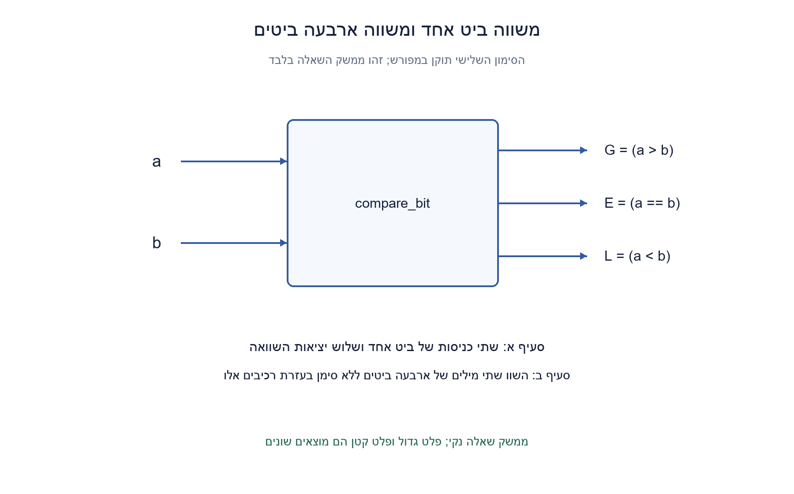
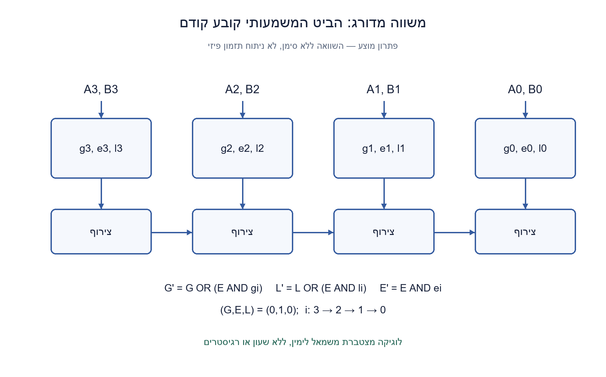
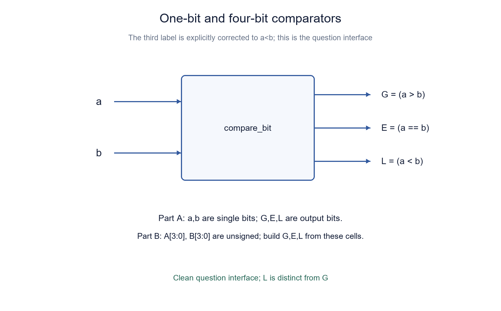
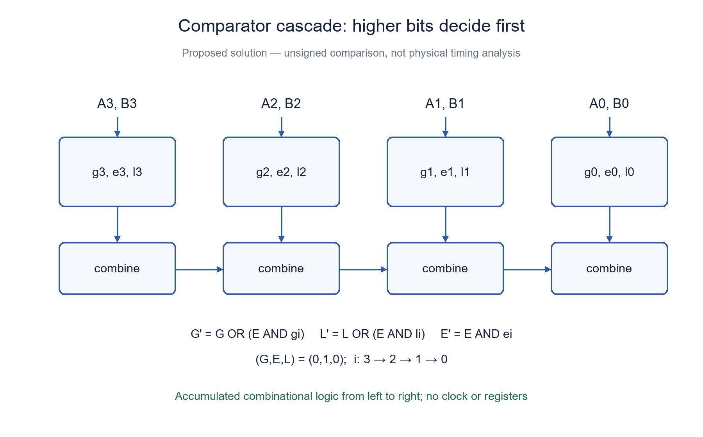

# PREP-110 — משווה ביט אחד והרחבה למשווה ארבעה ביטים

פתרון מוצע בסיוע AI. ביקורת מקצועית אנושית ממתינה; הקושי לא כויל.

## מקור

[צילום מקורי](../sources/2026-10-24-batch10-05.png)

א. ממש רכיב המקבל שני ביטים ומוציא שלושה ביטים כפי שמתואר בתמונה.
ב. בעזרת רכיב זה, ממש רכיב המתאר יחס בין שתי כניסות, כל אחת בעלת 4 ביט.
האיור המקורי מסמן a>b, a==b, b<a; הסימון האחרון כפול לראשון ונשמר כאן כלשונו.

חברות מדווחות מהצילום בלבד, ללא אימות עצמאי: Marvell, Apple

## משווה ביט אחד והרחבה למשווה ארבעה ביטים

א. ממשו בשערים רכיב עם שתי כניסות ביט a,b ושלוש יציאות: G המציינת a>b, E המציינת a=b ו־L המציינת a<b. הציגו טבלת אמת ומשוואות.
ב. בעזרת ארבעה רכיבים כאלה ולוגיקה משלימה, השוו שתי מילים A[3:0],B[3:0] ללא סימן. החזירו את שלוש תוצאות ההשוואה והסבירו איזה ביט קובע כאשר כמה ביטים שונים.

הבהרות עריכה: באיור המקור מסומנים a>b, a==b, b<a. הסימון השלישי זהה לראשון, ולכן אינו נותן שלוש אפשרויות השוואה שונות; כאן הוא מתוקן במפורש ל־a<b. אם מפרשים את האיור מילולית, שתי יציאותיו הקיצוניות הן אותו אות. הקלטים בגרסה הערוכה הם בינאריים וללא סימן, ביט 3 הוא המשמעותי ביותר. זהו רכיב קומבינטורי; אין שעון או מחזורי השהיה מוגדרים. מותרות לוגיקה בסיסית וחיווט. אין דרישה למספר שערים מינימלי.

### שלושה רמזים

1. התחילו מארבע אפשרויות הקלט של ביט אחד. באילו מהן יש שוויון, ובאילו יש יתרון לאחד הצדדים?
2. השוו מהביט המשמעותי ביותר. מתי מותר לביט נמוך יותר להשפיע על התוצאה?
3. שמרו אות המציין שכל הביטים הגבוהים שווים. אפשר להוסיף הכרעה מהביט הבא רק כשהאות הזה הוא 1; עדכנו גם את אות השוויון.

### פתרון מוצע

### למה ביט גבוה קודם לביט נמוך?
במספר ללא סימן, משקל ביט גבוה גדול מסכום משקלי כל הביטים שמתחתיו. לכן הביט הגבוה הראשון שבו A ו־B שונים מכריע את כל ההשוואה. אם כל הביטים שווים, המספרים שווים. למשל 1000 גדול מ־0111, למרות שבמספר הימני יש יותר אחדים.

### רכיב של ביט אחד
| a | b | G: a>b | E: a=b | L: a<b |
| --- | --- | --- | --- | --- |
| 0 | 0 | 0 | 1 | 0 |
| 0 | 1 | 0 | 0 | 1 |
| 1 | 0 | 1 | 0 | 0 |
| 1 | 1 | 0 | 1 | 0 |

המשוואות הן g=a AND NOT b, ‏e=NOT(a XOR b), ‏l=NOT a AND b. בדיוק יציאה אחת דולקת בכל קלט חוקי. שער XNOR הוא דרך ישירה לשוויון, ואפשר לפרקו לשערים בסיסיים אם הספרייה דורשת זאת. אלו אינן יציאות מספריות בנות כמה ביטים, אלא שלושה דגלים.

### ארבעה רכיבים ולוגיקת קדימות
לכל זוג Ai,Bi בונים רכיב ומקבלים gi,ei,li. מתחילים ב־G=0,E=1,L=0, כלומר עדיין לא נבדק הבדל. עוברים i=3,2,1,0 ומעדכנים בו־זמנית לפי הערכים הישנים:

```text
G_next = G OR (E AND gi)
L_next = L OR (E AND li)
E_next = E AND ei
```

אם כבר נמצא הבדל גבוה, E=0 ושום ביט נמוך אינו משנה G או L. אם הגבוהים שווים, E=1 והביט הנוכחי רשאי להכריע. אין כאן שעון: 'עוברים' מתאר חיבור מדורג של ארבעה מקטעים קומבינטוריים. בקוד זהו חישוב המודל.

אפשר גם לפרוש משוואה: G=g3 OR(e3 AND g2) OR(e3 AND e2 AND g1) OR(e3 AND e2 AND e1 AND g0). ל־L אותה משוואה עם li, ו־E=e3 AND e2 AND e1 AND e0. הפירוק מראה מדוע OR של כל gi ללא תנאי שוויון אינו נכון: ביט נמוך לא רשאי לבטל הכרעה גבוהה הפוכה.

### הוכחת נכונות ועלות
אחרי כל תחילית ביטים, שלושת האותות משווים בדיוק את התחיליות שנבדקו. אם התחיליות כבר שונות, הביטים הבאים אינם מכריעים. אם הן שוות, ההשוואה החדשה היא זו של הביט הבא. בסיס הריק הוא שוויון, ולכן באינדוקציה ההשוואה הסופית נכונה. הקלטים 0000,1111, השוויון וההבדל בביט התחתון נכללים באותו כלל.

לרוחב n, שרשרת משתמשת ב־n תאי ביט וב־O(n) לוגיקת צירוף, ועומק לוגי O(n) בספריית שערים בעלת מניפה קבועה. אפשר לשלב קבוצות של (G,E,L) בעץ מאוזן ולקבל O(log n) עומק עם O(n) תאים וצירופים. אין טענה למינימום שטח, הספק או זמן בספרייה פיזית. עבור ארבעה ביטים העלות קבועה.

### תיקון המקור והגבול לחתומים
האיור המקורי מכיל שתי תוויות זהות במשמעות. התיקון מפורש; לא מתיימרים שהמקור כבר ביקש L נפרד. במספרים חתומים במשלים לשתיים, אי אפשר להפעיל השוואה ללא סימן על כל המילה: למשל 1111 הוא 15 ללא סימן אך ‎-1 בחתום. כשביטי הסימן שונים, הסימן מכריע; כשזהים אפשר להשתמש בהשוואת הביטים המתאימה. זו הרחבה, לא החוזה הראשי.

### מה נבדק?
המודל הורץ מול השוואת שלמים עצמאית בכל 5,460 זוגות הקלט לרוחבים 1..6, ובפרט כל 256 הזוגות של ארבעה ביטים. אומתו גם ארבע שורות תא הביט, תנאי בדיוק־אחד ודחיית קלט לא תקין. זו בדיקת לוגיקה בינארית בפייתון, ללא HDL, סינתזה או בדיקת תזמון פיזי.

```python
"""Two-state gates and most-significant-first unsigned comparator cascade."""


def compare_bit(a, b):
    if any(type(v) is not int or v not in (0, 1) for v in (a, b)):
        raise ValueError("expected integer bits")
    return a & (b ^ 1), (a ^ b) ^ 1, (a ^ 1) & b


def compare_words(a, b, width=4):
    if type(width) is not int or width < 1:
        raise ValueError("positive width required")
    if any(type(v) is not int or not 0 <= v < (1 << width) for v in (a, b)):
        raise ValueError("unsigned words outside width")
    greater, equal, less = 0, 1, 0
    for i in range(width - 1, -1, -1):
        gi, ei, li = compare_bit((a >> i) & 1, (b >> i) & 1)
        greater, less = greater | (equal & gi), less | (equal & li)
        equal &= ei
    return greater, equal, less
```





## One-bit comparator and a four-bit unsigned cascade

A. Build a gate-level component with input bits a,b and outputs G for a>b, E for a=b and L for a<b. Give its truth table and equations.
B. Using four such cells and combining logic, compare unsigned words A[3:0],B[3:0]. Produce the three comparison results and explain which bit decides when several bit positions differ.

Editorial clarifications: the source diagram labels a>b, a==b and b<a. The last is identical to the first, not a third comparison outcome; this edition explicitly corrects it to a<b. A literal implementation of the source would simply duplicate the first output. Inputs are binary and unsigned; bit 3 is most significant. The circuit is combinational, without a clock or specified cycle latency. Basic combining logic and wires are allowed. No minimum gate-count requirement is claimed.

### Three hints

1. Start with the four one-bit input combinations. Which represent equality, and which favor either operand?
2. Compare from the most significant bit. When may a lower bit influence the result?
3. Maintain an all-higher-bits-equal signal. Accept a decision from the next bit only when this signal is one; update equality too.

### Proposed solution

### Why do higher bits take priority?
For unsigned numbers, a high bit outweighs the sum of every lower bit. Therefore the highest differing bit decides the comparison. If no bit differs, the words are equal. For example, 1000 exceeds 0111 even though the latter contains more ones.

### A one-bit cell
| a | b | G: a>b | E: a=b | L: a<b |
| --- | --- | --- | --- | --- |
| 0 | 0 | 0 | 1 | 0 |
| 0 | 1 | 0 | 0 | 1 |
| 1 | 0 | 1 | 0 | 0 |
| 1 | 1 | 0 | 1 | 0 |

Use g=a AND NOT b, e=NOT(a XOR b), l=NOT a AND b. Exactly one output is high for every valid input. XNOR directly provides equality, or may be decomposed when the gate library requires it. These are three Boolean flags, not wider numeric outputs.

### Four cells and priority logic
Build one cell for each Ai,Bi, yielding gi,ei,li. Initialize G=0,E=1,L=0: no difference has yet been seen. Process i=3,2,1,0, updating simultaneously from the old signals:

```text
G_next = G OR (E AND gi)
L_next = L OR (E AND li)
E_next = E AND ei
```

Once a higher difference exists, E=0 and lower bits cannot change the decision. While the higher bits remain equal, E=1 and the current bit may decide. This is a combinational cascade, not four clock cycles; the loop only evaluates its logical model.

Equivalently, G=g3 OR(e3 AND g2) OR(e3 AND e2 AND g1) OR(e3 AND e2 AND e1 AND g0). Replace gi with li for L; E=e3 AND e2 AND e1 AND e0. Simply ORing all gi is wrong because a lower bit must not override an opposite higher-bit decision.

### Correctness and cost
After each prefix, G,E,L compare precisely the processed prefixes. Different prefixes preserve their higher decision; equal prefixes delegate to the next bit. The empty prefix is equal, proving the recurrence by induction. All-zero, all-one, equal words and a difference only at the lowest bit follow the same rule.

An n-bit chain uses n bit cells and O(n) combining logic with O(n) depth in a bounded-fan-in gate library. Combining groups of (G,E,L) in a balanced tree gives O(log n) depth using O(n) cells and combinations. No minimum physical area, power or delay is claimed. Four-bit width has constant cost.

### Source correction and signed values
The source diagram repeats one comparison under two labels. The correction is explicit rather than attributed to the original. Signed two's-complement comparison is a separate contract: 1111 is unsigned 15 but signed -1. Different sign bits decide immediately; matching signs permit the appropriate remaining comparison. The unsigned circuit is not automatically a signed comparator.

### Verification
The actual model was compared with an independent integer-comparison oracle on all 5,460 input pairs for widths 1..6, including all 256 four-bit pairs. Checks also cover all four bit-cell rows, exactly-one output and invalid-input rejection. These are two-state Python checks, not HDL simulation, synthesis or physical timing analysis.

```python
"""Two-state gates and most-significant-first unsigned comparator cascade."""


def compare_bit(a, b):
    if any(type(v) is not int or v not in (0, 1) for v in (a, b)):
        raise ValueError("expected integer bits")
    return a & (b ^ 1), (a ^ b) ^ 1, (a ^ 1) & b


def compare_words(a, b, width=4):
    if type(width) is not int or width < 1:
        raise ValueError("positive width required")
    if any(type(v) is not int or not 0 <= v < (1 << width) for v in (a, b)):
        raise ValueError("unsigned words outside width")
    greater, equal, less = 0, 1, 0
    for i in range(width - 1, -1, -1):
        gi, ei, li = compare_bit((a >> i) & 1, (b >> i) & 1)
        greater, less = greater | (equal & gi), less | (equal & li)
        equal &= ei
    return greater, equal, less
```





## חומר משלים / Supporting material

```json
{
  "assumptions": {
    "he": [
      "קלט בינארי ללא סימן; ביט 3 הוא המשמעותי ביותר.",
      "L מוגדר במפורש a<b במקום התווית הכפולה b<a במקור.",
      "מותרות לוגיקה משלימה וחיווט; רכיב קומבינטורי ללא דרישת מינימום שערים."
    ],
    "en": [
      "Binary unsigned inputs; bit 3 is most significant.",
      "L explicitly means a<b, correcting the duplicated source label b<a.",
      "Combining logic and wires allowed; combinational circuit, no minimum gate-count claim."
    ]
  },
  "optimality": {
    "he": "מוצגת בנייה לינארית במספר תאי הביט; לא הוכחה למינימום שערים. עץ צירוף מאפשר עומק לוגריתמי במודל מניפה קבועה.",
    "en": "The construction uses a linear number of bit cells; it does not establish a minimum gate count. A balanced combination tree permits logarithmic depth with bounded fan-in."
  },
  "edge_cases": {
    "he": [
      "שוויון, אפסים, וכל הביטים אחד.",
      "הבדל בביט העליון מול הרבה הבדלים נמוכים בכיוון ההפוך.",
      "הבדל בביט התחתון בלבד; קלט חתום דורש חוזה אחר."
    ],
    "en": [
      "Equal words, all zero and all one.",
      "A highest-bit difference versus many opposite lower differences.",
      "A difference only at the lowest bit; signed input requires another contract."
    ]
  },
  "common_mistakes": {
    "he": [
      "לחבר את כל תוצאות גדול ב־OR בלי בדיקת שוויון של הגבוהים.",
      "לעדכן E לפני שחישבתם G_next,L_next מהערכים הישנים.",
      "לתאר ארבעה תאי השוואה קומבינטוריים כארבעה מחזורי שעון."
    ],
    "en": [
      "ORing all greater outputs without higher-bit equality.",
      "Updating E before computing G_next,L_next from the old values.",
      "Calling a four-cell combinational cascade four clock cycles."
    ]
  },
  "interview_answer": {
    "he": "לתא ביט: g=a·¬b, e=¬(a⊕b), l=¬a·b. מחברים ארבעה תאים מהמשמעותי לפחות משמעותי. כל הכרעה נמוכה מותנית בשוויון כל הגבוהים; בדיוק דגל אחד דולק.",
    "en": "For one bit use g=a·¬b, e=¬(a⊕b), l=¬a·b. Combine four cells from most to least significant, admitting a lower decision only if every higher bit is equal. Exactly one flag is high."
  },
  "source_ambiguities": {
    "he": "התווית b<a כפולה ל־a>b; תוקנה ל־a<b בעריכה. המקור לא קובע חתימות, ספריית שערים או עלות מינימלית. ההנחות נוספו במפורש.",
    "en": "The source label b<a duplicates a>b; this edition corrects it to a<b. Signedness, gate library and minimum cost were unspecified and are explicitly clarified."
  },
  "verification": {
    "he": "5,460 זוגות ברוחבים 1..6, בהם כל 256 זוגות ארבעת הביטים, הושוו להשוואות שלמים נפרדות; אומתו דגל יחיד וקלט שגוי. מודל Python בלבד.",
    "en": "5,460 pairs across widths 1..6, including all 256 four-bit pairs, matched independent integer comparisons; exactly-one and invalid inputs checked. Python model only."
  },
  "solution_extensions": {
    "he": {
      "question": "איך מקצרים את עומק השרשרת ברוחב גדול?",
      "direction": "הגדירו לכל קבוצת ביטים G,E,L; צירוף קבוצה גבוהה ונמוכה הוא G=Gh OR(Eh AND Gl), E=Eh AND El, L=Lh OR(Eh AND Ll). בנו עץ מאוזן."
    },
    "en": {
      "question": "How can a wide comparison avoid linear cascade depth?",
      "direction": "Represent each group by G,E,L. Combine high and low groups as G=Gh OR(Eh AND Gl), E=Eh AND El, L=Lh OR(Eh AND Ll), using a balanced tree."
    }
  }
}
```

## קליטה נוספת — 31.10.2026 / Additional intake

- מקור 9: [sources/2026-10-31-batch20-09.png](../sources/2026-10-31-batch20-09.png)

נתונה קופסה שמקבלת A,B שני מספרים בינארים באורך N, והקופסה מחזירה 1 אם A>B ו0 אחרת. תכנן את הקופסה בשערים ומוקסים

- מקור 14: [sources/2026-10-31-batch20-14.png](../sources/2026-10-31-batch20-14.png)

סעיף א׳ - נתון קופסה כניסות A,B ומוצא X,Y. ממש את X ו Y כך ש X=1 אם A

התוכן הבא הוא הרחבה מוצעת בסיוע AI; הוא אינו אישור אנושי לפתרון המקורי או החדש.

### he — הרחבה / Extension


וריאציית מקור נוספת, צילום 9 מ־31.10.2026: שתי כניסות unsigned A,B ברוחב N≥1. הפיקו G=1 אם ורק אם A>B, ואפס אחרת, באמצעות שערים ומרבבים. השוויון מחזיר אפס; שמרו את הגרסה המקורית בעלת שלושת פלטי ההשוואה.

השלמה עריכתית נפרדת לצילום 14, לפי בקשה מפורשת של המשתמש לאחר שהמקור נקטע: הגדירו A,B ככניסות של ביט יחיד, X=(A>B), Y=(A<B), ובשוויון X=Y=0. הנוסח המקורי הקטוע נשמר במקור; זהו נוסח משלים שאושר להכנה, לא שחזור מוכח של המשך הצילום.

#### רמזים להרחבה / Variant hints

1. בגרסת N הסיביות, חשבו מה קורה אם זוג הסיביות הגבוהות שווה, ומה קורה אם הוא שונה. בהשלמה החד־ביטית התחילו מארבע שורות.
2. הסיבית הגבוהה ביותר שבה A ו־B שונים קובעת את היחס; סיביות שוות משמרות את תוצאת האזור הנמוך.
3. התחילו g[-1]=0 והתקדמו מה־LSB: g[i]=MUX(Ai XOR Bi,g[i-1],Ai). לביט יחיד, X=A AND NOT B ו־Y=NOT A AND B.

#### הצעה לפתרון / Proposed solution


### הצעה לפתרון לגרסת N הסיביות
נבנה בהדרגה את ההשוואה של A[i:0] ו־B[i:0]. מתחילים g[-1]=0, כי שתי מחרוזות ריקות שוות ואינן מקיימות גדול־ממש. לכל i מהנמוך לגבוה נגדיר d_i=Ai XOR Bi ו־g[i]=MUX(d_i,g[i−1],Ai). אם שתי הסיביות שוות, הן אינן משנות את היחס ולכן המרבב מחזיר את ההשוואה הנמוכה. אם הן שונות, זו הסיבית הגבוהה ביותר שנוספה: Ai=1 קובע גדול, ו־Ai=0 קובע שאינו גדול. האינדוקציה על i מוכיחה g[N−1]=(A>B). למשל A=1000,B=0111 מחזיר אחד, גם אם כל הביטים הנמוכים נוטים לכיוון ההפוך. כש־A=B כל d_i אפס והאתחול אפס נשמר.

המבנה משתמש ב־N שערי XOR ו־N מרבבים ועומק ליניארי במסלול ההכרעה. חלופת שערים מאוזנת מייצגת כל מקטע בזוג (G,E), כאשר G מציין גדול ו־E שווה. עבור מקטע גבוה H ונמוך L משלבים G=G_H OR (E_H AND G_L), E=E_H AND E_L. מתחילים בכל סיבית ב־G_i=Ai AND NOT Bi ו־E_i=NOT(Ai XOR Bi), ומשלבים עץ של מקטעים סמוכים עד המילה המלאה. ההוכחה זהה: הגבוה מכריע אם אינו שווה, ורק בשוויון ניגשים לנמוך. עלות ישירה O(N) צמתים ועומק O(log N), בלי טענת מינימום פיזי או תזמון מספרי ללא ספריית שערים.

### השלמה עריכתית מאושרת לצילום 14
המקור נקטע אחרי התנאי 'כך ש X=1 אם A'. לפי בקשת המשתמש השלמנו תרגיל מפורש: A,B בני ביט יחיד, X מסמן A>B ו־Y מסמן A<B. אין טענה שזה מה שהופיע בחלק החסר.

| A | B | X | Y |
|---|---|---|---|
|0|0|0|0|
|0|1|0|1|
|1|0|1|0|
|1|1|0|0|

לכן X=A AND NOT B ו־Y=NOT A AND B. כל פלט דורש זוג אחד בלבד מטבלת האמת, והם לעולם אינם אחד יחד. אם נדרש גם פלט שוויון, E=NOT(X OR Y). הגרסה הזו מקושרת ל־PREP-110 ואינה מחליפה את השאלה המקורית או ממציאה שיוך מקור חדש.

נבדקו ממצה כל 87,380 זוגות unsigned ברוחבים 1..8 בכל אחד משני מימושי ההשוואה, כולל כל השוויונות, וארבע שורות ההשלמה החד־ביטית. הבדיקות הן מודלים עצמאיים של אמת לוגית, ללא RTL או בדיקת השהיה פיזית.

#### assumptions

[
  "גרסה כללית: N≥1, unsigned, השוואה קשיחה A>B; g[-1]=0.",
  "השלמת צילום 14 שאושרה על ידי המשתמש: A,B הם ביט יחיד ו־X,Y מסמנים גדול וקטן; שני הפלטים אפס בשוויון."
]

#### optimality

"שרשרת: N XOR ו־N MUX, עומק O(N). עץ זוגות (G,E): O(N) צמתים ועומק O(log N). אין טענת מינימום שערים או זמן פיזי."

#### verification

"עברו כל 87,380 זוגות הקלט ברוחבים 1..8 בכל רשת, ועוד ארבע שורות ההשלמה החד־ביטית; ללא RTL או חומרה."

#### edge_cases

[
  "A=B בכל רוחב מחזיר אפס ב־G.",
  "0 מול הערך המרבי; הבדל רק ב־MSB; הבדל רק ב־LSB.",
  "בהשלמה החד־ביטית X,Y לעולם אינם אחד יחד."
]

#### common_mistakes

[
  "אתחול g[-1]=1 הופך שוויון לגדול־או־שווה.",
  "אין לעבור מהגבוה לנמוך באותה רקורסיה: סיבית נמוכה שונה עלולה למחוק הכרעה גבוהה.",
  "אין להציג את השלמת צילום 14 כאילו שוחזרה מהמקור."
]

#### interview_answer

"אעבור מהנמוך לגבוה: סיביות שוות שומרות תוצאה קודמת, ושונות בוחרות Ai; אתחול אפס נותן גדול־ממש. להשלמה החד־ביטית X=A∧¬B ו־Y=¬A∧B."

#### source_ambiguities

[
  "צילום 9 אינו מציין signed; העריכה בוחרת unsigned במפורש.",
  "צילום 14 קטוע. המשתמש ביקש במפורש להשלים אותו; המשך התרגיל הוא החלטת עריכה ולא עובדה שנקראה מן הצילום."
]

#### solution_extensions

{
  "question": "איך מתאימים את ההשוואה למספרים signed במשלים לשתיים באותו רוחב?",
  "direction": "אם סיביות הסימן שונות, המספר עם סימן אפס גדול. אם הן שוות, השוואת unsigned של הדפוסים נותנת אותו סדר. אפשר לבחור בין שתי התוצאות לפי XOR של סיביות הסימן.",
  "integration": "מוכן בתוכן; אינו מחובר לתור המשך אינטראקטיבי."
}

### en — הרחבה / Extension


Additional source variant, screenshot nine on 31 October 2026: unsigned A,B of width N≥1. Produce G=1 exactly when A>B, otherwise zero, using gates and MUXes. Equality returns zero; retain the original three-output comparison exercise.

Separate editorial completion for screenshot fourteen, explicitly requested by the user after source truncation: A,B are one-bit inputs, X=(A>B), Y=(A<B), and equality makes both zero. The truncated original is preserved in its source record. This is an authorized edited exercise, not a verified reconstruction of the missing screenshot text.

#### רמזים להרחבה / Variant hints

1. For N bits, distinguish equal and different high-bit pairs. For the one-bit completion, begin with four rows.
2. The highest differing bit decides; equal bits preserve the lower-region result.
3. Start g[-1]=0 and scan from the LSB: g[i]=MUX(Ai XOR Bi,g[i-1],Ai). For one bit use X=A AND NOT B and Y=NOT A AND B.

#### הצעה לפתרון / Proposed solution


### Proposed solution for the N-bit variant
Build the comparison of A[i:0] and B[i:0] incrementally. Start g[-1]=0: two empty strings are equal, so strict greater-than is false. From low bits to high, define d_i=Ai XOR Bi and g[i]=MUX(d_i,g[i−1],Ai). Equal current bits do not change the lower comparison, so the MUX retains g[i−1]. Different current bits are the highest pair added: Ai=1 means greater, Ai=0 means not greater. Induction on i proves g[N−1]=(A>B). For A=1000,B=0111 the result is one despite the opposite tendency of every lower bit. When A=B all d_i are zero and the zero initialization survives.

This uses N XOR gates and N MUXes with a linear decision path. A balanced gate alternative represents each block by (G,E), denoting greater and equal. Combine high block H and low block L as G=G_H OR (E_H AND G_L), E=E_H AND E_L. Initialize each bit with G_i=Ai AND NOT Bi and E_i=NOT(Ai XOR Bi), then combine adjacent blocks in a tree. Correctness follows because the high block decides unless equal, in which case the lower block decides. A direct construction has O(N) nodes and O(log N) depth, without physical-optimality or numerical timing claims absent a gate library.

### Authorized editorial completion for screenshot fourteen
The source stops after the partial condition 'X=1 if A'. At the user's explicit request, the completed exercise defines one-bit A,B, X=(A>B) and Y=(A<B). This does not claim to reconstruct the missing original text.

| A | B | X | Y |
|---|---|---|---|
|0|0|0|0|
|0|1|0|1|
|1|0|1|0|
|1|1|0|0|

Thus X=A AND NOT B and Y=NOT A AND B. Each output recognizes just one input row, and they can never both be one. If equality is also required, E=NOT(X OR Y). This variant is linked to PREP-110, preserving its original question and making no invented source-attribution claim.

Exhaustive checks covered all 87,380 unsigned operand pairs across widths 1..8 for both comparator implementations, including every equality, plus the four one-bit completion rows. These are independent Boolean models, without RTL compilation or physical-delay testing.

#### assumptions

[
  "General variant: N≥1, unsigned strict A>B; g[-1]=0.",
  "User-authorized screenshot-fourteen completion: one-bit A,B; X,Y denote greater and less; equality makes both zero."
]

#### optimality

"Chain: N XORs and N MUXes, O(N) depth. A (G,E) tree uses O(N) nodes and O(log N) depth. No gate-count or physical-delay minimum claim."

#### verification

"All 87,380 operand pairs across widths one through eight passed in each network, plus four one-bit completion rows; no RTL or hardware."

#### edge_cases

[
  "A=B returns zero for G at every width.",
  "Zero versus maximum; MSB-only difference; LSB-only difference.",
  "The one-bit completion never asserts X and Y together."
]

#### common_mistakes

[
  "Initializing g[-1]=1 changes equality into greater-or-equal.",
  "Do not run the same recurrence high-to-low: a lower difference could erase a higher decision.",
  "Do not present the screenshot-fourteen completion as recovered original text."
]

#### interview_answer

"Scan low to high: equal bits retain the previous result, different bits select Ai; zero initialization ensures strict greater-than. For the one-bit completion X=A∧¬B and Y=¬A∧B."

#### source_ambiguities

[
  "Screenshot nine does not state signedness; the edited version explicitly chooses unsigned.",
  "Screenshot fourteen is truncated. The user explicitly requested completion; the completed contract is editorial, not a fact read from the screenshot."
]

#### solution_extensions

{
  "question": "How would you adapt comparison for same-width signed two's-complement numbers?",
  "direction": "When sign bits differ, the nonnegative operand is greater. When signs match, unsigned comparison of the bit patterns has the same order. Select between these cases using the XOR of sign bits.",
  "integration": "Prepared in content; not connected to an interactive follow-up queue."
}

- [solutions/prep_batch20_combinational.py](../solutions/prep_batch20_combinational.py)
- [diagrams/prep-110-combinational-batch20-he.png](../diagrams/prep-110-combinational-batch20-he.png)
- [diagrams/prep-110-combinational-batch20-en.png](../diagrams/prep-110-combinational-batch20-en.png)
