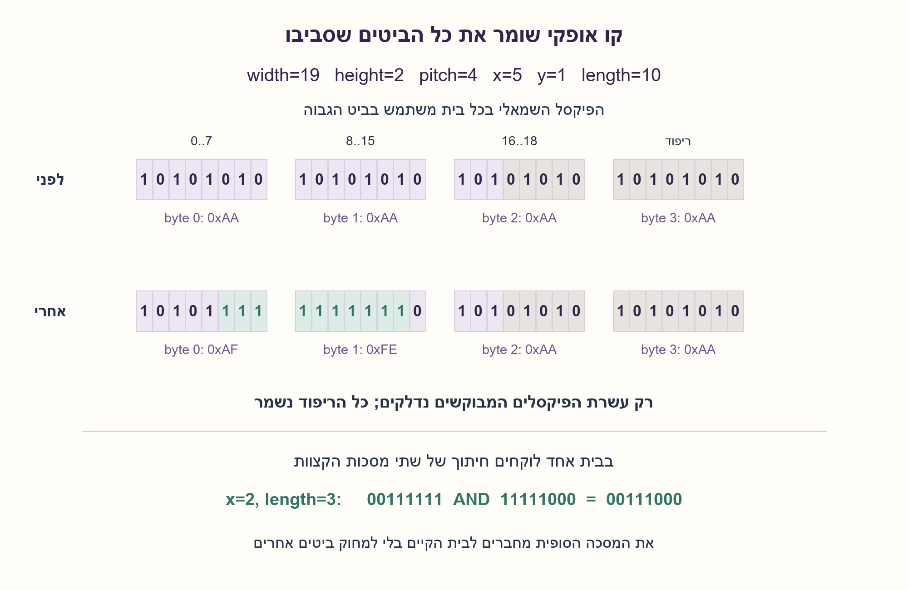
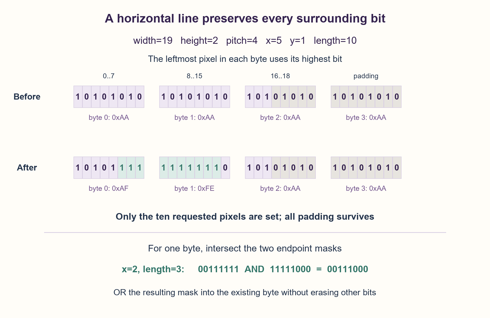

# PREP-111 — קו אופקי במפת ביטים — בלי לשנות פיקסלים מסביב

פתרון מוצע בסיוע AI; ביקורת מקצועית אנושית ממתינה. הקושי לא כויל.

## מקור

[צילום המקור](../sources/2026-10-24-batch10-06.png)

נתון לך מצביע למסך עם כמות פיקסלים מסויימת, המיוצג על ידי מערך. כל איבר במערך הוא בית ביטים, המייצג שמונה פיקסלים במסך. כתוב פונקציה המקבלת מיקום x,y ואורך, ומדפיסה על המסך קו אופקי לפי האורך הנתון.

שיוכי החברות בצילום הם דיווח לא מאומת: Google.

## קו אופקי במפת ביטים — בלי לשנות פיקסלים מסביב

מסך מונוכרומי נשמר במערך בתים קיים; כל בית בן שמונה ביטים מייצג שמונה פיקסלים. כתבו draw_horizontal(x,y,length) שמדליקה בדיוק את הפיקסלים בקו האופקי [x,x+length) בשורה y ושומרת כל ביט אחר. הסבירו חישוב כתובת, מסכות קצוות, נכונות ועלות.

מטא־נתוני המסך ידועים מראש: width,height חיוביים בפיקסלים ו־pitch בבתים בין תחילות שורות, לפחות ceil(width/8). המאגר מכיל לפחות pitch×height בתים ואינו משנה גודל במהלך הפעולה. כל שורה מתחילה בגבול בית; x=0 משמאל ו־y=0 בשורה הראשונה. הסדר הוא MSB-first: פיקסל x משתמש בביט 7−(x modulo 8). ערך 1 הוא פיקסל דלוק.

אלו הבהרות עריכה: המקור לא מגדיר רוחב, pitch, סדר ביטים או צבע. אין חיתוך אוטומטי לגבולות ואין גלישה לשורה הבאה. קלט שלם חוקי חייב לקיים 0≤y<height, 0≤x≤width ו־0≤length≤width−x. אורך אפס הוא ללא פעולה; x=width מותר רק אז. קלט שגוי נדחה לפני כל כתיבה. יש לשמר גם ביטי ריפוד בבית האחרון, בתי ריפוד בין שורות וכל הבתים האחרים. במימוש המצורף המסך והמאגר הם הקשר האובייקט, והפעולה מקבלת שלושה ארגומנטים כפי שבמקור.

### שלושה רמזים

1. איזה בית ואיזה ביט מייצגים את הפיקסל x בשורה y? אילו פיקסלים בקצוות חולקים בית עם פיקסלים מחוץ לקו?
2. בתוך הקו אפשר למלא בתים שלמים באחדות. בשני הקצוות צריך מסכה ו־OR כדי לא למחוק מידע שהיה שם.
3. ב־MSB-first מסכת ההתחלה היא 0xFF>>(x%8) ומסכת הסוף משאירה את הביטים משמאל עד לפיקסל האחרון. אם הקו כולו באותו בית, בצעו AND בין המסכות ורק אז OR עם הבית. בדקו גבולות לפני כתיבה.

### הצעה לפתרון

### הרעיון: קצוות חלקיים ואמצע שלם
פיקסל הוא ביט, לא בית. שמונה פיקסלים סמוכים חולקים בית אחד. קו עשוי להתחיל באמצע בית ולהסתיים באמצע אחר; החלפת כל בתי הקצוות ב־255 תדליק גם פיקסלים שאינם בקו. לכן מפרידים בין קצוות עם מסכה לבין בתים פנימיים שמכוסים במלואם.

### קודם מתרגמים פיקסל לכתובת
תחילת שורה y נמצאת ב־y×pitch. הבית של x הוא y×pitch + floor(x/8), והביט שלו הוא 7−(x modulo 8). משתמשים ב־pitch, לא ברוחב הפיקסלים, כדי לעבור שורה. הרוחב אינו חייב להתחלק בשמונה; למשל רוחב 19 צורך לפחות שלושה בתים, והחמישה ביטים האחרונים בבית השלישי הם ריפוד.

מאמתים את כל המטא־נתונים והגבולות לפני כתיבה. משתמשים בבדיקה length≤width−x, לאחר בדיקת x, במקום להסתמך על סכום שעלול לגלוש בשפה ברוחב קבוע. עבור length=0 חוזרים לפני חישוב x+length−1. כך גם קו ריק בקצה הימני אינו יוצר אינדקס של פיקסל שלילי או גישה לבית הבא.

### שתי המסכות
נסמן last_x=x+length−1. במפת MSB-first:
```text
first_mask = 0xFF >> (x modulo 8)
last_mask  = (0xFF << (7 − (last_x modulo 8))) AND 0xFF
```
המסכה הראשונה מסמנת את הביטים מפיקסל ההתחלה ימינה עד סוף הבית. השנייה מסמנת מתחילת הבית משמאל ועד הפיקסל האחרון. אם אלו בתים שונים, מחברים כל מסכה לבית שלה באמצעות OR וממלאים כל בית שביניהם ב־255. OR מדליק את הנדרש ומשאיר ללא שינוי כל ביט שבו המסכה אפס.

אם שני הקצוות באותו בית, משתמשים בחיתוך המסכות: first_mask AND last_mask. לדוגמה x=2 ואורך 3 נותנים 00111111 וגם 11111000; החיתוך הוא 00111000 — בדיוק המקומות 2,3,4. OR בין שתי המסכות היה נותן 11111111 ומדליק יותר מדי. לאחר החיתוך כן עושים OR עם תוכן הבית הקיים.

### דוגמה ושמירת הריפוד
ברוחב 19 ו־pitch=4 יש שלושה בתי פיקסלים ועוד בית ריפוד לשורה. ציירו בשורה 1 החל מ־x=5 באורך 10: הפיקסל האחרון הוא 14. בבית הראשון נדלקים שלושה ביטים, ובשני שבעה. הבית השלישי, ביטי הריפוד שבו, בית הריפוד הרביעי וכל השורות האחרות נשארים בדיוק כפי שהיו. אם לפני הפעולה כל בית הוא 10101010, שני בתי הקו נעשים 10101111 ו־11111110.

### למה כל ביט מחוץ לקו נשמר?
כל בית פנימי מכוסה כולו ולכן 255 נכון לכל ביט בו. בבית קצה, ביט במסכה דלוק אם ורק אם הוא שייך לקטע שביקשנו; OR אינו משנה ביט מחוץ למסכה. במקרה של בית אחד, החיתוך דורש שהביט יהיה גם אחרי ההתחלה וגם לפני הסוף. בדיקת הגבולות מבטיחה ששום בית של שורה אחרת או ביט ריפוד לא ייכלל. כתיבה שנייה של אותו קו אינה משנה שוב את התמונה — זו הדלקה, לא XOR שמחליף מצב.

### עלות והקשר לפונקציה מהמקור
למסך קיים אין הקצאת עותק. מספר הבתים שנוגעים בהם הוא B=floor((x+length−1)/8)−floor(x/8)+1 לקו לא ריק. זמן הפעולה O(B), כלומר O(1+length/8), ומספר קבוע של משתנים — O(1) מילות עזר. אורך אפס עולה O(1). אי אפשר לייחס לבית אחד שמונה פעולות פיקסל אם עובדים כאן במסכות על בתים; מצד שני אין טענה למינימום הוראות בכל מכונת SIMD או ספריית ציור.

המקור נותן מצביע ושלושה ארגומנטים בלבד, אך בלי רוחב ופסיעה אי אפשר לדעת היכן השורה מתחילה. MonoScreen שומר את המאגר והמטא־נתונים כהקשר, ו־draw_horizontal מקבלת רק x,y,length. זהו קוד Python שמשנה את מאגר הזיכרון, ללא חיבור לדרייבר מסך. בתרגום ל־C יש להגדיר בתים בני שמונה ביטים, להשתמש בטיפוסים לא־מסומנים ולבדוק גם גלישת כפל בחישוב גודל/כתובת לפני גישה למצביע. אין כאן גישה מקבילית או שינוי גודל המאגר במהלך פעולה.

```python
"""Draw into an existing bytearray: MSB-first, padded rows, no clipping.

Screen metadata is established once. draw_horizontal(x,y,length) sets exactly
that half-open pixel range, preserving all other pixels, padding and extra bytes.
Invalid arguments raise ValueError before any buffer write.
"""


class MonoScreen:
    def __init__(self, buffer, width, height, pitch):
        if not isinstance(buffer, bytearray):
            raise ValueError("buffer must be a mutable bytearray")  # noqa: TRY004 - one documented rejection type.
        if any(type(value) is not int for value in (width, height, pitch)):
            raise ValueError("screen dimensions must be integers")
        if width <= 0 or height <= 0 or pitch < (width + 7) // 8:
            raise ValueError("invalid dimensions or row pitch")
        if len(buffer) < pitch * height:
            raise ValueError("buffer is shorter than its screen metadata")
        self.buffer = buffer
        self.width, self.height, self.pitch = width, height, pitch

    def draw_horizontal(self, x, y, length):
        if any(type(value) is not int for value in (x, y, length)):
            raise ValueError("coordinates and length must be integers")
        if not (0 <= y < self.height and 0 <= x <= self.width
                and 0 <= length <= self.width - x):
            raise ValueError("line must be wholly inside the screen")
        if length == 0:
            return
        first, last = x // 8, (x + length - 1) // 8
        row = y * self.pitch
        first_mask = 0xFF >> (x % 8)
        last_mask = (0xFF << (7 - ((x + length - 1) % 8))) & 0xFF
        if first == last:
            self.buffer[row + first] |= first_mask & last_mask
        else:
            self.buffer[row + first] |= first_mask
            for column in range(first + 1, last):
                self.buffer[row + column] = 0xFF
            self.buffer[row + last] |= last_mask
```



## Draw a horizontal bitmap line without changing surrounding pixels

A monochrome screen uses an existing byte array, with eight pixels per eight-bit byte. Implement draw_horizontal(x,y,length), setting exactly the horizontal pixel interval [x,x+length) on row y to one while preserving every other bit. Explain addressing, endpoint masks, correctness and cost.

Screen metadata is established beforehand: positive pixel width/height and byte pitch between row starts, at least ceil(width/8). The buffer contains at least pitch×height bytes and is not resized during the operation. Every row starts at a byte boundary; x=0 is leftmost and y=0 the first row. Use MSB-first order: pixel x maps to bit 7−(x modulo 8). One means lit.

These are editorial clarifications: the source does not specify width, pitch, bit order or color. Do not clip or wrap into another row. Valid integer arguments satisfy 0≤y<height, 0≤x≤width and 0≤length≤width−x. Zero length is a no-op; x=width is allowed only then. Reject invalid arguments before any write. Preserve unused last-byte bits, row-padding bytes and every other byte. The supplied object holds buffer/metadata as context, leaving three action arguments as in the source.

### Three hints

1. Which byte and bit represent pixel x on row y? Which endpoint bytes also contain pixels outside the line?
2. Full interior bytes can become all ones. Endpoints need masks combined with OR so existing outside bits survive.
3. For MSB-first use start mask 0xFF>>(x%8); the end mask keeps bits from the left through the last pixel. If both endpoints share a byte, AND the masks before ORing into that byte. Validate before writing.

### Proposed solution

### Partial endpoints, complete interior
A pixel is one bit, not one byte. Eight adjacent pixels share a byte. A line may start and end within bytes; assigning 255 to those entire bytes would light pixels outside the line. Separate masked endpoints from completely covered interior bytes.

### Translate pixels to addresses first
Row y starts at y×pitch. Pixel x uses byte y×pitch+floor(x/8), with bit 7−(x modulo 8). Use byte pitch rather than pixel width to change rows. Width need not be divisible by eight: width 19 requires at least three bytes, and the last five bits of byte three are unused padding.

Validate metadata and all bounds before writing. After validating x, test length≤width−x instead of relying on a sum that could overflow in fixed-width code. For zero length return before calculating x+length−1. An empty line at the right boundary thus creates neither a negative last-pixel index nor an access to the next byte.

### The endpoint masks
Let last_x=x+length−1. With MSB-first packing:
```text
first_mask = 0xFF >> (x modulo 8)
last_mask  = (0xFF << (7 − (last_x modulo 8))) AND 0xFF
```
The first mask selects positions from the starting pixel rightward to its byte end. The second selects from its byte's left edge through the last pixel. If the endpoint bytes differ, OR each mask into its endpoint and fill intervening bytes with 255. OR sets selected bits while retaining every bit where the mask is zero.

If both endpoints share a byte, use first_mask AND last_mask. For x=2,length=3 the masks are 00111111 and 11111000, intersecting to 00111000: exactly positions 2,3,4. ORing the masks together would give 11111111 and set too much. After intersecting, OR that result into the existing byte.

### Example and padding preservation
With width 19 and pitch 4, each row has three pixel bytes and one padding byte. Draw at y=1,x=5,length=10; the last pixel is 14. Three bits are selected in the first byte and seven in the second. Byte three, its unused bits, padding byte four and all other rows remain unchanged. If every byte initially equals 10101010, the two affected bytes become 10101111 and 11111110.

### Why outside bits survive
Every interior byte is fully covered, so 255 is correct for all its bits. In an endpoint byte a mask bit is set exactly when it belongs to the requested portion; OR cannot alter bits outside that mask. The single-byte intersection requires a bit to be both after the start and before the end. Bounds guarantee that no other row or unused padding bit enters the range. Drawing the same line again is idempotent: this sets bits rather than toggling them with XOR.

### Cost and the source's function signature
No copy of the existing screen is allocated. For nonempty input, touched bytes number B=floor((x+length−1)/8)−floor(x/8)+1. Time is O(B), equivalently O(1+length/8), with O(1) auxiliary machine words. Zero length costs O(1). Byte masks avoid one operation per pixel, but no minimum instruction count across SIMD machines or graphics libraries is claimed.

The source provides a pointer and only three action arguments, but width/pitch are necessary to locate rows. MonoScreen retains the buffer and metadata as context; draw_horizontal accepts only x,y,length. This Python code modifies memory without a physical display-driver connection. A C translation must define eight-bit bytes, use unsigned types and guard size/address multiplication overflow before pointer access. Concurrent operations and buffer resizing during an operation are outside this contract.

```python
"""Draw into an existing bytearray: MSB-first, padded rows, no clipping.

Screen metadata is established once. draw_horizontal(x,y,length) sets exactly
that half-open pixel range, preserving all other pixels, padding and extra bytes.
Invalid arguments raise ValueError before any buffer write.
"""


class MonoScreen:
    def __init__(self, buffer, width, height, pitch):
        if not isinstance(buffer, bytearray):
            raise ValueError("buffer must be a mutable bytearray")  # noqa: TRY004 - one documented rejection type.
        if any(type(value) is not int for value in (width, height, pitch)):
            raise ValueError("screen dimensions must be integers")
        if width <= 0 or height <= 0 or pitch < (width + 7) // 8:
            raise ValueError("invalid dimensions or row pitch")
        if len(buffer) < pitch * height:
            raise ValueError("buffer is shorter than its screen metadata")
        self.buffer = buffer
        self.width, self.height, self.pitch = width, height, pitch

    def draw_horizontal(self, x, y, length):
        if any(type(value) is not int for value in (x, y, length)):
            raise ValueError("coordinates and length must be integers")
        if not (0 <= y < self.height and 0 <= x <= self.width
                and 0 <= length <= self.width - x):
            raise ValueError("line must be wholly inside the screen")
        if length == 0:
            return
        first, last = x // 8, (x + length - 1) // 8
        row = y * self.pitch
        first_mask = 0xFF >> (x % 8)
        last_mask = (0xFF << (7 - ((x + length - 1) % 8))) & 0xFF
        if first == last:
            self.buffer[row + first] |= first_mask & last_mask
        else:
            self.buffer[row + first] |= first_mask
            for column in range(first + 1, last):
                self.buffer[row + column] = 0xFF
            self.buffer[row + last] |= last_mask
```



## חומר משלים / Supporting material

```json
{
  "assumptions": {
    "he": [
      "מאגר bytearray קיים, width,height חיוביים ו־pitch≥ceil(width/8); כל שורה מתחילה בבית.",
      "הקשר המסך מחזיק מטא־נתונים תקינים ומאגר שאינו משנה גודל במהלך הפעולה.",
      "MSB-first, פיקסל דלוק הוא 1, הטווח חצי־פתוח, אין חיתוך או גלישה בין שורות.",
      "קלט שגוי מעלה ValueError לפני כתיבה; אורך אפס תקין הוא ללא פעולה."
    ],
    "en": [
      "Existing bytearray, positive width/height and pitch≥ceil(width/8); byte-aligned row starts.",
      "Screen context contains valid metadata and a buffer not resized during an operation.",
      "MSB-first, lit pixels are one, half-open range, no clipping or row wrapping.",
      "Invalid input raises ValueError before writes; valid zero length is a no-op."
    ]
  },
  "optimality": {
    "he": "O(B) זמן עבור B בתי הקו ו־O(1) מילות עזר ללא העתקת המאגר; לקו ריק O(1). לא נטען מינימום הוראות בכל ארכיטקטורה או איפוס/היפוך של פיקסלים.",
    "en": "O(B) time for B touched line bytes and O(1) auxiliary words without copying the buffer; empty lines cost O(1). No universal instruction minimum or clearing/toggling behavior is claimed."
  },
  "edge_cases": {
    "he": [
      "קו בבית יחיד, חציית הגבול בין ביט 7 לביט 8, תחילה וסוף על גבולות בתים.",
      "רוחב שאינו כפולה של שמונה, pitch גדול מהנדרש ומאגר עם זנב נוסף.",
      "אורך אפס, קו ברוחב מלא, פיקסלים שכבר דלוקים וכל השורות.",
      "קלט שגוי אינו משנה אף בית."
    ],
    "en": [
      "One-byte line, crossing pixel 7 to 8, and byte-aligned endpoints.",
      "Width not divisible by eight, extra row pitch and trailing buffer bytes.",
      "Zero length, full-width lines, already-lit pixels and all rows.",
      "Invalid input leaves every byte unchanged."
    ]
  },
  "common_mistakes": {
    "he": [
      "להשתמש ב־width כפסיעת בתים או להניח שמידע ממדים נובע מהמצביע.",
      "להציב 255 בבתי קצוות או לבצע OR בין מסכות הקצוות כשהן באותו בית.",
      "לחשב פיקסל אחרון לפני הטיפול באורך אפס.",
      "לכבות ביטים קיימים, לגעת בריפוד או לכתוב חלק מהקו לפני גילוי חריגה."
    ],
    "en": [
      "Using pixel width as byte pitch or assuming a pointer contains dimensions.",
      "Assigning 255 to partial endpoint bytes or ORing the two masks for a one-byte line.",
      "Computing a last pixel before handling zero length.",
      "Clearing existing bits, changing padding, or partially writing before detecting invalid input."
    ]
  },
  "interview_answer": {
    "he": "אברר רוחב, pitch וסדר ביטים. אחרי בדיקת גבולות אחשב את שני בתי הקצה. אדליק במסכת OR את חלקי הקו בקצוות ואמלא את האמצע ב־255; לבית יחיד אשתמש בחיתוך המסכות. כך כל ביט מחוץ לקו נשמר, בזמן לפי מספר הבתים שנוגעים בהם.",
    "en": "Clarify width, pitch and bit order. After bounds checks locate both endpoint bytes, OR their selected portions and fill interior bytes with 255. For one byte intersect the masks first. Every outside bit survives, with time proportional to touched bytes."
  },
  "source_ambiguities": {
    "he": "הנוסח המקורי “בית ביטים” נשמר בארכיון; הוא מציין שמונה פיקסלים לאיבר. שמונה ביטים לבית, ממדים, pitch, סדר MSB-first, משמעות 1, אורך חצי־פתוח ומדיניות שגיאות נוספו במפורש. תגיות c/java אינן הוכחה שדרייבר מסך סופק או שהקוד קומפל בשפות אלו.",
    "en": "The archived Hebrew wording includes the original byte/bit typo and states eight pixels per element. Eight-bit bytes, dimensions, pitch, MSB-first order, one-as-lit, half-open length and rejection policy are explicit additions. C/Java tags do not establish a supplied display driver or compilation in those languages."
  },
  "verification": {
    "he": "18,224 קווים חוקיים ממצים ברוחבים 1..17, שתי שורות, שני ערכי ריפוד וארבעה דפוסים התחלתיים, ועוד 500 מקרים אקראיים, הושוו לאורקל שמדליק פיקסל בודד בחשבון אריתמטי. הושווה כל המאגר, לרבות ריפוד וזנב; נבדקו חזרה על קו ודחיית קלט ללא שינוי. הורץ Python בלבד.",
    "en": "18,224 exhaustive valid lines across widths 1..17, two rows, two pitch-padding choices and four initial patterns, plus 500 seeded random cases, matched a per-pixel arithmetic oracle. Compared the entire buffer including padding/trailing bytes; checked redraw idempotence and rejection without mutation. Python only."
  },
  "relationship_note": {
    "he": "מקושרת ל־VSW-008, ניהול bitset, אך כאן נדרשים תרגום דו־ממדי, מסכות טווח ושמירת ריפוד. PREP-102 משתמש במפה לתפוסת זיכרון ואינו מצייר קו. אין כפילות.",
    "en": "Related to VSW-008 compact bitsets, but adds two-dimensional addressing, range masks and padding preservation. PREP-102 uses a bitmap for allocation rather than drawing. This is not a duplicate."
  },
  "solution_extensions": {
    "he": {
      "question": "איך מנקים קו במקום להדליק אותו?",
      "direction": "בקצוות מבצעים AND עם ההיפוך בן שמונה הביטים של המסכה, ובבתים הפנימיים כותבים 0. שומרים את אותם גבולות וכלל הבית היחיד.",
      "status": "מוכן בתוכן; לא מחובר לתור המשך."
    },
    "en": {
      "question": "How would you clear a line rather than set it?",
      "direction": "At endpoints AND with the eight-bit complement of the mask; write zero to interior bytes. Keep the same bounds and single-byte intersection rule.",
      "status": "Prepared in content; not connected to the follow-up queue."
    }
  }
}
```
