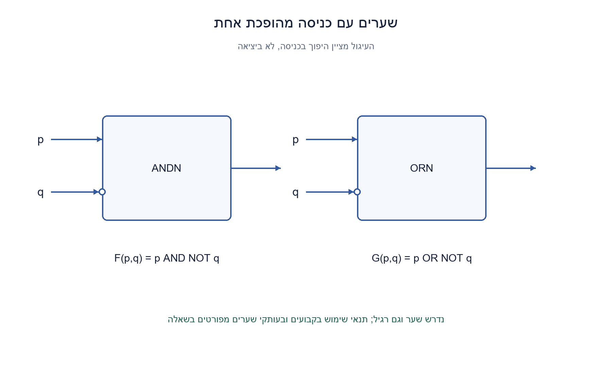
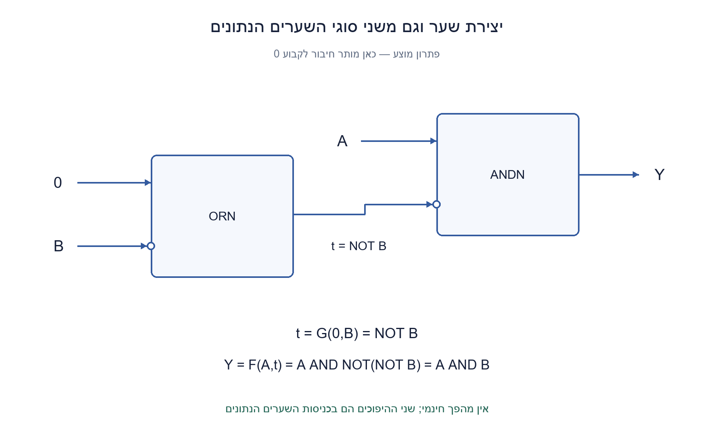
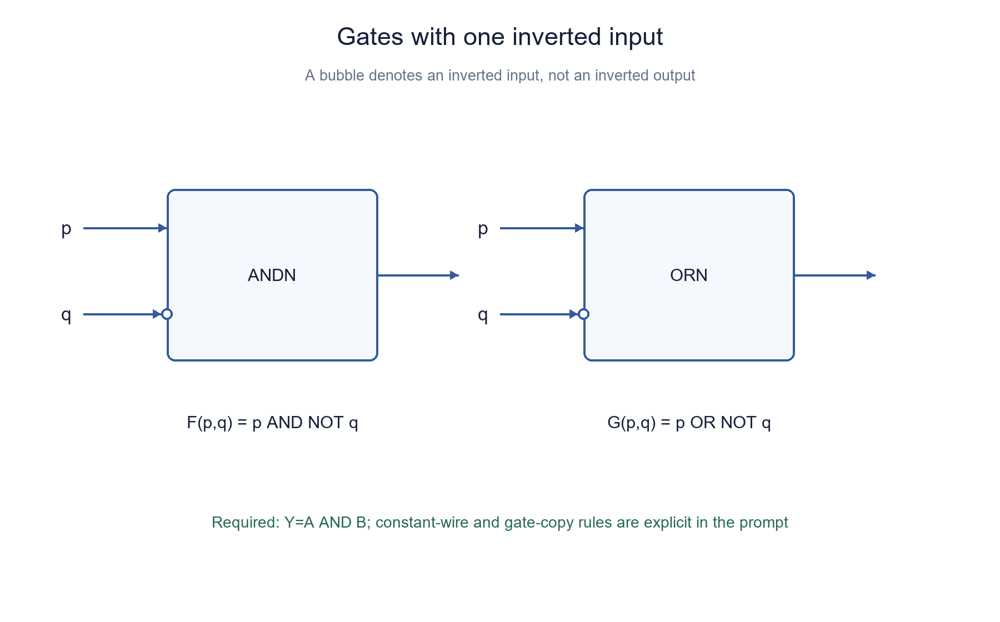
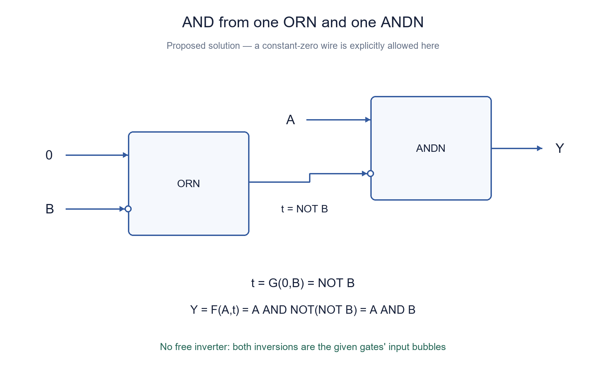

# PREP-112 — מימוש AND משערים עם כניסה מהופכת

פתרון מוצע בסיוע AI. ביקורת מקצועית אנושית ממתינה; הקושי לא כויל.

## מקור

[צילום מקורי](../sources/2026-10-24-batch10-08.png)

יש ליצור שער AND כאשר נתון לנו שני שערי OR וAND כאשר אחת הכניסות שלהן היא not.
באיור: AND בעל כניסה אחת מהופכת, OR בעל כניסה אחת מהופכת, ונדרש AND רגיל.

חברות מדווחות מהצילום בלבד, ללא אימות עצמאי: NVIDIA

## מימוש AND משערים עם כניסה מהופכת

נתונים שני סוגי שערים, כל אחד בעל שתי כניסות והיפוך בכניסה אחת בלבד: F(p,q)=p AND NOT q ו־G(p,q)=p OR NOT q. p הוא הפין הרגיל ו־q הוא הפין המסומן בעיגול. ממשו Y=A AND B, והציגו חיבורים וטבלת אמת.

הבהרות עריכה: הבועות במקור נמצאות בכניסות, ולכן אלה אינם שערי NAND/NOR. בגרסה הראשית מותר להשתמש בשער אחד מכל סוג ובחיבור חינמי לקבוע 0; אין מהפך נפרד. המקור אינו מציין אם קבועים מותרים ואם חייבים להשתמש בשני הסוגים. לכן דונו גם בחלופות: ללא קבועים עם עותקים נוספים מותרים, ובדיוק שער אחד מכל סוג ללא קבועים. מותר לפצל אות ולחבר אותו לשני פינים. קלטים בינאריים יציבים; אין הנחת אחסון או שעון.

### שלושה רמזים

1. התמקדו בפין המהופך: מה יקרה אם נכניס אליו אות שכבר הוּפך קודם?
2. כשמחברים 0 לפין הרגיל של OR עם כניסה מהופכת, איזו פעולה מתקבלת על הפין השני?
3. השתמשו ב־G כדי לקבל NOT B, וחברו אותו לפין המהופך של F. לפין הרגיל של F חברו את A.

### פתרון מוצע

### הכפלת היפוך במקום החלפת סוג שער
היפוך בכניסה פועל רק על אותו פין. F(p,q)=p·¬q אינו NAND, שהופך את כל תוצאת AND. המטרה היא שהפין המהופך של F יקבל ¬B; ההיפוך הפנימי יחזיר B, ונקבל A·B.

### פתרון עם שער אחד מכל סוג וקבוע אפס
מחברים את 0 לפין הרגיל של G ואת B לפין המהופך. פלטו t=0 OR NOT B=NOT B. מחברים את A לפין הרגיל של F ואת t לפין המהופך שלו:

```text
t = G(0,B) = NOT B
Y = F(A,t) = A AND NOT(NOT B) = A AND B
```

נדרשים שני שערים בסך הכול, חיווט וקבוע אפס. לא הוספנו מהפך חינמי: ההיפוכים נמצאים בשערים הנתונים. יש לצייר את בועת t בכניסה ל־F ולא ביציאה.

| A | B | t=NOT B | Y |
| --- | --- | --- | --- |
| 0 | 0 | 1 | 0 |
| 0 | 1 | 0 | 0 |
| 1 | 0 | 1 | 0 |
| 1 | 1 | 0 | 1 |

### אם אין חיבור לקבוע אבל מותרות שתי יחידות F
מכינים t=F(A,B)=A·¬B ואז Y=F(A,t)=A·¬(A·¬B). לפי דה־מורגן זה A·(¬A+B)=A·B. אפשר לראות זאת גם בשני מקרים: אם A=0 הפלט ממילא אפס; אם A=1, אז t=¬B והיפוכו מחזיר B. אין צורך בשער G בחלופה הזאת.

אם גם דורשים ששני סוגי השערים ישתתפו ואין קבועים, משתמשים בשלושה שערים: z=F(A,A)=0; t=G(z,B)=¬B; Y=F(A,t)=AB. כאן האפס מיוצר בשער שנספר, ולא מגיע כחיבור חיצוני חינמי.

### בדיוק אחד מכל סוג וללא קבועים
במודל קומבינטורי חסר מחזורים, עם A,B בלבד, אי אפשר לממש AND בשני השערים האלה כשחייבים אחד מכל סוג. השער הראשון מקבל A/B בכל סדר, כולל כניסות קשורות. השני מקבל A,B או את פלט הראשון. יש שני סדרי סוגים, ארבע בחירות לפיני הראשון ותשע לשני: 2×4×9=72 רשתות. מיצוי טבלאות האמת שלהן אינו מכיל AND. בחירת פלט השער הראשון בלבד או חוט A/B אינה פותרת זאת גם היא.

זו אינה טענה שלא ניתן לבצע AND בכלל, אלא גבול למלאי ולחיבורים שהוגדרו. תוספת קבוע אפס מאפשרת שני שערים; תוספת עותק F מאפשרת חלופת שני F, או שלושה שערים כשדורשים את שני הסוגים.

### מינימום במודל הראשי והיקף האימות
שער יחיד F או G, שכל פין שלו מחובר ל־A,B או 0, אינו נותן AND: מעבר על 18 האפשרויות מכסה גם חיבורים קשורים. גם חוט או הקבוע לבדם אינם AND. לכן שני שערים הם מינימום במודל הראשי. באותו אופן, כשדורשים את שני הסוגים ללא קבועים, כישלון כל 72 רשתות שני השערים והבנייה בשלושה מראים שמינימום שלושה.

כל ארבע שורות האמת נבדקו בפועל בכל אחת משלוש הבניות מול תנאי עצמאי ששני הקלטים אחד. מיצוי 72 הרשתות בוצע בקוד. זו בדיקה סופית וממצה של המודל המוגדר, לא טענת מינימום שטח בספריית תאים ולא בדיקת גליצ'ים, עומס או השהיה בחומרה.

```python
"""Explicit pin order: F(normal,inverted)=normal&~inverted;
G(normal,inverted)=normal|~inverted, for Boolean bits.
"""


def _bits(a, b):
    if any(type(v) is not int or v not in (0, 1) for v in (a, b)):
        raise ValueError("expected integer bits")


def andn(normal, inverted):
    _bits(normal, inverted)
    return normal & (inverted ^ 1)


def orn(normal, inverted):
    _bits(normal, inverted)
    return normal | (inverted ^ 1)


def both_with_zero(a, b):
    """One gate of each kind; a constant-zero wire is explicitly allowed."""
    return andn(a, orn(0, b))


def no_constants(a, b):
    """Two copies of ANDN; ORN unused; no constants."""
    return andn(a, andn(a, b))


def both_no_constants(a, b):
    """Three gates, uses both kinds; tied inputs allowed, no constant wires."""
    zero = andn(a, a)
    inverted_b = orn(zero, b)
    return andn(a, inverted_b)
```





## Build AND from inverted-input AND and OR gates

Two two-input gate types each invert exactly one input: F(p,q)=p AND NOT q and G(p,q)=p OR NOT q. p is the normal pin; q is the bubbled pin. Construct Y=A AND B and show connections and a truth table.

Editorial clarifications: the source bubbles are at inputs, so these are not NAND/NOR gates. The primary version allows one gate of each type and a free constant-zero wire, with no separate inverter. The source does not say whether constants are allowed or both gate types must be used. Also discuss no-constant alternatives with additional copies allowed, and exactly one of each type without constants. Fan-out and tied inputs are allowed. Inputs are stable binary bits; there is no storage or clock.

### Three hints

1. Focus on the bubbled pin: what happens if its incoming signal was already inverted?
2. What does an inverted-input OR gate do when its normal pin is tied to zero?
3. Use G to obtain NOT B, feed it into F's bubbled pin, and connect A to F's normal pin.

### Proposed solution

### Cancel an input inversion
An input bubble affects only its pin. F(p,q)=p·¬q is not NAND, which inverts the entire AND output. Feed ¬B into F's bubbled pin: its internal inversion recovers B, giving A·B.

### One gate of each kind with a zero wire
Connect zero to G's normal pin and B to its inverted pin. Its output is t=0 OR NOT B=NOT B. Connect A to F's normal pin and t to its inverted pin:

```text
t = G(0,B) = NOT B
Y = F(A,t) = A AND NOT(NOT B) = A AND B
```

This uses two gates, wires and an explicitly permitted zero constant. No free inverter was introduced: the inversions belong to the supplied gates. Draw the bubble on F's t input, not on its output.

| A | B | t=NOT B | Y |
| --- | --- | --- | --- |
| 0 | 0 | 1 | 0 |
| 0 | 1 | 0 | 0 |
| 1 | 0 | 1 | 0 |
| 1 | 1 | 0 | 1 |

### No constant wire, but two F copies allowed
Let t=F(A,B)=A·¬B and Y=F(A,t)=A·¬(A·¬B)=A·(¬A+B)=A·B. Case analysis is intuitive: A=0 forces zero; A=1 makes t=¬B, and its inversion recovers B. This alternative does not need G.

If both gate types must participate and no constants exist, use three gates: z=F(A,A)=0; t=G(z,B)=¬B; Y=F(A,t)=AB. The generated zero costs a counted gate rather than a free external wire.

### Exactly one of each kind without constants
With an acyclic combinational circuit and A,B as the only starting signals, the required AND cannot be built with exactly these two gates, one of each kind. The first gate takes A/B at either pin, including tied inputs. The second takes A,B or the first output. There are two type orders, four first-gate input choices and nine second-gate choices: 2×4×9=72 networks. None of their truth tables is AND. Outputting only the first gate or a direct A/B wire does not help either.

This is a restriction of that inventory and wiring model, not an impossibility of AND in general. A zero wire permits two gates. Another F copy permits the two-F alternative, or three total gates when both types must participate.

### Minimum and verification scope
One F or G with pins drawn from A,B,0 cannot equal AND: all 18 choices, including tied pins, were exhausted. Neither a wire nor zero alone is AND. Thus the primary construction's two gates are minimal in that model. Requiring both kinds without constants makes three minimal, by the 72-network exclusion and the explicit three-gate construction.

All four truth rows of each of the three constructions were executed against an independent both-inputs-one condition. The 72-network enumeration also ran. This is a finite exhaustive logical-model result, not a minimum physical cell-area claim or a test of glitches, loading or hardware delay.

```python
"""Explicit pin order: F(normal,inverted)=normal&~inverted;
G(normal,inverted)=normal|~inverted, for Boolean bits.
"""


def _bits(a, b):
    if any(type(v) is not int or v not in (0, 1) for v in (a, b)):
        raise ValueError("expected integer bits")


def andn(normal, inverted):
    _bits(normal, inverted)
    return normal & (inverted ^ 1)


def orn(normal, inverted):
    _bits(normal, inverted)
    return normal | (inverted ^ 1)


def both_with_zero(a, b):
    """One gate of each kind; a constant-zero wire is explicitly allowed."""
    return andn(a, orn(0, b))


def no_constants(a, b):
    """Two copies of ANDN; ORN unused; no constants."""
    return andn(a, andn(a, b))


def both_no_constants(a, b):
    """Three gates, uses both kinds; tied inputs allowed, no constant wires."""
    zero = andn(a, a)
    inverted_b = orn(zero, b)
    return andn(a, inverted_b)
```





## חומר משלים / Supporting material

```json
{
  "assumptions": {
    "he": [
      "F(p,q)=p AND NOT q; G(p,q)=p OR NOT q; הפין השני מהופך.",
      "בגרסה הראשית מותר קבוע 0 ושער אחד מכל סוג, ללא מהפך נוסף.",
      "מניפה חופשית וכניסות קשורות מותרות; רשת חסרת מחזורים. חלופות ללא קבועים מוגדרות בנפרד."
    ],
    "en": [
      "F(p,q)=p AND NOT q; G(p,q)=p OR NOT q; the second pin is inverted.",
      "The primary version permits zero and one gate of each type, without another inverter.",
      "Fan-out and tied inputs allowed; acyclic network. No-constant alternatives are separate."
    ]
  },
  "optimality": {
    "he": "שני שערים מינימליים כאשר מותר קבוע 0: כל 18 אפשרויות שער יחיד אינן AND. כשדורשים שני סוגים ללא קבועים, כל 72 רשתות שני שערים נכשלות ובנייה בשלושה קיימת.",
    "en": "Two gates are minimal with zero allowed: none of the 18 single-gate choices equals AND. Requiring both types without constants excludes all 72 two-gate networks; a three-gate construction exists."
  },
  "edge_cases": {
    "he": [
      "כל ארבע אפשרויות A,B, כולל 00 ו־11.",
      "ללא קבועים: שתי יחידות F מספיקות רק אם מותר שלא להשתמש ב־G.",
      "בדיוק אחד מכל סוג וללא קבועים אינו אותו חוזה כמו הגרסה הראשית."
    ],
    "en": [
      "All four input rows, including 00 and 11.",
      "Without constants, two F copies suffice only if using G is optional.",
      "Exactly one of each without constants is a different contract from the primary version."
    ]
  },
  "common_mistakes": {
    "he": [
      "לבלבל היפוך בכניסה עם NAND/NOR.",
      "להשתמש במהפך שלא קיים או בקבוע שאינו מותר בלי לציין הנחה.",
      "לטעון שצריך רק שני שערים כשדורשים אחד מכל סוג ואין קבועים."
    ],
    "en": [
      "Confusing an input inversion with NAND/NOR.",
      "Adding an unavailable inverter or an unpermitted constant silently.",
      "Claiming two gates when exactly one of each is required and constants are forbidden."
    ]
  },
  "interview_answer": {
    "he": "אם מותר 0, בונים t=G(0,B)=¬B ומזינים F(A,t), ולכן Y=AB. ללא קבועים ושני F מותרים: t=F(A,B), Y=F(A,t). יש לברר את מלאי השערים והקבועים לפני טענת מינימום.",
    "en": "With zero allowed, t=G(0,B)=¬B and Y=F(A,t)=AB. Without constants but with two F copies, use t=F(A,B), Y=F(A,t). Clarify gate inventory and constants before claiming a minimum."
  },
  "source_ambiguities": {
    "he": "המקור אינו מגדיר קבועים, עותקים או חובה לשני הסוגים. נשמרו שלוש חלופות מפורשות. הבועות בצילום הן בכניסה, לא ביציאה.",
    "en": "The source does not define constants, copies or whether both types must be used. Three explicit alternatives are retained. The pictured bubbles are input bubbles, not output inversion."
  },
  "verification": {
    "he": "12 שורות של שלוש בניות נבדקו מול אורקל AND, ומוצו כל 72 רשתות שני הסוגים ללא קבועים וכל 18 אפשרויות שער יחיד עם אפס. Python בינארי בלבד.",
    "en": "Twelve rows across three constructions matched an independent AND oracle; all 72 mixed two-gate networks without constants and 18 one-gate choices with zero were exhausted. Two-state Python only."
  },
  "solution_extensions": {
    "he": {
      "question": "מה המינימום אם חייבים להשתמש בשני הסוגים ואסור לחבר קבועים?",
      "direction": "צרו אפס עם F(A,A), הפכו B עם G(0,B) כאשר האפס הוא הפלט המחושב, ולבסוף השתמשו ב־F. שלושה מספיקים, ומיצוי 72 רשתות שולל שניים."
    },
    "en": {
      "question": "What is the minimum if both types are mandatory and constant wires forbidden?",
      "direction": "Generate zero with F(A,A), invert B using G with that computed zero, then apply F. Three suffice; the 72-network exclusion rules out two."
    }
  }
}
```


## מקור נוסף — 30.10.2026, מקבץ40, צילום 2

[צילום פרטי](../sources/2026-10-30-batch40-02.png)

זהו מקור נוסף לשאלה הקיימת; הגרסה והתוכן הטכני נשמרו ללא שינוי.
