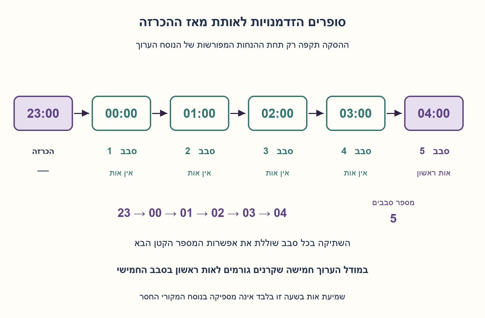
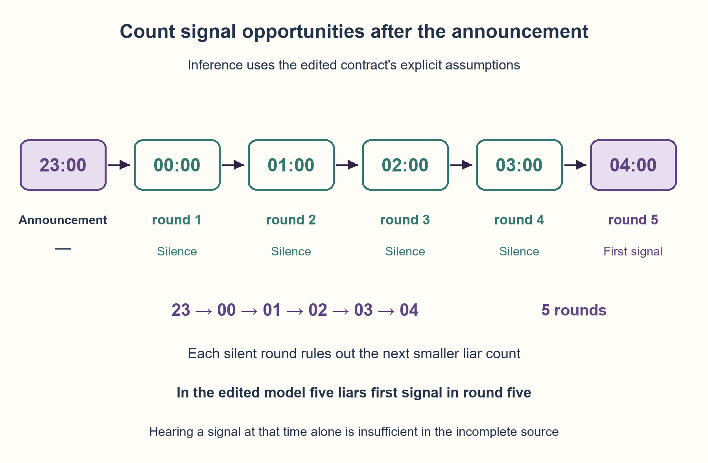

# PREP-113 — שקרנים ואותות בשעות עגולות — מה אפשר להסיק?

פתרון מוצע בסיוע AI; ביקורת מקצועית ותרגום אנושיים ממתינים. קושי אינו מכויל.

## צילום המקור והנוסח המקורי

[צילום מקור](../sources/2026-10-24-batch10-09.png)

בכפר יש 200 זוגות גברים ונשים, לפחות אחד מהגברים שקרן ולכל הנשים בכפר יש אקדח. בשעה 23:00 ראש הכפר מכנס את כולם ואומר להם שכל אישה שיודעת שהגבר שלה שקרן תירה באוויר רק בשעה עגולה. הנשים יודעות מידע רק על הגברים האחרים ולא על הגבר שלהם.
בשעה 4:00 נשמע ירייה (לא יודעים כמה)
כמה שקרנים יש?

שיוך NVIDIA מדווח בצילום בלבד ולא אומת באופן עצמאי.

## נוסח עברי

בכפר 200 זוגות. כל אישה יודעת בוודאות מי מהגברים האחרים שקרן, אך אינה יודעת את מצבו של בן זוגה. לפחות גבר אחד שקרן. בשעה 23:00 ראש הכפר אומר שכל אישה שיודעת שבן זוגה שקרן תירה באוויר רק בשעה עגולה. בשעה 04:00 נשמעות יריות, בלי לדעת כמה.

א. האם הנוסח המקורי לבדו קובע מספר יחיד של שקרנים? הסבירו אילו הנחות חסרות ותנו דוגמה נגדית למסקנה נחרצת.

ב. נתחו גרסה ערוכה עם ההנחות הבאות שנוספו במפורש: ראש הכפר מכריז בפומבי ובאמת שיש לפחות שקרן אחד, וכולם יודעים שכולם שמעו והבינו זאת. הנשים מסיקות ללא טעות, וכללי המידע והפעולה הם ידיעה משותפת. כל אישה שטרם אותתה ויודעת שבן זוגה שקרן חייבת לאותת פעם אחת בדיוק בהזדמנות הקרובה. ההזדמנות הראשונה אחרי ההכרזה היא 00:00, ואחריה 01:00,02:00 וכן הלאה. בכל שעה ההחלטות סימולטניות ומסתמכות רק על מה שנשמע בשעות הקודמות; שתיקה בסבב נודעת אחרי סיומו. כולם שומעים אם היה אות, בלי צורך לספור אותו, ואין אותות שווא. עד 03:00 כולל הייתה שתיקה, והאותות הראשונים נשמעו ב־04:00 בבוקר שאחרי ההכרזה. כמה גברים שקרנים בגרסה זו?

היריות באוויר משמשות כאן אותות ציבוריים בלבד: איש אינו נפגע או מוסר מהכפר. המקור אינו מספק את כל הנחות סעיף ב׳, ולכן יש להפריד את המסקנה המותנית ממנו.

### רמזים

1. הבחינו בין ״מותר רק בשעה עגולה״ לבין חובה לאותת בשעה הראשונה האפשרית. התחילו מהגרסה הערוכה: מה תסיק אישה שלא רואה אף שקרן אחר?
2. אם היו שני שקרנים, כל אחת משתי הנשים הייתה רואה אחד. מה מלמד אותה סבב ראשון ללא אות על האפשרות שבן זוגה אינו שקרן?
3. הכלילו: כשיש k שקרנים, כל אחת רואה k−1. השתיקה של k−1 סבבים שוללת את העולם שבו בן זוגה אינו שקרן. מנו הזדמנויות החל מחצות ולא לפי הספרה 4 בשעון.

### הצעה לפתרון

### קודם מתקנים את החוזה: מן המקור לבדו אין תשובה יחידה
המשפט ״רק בשעה עגולה״ מגביל מתי מותר לאותת, אך אינו אומר שחייבים לאותת בשעה הראשונה שבה יודעים. גם לא נאמר שהיריות ב־04:00 היו הראשונות או שכל אישה מאותתת פעם אחת בלבד. מאחר שמדובר ביריות באוויר, המאותתות נשארות בכפר ויכולות עקרונית לאותת שוב אם לא אוסרים זאת.

למשל, אם יש שקרן אחד ואשתו יודעת זאת בעקבות מידע ציבורי שלפחות אחד שקרן, היא יכולה לירות בכל שעה מ־00:00 ועד 04:00 אם חזרות מותרות. שמיעת ירייה ב־04:00 אז אינה אומרת שיש חמישה. גם אם דורשים ירייה אחת בלבד אבל לא פעולה בהזדמנות הראשונה, אותה אישה יכולה להמתין עד 04:00. אלה דוגמאות נגדיות, לא כללי הגרסה הערוכה.

בנוסף, ״לפחות אחד שקרן״ כעובדה שנמסרה לקורא אינה בהכרח מידע ציבורי שהנשים יודעות שכולן יודעות. בלעדיו אפילו אישה שאינה רואה שקרנים אחרים לא תוכל להבדיל בין אפס שקרנים לבין בן זוג שקרן. לכן המסקנה המספרית הבאה מותנית בהנחות שנוספו במפורש בסעיף ב׳.

### הרעיון: גם שתיקה מוסרת מידע כשפעולה היא חובה
אישה יודעת את מצב כל האחרים. נשארו מבחינתה שני עולמות אפשריים: בן זוגה שקרן, או שאינו שקרן. כל סבב שבו אישה מסוימת הייתה חייבת לאותת אך לא נשמע אות שולל עולמות שבהם הייתה יודעת כבר. החובה לפעול בזמן היא שמאפשרת ללמוד מהשתיקה.

### בונים את ההבנה ממקרה קטן
**שקרן אחד:** אשתו רואה אפס שקרנים אחרים. ההכרזה האמיתית שלפחות אחד קיים מחייבת שזהו בן זוגה. היא יודעת כבר אחרי ההכרזה, אבל ההזדמנות הראשונה שהוגדרה היא חצות: היא מאותתת ב־00:00.

**שני שקרנים:** כל אחת משתי הנשים רואה שקרן אחד אצל אחרת. היא שואלת: ״אילו בן זוגי לא היה שקרן, היה רק אחד, ואשתו הייתה מאותתת בחצות״. בחצות אין אות. אחרי שהסבב הסתיים, האפשרות הזאת נפסלת; כל אחת יודעת שבן זוגה שקרן ומאותתת ב־01:00, הסבב השני.

**שלושה שקרנים:** כל אחת רואה שניים. אילו בן זוגה לא היה שקרן, המקרה הקודם היה יוצר אות ראשון בסבב השני. לאחר שני סבבי שתיקה כולן מסיקות אחרת, ומאותתות בסבב השלישי.

### ההכללה והנכונות לכל מספר עד 200
נניח שהכלל הוכח עבור k−1 שקרנים. כשיש k, כל אישה שבן זוגה שקרן רואה בדיוק k−1 שקרנים אחרים. בעולם שבו בן זוגה אינו שקרן היו אותות ראשונים בסבב k−1 לפי ההנחה. בעולם האמיתי אין אות באותו סבב, ולכן היא שוללת את האפשרות ויודעת את האמת לפני סבב k. כל k הנשים מסיקות אותו דבר ומאותתות יחד בו.

הן אינן יכולות להסיק מוקדם יותר מן השתיקה הזאת: לפני שהסתיים סבב k−1, העולם החלופי עדיין תואם לכל סבבי השתיקה שכבר ראו. נשות הגברים שאינם שקרנים רואות את k השקרנים; האות בסבב k מתאים לעולם שבו בן זוגן אינו שקרן, ומבדיל אותו מעולם עם k+1. אין סיבה שגויה לאותת. זהו נימוק לידע ולפעולה במסגרת הפרוטוקול הנתון, לא טענת זמן מינימלי לכל פרוטוקול תקשורת אפשרי.

### עכשיו סופרים שעות, לא כותרות של שעות
| אירוע | שעה | מספר הסבב |
| --- | --- | --- |
| ההכרזה בלבד | 23:00 | עדיין אין הזדמנות |
| הזדמנות ראשונה | 00:00 | 1 |
| הזדמנות שנייה | 01:00 | 2 |
| הזדמנות שלישית | 02:00 | 3 |
| הזדמנות רביעית | 03:00 | 4 |
| האותות הראשונים | 04:00 | 5 |

לכן **בגרסה הערוכה יש חמישה גברים שקרנים**, וחמש נשותיהם מאותתות יחד. אין צורך לשמוע כמה אותות היו; עצם הסבב שבו נשמע האות הראשון מספיק. 200 הזוגות מגבילים את האפשרויות, אך אינם משנים את הנימוק למספר חמש.

### למה דרושות סימולטניות וידיעה משותפת?
בסבב אחד לא לומדים מ״עדיין לא שמעתי ירייה באותה שעה״ ומבצעים שרשרת הסקות מיידית בלי לחכות לסבב הבא. כל ההחלטות מתקבלות מההיסטוריה של הסבבים הקודמים. כך שתיקה אחת מספקת שכבת מידע אחת.

הודעה ציבורית יכולה לשנות ידע משותף גם כשנשים רבות כבר ראו שקרן אחר. חשוב לא רק שכל אחת יודעת שיש מישהו כזה, אלא גם מה היא יודעת על מה שהאחרות יודעות. הדוגמה של שקרן אחד היא בסיס ההסקה המקוננת של כולן.

אם מרשים אות כבר ב־23:00, המספור זז: 04:00 יהיה ההזדמנות השישית. אם 04:00 הוא יומיים אחרי ההכרזה, עברו 29 הזדמנויות ולא חמש. לכן גם מועד ההזדמנות הראשונה והיום של התצפית הם חלק מהחוזה.

### המודל שנבדק ומה לא נבדק
הקוד מייצג במפורש עולמות קטנים ואת ההבדל בין ידיעת כל שאר המצבים לבין אי־ידיעת בן הזוג. הוא אינו משתמש במספר השקרנים כדי לבחור את הפעולה: אישה יודעת כשעולם שבו רק בן זוגה מוחלף כבר אינו אפשרי. אחרי סבב שקט נשארים רק עולמות שבהם אף אחת לא הייתה חייבת לאותת.

אומתו כל 1,013 העולמות הלא־ריקים עבור 1..9 זוגות ו־4,097 זהויות מאותתות מול ספירת ביטים עצמאית. ב־1,022 עולמות הכוללים גם אפס שקרנים, בלי העובדה הציבורית, ההסקה אינה מתחילה. נבדקו שני התרחישים הנגדיים, מספור 23:00 עד 04:00 ושש דחיות קלט. לא הוצגו 2²⁰⁰ עולמות כאילו נסרקו: ההוכחה באינדוקציה מכסה את 200 הזוגות. זהו מודל ידע בדיד בלבד.



## English edition

A village has 200 couples. Each woman knows exactly which other men are liars, but not her own partner's status. At least one man is a liar. At 23:00 the chief says that any woman who knows her partner is a liar should fire into the air only on a whole hour. Shots are heard at 04:00, with their number unknown.

A. Does the original wording alone determine a unique liar count? Identify missing assumptions and give a counterexample to an unconditional numerical conclusion.

B. Analyze this edited version with explicit added assumptions: the chief publicly and truthfully announces at least one liar, and everyone knows everyone heard and understood it. The women reason correctly; information and action rules are common knowledge. A woman who has not signaled and knows her partner is a liar must signal exactly once at her first eligible opportunity. The first opportunity after the announcement is 00:00, followed by 01:00,02:00 and so on. Decisions at an hour are simultaneous and use only earlier rounds' observations; silence becomes known after a round ends. Everyone reliably hears whether any signal occurred, without needing its count, and there are no false signals. All rounds through 03:00 were silent, and the first signals occur at 04:00 the following morning. How many men are liars under this contract?

Air shots are public signals only: nobody is harmed or removed. The source does not supply all assumptions in B, so keep its conditional conclusion separate from the original wording.

### Hints

1. Distinguish “only on whole hours” from compulsory signaling at the first opportunity. In the edited model, what can a woman seeing no other liar infer?
2. With two liars, each relevant woman sees one. What does a silent first round tell her about the possibility that her own partner is not a liar?
3. Generalize: with k liars, each relevant woman sees k−1. Silence through k−1 rounds rules out her partner being innocent. Count opportunities from midnight, not from the clock's digit four.

### Proposed solution

### First repair the contract: the source alone has no unique answer
“Only on a whole hour” constrains allowed times, but does not require signaling at the first hour when knowledge is available. The source also never states that the 04:00 shots were the first or that each woman signals only once. These are air shots: the women remain present and could signal repeatedly unless that is forbidden.

For a counterexample, suppose there is one liar and his wife knows this from public information establishing at least one. If repeats are allowed, she can signal at every hour from 00:00 through 04:00. Hearing a shot at 04:00 then does not imply five liars. Even with one signal only, without compulsory first-opportunity action she could wait until 04:00. These are counterexamples, not the edited version's rules.

Moreover, a fact told to the reader—at least one liar—need not be public common knowledge among the women. Without it, even a woman seeing no other liar cannot distinguish no liars from her own partner being one. The numerical conclusion below therefore depends on the explicitly added assumptions in B.

### The idea: silence conveys information when action is compulsory
A woman knows every other man's status. Her remaining possibilities differ only in her own partner's status. A silent round excludes worlds in which somebody would already know and be required to signal. Compulsory timely action makes silence informative.

### Build from small cases
**One liar:** his wife sees no other liar. The truthful public announcement forces her own partner to be the liar. She knows immediately after it, but the first declared opportunity is midnight: she signals at 00:00.

**Two liars:** each relevant wife sees one other liar. She reasons: “If my own partner were not a liar, there would be only one, whose wife would signal at midnight.” Midnight is silent. Once that round finishes, the alternative is eliminated; both know and signal at 01:00, round two.

**Three liars:** each sees two. If her own partner were not a liar, the previous case would produce first signals in round two. Two silent rounds eliminate that possibility, so they signal in round three.

### General proof for every count through 200
Assume the result for k−1 liars. With k, each wife of a liar sees k−1 others. In the alternative world where her own partner is not a liar, the first signals would occur in round k−1 by the induction hypothesis. The real round is silent, ruling out that alternative. She knows before round k; all k relevant women reason alike and signal simultaneously then.

They cannot infer this earlier from the silent history: until round k−1 finishes, the alternative world remains consistent with all previous silent rounds. Wives of nonliars see k liars; first signals in round k distinguish their nonliar-partner world from a world with k+1. No mistaken signal is required. This is a knowledge/action argument for the specified protocol, not a globally fastest communication-protocol claim.

### Count opportunities, not the hour's label
| Event | Clock time | Round |
| --- | --- | --- |
| Announcement only | 23:00 | No opportunity yet |
| First opportunity | 00:00 | 1 |
| Second opportunity | 01:00 | 2 |
| Third opportunity | 02:00 | 3 |
| Fourth opportunity | 03:00 | 4 |
| First signals | 04:00 | 5 |

Thus **the edited version has five liars**, whose five wives signal together. The listener need not count the sounds: the first signaling round identifies the count. Two hundred couples bound the possibilities without changing this reasoning.

### Why simultaneous rounds and common knowledge matter
Nobody treats “no shot yet during this same hour” as a completed silent round and triggers an instantaneous cascade before the next opportunity. Every decision uses only earlier rounds. One completed silent round contributes one layer of information.

A public announcement may alter common knowledge even when many women already saw some other liar. What matters includes what each knows about what the others know. The one-liar case anchors everyone's nested reasoning.

Allowing an opportunity at 23:00 changes the numbering: 04:00 would be opportunity six. If 04:00 is two days later, 29 opportunities have elapsed. Both the first allowed opportunity and observation day are part of the contract.

### Model checks and their limits
The code explicitly represents small worlds and each woman's indistinguishable alternative. It does not use a liar count to select actions: a woman knows when the world obtained by changing only her own partner has disappeared. After silence, retain only worlds in which nobody was required to signal.

All 1,013 nonempty worlds for populations 1..9 and 4,097 signaler identities were checked against an independent bit-count oracle. Across 1,022 worlds admitting zero liars without the common public fact, deduction never starts. Checks include two counterexamples, clock counting and six invalid inputs. No enumeration of 2²⁰⁰ worlds is claimed; induction covers the actual 200 couples. This is a discrete knowledge model only.



## חומר משלים דו־לשוני / Bilingual material

```json
{
  "assumptions": {
    "he": [
      "המקור לבדו אינו קובע תשובה; חמש היא מסקנה מותנית של הגרסה הערוכה.",
      "200 זוגות קבועים; כל אישה יודעת את מצב כל הגברים מלבד בן זוגה.",
      "קיומו של לפחות שקרן אחד, אמיתות ההודעה, כללי המידע והסקה נכונה הם ידיעה משותפת.",
      "אות אחד לאישה, חובה בהזדמנות הראשונה שבה יודעת; ההזדמנות הראשונה היא 00:00.",
      "החלטות סימולטניות לפי סבבים קודמים, תצפית אמינה של אות או שתיקה, ללא אותות שווא.",
      "שתיקה עד 03:00 ואות ראשון ב־04:00 בבוקר למחרת; היריות באוויר ואיש אינו מוסר."
    ],
    "en": [
      "The source alone is underdetermined; five is conditional on the edited contract.",
      "Two hundred fixed couples; each woman sees every man's status except her partner's.",
      "At least one liar, truthful announcement, information rules and correct reasoning are common knowledge.",
      "One signal per woman, compulsory at first eligible opportunity, starting at 00:00.",
      "Simultaneous decisions using earlier rounds, reliable signal/silence observation and no false signals.",
      "Silence through 03:00 and first signals at 04:00 next morning; air shots remove nobody."
    ]
  },
  "optimality": {
    "he": {
      "result": "בפרוטוקול הערוך k שקרנים יוצרים אות ראשון בסבב k; 04:00 הוא הסבב החמישי.",
      "scope": "זהו אפיון הידע והפעולה תחת כללים נתונים, לא מינימום זמן לכל פרוטוקול אפשרי. המודל הממצה מוגבל ל־12 זוגות ועולה מעריכית; ההוכחה מכסה 200 בלי מיצוי."
    },
    "en": {
      "result": "In the edited protocol, k liars first signal in round k; 04:00 is round five.",
      "scope": "Characterizes knowledge/action under fixed rules, not minimum time across all possible protocols. The explicit model is capped at twelve couples and costs exponentially; induction covers 200 without enumeration."
    }
  },
  "edge_cases": {
    "he": [
      "שקרן אחד: אות בחצות; שניים: 01:00.",
      "ללא הכרזה משותפת שלפחות אחד קיים, עולם עם אפס שקרנים יכול למנוע את בסיס ההסקה.",
      "שמיעת ירייה מאוחרת שאינה ראשונה או היתר לחזרות אינם קובעים את המספר.",
      "אם 23:00 היא הזדמנות ראשונה, 04:00 הוא סבב שישי; יומיים אחרי ההכרזה פירושם 29 סבבים.",
      "היתר לעיכוב, אות שלא נשמע או מידע שונה מהחוזה פוסלים את הוכחת השתיקה."
    ],
    "en": [
      "One liar first signals at midnight; two at 01:00.",
      "Without common knowledge of at least one liar, an all-nonliar world blocks the induction base.",
      "A later signal not known to be first, or repeated signals, does not identify the count.",
      "If 23:00 is an opportunity, 04:00 is round six; two days later means 29 rounds.",
      "Optional delay, missed observations or another information model invalidate the silence proof."
    ]
  },
  "common_mistakes": {
    "he": [
      "תשובה חמש בלי לציין שהמקור חסר הנחות חיוניות.",
      "ספירת 04:00 כסבב רביעי במקום חמישי אחרי הכרזה ב־23:00.",
      "החלפת ירייה באוויר בפגיעה בבן הזוג והסרת אנשים שלא הופיעה במקור.",
      "בלבול בין ׳לפחות אחד׳ כמידע לקורא לבין ידיעה משותפת של הנשים.",
      "הסקה משתיקה בלי חובה לפעול בזמן, או למידה משתיקת אותו סבב לפני סיומו."
    ],
    "en": [
      "Answering five without disclosing the source's missing assumptions.",
      "Calling 04:00 round four rather than five after a 23:00 announcement.",
      "Replacing air shots with harm/removal absent from the source.",
      "Confusing a fact supplied to the reader with common knowledge among the women.",
      "Inferring from silence without timely action being compulsory, or using same-round silence before it completes."
    ]
  },
  "interview_answer": {
    "he": "מהנוסח לבדו אין מספר יחיד: רק שעות עגולות אינו אומר פעם אחת ובהזדמנות הראשונה, ולא נאמר שהיריות ראשונות. תחת ידיעה משותפת שלפחות אחד קיים, פעולה חובה פעם אחת וסבבים סימולטניים, k שקרנים מאותתים לראשונה בסבב k. מ־23:00 ההזדמנויות הן חצות,1,2,3,4 — לכן בגרסה הערוכה חמש.",
    "en": "The source alone has no unique count: whole-hour-only does not imply once at the first opportunity, and first shots are unspecified. With common knowledge of at least one liar, compulsory once-only action and simultaneous rounds, k liars first signal in round k. After 23:00, midnight,1,2,3,4 are five opportunities: the edited answer is five."
  },
  "source_ambiguities": {
    "he": [
      "לא נאמר במפורש שהעובדה ׳לפחות אחד׳ הוכרזה והפכה לידיעה משותפת.",
      "רק בשעה עגולה אינו מחייב פעולה בשעה הראשונה ואינו אוסר חזרה.",
      "04:00 לא מתוארת במקור כשעת האות הראשון; גם מועד ההזדמנות הראשונה והיום אינם מפורשים.",
      "סימולטניות, ידיעה על שיקול הדעת של האחרות ותצפית מהימנה נוספו בהפרדה מהמקור.",
      "המקור אומר ירייה באוויר; אין שינוי של מצב הגברים או הוצאה מהמשחק."
    ],
    "en": [
      "The at-least-one fact is not explicitly publicly announced and made common knowledge.",
      "Whole-hour-only does not require earliest action or forbid repeated signaling.",
      "The source does not identify 04:00 as the first signal, nor specify the first opportunity and observation day.",
      "Simultaneity, knowledge of others' reasoning and reliable observation are explicit additions.",
      "The source specifies air shots; no men change status or leave the model."
    ]
  },
  "verification": {
    "he": "מיצוי 1,013 עולמות לא־ריקים לאוכלוסיות 1..9 באמצעות עדכון קבוצות מידע; 4,097 בדיקות זהות מאותתות מול ספירה עצמאית. 1,022 עולמות ללא העובדה הציבורית נשארו בלתי מוכרעים. שני תרחישים נגדיים, מספור שעות ושש דחיות קלט עברו. אין מיצוי של 200 זוגות; הוכחה כללית באינדוקציה.",
    "en": "Enumerated 1,013 nonempty worlds for populations 1..9 using information-set updates, with 4,097 signaler-identity checks against independent counts. Without the public fact, 1,022 worlds remained unresolved. Two counterexamples, clock counting and six invalid cases passed. No enumeration of 200 couples; general induction supplies that result."
  },
  "relationship_note": {
    "he": "קשורה ל־PREP-033 ול־PREP-046 דרך הסקה על ידע של אחרים, אך כאן מידע של שתיקה, חובת פעולה וספירת סבבים מחייבים חוזה אחר. אינה כפילות של תוויות שקרניות או של ספירת אסירים.",
    "en": "Related to PREP-033 and PREP-046 through reasoning about others' knowledge, but silence, compulsory action and timed rounds require a different contract. Not a wrong-label or prisoner-counting duplicate."
  },
  "solution_extensions": {
    "he": {
      "question": "מה אם ההודעה הראשונה היא שיש לפחות L שקרנים, במקום לפחות אחד?",
      "direction": "בסיס ההסקה זז: עם L שקרנים הנשים הרלוונטיות רואות L−1 ומאותתות בסבב הראשון. באינדוקציה, k≥L שקרנים מאותתים לראשונה בסבב k−L+1, תחת אותם כללי פעולה ותצפית. ההרחבה לא נכללה בבדיקות הקוד.",
      "status": "מוכן בתוכן; אינו מחובר לתור שאלות המשך."
    },
    "en": {
      "question": "What if the public lower bound is at least L liars instead of one?",
      "direction": "The base shifts: with L liars, each relevant wife sees L−1 and signals in round one. Induction gives first round k−L+1 for k≥L under the same action/observation rules. This extension was not included in the code checks.",
      "status": "Prepared in content; not connected to the follow-up queue."
    }
  }
}
```
