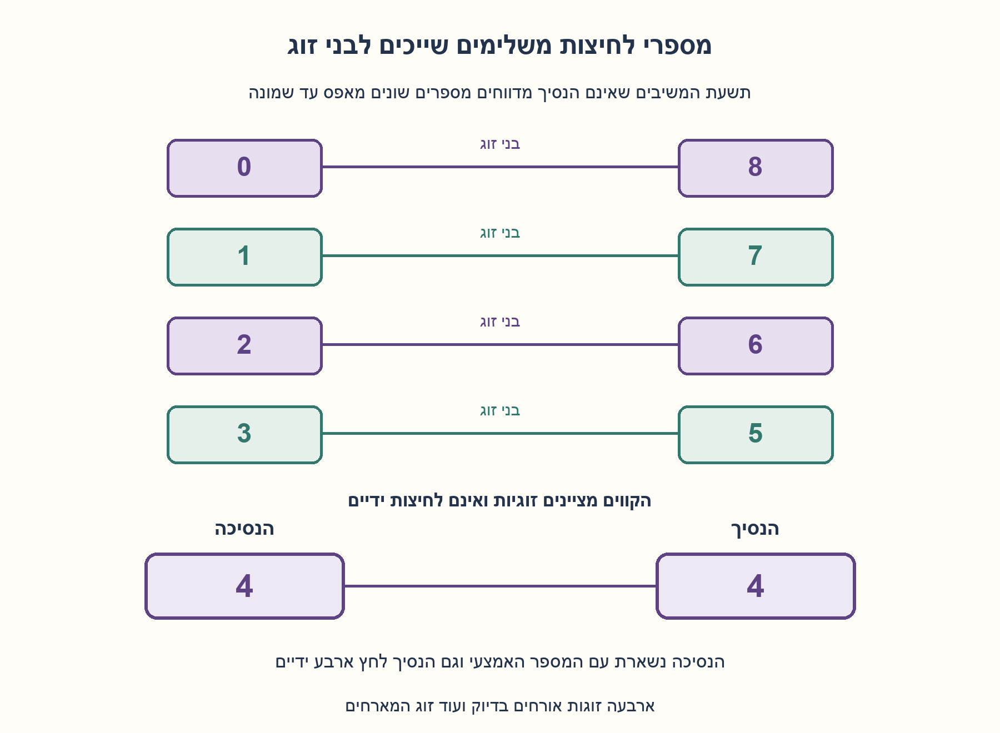
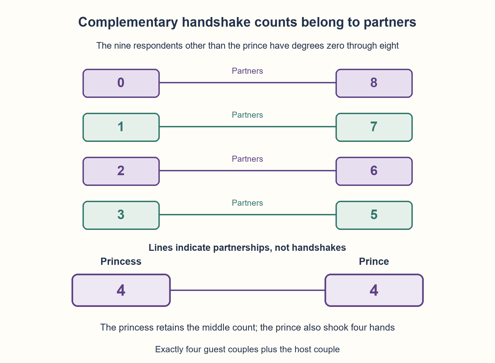

# PREP-114 — הנסיך, הנסיכה וארבעה זוגות — לחיצות ידיים שונות

פתרון מוצע בסיוע AI; ביקורת מקצועית ותרגום אנושיים ממתינים. קושי אינו מכויל.

## צילום המקור והנוסח המקורי

[צילום מקור](../sources/2026-10-24-batch10-10.png)

נסיך ונסיכה מארחים מסיבה עם עוד 4 זוגות.
מתחילים לחיצות ידיים בין האורחים, כולם יכולים ללחוץ ידיים עם כולם, חוץ מכל אדם עם בן הזוג שלו.
בשלב מסוים עוצרים ונתון שכל אחד ביצע מספר שונה של לחיצות ידיים מלבד הנסיך. מספר לחיצות הידיים של הנסיך הוא היחיד שיכול להיות שווה למישהו אחר. כמה ידיים לחצה הנסיכה?

שיוך NVIDIA מדווח בצילום בלבד ולא אומת באופן עצמאי.

## נוסח עברי

נסיך ונסיכה מארחים מסיבה עם עוד ארבעה זוגות בדיוק: עשרה אנשים בסך הכול, וחמישה זוגות כולל המארחים. אנשים רשאים ללחוץ ידיים לכל אדם אחר מלבד בן או בת זוגם. בשלב מסוים עוצרים. מספר לחיצות הידיים של כל אחד מתשעת האנשים שאינם הנסיך שונה משל שמונת האחרים בקבוצה זו; רק מספרו של הנסיך רשאי לחזור על מספר שנאמר. כמה לחיצות ידיים ביצעה הנסיכה? נמקו בלי להניח שכולם לחצו לכל מי שמותר.

הבהרות עריכה: גם המארחים משתתפים. כל זוג אנשים לוחץ ידיים לכל היותר פעם אחת, לחיצה היא הדדית ונספרת פעם אחת אצל כל משתתף, אין לחיצה לעצמך ואין לחיצה לבן זוג. מותר שלא ללחוץ לאדם שמותר ללחוץ לו. ׳עוד 4 זוגות׳ במקור הוא ארבעה בדיוק, ולא עד ארבעה. הרחיבו למספר ידוע n של זוגות אורחים.

### רמזים

1. לכל אחד יש תשעה אחרים, אך אחד מהם בן הזוג שאסור ללחוץ לו. אילו תשעה מספרים שונים יכולים להופיע אצל מי שאינם הנסיך?
2. התבוננו באדם שלחץ אפס ובאדם שלחץ שמונה. בעל השמונה לחץ לכל אדם שמותר לו. איך ייתכן שלא לחץ לבעל האפס?
3. האפס והשמונה חייבים להיות בני זוג אורחים. הוציאו אותם: מכל מספר שנותר יורד בדיוק אחד. חזרו על אותו נימוק עד שהנסיכה נשארת עם הנסיך.

### הצעה לפתרון

### התשובה: הנסיכה לחצה ארבע ידיים
העיקר הוא שלא צריך לדעת את כל לחיצות הידיים. שני המספרים הקיצוניים מזהים זוג, ואפשר להוציא אותו מהבעיה בלי לאבד את המבנה.

### תשעה מספרים שונים מתוך תשע אפשרויות
יש עשרה משתתפים. כל אחד יכול ללחוץ לכל היותר לשמונה: לא לעצמו ולא לבן זוגו. לכן כל מספר הוא בין 0 ל־8 כולל. אצל תשעת האנשים שאינם הנסיך כל המספרים שונים, ולכן מופיעים בדיוק כל המספרים 0,1,2,3,4,5,6,7,8.

אין להסיק מכך שכל אדם לחץ שמונה ידיים. ״יכול ללחוץ״ מתאר הרשאה, לא דרישה. אילו כולם היו לוחצים לכל מי שמותר, כל המספרים היו שמונה, בסתירה לנתון.

### מדוע האפס והשמונה הם בני זוג?
האדם שלחץ שמונה לחץ לכל האחרים מלבד עצמו ובן זוגו. האדם שלחץ אפס לא לחץ לו. לכן בעל האפס חייב להיות בן זוגו של בעל השמונה; זו האפשרות היחידה שלא הייתה חייבת להיכלל בין שמונת בני השיחה שלו.

שניהם בין התשעה, כי שני המספרים מופיעים אצלם. לכן הם אינם זוג המארחים: אילו הנסיכה הייתה אחת מהם, בן זוגה היה הנסיך, שאינו אחד משני המשיבים האלה. זהו זוג אורחים שאפשר להסיר.

### מוציאים זוג ומקבלים שוב אותה שאלה
כשמסירים את האפס והשמונה, כל מי שנשאר מאבד בדיוק לחיצה אחת: הוא לחץ לבעל השמונה ולא לבעל האפס. נשארים שמונה אנשים, כולל המארחים ושלושה זוגות אורחים. שבעת המספרים השונים שאינם של הנסיך היו 1..7, וכעת נעשים 0..6.

אפשר שוב להסיר את הזוג הקיצוני. במונחי המספרים המקוריים, זוגות האורחים חייבים להחזיק במספרים:

| בן זוג אחד | בן הזוג האחר |
| --- | --- |
| 0 | 8 |
| 1 | 7 |
| 2 | 6 |
| 3 | 5 |

המספר היחיד שנשאר מבין תשעת המשיבים הוא **4**, והוא של הנסיכה. גם הנסיך לחץ ארבע ידיים: בכל זוג שהוסר הוא לחץ לבעל המספר הגבוה ולא לנמוך. אחרי ארבע הסרות נשארים רק הוא והנסיכה, שאסור להם ללחוץ זה לזה. כך גם המספר החוזר היחיד הוא ארבע אצל שני המארחים.

### הוכחה כללית עם n זוגות אורחים
יש 2n+2 אנשים, ו־2n+1 משיבים שאינם הנסיך. מספריהם השונים חייבים להיות כל המספרים 0..2n. האפס וה־2n הם בני זוג אורחים. הסרתם מורידה אחד מכל מספר שנותר ומשאירה בדיוק את השאלה עם n−1 זוגות אורחים.

במקרה הבסיס n=0 נשארים רק המארחים, שאינם לוחצים זה לזה; לנסיכה אפס. החזרת כל זוג מוסיפה לה בדיוק לחיצה אחת. לכן עם n זוגות אורחים לנסיכה ולנסיך יש n לחיצות כל אחד. עבור ארבעה בדיוק נקבל ארבע. אילו נאמר רק ״עד ארבעה״ בלי מספר המשתתפים בפועל, התשובה הייתה תלויה ב־n ויכלה להיות 0..4; זה אינו הנוסח המצולם.

### דוגמה שמראה שהנתונים אפשריים
אפשר לבנות גרף שבו למארחים דרגות 4,4, ולזוגות האורחים דרגות (0,8),(1,7),(2,6),(3,5). מחברים שני אנשים כשסכום הדרגות המיועדות שלהם גדול מ־8. בני זוג בעלי סכום 8 אינם מחוברים. בדיקה של הגרף נותנת לכל אדם בדיוק את הדרגה שצוינה, ולכן קיימת מסיבה תקינה המתאימה לנתונים. זו בדיקת היתכנות, לא ההוכחה שכל מסיבה חייבת באותה תוצאה; ההוכחה היא הסרת הזוגות.

### מה נבדק ומה עלות ההסבר?
נבדקו כל 4,113 הגרפים הפשוטים המותרים לאפס עד שני זוגות אורחים. ב־11 הגרפים שמקיימים שונות של כל המשיבים, שני המארחים אכן בעלי דרגה n ובני זוג האורחים משלימים ל־2n. בנוסף נבנו 21 גרפים תקינים עבור n=0..20, ובפרט דוגמת עשרת האנשים. ארבעה קלטים הכוללים לחיצה חוזרת, עצמית, לבן זוג או לאדם לא קיים נדחו.

לא נסרקו כל הגרפים האפשריים של עשרה אנשים. הנימוק הכללי משתמש ב־n הסרות מושגיות, ולא טוען שמדגם גרפים מוכיח את המסקנה לכל מסיבה. אין כאן דרישת אופטימיזציה של אלגוריתם או ניסוי במסיבה אמיתית.



## English edition

A prince and princess host exactly four additional couples: ten people total and five couples including the hosts. A person may shake anyone else's hand except their own partner's. At some point they stop. The nine people other than the prince all have different handshake counts; only the prince's count may repeat another count. How many handshakes did the princess make? Justify without assuming everyone shook every permitted hand.

Editorial clarifications: hosts participate too. Each pair of people shakes at most once; a handshake is mutual and contributes one to each person's count. No self-handshake or partner handshake is allowed. A permitted handshake need not occur. The source says four additional couples exactly, not up to four. Generalize to a known number n of guest couples.

### Hints

1. Each person has nine others, but their partner is forbidden. Which nine different counts can the nonprince people have?
2. Consider the zero-handshake and eight-handshake people. The latter shook everyone permitted. How could they avoid shaking the zero-handshake person?
3. Zero and eight must be a guest couple. Remove them: every remaining count drops by exactly one. Repeat until the princess remains with the prince.

### Proposed solution

### Answer: the princess shook four hands
We do not need every handshake. Extreme counts identify a couple that can be removed without destroying the problem's structure.

### Nine distinct counts from nine possible values
There are ten people. Each can shake at most eight hands: neither their own nor their partner's. Thus counts lie in 0..8. The nine nonprince people have distinct counts, so they must attain precisely 0,1,2,3,4,5,6,7,8.

This does not mean everyone made eight handshakes. Permission is not obligation. If every allowed handshake occurred, everybody's count would be eight, contradicting distinctness.

### Why are zero and eight partners?
The eight-handshake person shook everyone except themselves and their partner. The zero-handshake person did not shake their hand. Zero must therefore be their partner: that is the only other person excluded from the required eight neighbors.

Both extremes belong to the nine respondents. Neither can form the host couple: if one were the princess, their partner would be the prince, who is not one of these two respondents. Hence they are a guest couple we may remove.

### Remove a couple and recover the same problem
After removing zero and eight, every remaining person loses exactly one handshake: they shook eight but never zero. Eight people remain, including the hosts and three guest couples. The seven distinct nonprince counts were 1..7 and become 0..6.

Repeat the extreme-pair argument. In terms of original counts, guest couples must be:

| One partner | The other partner |
| --- | --- |
| 0 | 8 |
| 1 | 7 |
| 2 | 6 |
| 3 | 5 |

The only original respondent count remaining is **4**, belonging to the princess. The prince also shook four hands: for each removed couple he shook the higher-count partner but not the lower. After four removals only the hosts remain, and they cannot shake each other's hands. Four is consequently the repeated count of the two hosts.

### General proof for n guest couples
There are 2n+2 people and 2n+1 nonprince respondents. Their distinct counts exhaust 0..2n. Zero and 2n must be guest partners. Removing them subtracts one from every remaining count, recovering the problem with n−1 guest couples.

At n=0 only the hosts remain and cannot shake each other; the princess has zero. Restoring each removed pair adds exactly one handshake. With n guest couples, both hosts therefore have n handshakes. Exactly four guest couples gives four. If only “up to four” were specified without an actual population, the answer would depend on n and could range 0..4; that is not the photographed wording.

### A feasible example
Construct a graph with host degrees 4,4 and guest-partner degrees (0,8),(1,7),(2,6),(3,5). Join two people when their intended degrees sum to more than eight. Partner counts sum to eight, so partners are not joined. Direct graph inspection gives every intended degree, establishing that the premises are feasible. This is a feasibility check, not the proof that every valid party has the same answer; the peeling argument supplies necessity.

### Verification and reasoning cost
Every one of the 4,113 permitted simple graphs for zero through two guest couples was checked. In the 11 graphs satisfying respondent distinctness, both hosts had degree n and guest partners' degrees summed to 2n. Another 21 valid graphs for n=0..20 were constructed and checked, including the ten-person case. Four invalid repeated, self, partner or nonexistent-person handshakes were rejected.

The checks do not enumerate all ten-person graphs. The general argument uses n conceptual pair removals rather than treating a sample as universal proof. No algorithm optimization or physical party experiment is claimed.



## חומר משלים דו־לשוני / Bilingual material

```json
{
  "assumptions": {
    "he": [
      "ארבעה זוגות אורחים בדיוק ועוד זוג המארחים: עשרה אנשים.",
      "גם הנסיך והנסיכה משתתפים; תשעת המספרים שאינם של הנסיך שונים זה מזה.",
      "לחיצה הדדית, לכל היותר אחת לכל זוג אנשים; אין לחיצה עצמית או עם בן זוג.",
      "לחיצה מותרת אינה חובה; מצב המסיבה הוא תת־גרף פשוט של הקשרים המותרים."
    ],
    "en": [
      "Exactly four guest couples plus the host couple: ten people.",
      "Hosts participate; all nine counts excluding the prince's are distinct.",
      "Mutual handshakes, at most one per pair; no self or partner handshakes.",
      "A permitted handshake is optional; the party is a simple subgraph of allowed contacts."
    ]
  },
  "optimality": {
    "he": {
      "result": "לנסיכה ארבע לחיצות, וגם לנסיך ארבע; עם n זוגות אורחים לשניהם n.",
      "scope": "הוכחת אילוץ באמצעות n הסרות זוגות. אין כאן טענת מינימום זמן או מספר השוואות; בדיקות גרפים קטנים משלימות הוכחה ולא מחליפות אותה."
    },
    "en": {
      "result": "Princess and prince each have four handshakes; with n guest couples each has n.",
      "scope": "Constraint proof by n partner removals. No minimum-time or comparison-count claim; small-graph checks supplement rather than replace proof."
    }
  },
  "edge_cases": {
    "he": [
      "n=0: שני המארחים אינם לוחצים ויש לשניהם אפס.",
      "אם כולם לחצו לכל מי שמותר, אין שונות של מספרי המשיבים; מצב זה אינו מתאים לנתונים.",
      "מספר הנסיך חייב בסופו של דבר להיות זהה לזה של הנסיכה, אף שלא נכנס לקבוצת התשעה השונים.",
      "אם מרשים לחיצות חוזרות או עם בני זוג, טווח 0..8 וההוכחה אינם תקפים.",
      "׳עד ארבעה׳ הוא וריאנט אחר; במקור כתוב ארבעה בדיוק."
    ],
    "en": [
      "n=0: hosts cannot shake each other and both have zero.",
      "All allowed handshakes occurring would destroy respondent distinctness.",
      "The prince's count is ultimately equal to the princess's, though excluded from the nine distinct counts.",
      "Repeated or partner handshakes invalidate the 0..8 range and proof.",
      "“Up to four” is another variant; the source says exactly four."
    ]
  },
  "common_mistakes": {
    "he": [
      "ספירת הנסיך בין תשעת המספרים השונים ואז דרישה לעשרה מספרים שונים.",
      "פירוש ׳יכולים׳ כ׳חייבים׳ ללחוץ לכל אדם מותר.",
      "זיהוי אפס ושמונה כאנשים שלא יכולים להיות בני זוג, במקום להבחין שהם חייבים להיות זוג.",
      "הוצאת הקיצוניים בלי להפחית אחד מכל מספר שנותר.",
      "קריאת ׳עוד ארבעה׳ בטעות כ׳עד ארבעה׳, או הצגת דוגמה אחת כהוכחה לכל מצב."
    ],
    "en": [
      "Including the prince in the distinct set and demanding ten distinct counts.",
      "Treating permitted handshakes as compulsory.",
      "Missing that zero and eight must be partners.",
      "Removing extremes without subtracting one from every remaining count.",
      "Misreading four additional couples as up to four, or presenting one example as a universal proof."
    ]
  },
  "interview_answer": {
    "he": "תשעת המספרים שאינם של הנסיך חייבים להיות 0..8. בעל השמונה לחץ לכולם מלבד בן זוגו, ולכן בעל האפס הוא בן זוגו. מסירים אותם וכל מספר שנותר קטן באחד. חוזרים ומקבלים במקור זוגות 0/8,1/7,2/6,3/5. הנסיכה נשארת עם ארבע, וגם לנסיך ארבע.",
    "en": "The nine nonprince counts exhaust 0..8. Eight shook everyone except their partner, so zero is that partner. Remove both and decrement every remaining count. Repeating identifies original partner counts 0/8,1/7,2/6,3/5, leaving the princess at four. The prince also has four."
  },
  "source_ambiguities": {
    "he": [
      "המקור אומר עוד ארבעה זוגות, כלומר ארבעה בדיוק; אין כאן אי־ודאות של עד ארבעה.",
      "הנוסח הערוך מבהיר שכל לחיצה הדדית, אין חזרות ואין לחיצה עצמית; אחרת דרגות אינן חסומות בשמונה.",
      "גם המארחים נכללים במשתתפים והנסיכה בקבוצת התשעה השונים; ׳בין האורחים׳ אינו מוציא אותם כאן.",
      "תגית hardware היא תגית מקור; הפתרון עוסק בגרפים והיגיון, ושיוך NVIDIA לא אומת."
    ],
    "en": [
      "The source says four additional couples exactly, not up to four.",
      "The edition states mutuality, no repeats and no self-handshakes; otherwise eight need not be the degree bound.",
      "Hosts participate and the princess belongs to the nine distinct respondents; “guests” is not used to exclude hosts here.",
      "Hardware is a source tag; the reasoning is graph/logical, and NVIDIA attribution is unverified."
    ]
  },
  "verification": {
    "he": "מוצו 4,113 גרפים מותרים עבור 0..2 זוגות אורחים; 11 עמדו בשונות וכל אחד נתן לשני המארחים דרגה n. נבנו 21 דוגמאות חוקיות ל־n=0..20, כולל דרגות [4,4,0,8,1,7,2,6,3,5] בעשרת המשתתפים. ארבע דחיות קלט לא תקין. לא מוצו כל גרפי עשרת האנשים; הוכחת הזוגות כללית.",
    "en": "Enumerated 4,113 allowed graphs for 0..2 guest couples; 11 met distinctness and each gave both hosts degree n. Constructed 21 valid examples for n=0..20, including ten-person degrees [4,4,0,8,1,7,2,6,3,5]. Four invalid cases rejected. No exhaustive ten-person enumeration; the partner proof is general."
  },
  "relationship_note": {
    "he": "אין במאגר שאלה שקולה על דרגות שונות למעט מארח והסקת מספר בן זוגו. תרגיל קצר על מספר כל הזוגות שלוחצים ידיים בודק ספירה קומבינטורית אחרת, לא הסרה של בני זוג לפי דרגות.",
    "en": "No equivalent catalog question infers a host partner's degree from all-other distinct degrees. A short card counting all handshake pairs tests another combinatorial task, not partner-degree peeling."
  },
  "solution_extensions": {
    "he": {
      "question": "מה משתנה אם לא ידוע מספר זוגות האורחים, ורק נאמר שהוא עד ארבעה?",
      "direction": "ההוכחה נותנת n לחיצות אצל הנסיכה, כאשר n מספר זוגות האורחים בפועל. בלי n או מספר המשתתפים אין תשובה מספרית יחידה: 0..4 אפשריים במודל המאפשר גם מסיבה בלי אורחים.",
      "status": "מוכן בתוכן; אינו מחובר לתור שאלות המשך."
    },
    "en": {
      "question": "What if the actual guest-couple count is unknown and only at most four is given?",
      "direction": "The proof gives the actual n. Without n or the population, there is no unique number: 0..4 are possible if zero guest couples is allowed.",
      "status": "Prepared in content; not connected to the follow-up queue."
    }
  }
}
```


## מקורות נוספים — 25.10.2026, מקבץ20

[צילום6](../sources/2026-10-25-batch20-06.png) מחליף נסיך ונסיכה במלך ומלכה שמזמינים ארבעה זוגות נוספים. זהו אותו סך חמישה זוגות, ומניין המלכה הוא ארבע. נותרת הנחת לחיצות חלקיות בזמן העצירה.


## מקור נוסף — 30.10.2026, צילום 20

[צילום פרטי](../sources/2026-10-30-batch20-20.png)

זהו מקור נוסף לשאלה הקיימת; הגרסה והתוכן הטכני נשמרו ללא שינוי.
