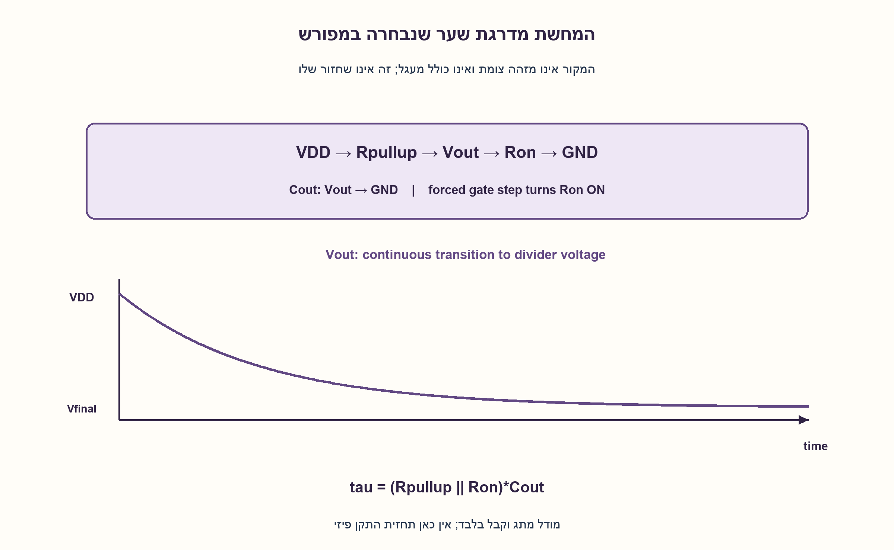
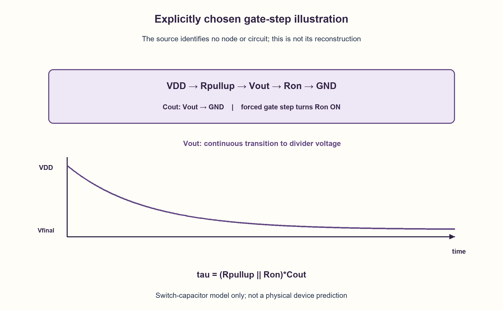

# PREP-115 — הרחבה מ־30.10.2026

הצעה בסיוע AI; ביקורת אנושית ממתינה.

[מקור פרטי](../sources/2026-10-30-batch70-11.png)

מה תפקיד הטרנזיסטור? מה קורה כשמכניסים פונקציית מדרגה ל"גודל"?

## עברית

### הרחבה: תפקיד טרנזיסטור וכניסת מדרגה שלא זוהתה
מה תפקיד הטרנזיסטור, ומה קורה כשמכניסים פונקציית מדרגה? בצילום מופיע ממש הביטוי ״לגודל״. אין שרטוט ולא מוגדרת צומת קלט, ולכן אין לתקן בשקט ל־gate או לקבוע תגובת מוצא מסוימת. הסבירו קודם אילו נתונים חסרים. כהמחשה מסומנת בלבד, נתחו NMOS במבנה pull-down עם נגד pull-up ל־VDD וקיבול מוצא, כאשר מדרגת מתח 0→VDD נכפית על השער, והמוצא התחיל גבוה. הבדילו בין מדרגה אידאלית בשער לבין מקור מדרגה המחובר דרך התנגדות וקיבול שער.

1. טרנזיסטור יכול להיות מתג או רכיב מגביר, אבל התגובה תלויה בחיבור. לאיזו צומת מגיעה המדרגה?
2. ב־NMOS לדוגמה שער גבוה יכול ליצור ערוץ ולפרוק מוצא, אך נגד עומס וקיבולים קובעים את המעבר בפועל.
3. אם בוחרים במפורש מודל מתג עם Ron ונגד pull-up, המוצא מתקרב למחלק מתח בקבוע זמן(Rpullup||Ron)Cout. זו המחשה שנוספה, לא המעגל החסר במקור.

### אין תגובת מדרגה בלי להגדיר את המערכת
טרנזיסטור שולט בזרם בין שני מסופים באמצעות מתח או זרם במסוף בקרה, לפי סוג ההתקן. ניתן להשתמש בו כמתג, כמגבר או כרכיב העברה; ״התפקיד״ אינו קבוע לכל חיבור. במודל ה־NMOS המקורי כאן VGS משפיע על זרם הנקז. תיאור BJT או PMOS היה מחייב סימנים וממשק אחרים.

המילה ״לגודל״ אינה שם צומת מזוהה. חסרים סוג ההתקן, חיבורי מסופים, מתחי הטיה, מקום המדרגה, עומס ומה נמדד. למשל מדרגה בשער NMOS יכולה לגרום למוצא נקז לרדת במבנה common-source, בעוד מדרגה באספקה או מקור עוקב נותנת התנהגות אחרת. אי אפשר לבחור אחת מהן כעובדת מקור.

### המחשה שנבחרה בגלוי
נניח NMOS שמקורו לאדמה, נקזו במוצא, נגד Rpullup למתח VDD וקבל Cout לאדמה. המוצא היה גבוה לפני t=0. מדרגה חיובית נכפית ישירות על השער. בקירוב מתג פשוט, ה־NMOS נהיה Ron, ומתקבל:

```text
Vfinal = VDD*Ron/(Rpullup+Ron)
tau = (Rpullup || Ron)*Cout
Vout(t) = Vfinal + (VDD-Vfinal)*exp(-t/tau)
```

המוצא אינו קופץ בקבל ואינו בהכרח מגיע לאפס. זהו מודל RC עם Ron קבוע, לא משוואת MOS מלאה ולא נתון שסופק בצילום. בלי Cout או התנגדויות לא נקבע זמן מעבר מספרי.

גם לשער MOS אין ״אפס זרם״ בכל מצב: במודל DC אידאלי זרם השער זניח, אבל טעינת קיבולי שער דורשת זרם מעבר. אם מקור מדרגה מזין את השער דרך Rs ובקירוב קיבול Cg, אז Vg(t)=Vstep(1−exp(−t/(RsCg))); זו אינה אותה הנחה כמו מדרגה אידאלית שכבר נכפית על Vg. במדרגה אידאלית ממש על קבל יש זרם אימפולס במודל המתמטי, לא זרם פיזי סופי שנחזה מכאן.

16 תצורות המחשת RC הושוו לאינטגרציה עצמאית של משוואת הזרם ב־16,016 דגימות. הבדיקה מאמתת רק את ההמחשה שהגדרנו ואינה פותרת את חוסר הצומת בצילום. המקור והניסוח הקודם נשמרים, והרמזים הנוספים מופיעים בנפרד.

```python
"""Explicit added resistor-switch example, not the ambiguous source's circuit."""

from math import exp


def drain_after_gate_turn_on(time, *, supply=3.3, pullup=1000.0, on_resistance=100.0, load_capacitance=1e-9):
    """Gate is an externally forced step; output starts at supply and relaxes.

    Model NMOS as Ron after turn-on. Rpullup remains attached. No gate slew,
    threshold transition, channel-charge effect or physical device fit is implied.
    """
    if min(supply, pullup, on_resistance, load_capacitance) <= 0 or time < 0:
        raise ValueError("positive parameters and nonnegative time required")
    final_voltage = supply * on_resistance / (pullup + on_resistance)
    equivalent = pullup * on_resistance / (pullup + on_resistance)
    tau = equivalent * load_capacitance
    return final_voltage + (supply - final_voltage) * exp(-time / tau)
```




## English

### Extension: transistor role and an unidentified step-input node
What does a transistor do, and what happens when a step is applied? The screenshot literally uses the unidentified word legodel; no circuit or input node is specified. Do not silently replace it withgate or assert one output waveform. First identify missing information. As a separately labeled illustration only, analyze anNMOS pull-down with resistor pull-up to VDD and output capacitance, whose gate is forced from 0 to VDD and output starts high. Distinguish an ideal gate step from a step source connected through resistance and gate capacitance.

1. A transistor can switch or amplify, but response depends on the circuit. Which node receives the step?
2. In anNMOS illustration a high gate can form a conducting channel and discharge output; loading and capacitance govern the transition.
3. An explicitly chosenRon switch plus pull-up approaches a divider voltage with time constant(Rpullup||Ron)Cout. This is an added illustration, not the missing original circuit.

### A step response needs a defined system
A transistor controls current between terminals through a control voltage or current, depending on device type. It may be used as a switch, amplifier or pass device; its role is circuit-dependent. In this record'sNMOS model, VGS affects drain current. BJT orPMOS would require a different interface and polarity.

The quoted source word does not identify a node. Missing information includes device type, connections, bias, step location, load and observed output. A gate step on a common-sourceNMOS may drive its drain downward; a supply step or source-follower topology behaves differently. None can be asserted as the original circuit.

### Explicit added illustration
Choose anNMOS from output to ground, a pull-up resistor to VDD and output capacitanceCout, initially charged high. Force a positive gate step at t=0. Approximating the on transistor byRon gives:

```text
Vfinal = VDD*Ron/(Rpullup+Ron)
tau = (Rpullup || Ron)*Cout
Vout(t) = Vfinal + (VDD-Vfinal)*exp(-t/tau)
```

Capacitor voltage remains continuous and need not reach zero. This is a constant-Ron RC approximation, not a fullMOS equation or source-supplied circuit. Without resistance and capacitance values, no numeric switching time follows.

AnMOS gate also does not imply zero current during every transition: idealDC gate current is negligible, but capacitance charging needs transient current. A step source behindRs driving lumpedCg gives Vg(t)=Vstep(1−exp(−t/(RsCg))), unlike directly imposing a step atVg. An ideal voltage step directly across a capacitor implies a mathematical current impulse, not a finite physical current predicted by this illustration.

Sixteen explicitRC scenarios matched independent current-equation integration at 16,016 samples. This checks only the stated illustration and does not resolve the missing node. Original copy/hints remain intact; new hints are supplemental.

```python
"""Explicit added resistor-switch example, not the ambiguous source's circuit."""

from math import exp


def drain_after_gate_turn_on(time, *, supply=3.3, pullup=1000.0, on_resistance=100.0, load_capacitance=1e-9):
    """Gate is an externally forced step; output starts at supply and relaxes.

    Model NMOS as Ron after turn-on. Rpullup remains attached. No gate slew,
    threshold transition, channel-charge effect or physical device fit is implied.
    """
    if min(supply, pullup, on_resistance, load_capacitance) <= 0 or time < 0:
        raise ValueError("positive parameters and nonnegative time required")
    final_voltage = supply * on_resistance / (pullup + on_resistance)
    equivalent = pullup * on_resistance / (pullup + on_resistance)
    tau = equivalent * load_capacitance
    return final_voltage + (supply - final_voltage) * exp(-time / tau)
```




```json
{
  "assumptions": {
    "he": [
      "מילת הצומת במקור אינה מזוהה; אין לקבוע שזו gate.",
      "המודל הנוסף בוחר NMOS, Rpullup, Ron, Cout ומדרגה ישירה בשער."
    ],
    "en": [
      "The source node is unidentified;gate is not asserted as source fact.",
      "Added illustration explicitly choosesNMOS, Rpullup, Ron, Cout and forced gate step."
    ]
  },
  "optimality": {
    "he": "אין תכנון מיטבי מוגדר ללא מעגל ומדד. פתרון RC אנליטי להמחשה בלבד.",
    "en": "No optimum is defined without a circuit/cost model. AnalyticRC is illustrative only."
  },
  "verification": {
    "he": "16 תצורות ו־16,016 דגימות מול RK4 עצמאי; לא SPICE ולא זיהוי כוונת המילה במקור.",
    "en": "Sixteen scenarios,16,016 samples versus independentRK4; neitherSPICE nor resolution of the source typo."
  },
  "edge_cases": {
    "he": [
      "מדרגה בשער לעומת באספקה או במקור.",
      "שער אידאלי כפוי לעומת מקור עם התנגדות.",
      "מוצא בלי קיבול לעומת תגובה בעלת קבוע זמן."
    ],
    "en": [
      "Gate versus supply/source step.",
      "Forced gate step versus resistive source.",
      "No output capacitance versus finite time constant."
    ]
  },
  "common_mistakes": {
    "he": [
      "תיקון שקט של המילה ל־gate.",
      "תחזית מתח יציאה בלי שרטוט.",
      "טענה שזרם שער תמיד אפס, גם בזמן טעינה."
    ],
    "en": [
      "Silently replacing the unknown word withgate.",
      "Predicting output without a circuit.",
      "Claiming gate current is always zero, including charging."
    ]
  },
  "interview_answer": {
    "he": "טרנזיסטור יכול לשלוט בזרם כמתג או מגבר. לפני תגובת מדרגה אברר סוג, צומת, הטיה ועומס; ״לגודל״ אינו נתון מספיק. רק בהנחת NMOS pull-down מוגדרת אפשר להסביר פריקת מוצא וקבוע זמן.",
    "en": "A transistor can control current as a switch or amplifier. Before a step response, identify type, node, bias and load; the source word is insufficient. A specifiedNMOS pull-down permits a conditional output-discharge example."
  },
  "source_ambiguities": {
    "he": [
      "המקור אינו כולל שרטוט או צומת תקפה; ההמחשה אינה שחזור.",
      "Intel מדווחת בלבד."
    ],
    "en": [
      "No circuit or valid node is supplied; the illustration is not a reconstruction.",
      "Intel is source-reported only."
    ]
  },
  "solution_extensions": {
    "he": [
      {
        "question": "מה צריך כדי להחליף את Ron הקבוע במודל אמין יותר?",
        "answer_direction": "מודל התקן ותהליך, הטיה, קיבולים, עומס ומקור הקלט; אז מנתחים את המשוואות הלא־לינאריות או סימולציה מתאימה.",
        "principle": "מודל פשוט מחייב גבולות שימוש."
      }
    ],
    "en": [
      {
        "question": "What is needed beyond fixedRon?",
        "answer_direction": "A process/device model, bias, capacitances, load and source; then use the nonlinear equations or appropriate simulation.",
        "principle": "A simple model has explicit limits."
      }
    ]
  }
}
```
