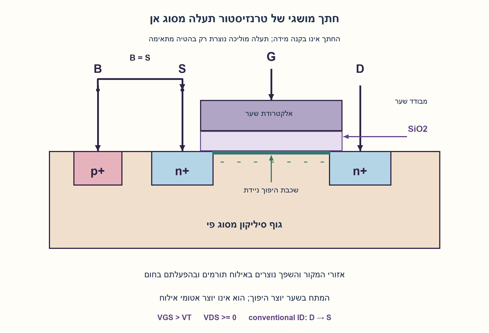
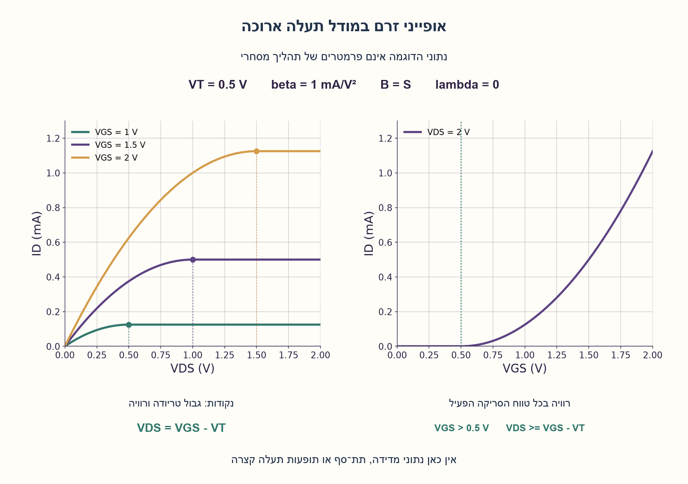
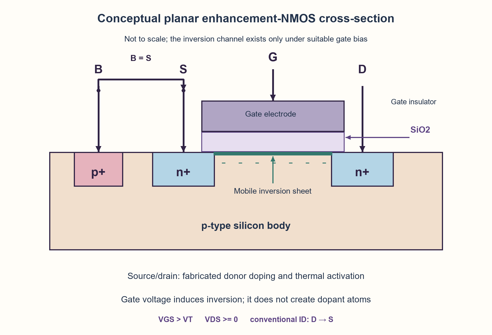
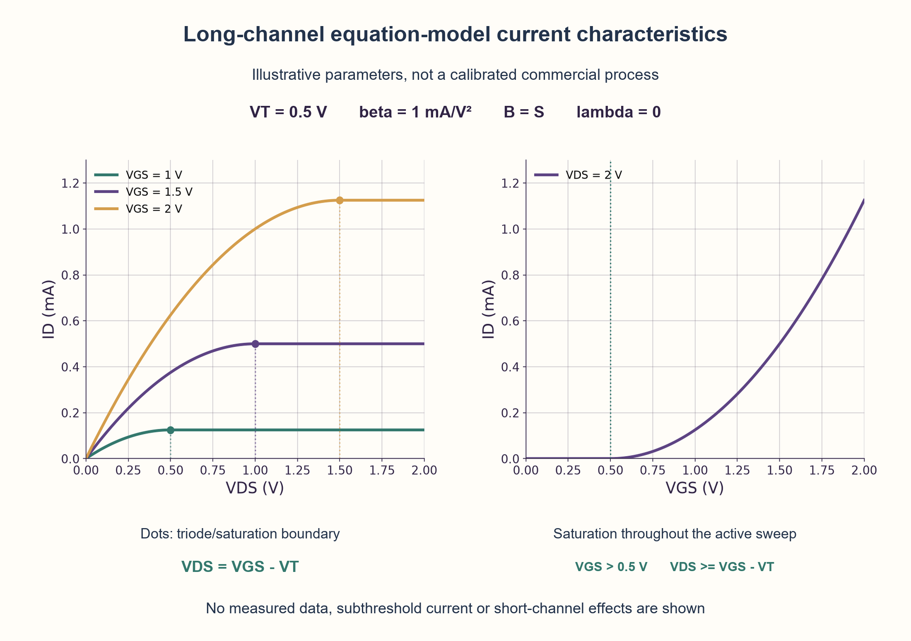

# PREP-115 — מבנה MOSFET, אילוח, אופייני זרם והשפעת מתח האספקה

פתרון מוצע בסיוע AI; ביקורת מקצועית אנושית ממתינה. הקושי לא כויל.

## מקור

[צילום המקור](../sources/2026-10-24-batch30-01.png)

צייר טרנזיסטור MOSFET, הסבר על כל שכבה, הסבר כיצד יוצרים זיהום n+, צייר אופיין של זרם הטרנזיסטור, מהי המשוואה לזרם הטרנזיסטור, כיצד משפיע שינוי מתח VDD על הטרנזיסטור

שיוכי החברות בצילום מדווחים ולא אומתו באופן עצמאי: NVIDIA.

## נוסח ערוך

מבנה MOSFET, אילוח, אופייני זרם והשפעת מתח האספקה

א. שרטטו חתך MOSFET והסבירו את הגוף, המקור, השפך, השער והמבודד. כיצד מייצרים אזורי n+ ומה ההבדל בינם לבין תעלת היפוך?
ב. שרטטו אופייני ID מול VDS עבור כמה ערכי VGS, ו־ID מול VGS בתנאי רוויה. תנו משוואות זרם ותנאי תחומים, הגדירו פרמטרים ויחידות.
ג. כיצד שינוי VDD עשוי להשפיע? הגדירו חיבור מתח מסוים והסבירו מה משתנה בו.

הבהרות עריכה: המקור אינו בוחר NMOS או PMOS, טכנולוגיה או מעגל הטיה. נשתמש ב־NMOS מסוג enhancement, חתך מישורי בגוף p, מקור וגוף מחוברים, VDS≥0, טמפרטורה קבועה ומודל תעלה ארוכה עם ניידות קבועה. מודל הבסיס מזניח זרם תת־סף ומודולציית אורך תעלה. הפרידו הרחבות וקירובים מהמודל הזה, וציינו בקצרה את שינוי הקוטביות ב־PMOS. VDD הוא שם של אספקת המעגל ואינו מסוף חמישי של הטרנזיסטור. אין נתוני תהליך או מדידות שהופכים את המודל לתחזית כמותית של רכיב מודרני.

### שלושה רמזים

1. הפרידו בין שני דברים: מה נבנה לצמיתות בתהליך הייצור, ואיזה מטען מופיע מתחת לשער רק כאשר מפעילים מתח מתאים?
2. VGS קובע אם קיימת תעלת הולכה וכמה מטען יש בה; VDS יוצר את הדחיפה לאורך התעלה. מה קורה ליד השפך כאשר VDS מגיע ל־VGS−VT?
3. הגדירו Vov=VGS−VT ו־β=μn·Cox·W/L. בתעלה הרציפה אינטגרלו את גורם המטען Vov−v מ־0 עד VDS; ברוויה הגבול הוא Vov. לפני תשובה על VDD, כתבו אילו מסופים מחוברים אליו.

### הצעה לפתרון

### שני תפקידים שונים: ליצור נתיב ולדחוף מטען לאורכו
חשבו על השער כבקר של כמות האלקטרונים בתעלה, ועל הפרש המתח בין השפך למקור כדוחף אותם לאורכה. אלו שני מתחים שונים: VGS=VG−VS ו־VDS=VD−VS. הגוף הוא המסוף הרביעי; כאן מחברים אותו למקור כדי שלא לשנות את מתח הסף בגלל הטיית גוף.

### א. מה רואים בחתך
הגוף הוא סיליקון מסוג p. בתוכו שני אזורים מאולחים חזק מסוג n+, המקור S והשפך D. מגע גוף p+ מאפשר לחבר את הגוף B. מעל השטח שביניהם יש מבודד שער דק, ומעליו אלקטרודת שער G. בדוגמה לימודית המבודד הוא SiO2 והשער מתכת או פוליסיליקון; מבני high-k, FinFET ואחרים אינם אותו חתך פשוט.

n+ פירושו ריכוז גבוה של תורמים פעילים, למשל זרחן או ארסן. בתהליך מישורי טיפוסי מחדירים יוני תורמים לאזורים שנבחרו במסכה, ואז מבצעים טיפול חום להפעלת האילוח ולתיקון נזקי ההחדרה. אפשר גם תהליכי אילוח אחרים. סימן הפלוס מציין אילוח חזק, לא מתח חיובי על האזור. שינוי VG אינו יוצר אטומי אילוח: מתח שער חיובי מספיק יוצר ליד פני הגוף שכבת היפוך של אלקטרונים ניידים. השכבה הזו מחברת חשמלית את המקור לשפך כשהרכיב מוליך, ואינה אזור n+ שיוצר בתהליך.

### ב. שלושה תחומים במודל המוצהר
נסמן Vov=VGS−VT ו־β=μn·Cox·W/L. הניידות μn נמדדת ב־m²/(V·s), קיבול המבודד ליחידת שטח Cox ב־F/m², והיחס W/L חסר יחידות. לכן β נמדד ב־A/V² ו־ID באמפר.

| תנאי | תחום | זרם במודל הבסיס |
| --- | --- | --- |
| VGS≤VT | קיטעון | ID=0 |
| VGS>VT וגם 0≤VDS<Vov | לינארי / טריודה | ID=β·(Vov·VDS−VDS²/2) |
| VGS>VT וגם VDS≥Vov | רוויה | ID=β·Vov²/2 |

בטריודה כמות המטען המקומית פוחתת לכיוון השפך. אינטגרציה של β·(Vov−v) בין 0 ל־VDS נותנת את המשוואה. כאשר VDS=Vov, קצה התעלה סמוך לשפך מגיע לצביטה והמודל עובר לרוויה. צביטה אינה חסימת הזרם: אלקטרונים עדיין עוברים לאזור השפך. בהצבת הגבול בשתי הנוסחאות מקבלים אותו זרם, ולכן אין קפיצה באופיין האידיאלי. הזרם המקובל ID זורם משׂפך למקור; תנועת האלקטרונים הפוכה.

לדוגמה, β=1 mA/V², VT=0.5 V ו־VGS=1.5 V נותנים Vov=1 V. עבור VDS=0.25 V מתקבל ID=0.21875 mA; עבור VDS≥1 V מתקבל ID=0.5 mA במודל האידיאלי. באופיין ID מול VDS הזרם עולה ומתיישר, ועבור VGS גבוה יותר מתקבלת עקומה גבוהה יותר. אופיין ID מול VGS הוא ריבועי מעל VT רק כל עוד נשמר תנאי הרוויה עבור כל נקודה.

### ג. קודם מחברים את VDD, ורק אז מסיקים
אם S=B=0, השפך מוחזק ב־2 V והשער מחובר ל־VDD, שינוי VDD משנה VGS. בטווח VDD>VT ו־2≥VDD−VT, הזרם הוא β·(VDD−VT)²/2. לעומת זאת, אם VGS=1.5 V קבוע ורק השפך מחובר ל־VDD, הזרם עולה בטריודה עד VDD=1 V ואז נשאר קבוע במודל האידיאלי. לכן המשפט ״הגדלת VDD תמיד מגדילה את הזרם״ אינו תשובה בלי חיבור והנחות.

ברכיב אמיתי יש זרם תת־סף, תלות בטמפרטורה, שינוי ניידות ומגבלות מתח. מודולציית אורך תעלה מוסיפה שיפוע גם ברוויה; הרחבה מקומית אפשרית כאן היא ID≈(β·Vov²/2)·[1+λ·(VDS−Vov)] לרוויה בלבד, עם λ ביחידות 1/V. זו בחירת קירוב רציפה בגבול, לא התאמה שנמדדה. הטיית גוף משנה VT, ותופעות תעלה קצרה ומהירות נשאים עלולות לפסול את חוק הריבוע. ל־PMOS מחליפים את סוגי האילוח והקוטביות: גוף n, מקור/שפך p+, ומשתמשים ב־VSG,VSD,|VTp| ובגודל הזרם. הקוד והגרפים הם מודל משוואות לימודי; אינם SPICE, BSIM או מדידת חומרה.

```python
"""Educational DC equation model, not a process/BSIM or measured-device model.

Enhancement NMOS, source tied to body, VDS >= 0, constant mobility and VT.
All voltages are volts, beta = mu_n * Cox * W/L is A/V**2; ID is amperes.
The ideal core omits subthreshold conduction and channel-length modulation.
"""
from math import isfinite


def nmos_current(vgs, vds, beta, vth):
    """Return (region, ID) for the declared long-channel model."""
    values = (vgs, vds, beta, vth)
    if any(isinstance(value, bool) or not isfinite(value) for value in values):
        raise ValueError("finite real parameters required")
    if beta <= 0 or vth <= 0 or vds < 0:
        raise ValueError("require beta > 0, VT > 0, VDS >= 0")
    overdrive = vgs - vth
    if overdrive <= 0:
        return "cutoff", 0.0
    if vds < overdrive:
        return "triode", beta * (overdrive * vds - vds * vds / 2)
    return "saturation", beta * overdrive * overdrive / 2


def saturation_with_clm(vgs, vds, beta, vth, channel_lambda):
    """Optional local CLM approximation, continuous at VDS = VGS - VT.

    Uses 1 + lambda*(VDS - VDSsat), lambda in 1/V. Valid only in
    saturation; lambda is not a universal device constant or a fit here.
    """
    region, current = nmos_current(vgs, vds, beta, vth)
    if not isfinite(channel_lambda) or channel_lambda < 0:
        raise ValueError("lambda must be finite and nonnegative")
    if region != "saturation":
        raise ValueError("optional CLM extension requires saturation")
    return current * (1 + channel_lambda * (vds - (vgs - vth)))
```





## English edition

MOSFET structure, doping, current characteristics and supply bias

A. Draw a MOSFET cross-section and explain body, source, drain, gate and insulator. How are n+ regions fabricated, and how do they differ from an inversion channel?
B. Plot ID against VDS for several VGS values and ID against VGS under saturation conditions. Give current equations, region conditions, parameter definitions and units.
C. How can changing VDD affect operation? Specify a bias connection and identify what changes.

Editorial clarifications: the source specifies neither NMOS/PMOS, technology nor bias circuit. Use an enhancement NMOS, planar p-type body, source tied to body, VDS≥0, fixed temperature and a long-channel constant-mobility model. The core neglects subthreshold current and channel-length modulation. Separate extensions/approximations from this model and briefly explain the PMOS polarity changes. VDD names a circuit supply, not a fifth transistor terminal. No process data or measurements make this a quantitative model of a modern device.

### Three hints

1. Separate what is permanently fabricated from the charge that appears beneath the gate only under a suitable voltage.
2. VGS controls whether a conducting channel exists and its charge; VDS drives motion along it. What happens at the drain end as VDS reaches VGS−VT?
3. Define Vov=VGS−VT and β=μn·Cox·W/L. Integrate the channel-charge factor Vov−v from 0 to VDS in triode, stopping at Vov in saturation. Before discussing VDD, write which terminals connect to it.

### Proposed solution

### Two separate jobs: create a path and drive charge along it
Think of the gate as controlling the electron charge available in the channel, while the drain-to-source voltage drives motion along that channel. These are distinct voltages: VGS=VG−VS and VDS=VD−VS. Body is the fourth terminal; tying it to source removes body-bias variation from our threshold model.

### A. Reading the cross-section
The body is p-type silicon containing heavily doped n+ source S and drain D. A p+ body contact connects B. A thin gate insulator separates the intervening surface from gate electrode G. In the teaching example the insulator is SiO2 and the gate is metal or polysilicon; high-k structures, FinFETs and other technologies are not this simple cross-section.

n+ denotes a high concentration of electrically active donors, such as phosphorus or arsenic. A typical planar process implants donor ions into selected masked regions, then anneals to activate dopants and repair implantation damage. Other doping processes exist. The plus denotes heavy doping, not a positive terminal voltage. Gate bias does not create dopant atoms: sufficiently positive gate bias induces a mobile electron inversion sheet near the body surface. That sheet electrically connects source and drain during conduction; it is distinct from fabricated n+ regions.

### B. Three regions in the declared model
Let Vov=VGS−VT and β=μn·Cox·W/L. Mobility μn has units m²/(V·s), oxide capacitance per area Cox has units F/m², and W/L is dimensionless. Thus β has units A/V² and ID is amperes.

| Condition | Region | Core-model current |
| --- | --- | --- |
| VGS≤VT | Cutoff | ID=0 |
| VGS>VT and 0≤VDS<Vov | Linear / triode | ID=β·(Vov·VDS−VDS²/2) |
| VGS>VT and VDS≥Vov | Saturation | ID=β·Vov²/2 |

In triode, local inversion charge decreases toward the drain. Integrating β·(Vov−v) from 0 to VDS produces the equation. At VDS=Vov the channel reaches pinch-off near the drain and enters saturation. Pinch-off does not block current: electrons still reach the drain region. Substitution at the boundary gives the same current from both equations, so the ideal characteristic is continuous. Conventional ID flows drain to source; electron motion is opposite.

For example, β=1 mA/V², VT=0.5 V and VGS=1.5 V give Vov=1 V. At VDS=0.25 V, ID=0.21875 mA; for VDS≥1 V the ideal current is 0.5 mA. The ID–VDS curve rises then levels off; higher VGS yields a higher curve. The ID–VGS curve is quadratic above VT only while the saturation condition remains true at every plotted point.

### C. Connect VDD before drawing a conclusion
If S=B=0, drain is held at 2 V and gate connects to VDD, changing VDD changes VGS. For VDD>VT and 2≥VDD−VT, current is β·(VDD−VT)²/2. Conversely, with VGS fixed at 1.5 V and only drain connected to VDD, current rises through triode until VDD=1 V and then stays constant in the ideal model. Therefore, “raising VDD always raises current” is incomplete without wiring and assumptions.

Real devices have subthreshold current, temperature dependence, mobility changes and voltage limits. Channel-length modulation gives saturation a slope; an optional local extension here is ID≈(β·Vov²/2)·[1+λ·(VDS−Vov)] in saturation only, with λ in 1/V. This is a boundary-continuous approximation choice, not a measured fit. Body bias changes VT, while short-channel and carrier-velocity effects can invalidate the square law. For PMOS reverse doping and voltage polarity: n-type body, p+ source/drain, and use VSG,VSD,|VTp| and current magnitude. Code and plots are educational equation models, not SPICE, BSIM or hardware measurements.

```python
"""Educational DC equation model, not a process/BSIM or measured-device model.

Enhancement NMOS, source tied to body, VDS >= 0, constant mobility and VT.
All voltages are volts, beta = mu_n * Cox * W/L is A/V**2; ID is amperes.
The ideal core omits subthreshold conduction and channel-length modulation.
"""
from math import isfinite


def nmos_current(vgs, vds, beta, vth):
    """Return (region, ID) for the declared long-channel model."""
    values = (vgs, vds, beta, vth)
    if any(isinstance(value, bool) or not isfinite(value) for value in values):
        raise ValueError("finite real parameters required")
    if beta <= 0 or vth <= 0 or vds < 0:
        raise ValueError("require beta > 0, VT > 0, VDS >= 0")
    overdrive = vgs - vth
    if overdrive <= 0:
        return "cutoff", 0.0
    if vds < overdrive:
        return "triode", beta * (overdrive * vds - vds * vds / 2)
    return "saturation", beta * overdrive * overdrive / 2


def saturation_with_clm(vgs, vds, beta, vth, channel_lambda):
    """Optional local CLM approximation, continuous at VDS = VGS - VT.

    Uses 1 + lambda*(VDS - VDSsat), lambda in 1/V. Valid only in
    saturation; lambda is not a universal device constant or a fit here.
    """
    region, current = nmos_current(vgs, vds, beta, vth)
    if not isfinite(channel_lambda) or channel_lambda < 0:
        raise ValueError("lambda must be finite and nonnegative")
    if region != "saturation":
        raise ValueError("optional CLM extension requires saturation")
    return current * (1 + channel_lambda * (vds - (vgs - vth)))
```





## חומר משלים דו־לשוני / Bilingual supporting material

```json
{
  "assumptions": {
    "he": [
      "NMOS מסוג enhancement, תעלה ארוכה, גוף מחובר למקור, VDS≥0, טמפרטורה וניידות קבועות.",
      "VT>0, β>0; מודל הבסיס מזניח תת־סף, דליפות ומודולציית אורך תעלה.",
      "החתך מושגי ומישורי; תהליך הייצור והפרמטרים אינם מפרט של רכיב מסחרי."
    ],
    "en": [
      "Enhancement long-channel NMOS, body tied to source, VDS≥0, constant temperature/mobility.",
      "VT>0 and β>0; core omits subthreshold conduction, leakage and channel-length modulation.",
      "The planar cross-section is conceptual; fabrication discussion and parameters do not specify a commercial device."
    ]
  },
  "optimality": {
    "he": "אין טענת מינימום רכיבים או אופטימליות. חישוב נקודת DC במודל דורש O(1) פעולות וזיכרון; גרף בן m נקודות דורש O(m) חישובים. תכנון תהליך, שטח, השהיה והספק אינם נגזרים ממספר הפעולות בקוד.",
    "en": "No minimum-component or optimality claim. One modeled DC point costs O(1) arithmetic/storage; an m-point plot takes O(m) evaluations. Process design, area, delay and power do not follow from code-operation count."
  },
  "verification": {
    "he": "בוצעו 858 נקודות על רשת ערכים עם אינטגרציית מטען עצמאית ב־Decimal בדיוק 60 ספרות; 27 מקרי הרחבת CLM, שתי דוגמאות חיבור שונות של VDD וארבע דחיות קלט. נבדקו גבולות ויחידות בדוגמה. זו בדיקת משוואות Python, לא אימות תהליך, סימולציית רכיב או מדידה.",
    "en": "Executed 858 grid points against independent 60-digit Decimal charge integration, 27 CLM-extension cases, two distinct VDD connections and four rejected inputs. Boundary behavior and example units were checked. This verifies Python equations, not fabrication, device simulation or measurements."
  },
  "edge_cases": {
    "he": [
      "VDS=0 נותן זרם אפס גם כאשר יש תעלה.",
      "ב־VGS=VT מודל הבסיס נותן אפס; זרם אמיתי סמוך לסף אינו נחתך בחדות.",
      "VDS=Vov הוא גבול רציף בין טריודה לרוויה.",
      "בגרף ID–VGS יש לוודא שתנאי הרוויה מתקיים עד סוף טווח הסריקה.",
      "VDS שלילי, גוף שאינו במתח המקור או גלישת מתח דורשים מודל אחר."
    ],
    "en": [
      "VDS=0 gives zero current even with an induced channel.",
      "At VGS=VT the core gives zero; a real near-threshold current does not abruptly vanish.",
      "VDS=Vov is a continuous triode/saturation boundary.",
      "An ID–VGS saturation plot must satisfy saturation throughout its sweep.",
      "Negative VDS, body different from source or overvoltage requires a different model."
    ]
  },
  "common_mistakes": {
    "he": [
      "בלבול בין אילוח n+ קבוע לבין שכבת היפוך נשלטת שער.",
      "אמירה שצביטת התעלה מפסיקה את הזרם.",
      "השמטת W/L או שימוש ב־Cox כקיבול כולל במקום ליחידת שטח.",
      "החלפת VGS ב־VDD בלי לציין חיבורי מסופים.",
      "שימוש בחוק הריבוע כמדידה או מודל מדויק לכל טרנזיסטור מודרני."
    ],
    "en": [
      "Confusing permanent n+ doping with gate-induced inversion.",
      "Claiming pinch-off stops current.",
      "Omitting W/L or treating Cox as total rather than per-area capacitance.",
      "Replacing VGS with VDD without terminal connections.",
      "Presenting the square law as a measurement or an accurate model of every modern transistor."
    ]
  },
  "interview_answer": {
    "he": "ב־NMOS בגוף p יש מקור ושפך n+ ושער מבודד. את האילוח יוצרים בייצור, למשל בהחדרת תורמים וטיפול חום; שער חיובי יוצר תעלת היפוך ניידת, לא אילוח. מעל VT הזרם בטריודה הוא β[(VGS−VT)VDS−VDS²/2], וברוויה β(VGS−VT)²/2 כאשר VDS≥VGS−VT. VDD משפיע לפי חיבורי VGS,VDS והגוף, ולכן חייבים לציין מעגל הטיה.",
    "en": "An NMOS has n+ source/drain in a p body and an insulated gate. Fabrication, for example donor implantation and annealing, creates the doping; positive gate bias creates mobile inversion, not doping. Above VT, triode current is β[(VGS−VT)VDS−VDS²/2]; saturation is β(VGS−VT)²/2 for VDS≥VGS−VT. VDD acts through the actual gate/drain/body biases, so specify a circuit."
  },
  "source_ambiguities": {
    "he": [
      "המקור אינו בוחר סוג טרנזיסטור, מבנה גוף או תהליך; נבחר מודל NMOS לימודי מפורש.",
      "״אופיין זרם״ אינו מציין צירים; נוספו אופיין מוצא ואופיין מעבר עם תנאי הטיה.",
      "VDD לבדו אינו מגדיר מתח שער או שפך. דוגמאות החיבור הוספו בעריכה.",
      "שיוך NVIDIA מדווח מהצילום ולא אומת עצמאית."
    ],
    "en": [
      "The source does not choose transistor type, body structure or process; an explicit educational NMOS model is selected.",
      "“Current characteristic” supplies no axes; output and transfer plots with bias conditions are added.",
      "VDD alone does not define gate or drain voltage. Bias examples are editorial additions.",
      "NVIDIA attribution is reported by the screenshot, not independently verified."
    ]
  },
  "solution_extensions": {
    "he": [
      {
        "question": "מה משתנה כאשר הגוף אינו מחובר למקור?",
        "answer_direction": "נדרש קשר של VT להטיית הגוף בתנאי דיודות מתאימים; אי אפשר להמשיך להשתמש באותו VT קבוע בלי הצדקה.",
        "principle": "מתח נמדד בין מסופים ומודל סף תלוי בהנחות ההטיה."
      },
      {
        "question": "מדוע רוויה אינה נותנת עקומה שטוחה לחלוטין במדידה?",
        "answer_direction": "הסבירו מודולציית אורך תעלה ותופעות נוספות; הפיקו שיפוע מתוך מדידה רק אם קיימים נתונים.",
        "principle": "להפריד מודל סדר ראשון מנתוני רכיב."
      }
    ],
    "en": [
      {
        "question": "What changes when body is not tied to source?",
        "answer_direction": "VT needs a body-bias relation under appropriate junction conditions; keeping the same fixed VT needs justification.",
        "principle": "Terminal differences and bias assumptions define the threshold model."
      },
      {
        "question": "Why is a measured saturation curve not perfectly flat?",
        "answer_direction": "Explain channel-length modulation and other effects; extract a slope from measurements only when data exists.",
        "principle": "Separate a first-order model from device data."
      }
    ]
  },
  "technical_references": {
    "he": [
      {
        "title": "MIT 6.012, הרצאה 9 — חתך ותעלת היפוך ותחום טריודה",
        "url": "https://ocw.mit.edu/courses/6-012-microelectronic-devices-and-circuits-fall-2005/5c5960f14ae37d0a65478c4f3f628d98_lec9.pdf"
      },
      {
        "title": "MIT 6.012, הרצאה 10 — רוויה, צביטה והטיית גוף",
        "url": "https://ocw.mit.edu/courses/6-012-microelectronic-devices-and-circuits-fall-2005/0498bbf0f0e585507d9cfe5dc3bd54b1_lec10.pdf"
      },
      {
        "title": "Berkeley EECS-2012-50, סעיף 5.2 — החדרת מקור/שפך וטיפול חום להפעלת האילוח",
        "url": "https://www2.eecs.berkeley.edu/Pubs/TechRpts/2012/EECS-2012-50.pdf"
      }
    ],
    "en": [
      {
        "title": "MIT 6.012 Lecture 9 — cross-section, inversion and triode operation",
        "url": "https://ocw.mit.edu/courses/6-012-microelectronic-devices-and-circuits-fall-2005/5c5960f14ae37d0a65478c4f3f628d98_lec9.pdf"
      },
      {
        "title": "MIT 6.012 Lecture 10 — saturation, pinch-off and body bias",
        "url": "https://ocw.mit.edu/courses/6-012-microelectronic-devices-and-circuits-fall-2005/0498bbf0f0e585507d9cfe5dc3bd54b1_lec10.pdf"
      },
      {
        "title": "Berkeley EECS-2012-50 §5.2 — source/drain implantation and dopant-activation annealing",
        "url": "https://www2.eecs.berkeley.edu/Pubs/TechRpts/2012/EECS-2012-50.pdf"
      }
    ]
  }
}
```


## מקור נוסף — 30.10.2026, מקבץ70, צילום 11

[צילום מקור פרטי](../sources/2026-10-30-batch70-11.png)

נוספה הרחבה דו־לשונית ברשומה ובנספח נפרד; התוכן והרמזים הקודמים נשמרו.

החלטת קליטה: `existing_question_source_and_variant`.

תמלול המקור (נתוני מקור):

```text
מה תפקיד הטרנזיסטור? מה קורה כשמכניסים פונקציית מדרגה ל"גודל"?
```
