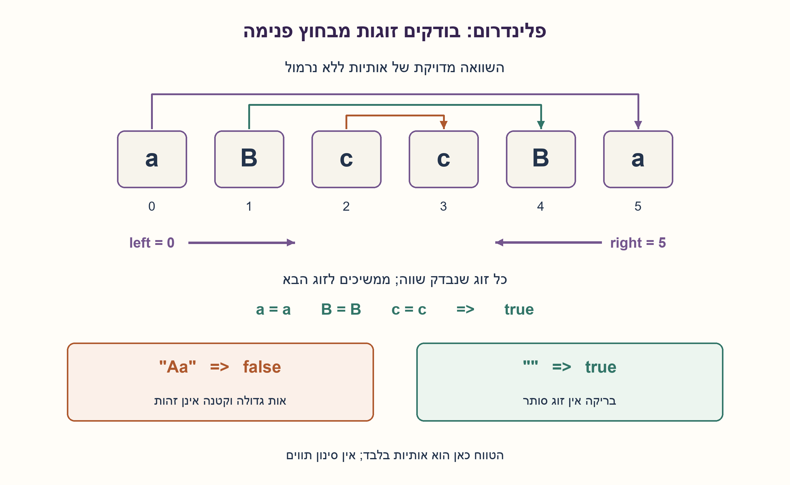
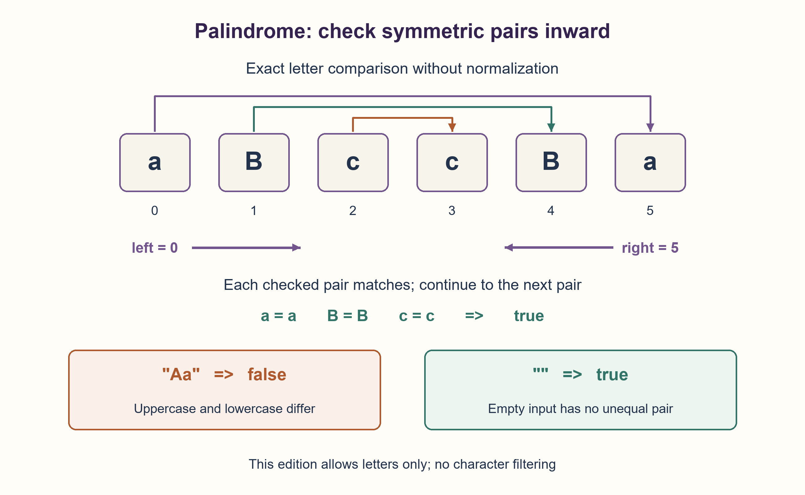

# PREP-116 — פלינדרום של אותיות ASCII — השוואה בלי נרמול

פתרון מוצע בסיוע AI; ביקורת מקצועית אנושית ממתינה. הקושי לא כויל.

## מקור

[צילום המקור](../sources/2026-10-24-batch30-02.png)

בהינתן מחרוזת מחזיר true אם המחרוזת היא פולינדרום, אחרת false. המחרוזת מורכבת מאותיות ascii

שיוכי החברות בצילום הם דיווח לא מאומת: NVIDIA.

## פלינדרום של אותיות ASCII — השוואה בלי נרמול

כתבו פונקציה שמחזירה true אם מחרוזת היא פלינדרום, ו־false אחרת. המחרוזת מורכבת מאותיות ASCII. הסבירו את האלגוריתם, נכונותו ועלותו, בלי לבנות מחרוזת הפוכה.

הבהרות שנוספו: הגרסה הזאת מקבלת רק אותיות A..Z ו־a..z, ומשווה בדיוק כפי שנכתבו. אין המרה לאותיות קטנות, סינון, מחיקת רווחים או נרמול. לפיכך Aa אינה פלינדרום, ואילו aBa כן. מחרוזת ריקה או אות אחת הן פלינדרום. המקור מבטיח את תחום הקלט; המימוש המצורף בודק אותו ומעלה ValueError עבור סוג אחר או תו מחוץ לתחום במקום להתעלם ממנו. אם במילה ״אותיות״ התכוונו לכל תווי ASCII, יש להגדיר את ההרחבה במפורש.

### שלושה רמזים

1. אילו שני תווים חייבים להיות שווים אם הקריאה מהסוף זהה לקריאה מההתחלה?
2. השוו את שני הקצוות. אם הם שווים, נשאר לבדוק רק את החלק הפנימי.
3. שמרו אינדקס שמאלי וימני, החזירו false בשוני הראשון, וקדמו אותם זה כלפי זה. כאשר נפגשים או חוצים, כל הזוגות הדרושים נבדקו.

### הצעה לפתרון

### הרעיון: הקצוות חייבים להסכים
פלינדרום נקרא אותו דבר משני הכיוונים. לכן האות הראשונה חייבת להיות שווה לאחרונה, השנייה ללפני־אחרונה וכן הלאה. אם זוג אחד שונה אין אפשרות ששאר האותיות יתקנו את השוני, ולכן אפשר לעצור מיד.

נחזיק left=0 ו־right=len(text)−1. כל עוד left<right נשווה text[left] ו־text[right]. בשוני נחזיר false. בשוויון נגדיל את left ונקטין את right. אם הלולאה הסתיימה נחזיר true. אין צורך להעתיק תת־מחרוזת, להסיר אותיות או להפוך את המחרוזת.

### דוגמה שאפשר לעקוב אחריה
ב־aBccBa משווים קודם a עם a, אחר כך B עם B ולבסוף c עם c. כל הזוגות שווים ולכן true. לעומת זאת ב־Aa כבר הזוג הראשון שונה: A ו־a הן אותיות ASCII שונות, ולכן false. הוספת lower הייתה פותרת שאלה אחרת.

בריקה right=−1, ותנאי הלולאה שקר מלכתחילה. באות אחת left=right ולכן אין זוג לבדיקה. שתיהן נקראות באותו אופן לאחור ולכן true. באורך אי־זוגי האות האמצעית אינה צריכה השוואה לעצמה.

### למה זה נכון?
לפני כל איטרציה, כל זוג סימטרי שמחוץ לטווח [left,right] כבר נבדק ונמצא שווה. האיטרציה בודקת את הזוג החיצוני הבא. שוני מוכיח שהמחרוזת אינה שווה להיפוכה; שוויון משמר את הטענה אחרי הקטנת הטווח. בסיום לא נשאר זוג שלא נבדק, ולכן כל האותיות תואמות בסדר ההפוך.

### הבטחת קלט לעומת בדיקת קלט
המקור מבטיח אותיות ASCII. בנוסח הערוך בחרנו A..Z/a..z בלבד והוספנו בדיקה מפורשת. רווח, ספרה, סימן פיסוק, אות עברית או é אינם מנורמלים או נמחקים: הם מחוץ לחוזה ומובילים לשגיאה לפני הבדיקה. זה שונה מתוצאה false עבור מחרוזת חוקית שאינה פלינדרום. אם רוצים גם ספרות ופיסוק, אפשר להרחיב את תחום הקלט ולשמור על אותה השוואה ישירה; עדיין אין להסיק שהתוים יושמטו.

### עלות ומה נבדק
סריקת האימות עולה O(n), ולכל היותר floor(n/2) השוואות זוגות מבוצעות אחריה. הזמן הכולל O(n), גם אם שוני נמצא מוקדם אחרי האימות. נשמרים שני אינדקסים ומספר קבוע של משתנים — O(1) מילות עזר, לא מספר קבוע של ביטים לכל n. אין מחרוזת עזר באורך n. במודל גישה לתווים, פלינדרום דורש בדיקה לינארית במקרה הגרוע; לא נטען למינימום הוראות בכל שפה.

הקוד בפועל הושווה להיפוך מחרוזת באורקל הבדיקה על כל 21,845 המחרוזות באורכים 0..7 מעל A,B,a,b. היפוך מופיע באורקל בלבד, לא בפתרון. נבדקו גם רגישות לאותיות גדולות, עשרה קלטים מחוץ לתחום ומחרוזת של 10,001 אותיות. זו הרצת Python, ללא מדידת ביצועים או אישור מקצועי אנושי.

```python
"""Exact case-sensitive palindrome over ASCII LETTERS; no normalization/copy.

The edited domain is strings over A..Z/a..z, including the empty string.
Other types/characters raise ValueError rather than being silently filtered.
"""


def is_ascii_palindrome(text):
    if not isinstance(text, str):
        raise ValueError("expected a string of ASCII letters")  # noqa: TRY004 - one rejection type.
    if any(not ("A" <= char <= "Z" or "a" <= char <= "z") for char in text):
        raise ValueError("only ASCII letters A..Z and a..z are accepted")
    left, right = 0, len(text) - 1
    while left < right:
        if text[left] != text[right]:
            return False
        left += 1
        right -= 1
    return True
```



## ASCII-letter palindrome — compare without normalization

Write a function returning true when a string is a palindrome and false otherwise. The string contains ASCII letters. Explain the algorithm, correctness and cost without constructing a reversed string.

Added clarifications: this edition accepts only A..Z and a..z and compares characters exactly as written. Do not lowercase, filter, remove spaces or normalize. Thus Aa is not a palindrome, while aBa is. Empty and one-letter strings are palindromes. The source promises its input domain; the supplied implementation validates it and raises ValueError for another type or an out-of-domain character rather than ignoring it. If “letters” was intended to mean every ASCII character, define that extension explicitly.

### Three hints

1. Which two characters must match if reading backward equals reading forward?
2. Compare the two endpoints. If they match, only the interior remains to be checked.
3. Keep left and right indices, return false on the first mismatch, and move inward. When they meet or cross, every required pair has been checked.

### Proposed solution

### The endpoints must agree
A palindrome reads identically in both directions. Its first letter must equal its last, its second must equal its penultimate, and so on. A single unequal pair is decisive: other letters cannot repair it, so stop.

Set left=0 and right=len(text)−1. While left<right compare text[left] with text[right]. Return false on mismatch; otherwise increment left and decrement right. Return true when the loop finishes. No substring copies, character removal or reversed string is needed.

### Walk through examples
For aBccBa compare a with a, then B with B, then c with c: every pair matches. For Aa, the first pair differs because A and a are distinct ASCII letters, so return false. Adding lower would solve a different contract.

For empty input right=−1, so the loop never starts. For one letter left=right, so no pair needs checking. Both read identically backward. An odd-length string's middle character need not be compared with itself.

### Correctness
Before each iteration every symmetric pair outside [left,right] has already matched. The iteration checks the next outer pair. A mismatch proves inequality with the reverse; a match preserves the invariant as the interval shrinks. At termination no unchecked pair remains, so the whole string reads identically backward.

### Input promise versus validation
The source promises ASCII letters. This edition explicitly chooses A..Z/a..z and adds validation. Spaces, digits, punctuation, Hebrew letters and é are neither normalized nor deleted: they are outside this contract and raise an error. That differs from false for a valid non-palindrome. To include digits and punctuation, expand the domain explicitly while retaining exact comparison; that does not imply ignoring those characters.

### Cost and evidence
Validation costs O(n), followed by at most floor(n/2) pair comparisons. Total time is O(n), even when comparison finds an early mismatch after validation. Two indices and constant additional state require O(1) auxiliary machine words, not a fixed bit count for arbitrary n. No length-n auxiliary string is built. Character inspection needs linear work in the worst case; no universal minimum instruction count is claimed.

The actual implementation matched a string-reversal test oracle on all 21,845 strings of lengths 0..7 over A,B,a,b. Reversal appears only in the oracle. Additional checks cover case sensitivity, ten invalid-domain inputs and a 10,001-letter string. This is Python execution, not a performance benchmark or human professional approval.

```python
"""Exact case-sensitive palindrome over ASCII LETTERS; no normalization/copy.

The edited domain is strings over A..Z/a..z, including the empty string.
Other types/characters raise ValueError rather than being silently filtered.
"""


def is_ascii_palindrome(text):
    if not isinstance(text, str):
        raise ValueError("expected a string of ASCII letters")  # noqa: TRY004 - one rejection type.
    if any(not ("A" <= char <= "Z" or "a" <= char <= "z") for char in text):
        raise ValueError("only ASCII letters A..Z and a..z are accepted")
    left, right = 0, len(text) - 1
    while left < right:
        if text[left] != text[right]:
            return False
        left += 1
        right -= 1
    return True
```



## חומר משלים / Supporting material

```json
{
  "assumptions": {
    "he": [
      "המימוש מקבל str של אותיות A..Z/a..z בלבד; הריקה מותרת.",
      "השוואה רגישה לאותיות גדולות, ללא נרמול, סינון או העתקה.",
      "קלט מחוץ לתחום מעלה ValueError; אינו שקול ל־false."
    ],
    "en": [
      "Accept str over A..Z/a..z only, including empty.",
      "Case-sensitive comparison without normalization, filtering or copying.",
      "Out-of-domain input raises ValueError rather than returning false."
    ]
  },
  "optimality": {
    "he": "O(n) זמן ו־O(1) מילות עזר במודל גישה לתווים; אימות התחום כלול בזמן. במקרה הגרוע יש לבדוק מספר לינארי של תווים. אין טענת זמן קבוע לאחר אימות או זיכרון קבוע בביטים לכל n.",
    "en": "O(n) time and O(1) auxiliary words in the character-access model, including validation. Worst-case character inspection is linear. No constant post-validation total time or fixed-bit-space claim for arbitrary n."
  },
  "edge_cases": {
    "he": [
      "ריקה, אות אחת, אורך זוגי ואי־זוגי, וכל האותיות שוות.",
      "Aa שקר אך aa אמת; זוג שונה קרוב למרכז.",
      "רווח, ספרה, פיסוק או תו שאינו ASCII אינם נזרקים אלא נפסלים."
    ],
    "en": [
      "Empty, singleton, even/odd lengths and all equal letters.",
      "Aa is false while aa is true; a mismatch near the middle.",
      "Spaces, digits, punctuation and non-ASCII characters are rejected rather than discarded."
    ]
  },
  "common_mistakes": {
    "he": [
      "להמיר לאותיות קטנות למרות דרישה להשוואה מדויקת.",
      "להשוות רק את הזוג הראשון או להחזיר true בתוך הלולאה.",
      "לבנות היפוך ולהציג אותו כ־O(1) זיכרון.",
      "לבלבל false של קלט חוקי עם דחיית קלט מחוץ לתחום."
    ],
    "en": [
      "Lowercasing despite exact-comparison semantics.",
      "Checking only the first pair or returning true inside the loop.",
      "Building a reverse while claiming O(1) auxiliary storage.",
      "Confusing false on valid input with rejection of invalid-domain input."
    ]
  },
  "interview_answer": {
    "he": "אשווה אות ראשונה ואחרונה בשני אינדקסים ואנוע פנימה. כל שוני מחזיר false; אם כל הזוגות שווים נחזיר true. ההשוואה רגישה לאותיות גדולות, והריקה אמת. זמן O(n), זיכרון עזר O(1) מילים בלי לבנות היפוך.",
    "en": "Compare first and last letters with two indices, moving inward. Any mismatch returns false; matching every pair returns true. Comparison is case-sensitive and empty input is true. O(n) time, O(1) auxiliary words, no reverse copy."
  },
  "source_ambiguities": {
    "he": "המקור אומר אותיות ASCII אך לא קובע טיפול בקלט שגוי, ריקה או רגישות לגודל אות. A..Z/a..z, השוואה מדויקת, ריקה אמת ודחייה מפורשת נוספו בעריכה. ASCII עצמו כולל גם ספרות, פיסוק ותווי בקרה; איסורם הוא מדיניות תחום הקלט שבחרנו, ולא תכונה של התקן. אם הכוונה לכל תווי ASCII בעלי קודים 0..127, אותו אלגוריתם השוואה תקף אחרי הרחבת האימות. לא הונחו סינון או נרמול.",
    "en": "The source says ASCII letters without specifying invalid input, empty strings or case sensitivity. A..Z/a..z, exact comparison, empty-as-true and explicit rejection are editorial choices. ASCII itself also includes digits, punctuation and control characters; rejecting them is this edition’s domain policy, not a property of the standard. If all ASCII characters with codes 0..127 are intended, the same exact-comparison algorithm applies after broadening validation. Filtering and normalization were not inferred."
  },
  "verification": {
    "he": "21,845 מחרוזות ממצות באורכים 0..7 מעל A,B,a,b עברו מול אורקל היפוך עצמאי. נוספו דוגמאות גודל אות, עשר דחיות תחום ו־10,001 אותיות. רק אורקל הבדיקה יוצר מחרוזת הפוכה; הפונקציה המוצעת אינה מעתיקה.",
    "en": "21,845 exhaustive strings of lengths 0..7 over A,B,a,b passed an independent reverse oracle, plus case examples, ten domain rejections and 10,001 letters. Only the test oracle creates a reversed string; the proposed function does not copy."
  },
  "relationship_note": {
    "he": "לא נמצאה שאלת פלינדרום במאגר ההכנה, הדוגמאות או מאגר האימות. זו שאלה חדשה על אינווריאנט של זוגות סימטריים.",
    "en": "No palindrome question was found in the preparation, example or validation banks. New question about a symmetric-pair invariant."
  },
  "solution_extensions": {
    "he": {
      "question": "מה משתנה אם מותר למחוק לכל היותר אות אחת כדי לקבל פלינדרום?",
      "direction": "בשוני הראשון צריך לבדוק את שתי האפשרויות: דילוג על האות השמאלית או על הימנית. אין לבחור אחת באופן שרירותי; שאר ההשוואות כבר תואמות. ההרחבה אינה ממומשת.",
      "status": "מוכן בתוכן; לא מחובר לתור המשך."
    },
    "en": {
      "question": "What changes if at most one letter may be deleted to obtain a palindrome?",
      "direction": "At the first mismatch check both choices: skip the left letter or the right one. Do not choose arbitrarily; earlier symmetric pairs already match. Extension not implemented.",
      "status": "Prepared in content; not connected to the follow-up queue."
    }
  }
}
```
