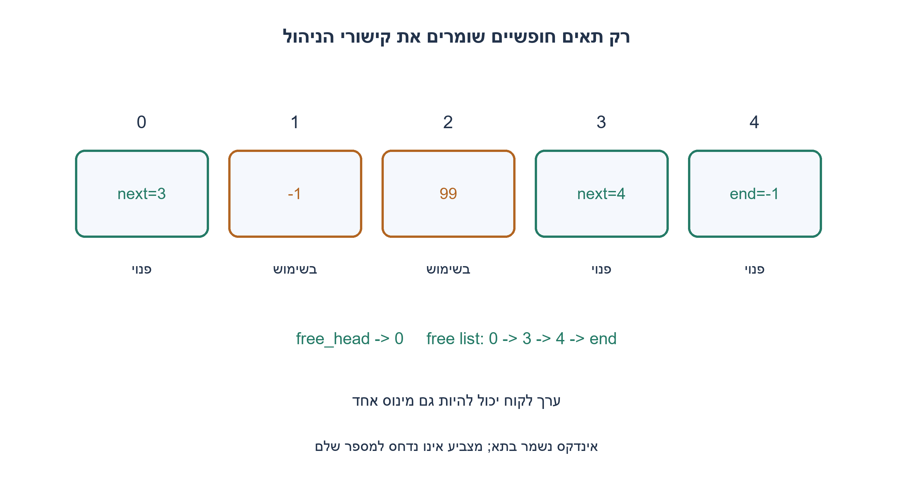
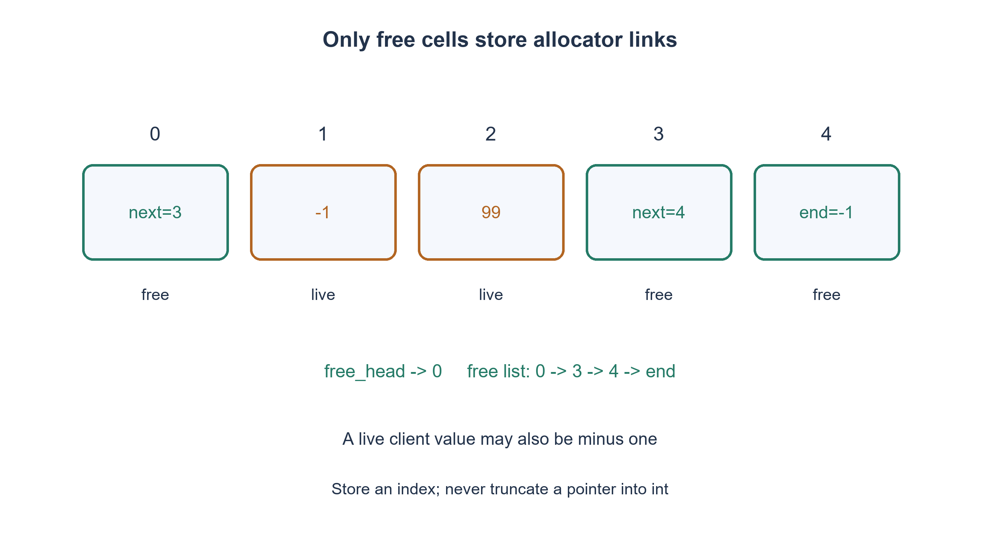

# PREP-117 — 64 תאים ורק 32 ביטי ניהול חיצוניים — רשימה בתאים הפנויים

פתרון מוצע בסיוע AI; ביקורת מקצועית אנושית ממתינה. הקושי אינו מכויל.

## עברית

### מאגר גדול ללא מטא־דאטה חיצוני נוסף
נתון אזור הזיכרון המתואר במקור כ־2gb. ממשו allocate ו־free כשאפשר להקצות ממנו int* ואסור להשתמש בזיכרון נוסף. הכתיב אינו מבהיר gigabit מול gigabyte או בסיס עשרוני מול בינארי; נתחו באמצעות M תאי int זמינים, בלי להמציא קיבולת מדויקת.

נבחר חוזה יחידות מפורש: כל allocate מחזיר תא int יחיד, לא בלוק באורך משתנה. התאים כבר הוקצו ומיושרים כמערך int אמיתי, וידועים base ואורכם. מותר int* free_head אחד כמצב ניהול חיצוני מתמיד, ומספר קבוע של משתנים זמניים בזמן קריאה. קישורי רשימת החופשיים נשמרים בתאים החופשיים בלבד; התאים שבשימוש יכולים להכיל כל int. M≤INT_MAX. free מקבל רק תא חי מאותו מאגר; double-free, מצביע זר ושימוש אחרי free אינם בתחום. הפעולות סדרתיות. הבחינו בין החוזה הזה לבין בלוקים משתנים, או איסור גם על המצביע החיצוני.

1. תא חופשי אינו צריך לשמור ערך לקוח. מה אפשר לאחסן בו עד שיוקצה?
2. אחסנו בו את אינדקס התא החופשי הבא, והחזיקו מצביע לראש הרשימה.
3. allocate מוציא את הראש; free כותב בתא המשוחרר את אינדקס הראש הקודם ומציבו כראש החדש. השתמשו באינדקס ולא בהמרת מצביע 64 ביט ל־int.

### הזיכרון החופשי נושא את מבנה הניהול שלו
באתחול מחברים את כל התאים לרשימת חופשיים: base[i] מכיל i+1, ובתא האחרון −1 כסמן סוף. free_head מצביע לתא הראשון או NULL בריק. אלה אינדקסים חוקיים במערך, לא ביטי מצביע שנדחסו ל־int. ההנחה M≤INT_MAX מאפשרת לייצג את האינדקסים ואת −1. קיבולת אפס בהכללה נותנת ראש ריק בלי כתיבה.

בהקצאה, אם הראש NULL מחזירים NULL. אחרת שומרים slot=head, קוראים את אינדקס היורש מהתא החופשי ומקדמים את הראש ל־base+index או ל־NULL. התא הוצא מהרשימה ושייך ללקוח, שרשאי לכתוב בו כל ערך, כולל −1. בשחרור חוקי כותבים בתא המשוחרר את אינדקס הראש הנוכחי או −1, ואז מציבים את הראש לתא הזה. אין גישה לתוכן תאים מוקצים אחרים.

האינווריאנט: הרשימה כוללת בדיוק את התאים החופשיים, כל אחד פעם אחת, והתאים החיים זרים לה. pop מסיר תא חופשי יחיד ו־push של תא חי מוסיף תא שלא נמצא בה. לכן הקצאה אינה מחזירה תא שכבר נמצא בידי לקוח, ואין פגיעה בערכו של אף תא חי אחר. הטיעון דורש free חוקי: שחרור כפול יכול ליצור מעגל. בדיקת טווח אינה מוכיחה בעלות, וב־C גם אי אפשר להפוך מצביע שרירותי לתקף באמצעות בדיקת NULL.

האתחול עולה Θ(M) כתיבות; לאחריו alloc/free חוקיים עולים O(1) פעולות מילה. המצב החיצוני המתמיד הוא מצביע int* יחיד. הקישורים תופסים את תוכן התאים רק כשהם פנויים, ולכן אינם גונבים ביט payload מתא חי; כל M התאים יכולים להיות מוקצים יחד. הפתרון אינו מאפס מידע לשם אבטחה. אם אסור אפילו ראש חיצוני, אפשר לשמור אינדקס ראש בתא שמור בתוך האזור, במחיר תא payload אחד ובהגדרת פורמט ניהול שונה.

אין להסיק מ־2gb מספר תאים בלי יחידות וגודל int: באזור בגודל B בתים אפשר לקבל floor(B/sizeof(int)) תאים מיושרים, בכפוף לבחירת יחידת המקור ולהקצאה התקפה. אין להניח ש־int* ו־int שווים בגודלם. הקצאת בלוק משתנה דורשת לכל הפחות חוזה גודל, גבולות, פיצול ואיחוד ומקום למטא־דאטה; המימוש הזה אינו malloc כללי.

מודל Python מיצה 15,309 עקבות חוקיות בקיבולות 0..6. קוד C99 עבר GCC מחמיר והריץ 36,000 צעדים בקיבולות 0..17, תוך בדיקת רשימת חופשיים ושמירת payload כגון INT_MIN ו־−1. הזיכרון הנוסף של אורקל הבדיקה אינו מצב שהמקצה משתמש בו; לא הוקצה בניסוי מאגר פיזי של 2gb.

```c
/* C99: fixed ONE-int allocations. Existing int array; only persistent
 * external management state is int *free_head. Constant temporary locals and
 * known arena base/length are permitted. Free cells store next INDICES, never
 * truncated pointers; allocated cells may contain any int.
 */
#include <limits.h>
#include <stdbool.h>
#include <stddef.h>

bool arena_init(int *base, size_t cells, int **free_head) {
    if (!free_head || (cells && !base) || cells > (size_t)INT_MAX) return false;
    for (size_t i = 0; i < cells; ++i) base[i] = i + 1 < cells ? (int)(i + 1) : -1;
    *free_head = cells ? base : NULL;
    return true;
}

int *arena_alloc(int *base, int **free_head) {
    /* Valid descriptor/free-list assumed after init and valid frees. */
    if (!*free_head) return NULL;
    int *slot = *free_head;
    int next_index = *slot;
    *free_head = next_index == -1 ? NULL : base + next_index;
    return slot;
}

void arena_free(int *base, int **free_head, int *slot) {
    /* slot must be a currently allocated cell of this arena. No stale,
     * double or foreign free is accepted by the caller contract. */
    *slot = *free_head ? (int)(*free_head - base) : -1;
    *free_head = slot;
}
```


```python
"""Logical fixed-int arena model; Python object overhead is not a C claim."""


class IntArena:
    def __init__(self, cells):
        if type(cells) is not int or cells < 0:
            raise ValueError('nonnegative cell count required')
        self.data = list(range(1, cells)) + [-1] if cells else []
        self.head = 0 if cells else -1

    def alloc(self):
        if self.head == -1:
            return None
        index = self.head
        self.head = self.data[index]
        return index

    def release(self, index):
        # Precondition: index is live; no hidden occupancy set in this model.
        self.data[index] = self.head
        self.head = index
```




## English

### A large arena without additional external metadata
The source gives a region called 2gb and asks for allocate/free returning int*, with no other memory. The spelling does not distinguish gigabits from gigabytes or decimal from binary units. Analyze M available int cells instead of inventing an exact capacity.

Choose an explicit unit contract: allocate returns one int cell, not a variable-size block. Storage is already a valid aligned int array with known base/length. Permit one persistent external int* free_head and constant temporary scalars during calls. Links reside only in free cells; allocated cells may contain any int. Require M≤INT_MAX. free receives a live cell from this arena; double/stale/foreign frees are outside scope. Operations are sequential. Distinguish this from variable-size blocks or a ban on even the external head pointer.

1. A free cell need not retain client payload. What could it store until allocated?
2. Store the next free-cell index there and retain a pointer to the free-list head.
3. allocate pops the head; free writes the previous head index into the released cell and pushes it. Store an index, not a truncated 64-bit pointer in int.

### Free storage carries its own management links
Initialize a chain by storing i+1 in base[i] and −1 in the last cell. free_head points at the first cell or NULL. These are array indices, not pointer bits truncated into int. M≤INT_MAX permits the indices and −1 sentinel. The generalized zero-capacity case has an empty head and performs no writes.

Allocation returns NULL for an empty head; otherwise save slot=head, read its next index and advance the head to base+index or NULL. The removed cell now belongs to its client, who may store any int, including −1. Valid release writes the previous head's index or −1 into that released cell and pushes it. Other allocated payload is never read or changed.

Invariant: the list contains every free cell exactly once and no live cell. Pop removes one free cell; pushing a valid released live cell adds an absent one. No live allocation is returned again and no unrelated live payload changes. This proof requires valid frees: double-free can form a cycle. A range check does not establish ownership, and nonnull checking cannot validate arbitrary C pointers.

Initialization takes Θ(M) writes; subsequent valid allocation/free take O(1) word operations. Persistent external management is one int* head. Links occupy cells only while free, so every cell can eventually become full-width payload. Release is not secure erasure. If even an external head is forbidden, reserve one in-arena metadata cell for a head index, losing one payload cell under a revised format.

The spelling 2gb does not determine capacity. For a B-byte valid aligned region, cell count is floor(B/sizeof(int)), after resolving unit interpretation. Pointer width need not equal int width. Variable-size allocation additionally needs a size/boundary/split/coalescing contract and metadata; this is not a general malloc.

Python exhausted 15,309 valid histories at capacities 0..6. Strict GCC C99 execution exercised 36,000 steps at capacities 0..17, checking the free chain and payloads such as INT_MIN and −1. Extra state in the independent checker is not used by the allocator. No physical 2gb arena was allocated in this verification.

```c
/* C99: fixed ONE-int allocations. Existing int array; only persistent
 * external management state is int *free_head. Constant temporary locals and
 * known arena base/length are permitted. Free cells store next INDICES, never
 * truncated pointers; allocated cells may contain any int.
 */
#include <limits.h>
#include <stdbool.h>
#include <stddef.h>

bool arena_init(int *base, size_t cells, int **free_head) {
    if (!free_head || (cells && !base) || cells > (size_t)INT_MAX) return false;
    for (size_t i = 0; i < cells; ++i) base[i] = i + 1 < cells ? (int)(i + 1) : -1;
    *free_head = cells ? base : NULL;
    return true;
}

int *arena_alloc(int *base, int **free_head) {
    /* Valid descriptor/free-list assumed after init and valid frees. */
    if (!*free_head) return NULL;
    int *slot = *free_head;
    int next_index = *slot;
    *free_head = next_index == -1 ? NULL : base + next_index;
    return slot;
}

void arena_free(int *base, int **free_head, int *slot) {
    /* slot must be a currently allocated cell of this arena. No stale,
     * double or foreign free is accepted by the caller contract. */
    *slot = *free_head ? (int)(*free_head - base) : -1;
    *free_head = slot;
}
```


```python
"""Logical fixed-int arena model; Python object overhead is not a C claim."""


class IntArena:
    def __init__(self, cells):
        if type(cells) is not int or cells < 0:
            raise ValueError('nonnegative cell count required')
        self.data = list(range(1, cells)) + [-1] if cells else []
        self.head = 0 if cells else -1

    def alloc(self):
        if self.head == -1:
            return None
        index = self.head
        self.head = self.data[index]
        return index

    def release(self, index):
        # Precondition: index is live; no hidden occupancy set in this model.
        self.data[index] = self.head
        self.head = index
```




## חומר משלים / Supporting material

```json
{
  "assumptions": {
    "he": [
      "יחידה אחת היא int יחיד; מערך תקף ומיושר עם M≤INT_MAX.",
      "מצביע ראש יחיד מתמיד מותר; קישורים בתאים חופשיים; free חוקי וסדרתי."
    ],
    "en": [
      "One allocation is one int cell; valid aligned array with M≤INT_MAX.",
      "One persistent head pointer is permitted; links use free cells; valid sequential frees."
    ]
  },
  "optimality": {
    "he": "אתחול Θ(M), ואחריו O(1) לפעולה חוקית. מצביע ניהול חיצוני אחד; אין הפחתת payload אלא אם בוחרים לשמור גם ראש בתוך האזור.",
    "en": "Θ(M) initialization, then O(1) per valid operation. One external management pointer; payload capacity changes only under an alternative in-arena-head design."
  },
  "verification": {
    "he": "15,309 עקבות Python ו־36,000 צעדי C99 מהודר מול אורקל בעלות חיצוני. אין טענת זיהוי double-free, בדיקת מקביליות או הקצאת 2gb בפועל.",
    "en": "15,309 Python histories and 36,000 compiled C99 steps against an external ownership oracle. No double-free detection, concurrency test or actual 2gb allocation claim."
  },
  "edge_cases": {
    "he": [
      "מאגר ריק; יחיד; מלא; שימוש חוזר; payload השווה לסמן −1; סוף רשימה; רוחב מצביע שונה מ־int."
    ],
    "en": [
      "Empty/one/full arena; reuse; payload equal to −1; end sentinel; pointer width unlike int."
    ]
  },
  "common_mistakes": {
    "he": [
      "bitmap חיצוני החורג מהתקציב.",
      "המרת מצביע ל־int ושחזורו בלי הבטחת ייצוג.",
      "סימון תפוסה בערך payload שרשאי להופיע אצל לקוח.",
      "הבטחת free שרירותי או בלוקים משתנים בלי מטא־דאטה."
    ],
    "en": [
      "An over-budget external bitmap.",
      "Truncating a pointer into int and reconstructing it.",
      "Using a legal client payload as an occupancy marker.",
      "Promising arbitrary frees or variable blocks without metadata."
    ]
  },
  "interview_answer": {
    "he": "אשתמש בתאים הפנויים כרשימה, עם אינדקס יורש בכל אחד ומצביע ראש יחיד. אגדיר במפורש יחידת int ו־free חוקי, ולא אכנה זאת malloc כללי.",
    "en": "Use free cells as a list, storing a next index in each with one head pointer. Explicitly require one-int allocations and valid frees rather than claiming general malloc."
  },
  "source_ambiguities": {
    "he": "2gb והביטוי int* עמומים. נשמרו שתי פרשנויות יחידות הזיכרון; החוזה הראשי מתיר ראש אחד ומפרש יחידה כתא int. אין הנחה שרוחב int הוא 32 ביט.",
    "en": "2gb and int* are ambiguous. Unit interpretations are retained; the main contract permits one head and chooses one int cell per allocation. int is not silently assumed to be 32 bits."
  },
  "solution_extensions": {
    "he": [
      {
        "question": "איך מזהים שחרור כפול בלי bitmap חיצוני?",
        "answer_direction": "אפשר לסרוק את רשימת החופשיים לפני שחרור, במחיר O(M), או להתיר מטא־דאטה נוסף. מצביע בטווח לבדו אינו הוכחת הקצאה חיה.",
        "principle": "אימות בעלות דורש מידע או זמן נוספים."
      }
    ],
    "en": [
      {
        "question": "How can double-free be detected without an external bitmap?",
        "answer_direction": "Scan the free list before release at O(M) cost, or permit more metadata. In-range pointers alone do not prove a live allocation.",
        "principle": "Ownership validation needs additional information or time."
      }
    ]
  }
}
```
