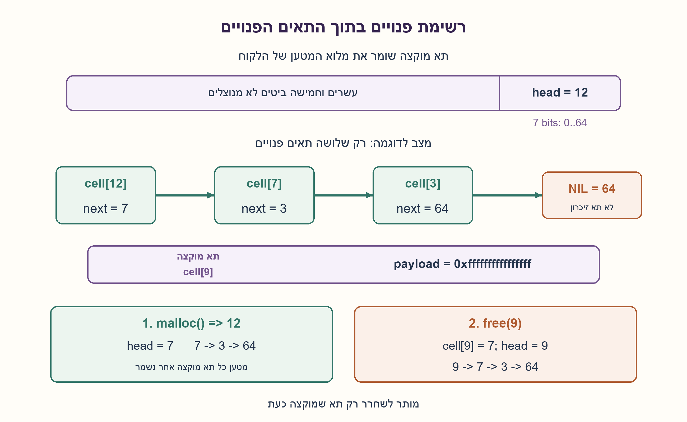
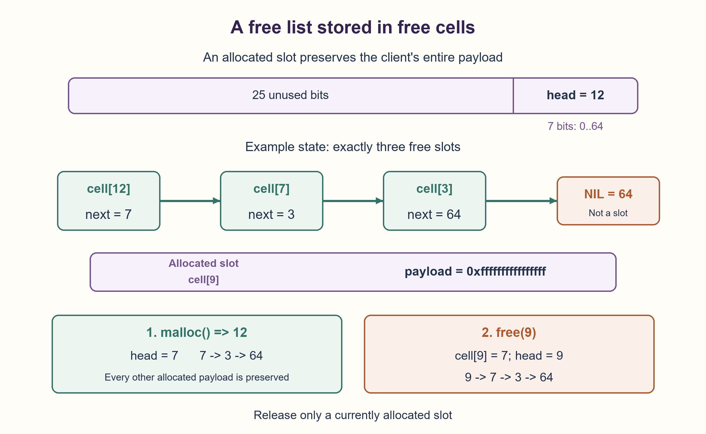

# PREP-117 — 64 תאים ורק 32 ביטי ניהול חיצוניים — רשימה בתאים הפנויים

פתרון מוצע בסיוע AI; ביקורת מקצועית אנושית ממתינה. הקושי לא כויל.

## מקור

[צילום המקור](../sources/2026-10-24-batch30-03.png)

הפעם, ברשותך מרחב זכרון רציף של 64 כתובות כאשר כל כתובת היא באורך 64 ביט. ממש malloc שמחזיר אינדקס של כתובת פנויה ו-free שמקבל מספר שורה ומשחרר את הזיכרון בה. בנוסף ברשותך מרחב זיכרון נוסף באורך 32 ביט לניהול הזיכרון.

שיוכי החברות בצילום הם דיווח לא מאומת: NVIDIA.

## 64 תאים ורק 32 ביטי ניהול חיצוניים — רשימה בתאים הפנויים

ברשותכם 64 תאי זיכרון רציפים, כל אחד בגודל 64 ביטים, ועוד 32 ביטים חיצוניים לניהול. ממשו malloc שמחזיר אינדקס פנוי ו־free שמקבל אינדקס ומשחרר אותו. הסבירו האם התקציב מספיק ובאילו הנחות.

הבהרה מהותית שנוספה: בפתרון העיקרי מותר להשתמש בתוכן תאים פנויים לשמירת קישורי ניהול. תוכן תא מוקצה שייך ללקוח, יכול להיות כל ערך בן 64 ביטים וחייב להישמר ללא שינוי עד שישוחרר. אין למנהל זכות לשמור דגל בתוך תא מוקצה. בתחילה כל 64 התאים פנויים; מותר אתחול של 64 קישורים. אינדקסים 0..63, וכשאין פנוי malloc מחזיר ‎-1. אין דרישה להחזיר את האינדקס הנמוך ביותר.

free מקבלת רק אינדקס של תא שמוקצה כרגע ללקוח: שחרור כפול או מזהה ישן אחרי הקצאה מחדש הם מחוץ לחוזה, ואין להבטיח זיהוי שלהם. הפעולות סדרתיות. מעבר למאגר הנתון, רק מילת בקרה אחת בת 32 ביטים נשמרת כמצב ניהול; כתובת הבסיס ידועה ומותר מספר קבוע של משתנים זמניים. נתחו בנפרד את הקריאה המחמירה שבה אסור לשמור ניהול גם בתאים פנויים; אין להכריז על אי־אפשרות בלי לציין את האיסור הזה.

### שלושה רמזים

1. האם כל תא חייב לשמור נתוני לקוח גם כשהוא פנוי? איפה אפשר לשמור את האינדקס של התא הפנוי הבא?
2. מפה חיצונית של ביט אחד לכל תא דורשת 64 ביטים, אך רשימת תאים פנויים יכולה לשמור את הקישורים בתוך אותם תאים.
3. שמרו ראש רשימה: 0..63 לתא ועוד 64 לסוף. הקצאה מוציאה ראש וקוראת ממנו את הבא; שחרור כותב את הראש הקודם לתא ששוחרר ומציב אותו כראש. שבעה ביטים מספיקים לראש.

### הצעה לפתרון

### למה המפה הקודמת אינה מספיקה, אבל עדיין יש פתרון
ב־PREP-102 היו 32 תאים ומפת תפוסה חיצונית בת 32 ביטים. ל־64 תאים אותה מפה צריכה 64 ביטים, ולכן אינה עומדת בתקציב החדש. זה פוסל את הייצוג ההוא, לא כל פתרון. כאן נשתמש בזיכרון שכבר פנוי, בלי להקטין אף מטען מוקצה של 64 ביטים.

### רשימת התאים הפנויים נמצאת בתוך התאים עצמם
שומרים בתא פנוי את אינדקס התא הפנוי הבא. המילה החיצונית מחזיקה head, אינדקס הראש. הערך 64 הוא סוף רשימה ואינו אינדקס חוקי. יש 65 ערכים אפשריים לראש, ולכן נדרשים שבעה ביטים, הנכנסים במילה החיצונית בת 32 הביטים. יתר ביטי המילה אינם דרושים לייצוג הזה.

באתחול כותבים בתאים את הקישורים 0→1→2→…→63→64, וקובעים head=0. אלה 64 כתיבות חד־פעמיות; אין לספור את האתחול כפעולת malloc יחידה בזמן קבוע בהכללה לקיבולת משתנה. התא הפנוי משתמש במילת המטען שלו לקישור, אך אין נתוני לקוח לשמר בו באותו זמן.

### הקצאה היא הוצאת הראש
אם head=64, הרשימה ריקה: מחזירים ‎-1 ולא משנים דבר. אחרת שומרים index=head, קוראים cells[index] לתוך head ומחזירים index. מרגע ההחזרה התא מוקצה, וערכו נחשב מטען לקוח ולא קישור. הלקוח רשאי לכתוב בו כל ערך, גם 64, 0 או 2^64−1; המנהל אינו מסתמך על ערכו לזיהוי תפוסה ואינו עובר דרך תא מוקצה.

### שחרור הוא הכנסת ראש חדש
עבור אינדקס מוקצה חוקי, כותבים cells[index]=head ואז head=index. כתיבת הקישור מתבצעת רק לאחר שהלקוח מוותר על התא. היא אינה נוגעת בשום תא מוקצה אחר. שחרור 7 ואחריו 12 יוצר ראש 12→7→היתרה, ולכן ההקצאה הבאה מחזירה 12. אין דרישת ״הנמוך ביותר״ בחוזה החדש.

### אינווריאנט הנכונות
הרשימה מכילה בדיוק את התאים הפנויים, כל אחד פעם אחת, ומסתיימת ב־64. בתחילה היא מכילה את כולם. הוצאת הראש מסירה תא פנוי אחד בלבד; הכנסת תא מוקצה ששוחרר מוסיפה אחד שאינו ברשימה. כך אין החזרת תא שמוקצה כבר, אין אובדן תא פנוי ואין שינוי במטען של תא מוקצה.

הנימוק של הכנסת הראש משתמש בהבטחה שהתא באמת מוקצה. שחרור כפול יכול ליצור מעגל או להחזיר אותו תא פעמיים בהמשך; היישום אינו מגלה זאת. בדיקת תחום אינדקס אינה בדיקת בעלות. אפשר להוסיף סריקת רשימה לגילוי שחרור של תא שכבר פנוי, אך בהכללה לקיבולת m זו עלות O(m), או לבחור מידע ניהול נוסף. אין להוסיף בשקט מערך תפוסה שאינו נכנס לתקציב.

### זמן וזיכרון
אחרי אתחול O(m), הקצאה ושחרור חוקיים הם O(1) פעולות מילה; כאן m=64. הראש דורש שבעה ביטים לוגיים בתוך 32 החיצוניים, וקישורים נמצאים רק במילים שכבר פנויות. אין מערך או קבוצת תפוסה סמויים. Python משתמש באובייקטים ובהפניות, ולכן המודל אינו טוען שצריכת ההיפ שלו היא ארבעה בתים; הוא מדגים את חלוקת המצב הלוגית. ההפניה למאגר מייצגת את כתובת הבסיס הנתונה, לא רשימת ניהול נוספת.

### מתי כן אפשר להוכיח אי־אפשרות עם 32 ביטים?
אם נאסר שימוש לניהול גם בתאים פנויים, אין מצב ניהול מתמשך אחר, וכל תוכן מטען נתון יכול להישאר זהה עבור כל קבוצת תפוסה, על הבקרה החיצונית לבדה להבחין בין 2^64 קבוצות התפוסה האפשריות. 32 ביטים נותנים רק 2^32 מצבים. דרושים אז לפחות 64 ביטים. ההוכחה מותנית באיסור אחסון המידע בתוך המאגר; היא אינה סותרת את הרשימה, שמשנה מילים פנויות.

גם ״ערך קסם״ בתא אינו הוכחת תפוסה אם כל 64 ביטי המטען מותרים: לקוח יכול לשמור את אותו הערך. אין לנו רשות לגנוב ביט ממטען מוקצה. ההבדל בין שתי הקריאות של המקור הוא מידע מהותי, ולכן שתיהן מתועדות.

```python
"""64 existing 64-bit payload cells; one logical 32-bit external control word.

Only FREE cells store next indices. Allocated cells may hold ANY uint64 payload
and are never traversed/changed by another allocation. head is in 0..64 (7 bits),
where 64 means empty. Python object overhead is not a four-byte memory claim.
free_index requires a currently allocated index; double/stale free is outside
the contract and is not detected. Invalid index types/ranges are rejected.
"""

NIL = 64


class Pool64:
    __slots__ = ("cells", "head")

    def __init__(self, cells):
        if not isinstance(cells, list) or len(cells) != 64:
            raise ValueError("supply the existing array of exactly 64 payload cells")
        self.cells = cells
        self.head = 0
        for index in range(64):
            cells[index] = index + 1

    def malloc_index(self):
        if self.head == NIL:
            return -1
        index = self.head
        self.head = self.cells[index]
        return index

    def free_index(self, index):
        if type(index) is not int or not 0 <= index < 64:
            raise ValueError("index must be an integer in 0..63")
        # Precondition: caller owns this currently allocated slot.
        self.cells[index] = self.head
        self.head = index
```



## 64 slots and 32 external control bits — an in-band free list

You have 64 contiguous slots of 64 bits each and 32 external management bits. Implement malloc returning a free index and free releasing an index. Explain whether this budget suffices and under which assumptions.

Essential added clarification: the primary construction may store management links inside FREE slots. Allocated payload belongs to the client, can be any 64-bit value, and must remain unchanged until released. No flag may consume an allocated payload bit. Initially all slots are free; 64 link-initialization writes are allowed. Indices are 0..63; malloc returns -1 when full. Lowest-free-index selection is not required.

free requires an index currently allocated to the caller: repeated frees and stale indices after reuse are outside the contract and are not detected. Operations are sequential. Beyond the given array, only one logical 32-bit control word persists; the base address is known and constant temporary scalars are allowed. Separately analyze the stricter reading forbidding management data even inside free slots. Do not claim impossibility without that restriction.

### Three hints

1. Must a free slot still retain client data? Where could its next-free index be stored?
2. An external occupancy bitmap needs 64 bits, but a free list can put its links inside the free slots themselves.
3. Keep a head: 0..63 for a slot, 64 for end. Allocation pops the head and reads its next link; freeing writes the old head into the released slot and makes that slot the head. Seven head bits suffice.

### Proposed solution

### The old bitmap fails, but that does not make every solution impossible
PREP-102 used 32 slots and a 32-bit external occupancy bitmap. For 64 slots that representation needs 64 bits and exceeds the new budget. This rules out that representation, not every solution. Use memory already free, without reducing any allocated 64-bit payload.

### Free slots store their own links
Each free slot holds the next free index. The external word stores head. Value 64 denotes end and is not a valid slot index. There are 65 possible head values, requiring seven bits, which fit the 32-bit external word. The other control bits are unnecessary for this representation.

Initialize links 0→1→2→…→63→64 and head=0. These are 64 one-time writes; generalized initialization is not one constant-time malloc. A free slot's payload word carries a link only when no client payload must be retained there.

### Allocation pops the head
If head=64, return -1 without modification. Otherwise save index=head, replace head with cells[index], and return index. The returned slot is now allocated; its word is client payload, not a link. The client may write any value, including 64, zero or 2^64−1. The allocator neither uses such values as occupancy markers nor traverses allocated slots.

### Release pushes a new head
For a valid currently allocated index, write cells[index]=head, then head=index. The link write occurs only after the client releases ownership and changes no other allocated payload. Releasing 7 then 12 makes 12→7→the remaining list, so the next allocation returns 12. This contract does not require the lowest free index.

### Correctness invariant
The list contains exactly the free slots, each once, ending at 64. Initialization includes them all. Popping removes exactly one free slot; pushing a released allocated slot adds one absent from the list. Therefore no live allocation is returned again, no free slot is lost, and allocated payloads remain unchanged.

The push proof requires the released slot to be allocated. A repeated free can create a cycle or later return one slot twice; the implementation does not detect this. A range check is not an ownership check. Scanning the free list can detect an already-free index, but generalizes to O(m) time for capacity m, or one can provide more metadata. Never silently add an over-budget occupancy array.

### Cost and logical state
After O(m) initialization, valid allocation and release take O(1) word operations; m=64 here. Head needs seven logical bits within the 32 external bits, while links occupy only already-free words. No hidden membership array or set is stored. Python object/reference overhead is not a four-byte heap claim; the model verifies logical state placement. The array reference represents the supplied base address, not another management list.

### When are 32 bits provably insufficient?
Under the stricter interpretation forbidding management data even in free slots, with no other persistent state and payload contents able to remain identical for every occupancy subset, external control must distinguish all 2^64 subsets. Thirty-two bits offer only 2^32 states, so at least 64 are required. This lower bound depends on forbidding in-band storage. It does not contradict a free list that changes free words.

A magic payload value cannot prove a slot is free when every 64-bit client value is legal: a client can store that value. Stealing an allocated payload bit is not permitted. The two interpretations materially differ and must both remain documented.

```python
"""64 existing 64-bit payload cells; one logical 32-bit external control word.

Only FREE cells store next indices. Allocated cells may hold ANY uint64 payload
and are never traversed/changed by another allocation. head is in 0..64 (7 bits),
where 64 means empty. Python object overhead is not a four-byte memory claim.
free_index requires a currently allocated index; double/stale free is outside
the contract and is not detected. Invalid index types/ranges are rejected.
"""

NIL = 64


class Pool64:
    __slots__ = ("cells", "head")

    def __init__(self, cells):
        if not isinstance(cells, list) or len(cells) != 64:
            raise ValueError("supply the existing array of exactly 64 payload cells")
        self.cells = cells
        self.head = 0
        for index in range(64):
            cells[index] = index + 1

    def malloc_index(self):
        if self.head == NIL:
            return -1
        index = self.head
        self.head = self.cells[index]
        return index

    def free_index(self, index):
        if type(index) is not int or not 0 <= index < 64:
            raise ValueError("index must be an integer in 0..63")
        # Precondition: caller owns this currently allocated slot.
        self.cells[index] = self.head
        self.head = index
```



## חומר משלים / Supporting material

```json
{
  "assumptions": {
    "he": [
      "קישורי ניהול מותרים רק בתוך תאים פנויים; כל 64 ביטי מטען מוקצה נשמרים.",
      "כל התאים פנויים תחילה, אתחול הקישורים מותר, ואינדקסים הם 0..63.",
      "free מקבלת תא שמוקצה כרגע; שחרור כפול או מזהה ישן מחוץ לחוזה.",
      "פעולות סדרתיות; מילה חיצונית אחת בת 32 ביטים, כתובת בסיס נתונה ומשתנים זמניים קבועים."
    ],
    "en": [
      "Links may occupy free cells only; every allocated 64-bit payload is preserved.",
      "Initially all free, link initialization allowed, indices 0..63.",
      "free requires a currently allocated slot; repeated/stale frees are outside the contract.",
      "Sequential operations; one external 32-bit control word, supplied base address and constant temporaries."
    ]
  },
  "optimality": {
    "he": "אתחול O(m), פעולות חוקיות O(1), וראש בעל שבעה ביטים לוגיים בתוך 32 החיצוניים. לא נטען למינימום הוראות או לתקציב היפ Python. חסם 64 הביטים חל רק כשאסור לאחסן ניהול בתוך כל המאגר.",
    "en": "O(m) initialization, O(1) valid operations, seven logical head bits within 32 external bits. No instruction minimum or Python heap-budget claim. The 64-bit lower bound applies only when all in-band management is forbidden."
  },
  "edge_cases": {
    "he": [
      "הרשימה מתרוקנת אחרי 64 הקצאות ואז malloc מחזירה ‎-1 בלי שינוי.",
      "שחרור והקצאה מחדש, תא 63, וערכי מטען 0,64,2^64−1.",
      "אין להניח שהמילה בתא מוקצה עדיין מכילה קישור.",
      "קלט free מחוץ לטווח נפסל; שחרור כפול אינו נבדק."
    ],
    "en": [
      "Empty list after 64 allocations; subsequent malloc returns -1 unchanged.",
      "Release/reuse, slot 63 and payload values 0,64,2^64−1.",
      "An allocated word need not retain a next link.",
      "Out-of-range free is rejected; repeated free is not detected."
    ]
  },
  "common_mistakes": {
    "he": [
      "להכריז על אי־אפשרות רק מפני שמפה חיצונית דורשת 64 ביטים.",
      "לשמור דגל או קישור במטען מוקצה בלי רשות או להסתמך על ערך קסם.",
      "להסתיר set תפוסה במודל ולייחס את מצבו לראש בלבד.",
      "להבטיח זיהוי שחרור כפול או סדר האינדקס הנמוך ביותר בלי לממשם."
    ],
    "en": [
      "Declaring impossibility merely because an external bitmap needs 64 bits.",
      "Using allocated payload bits without permission or relying on a magic value.",
      "Hiding an occupancy set in the model while attributing state to head alone.",
      "Promising repeated-free detection or lowest-index selection without implementing it."
    ]
  },
  "interview_answer": {
    "he": "אברר אם תאים פנויים מותרים למטא־נתונים. אם כן אשמור בהם רשימת קישורים, וב־32 הביטים החיצוניים רק ראש 0..64. malloc מוציאה ראש ו־free של תא מוקצה מכניסה אותו. כל מטען מוקצה נשמר; בלי רשות לאחסון פנימי יש חסם מידע אחר.",
    "en": "Clarify whether free cells may store metadata. If so, put links there and only head 0..64 in external control. malloc pops; free of a live slot pushes. All allocated payload is preserved. Forbidding in-band state gives a different information bound."
  },
  "source_ambiguities": {
    "he": "המקור מצמצם ניהול חיצוני ל־32 ביטים אך אינו אומר אם מותר לכתוב ניהול בתאים פנויים, אם יש דרישת סדר או איך מטפלים ב־free לא חוקית. הפתרון מתנה את הבנייה ברשות מפורשת לאחסון פנימי ובשחרור חוקי, ומנתח בנפרד איסור מוחלט.",
    "en": "The source limits external management to 32 bits but does not define free-cell metadata permission, allocation order or invalid free semantics. The construction explicitly assumes in-band free links and valid releases; a total in-band prohibition is analyzed separately."
  },
  "verification": {
    "he": "10,065 פעולות תקינות נבדקו מול רתמת deque ומילון מטענים בלתי תלויים: ריקון 64 התאים, כישלון במלא ו־10,000 פעולות מדגמיות. אחרי כל פעולה נבדקו רשימת הפנויים, ראש עד 64 וכל מטעני ה־64 ביטים המוקצים. הרתמה בלבד מחזיקה מידע חברות; היישום אינו מחזיקו.",
    "en": "10,065 valid operations matched an independent deque and allocated-payload dictionary: draining all 64 slots, full failure and 10,000 seeded actions. Every step checked free-list membership, head≤64 and all allocated uint64 payloads. Membership metadata exists only in the oracle, not the implementation."
  },
  "relationship_note": {
    "he": "וריאציה חדשה המקושרת ל־PREP-102: שם 32 תאים ומפת 32 ביטים מספיקים. כאן הקיבולת גדלה בלי להגדיל את הבקרה החיצונית, ולכן נדרש לברר מקום למידע ולהחליף ייצוג.",
    "en": "Linked variant of PREP-102: its 32-slot/32-bit bitmap fits. Here capacity grows without more external control, requiring an explicit storage-permission question and another representation."
  },
  "solution_extensions": {
    "he": {
      "question": "איך מזהים שחרור של תא שכבר פנוי בלי מפה חיצונית נוספת?",
      "direction": "אפשר לסרוק את הרשימה לפני ההכנסה ולבדוק אם האינדקס מופיע. העלות היא עד מספר התאים הפנויים; לקיבולת כללית m היא O(m). מזהה ישן לתא שהוקצה מחדש דורש חוזה או מידע נוספים.",
      "status": "מוכן בתוכן; לא מחובר לתור המשך."
    },
    "en": {
      "question": "How could an already-free release be detected without another external bitmap?",
      "direction": "Scan the list for the index before pushing. Cost is up to the free-list length, O(m) for general capacity m. Stale handles after reuse require another contract or information.",
      "status": "Prepared in content; not connected to the follow-up queue."
    }
  }
}
```
