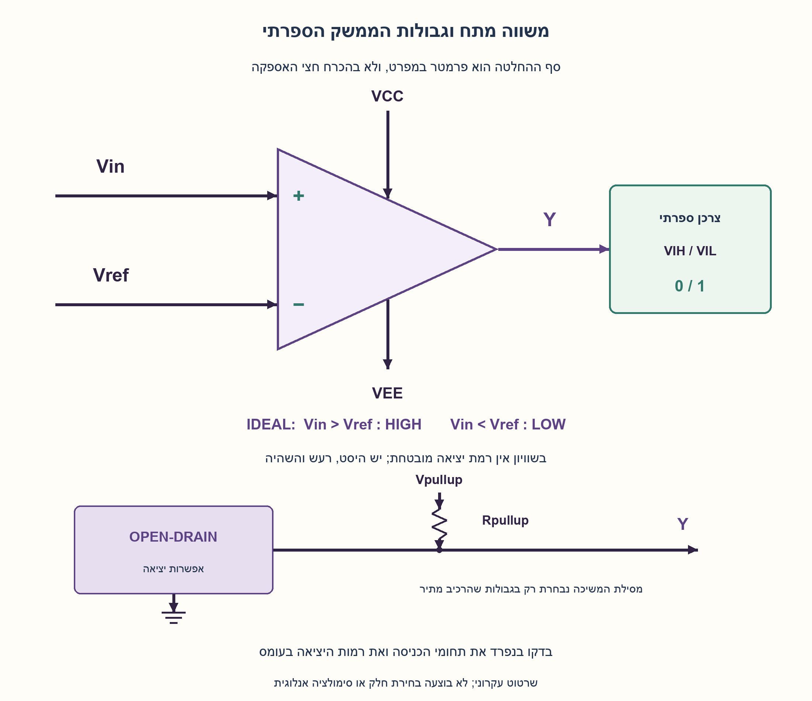
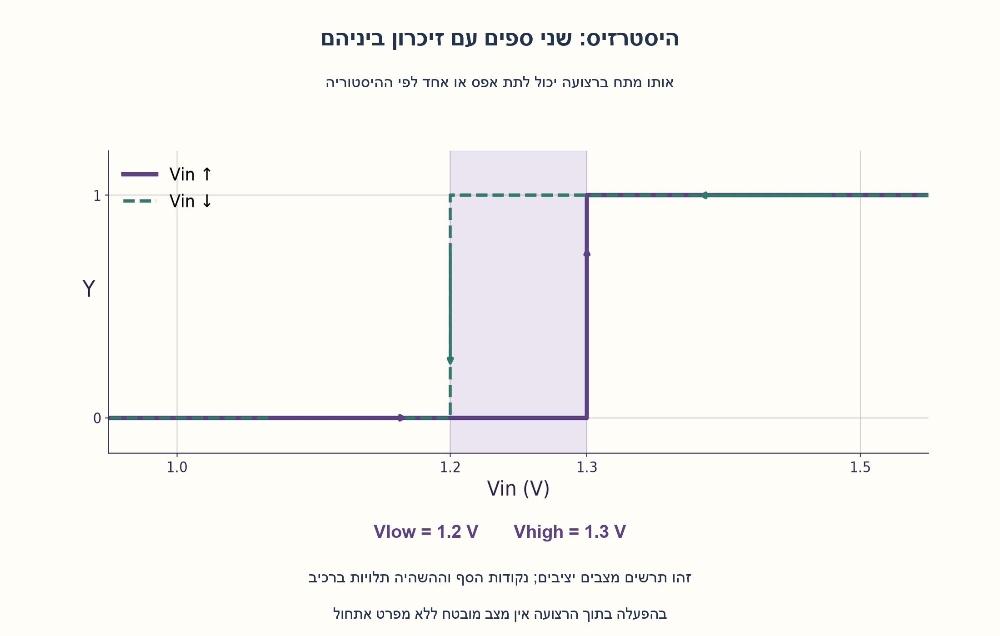
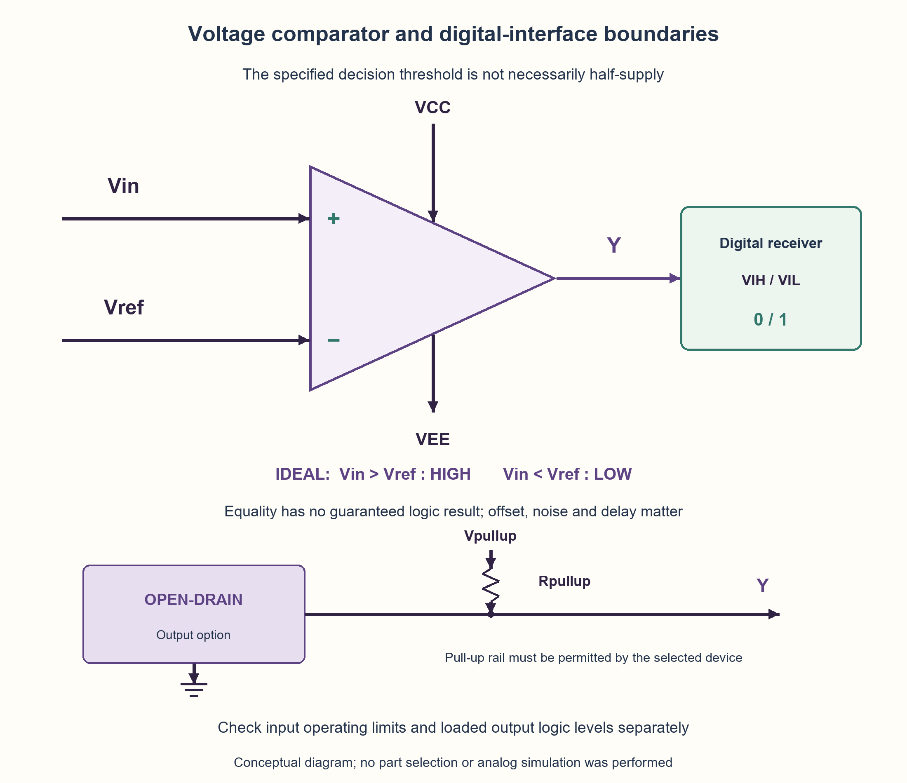
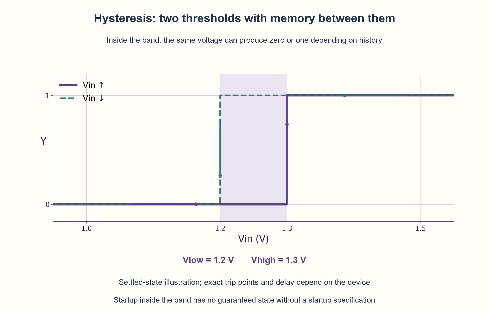

# PREP-118 — ממתח אנלוגי להחלטה ספרתית: סף, ממשק והיסטרזיס

פתרון מוצע בסיוע AI; ביקורת מקצועית אנושית ממתינה. הקושי לא כויל.

## מקור

[צילום המקור](../sources/2026-10-24-batch30-04.png)

איך ניתן לבנות מערכת שמקבלת מתח VIN מתח אנלוגי בין תחום טווח מסוים ומוציאה אות ספרתי (1 לוגי או 0 לוגי ביחס לכניסה)?

שיוכי החברות בצילום מדווחים ולא אומתו באופן עצמאי: NVIDIA.

## נוסח ערוך

ממתח אנלוגי להחלטה ספרתית: סף, ממשק והיסטרזיס

תכננו מערכת המקבלת מתח אנלוגי Vin בתחום [Vmin,Vmax] ומוציאה 0 או 1 לפי ערכו. מה חייבים לברר כדי להגדיר את ההתנהגות, באיזה רכיב תשתמשו, ואיך תחברו אותו למערכת ספרתית? הסבירו גם מה קורה ליד נקודת ההחלטה וכיצד מטפלים ברעש או בכניסה איטית.

הבהרות עריכה: התחום וסף ההחלטה אינם נתונים במספרים במקור. יש להשאירם פרמטרים, ולא להניח שסף ההחלטה הוא אמצע תחום הכניסה או חצי מתח האספקה. נגדיר כאן קוטביות לא־מהפכת: רצוי Y=1 כאשר Vin>Vref ו־Y=0 כאשר Vin<Vref. בשוויון אין דרישת 0/1 מובטחת. עליכם לציין תחומי מתח חוקיים, חיבור אות ייחוס וממשק יציאה. היסטרזיס הוא הרחבה לפי דרישת הרעש; אם מוסיפים אותו, ההתנהגות בתוך תחום הספים תלויה במצב הקודם. אם הכוונה המקורית הייתה לייצג מספר רב של רמות ולא החלטת סף יחידה, זהו מפרט אחר.

### שלושה רמזים

1. טווח מתח לבדו עדיין אינו קובע אילו ערכים נחשבים 0 ואילו 1. לאיזה מתח נוסף צריך להשוות, ובאיזו קוטביות?
2. חפשו רכיב שמשווה שתי כניסות אנלוגיות ומפיק החלטה דו־רמתית. בדקו בנפרד את תחום הכניסה המותר ואת רמות היציאה שהצרכן הספרתי מקבל.
3. חברו Vin לכניסה הלא־מהפכת ו־Vref למהפכת של משווה. ליד הסף רעש יכול לגרום למעברים חוזרים; כשנדרש, השתמשו בסף עליון לעלייה ובסף תחתון לירידה והחזיקו מצב ביניהם.

### הצעה לפתרון

### הרעיון: לענות על שאלה אחת, לא למדוד את כל המתח
משווה מתח עונה על ״האם Vin גדול מ־Vref?״. זו החלטה של ביט אחד. תחום הכניסה [Vmin,Vmax] אומר מה עשוי להגיע, אך אינו קובע היכן לחלק אותו. לכן מבררים סף, קוטביות, דיוק, מהירות ורמות מתח לפני בחירת רכיב. לא בוחרים חצי אספקה אוטומטית.

### החיבור הבסיסי
מחברים Vin לכניסת + של משווה ו־Vref לכניסת −, עם מסילת הזנה וייחוס אדמה מתאימים. עבור הפרש חיובי מספיק היציאה גבוהה, ועבור הפרש שלילי מספיק היא נמוכה. היפוך שתי הכניסות הופך את הקוטביות. אפשר לקבל Vref ממקור ייחוס או מחלק נגדים המתאים לדרישת הדיוק; מחלק מתוך אספקה משתנה יגרום גם לסף להשתנות.

אם לצורך הדגמה הוחלט בעריכה על Vin בין 0 ל־3.3 V ועל Vref=1.65 V, אז 1 V מבקש 0 ו־2 V מבקש 1. אלה מספרי דוגמה, לא נתונים מהמקור ולא המלצה לרכיב. ב־Vin=Vref אין להבטיח רמת יציאה: היסט כניסה, רעש ותנאי המעבר קובעים את התגובה בפועל.

### הכניסה והיציאה הן שתי בדיקות תאימות שונות
יש לוודא ששתי כניסות המשווה, כל אחת בנפרד, נמצאות בתחום הפעולה המותר בדף הנתונים; אין להסתפק בממוצע שלהן. בודקים גם הפרש כניסות מותר, מגבלות מתח מוחלטות והתנהגות כשההזנה כבויה. אם צריך, מוסיפים הנחתה והגנה מתאימות ומעדכנים את סף ההשוואה. תחום מוחלט שמונע נזק אינו הבטחת פעולה תקינה, והיכולת לקבל מתח מעל מסילה תלויה ברכיב.

ביציאה מוודאים VOL≤VIL(max) ו־VOH≥VIH(min) של הצרכן, תחת העומס, ההזנה והטמפרטורה שנבחרו. יציאת push-pull עשויה להתחבר ישירות אם התנאים מתאימים. יציאת open-drain דורשת בדרך כלל נגד pull-up; אפשר למשוך למסילת לוגיקה אחרת רק אם מפרט הרכיב מתיר את המתח הזה. גודל הנגד משפיע גם על זרם השקיעה וגם על זמן העלייה דרך קיבול העומס. אין כלל שאומר שכל משווה מוציא בדיוק 0 V או בדיוק VDD, או שכל יציאת open-drain סובלת כל מסילה.

### מה עושים כשהכניסה מטיילת סביב הסף
משווה אידיאלי ללא היסטרזיס הופך מצב בכל חציית סף. ברעש או בשינוי איטי, חציות חוזרות עלולות ליצור ריצוד. כאשר נדרשת החלטה יציבה בתחום רעש מוגדר, בוחרים משווה בעל היסטרזיס מתאים או מוסיפים משוב חיובי מתוכנן. מתקבלים שני ספים: מעבר ל־1 מעל Vhigh, מעבר ל־0 מתחת Vlow, ושימור המצב ביניהם. זהו עקרון Schmitt. זו תוספת זיכרון קטנה, ולכן הוא אינו אותה פונקציה חסרת־זיכרון של סף יחיד.

לדוגמה, Vlow=1.2 V ו־Vhigh=1.3 V. אם Y=0, תנודות בין 1.23 ל־1.27 V אינן מדליקות אותו; חצייה ל־1.31 V כן. לאחר מכן חזרה ל־1.25 V משאירה Y=1, ורק ירידה ל־1.19 V מאפסת. בהפעלה ראשונה בתוך הרצועה אין מצב מובטח בלי מפרט אתחול. רעש גדול מספיק לחצות את שני הספים עדיין יכול לגרום למעברים.

### מפרט בדיקה ברור
משווה אמיתי אינו מיידי: היסט, סבולות, רעש והשהיית התפשטות מגבילים את ההחלטה. אם ידוע חסם Δ לאי־ודאות ההפרש, אפשר לדרוש 1 רק כאשר Vin−Vref>Δ, ו־0 רק כאשר Vin−Vref<−Δ; בפס האמצעי אין הבטחת ערך. יש לבדוק קצוות תחום, משני צדי הסף, תנודות, כיווני חציה, מצב התחלתי ועומס יציאה. ספים והשהיה צריכים להילקח מדף הנתונים בתנאי העבודה, לא מהמודל הבינארי.

הקוד מתאר החלטות יציבות: בשוויון או באי־ודאות מחזירים None. במודל ההיסטרזיס בחרנו במפורש להחזיק את המצב גם בנקודות הסף המדויקות; זו מוסכמת מודל ולא הבטחה פיזית בנקודת מיתוג. לא בוצעה סימולציה אנלוגית או בחירת חלק. משווה מספק כימות של ביט אחד; למדידת רמות רבות נדרש ADC מתאים. מגבר שרת רגיל אינו תחליף אוטומטי למשווה בלי בדיקת התאמתו להפעלה הזו.

```python
"""Settled voltage-decision models; not a physical comparator simulation.

Voltages use the same reference and units (volts). Device operating limits,
output loading, propagation delay and startup behavior require a datasheet.
None means that the declared model does not determine a digital result.
"""
from math import isfinite


def compare_voltage(vin, vref, uncertainty=0.0):
    """Non-inverting decision with a bounded differential uncertainty.

    At exact equality, or when the uncertainty interval includes zero,
    return None. This is not an assertion of a particular physical voltage.
    """
    if any(isinstance(x, bool) or not isfinite(x) for x in (vin, vref, uncertainty)):
        raise ValueError("finite voltages required")
    if uncertainty < 0:
        raise ValueError("uncertainty must be nonnegative")
    difference = vin - vref
    if abs(difference) <= uncertainty:
        return None
    return int(difference > 0)


def schmitt_step(vin, lower, upper, previous=None):
    """Ideal non-inverting hysteresis state, with lower < upper.

    Strict crossings set the state; the closed band retains previous.
    Retention at the exact boundaries is an explicit model convention,
    not a guarantee at the physical trip voltage. Unknown startup in the
    band remains None; a strict outer crossing determines it.
    """
    if any(isinstance(x, bool) or not isfinite(x) for x in (vin, lower, upper)):
        raise ValueError("finite voltages required")
    if lower >= upper or previous not in (None, 0, 1):
        raise ValueError("require lower < upper and previous in {None, 0, 1}")
    if vin > upper:
        return 1
    if vin < lower:
        return 0
    return previous
```





## English edition

Analog voltage to a digital decision: threshold, interface and hysteresis

Design a system receiving an analog voltage Vin in [Vmin,Vmax] and producing a digital 0 or 1 according to its value. What must be clarified to define its behavior, which component would you use, and how would it interface to digital circuitry? Explain operation near the decision point and treatment of noisy or slowly changing input.

Editorial clarifications: neither numeric range nor threshold is provided by the source. Keep them as parameters; do not assume midpoint-of-range or half-supply switching. Choose non-inverting polarity here: desired Y=1 for Vin>Vref and Y=0 for Vin<Vref. Equality has no guaranteed 0/1 requirement. Specify legal input voltages, a reference connection and output interfacing. Hysteresis is an extension driven by noise requirements; when added, the previous state matters between thresholds. If the original intent was to encode many voltage levels rather than one threshold decision, that is a different specification.

### Three hints

1. An input range alone does not define which values count as zero or one. Which reference voltage and polarity are needed?
2. Find a component that compares two analog inputs and produces a two-level decision. Check the permitted input range separately from the digital receiver’s accepted output levels.
3. Connect Vin to a comparator’s non-inverting input and Vref to its inverting input. Noise near the threshold can cause repeated transitions; when required, use an upper rising threshold and a lower falling threshold, retaining state between them.

### Proposed solution

### The idea: answer one question rather than measure the whole voltage
A voltage comparator answers “is Vin greater than Vref?” This is a one-bit decision. [Vmin,Vmax] describes possible inputs but does not say where to divide them. Clarify threshold, polarity, accuracy, speed and voltage levels before selecting hardware. Half-supply is not an automatic choice.

### Basic connection
Connect Vin to the comparator’s + input and Vref to −, using suitable supplies and a common voltage reference. A sufficiently positive difference produces high; a sufficiently negative difference produces low. Swapping inputs reverses polarity. A reference source or an appropriately accurate resistor divider can provide Vref; deriving it from a varying supply also varies the threshold.

For an editorial illustration, choose Vin in 0–3.3 V and Vref=1.65 V: 1 V requests zero and 2 V requests one. These numbers are examples, not source data or a component recommendation. At Vin=Vref no output level is guaranteed: offset, noise and transition conditions determine the actual response.

### Input and output compatibility are separate checks
Both comparator inputs must individually stay in their datasheet operating range; checking only their average is insufficient. Also check allowed differential voltage, absolute maximum limits and power-off behavior. Add appropriate attenuation/protection if needed, updating the comparison threshold accordingly. An absolute-maximum damage limit is not an operating guarantee; above-rail tolerance is device-specific.

At the output require VOL≤VIL(max) and VOH≥VIH(min) of the receiving logic under the selected load, supply and temperature. A push-pull output may connect directly when compatible. Open-drain usually needs a pull-up resistor; pulling up to another logic rail is valid only if that device permits the output voltage. Resistance affects both sink current and capacitive rise time. Neither exact 0 V/VDD output levels nor arbitrary open-drain pull-up rails are universal properties.

### When input wanders around the threshold
An ideal memoryless comparator switches at every crossing. Noise or a slow input can cause repeated crossings and chatter. When stable decisions are needed under a specified noise environment, choose suitable built-in hysteresis or design positive feedback. This creates two thresholds: switch high above Vhigh, low below Vlow, and retain the previous state between them. This is the Schmitt principle. It adds memory, so it is a different contract from one memoryless threshold.

For example, let Vlow=1.2 V and Vhigh=1.3 V. Starting with Y=0, movement between 1.23 and 1.27 V does not turn it on; reaching 1.31 V does. Returning to 1.25 V then retains Y=1; falling to 1.19 V resets it. Startup inside the band has no guaranteed state without a startup specification. Noise large enough to cross both thresholds can still create transitions.

### A testable specification
A real comparator is not instantaneous: offset, tolerances, noise and propagation delay limit the decision. With a known bound Δ on differential uncertainty, require one only for Vin−Vref>Δ and zero only for Vin−Vref<−Δ; the middle band has no guaranteed value. Check range extremes, both sides of the threshold, noisy excursions, crossing directions, startup and output loading. Trip thresholds and delay must come from the datasheet under operating conditions, not this binary model.

The code models settled decisions, returning None for equality or unresolved uncertainty. Its hysteresis model explicitly retains state even at exact trip boundaries; this is a model convention, not a physical switching guarantee. No analog simulation or part selection was performed. A comparator is a one-bit quantizer; measuring many levels requires a suitable ADC. An ordinary op amp is not an automatic comparator substitute without checking suitability for this operation.

```python
"""Settled voltage-decision models; not a physical comparator simulation.

Voltages use the same reference and units (volts). Device operating limits,
output loading, propagation delay and startup behavior require a datasheet.
None means that the declared model does not determine a digital result.
"""
from math import isfinite


def compare_voltage(vin, vref, uncertainty=0.0):
    """Non-inverting decision with a bounded differential uncertainty.

    At exact equality, or when the uncertainty interval includes zero,
    return None. This is not an assertion of a particular physical voltage.
    """
    if any(isinstance(x, bool) or not isfinite(x) for x in (vin, vref, uncertainty)):
        raise ValueError("finite voltages required")
    if uncertainty < 0:
        raise ValueError("uncertainty must be nonnegative")
    difference = vin - vref
    if abs(difference) <= uncertainty:
        return None
    return int(difference > 0)


def schmitt_step(vin, lower, upper, previous=None):
    """Ideal non-inverting hysteresis state, with lower < upper.

    Strict crossings set the state; the closed band retains previous.
    Retention at the exact boundaries is an explicit model convention,
    not a guarantee at the physical trip voltage. Unknown startup in the
    band remains None; a strict outer crossing determines it.
    """
    if any(isinstance(x, bool) or not isfinite(x) for x in (vin, lower, upper)):
        raise ValueError("finite voltages required")
    if lower >= upper or previous not in (None, 0, 1):
        raise ValueError("require lower < upper and previous in {None, 0, 1}")
    if vin > upper:
        return 1
    if vin < lower:
        return 0
    return previous
```





## חומר משלים דו־לשוני / Bilingual supporting material

```json
{
  "assumptions": {
    "he": [
      "Vin,Vref חולקים ייחוס מתח; תחום הכניסה, הסף וההזנות יוגדרו במפרט.",
      "הקוטביות שנבחרה לא־מהפכת. בשוויון ובפס אי־ודאות אין דרישת 0/1.",
      "היסטרזיס אופציונלי ומשנה את המפרט לשני ספים עם זיכרון; אין אתחול מובטח בתוך הרצועה.",
      "בדיקות Python מתארות החלטה יציבה בלבד. התאמת רכיב ויציאה נבדקת בנפרד."
    ],
    "en": [
      "Vin and Vref share a voltage reference; range, threshold and supplies are specification parameters.",
      "Selected polarity is non-inverting. Equality and the uncertainty band have no required 0/1 value.",
      "Optional hysteresis changes the contract to two thresholds with memory; in-band startup is not guaranteed.",
      "Python checks model settled decisions only. Device/output compatibility needs separate checking."
    ]
  },
  "optimality": {
    "he": "לסף יחיד מספיק עקרונית משווה אחד ואות ייחוס, עם רכיבי ממשק לפי הצורך. אין טענת מינימום רכיבים פיזי או אופטימליות הספק/מהירות. החלטה במודל דורשת O(1) זמן; היסטרזיס מחזיק ביט מצב. ההשהיה האמיתית תלויה ברכיב, בהפרש הכניסה ובעומס.",
    "en": "One comparator and a reference conceptually suffice for one threshold, with interface components as needed. No physical minimum-component or power/speed optimality claim. A model decision costs O(1); hysteresis retains one state bit. Physical delay depends on device, input overdrive and load."
  },
  "verification": {
    "he": "בוצעו 225 החלטות מול אורקל רווחי אי־ודאות ב־Decimal; 11,718 רצפי היסטרזיס עם 55,665 צעדים מול היסטוריית החציה האחרונה; דוגמת רעש בת 16 דגימות וארבע דחיות קלט. נבדקו שוויון ואתחול לא ידוע. זו בדיקת חוזה Python, ללא סימולציה אנלוגית, בחירת חלק או הוכחת חסינות פיזית.",
    "en": "Executed 225 decisions against Decimal uncertainty intervals; 11,718 hysteresis streams/55,665 steps against last-crossing history; a 16-sample noise example and four rejected inputs. Equality and unknown startup were checked. This is a Python contract check, not analog simulation, part selection or physical-immunity proof."
  },
  "edge_cases": {
    "he": [
      "Vin=Vref אינו מבטיח יציאה.",
      "בתוך רצועת היסטרזיס קלט זהה יכול לתת שני פלטים בהתאם להיסטוריה.",
      "באתחול בתוך הרצועה המצב לא ידוע אם הרכיב לא מבטיח אחרת.",
      "מתח חוקי ביחס לאדמה עלול להיות מחוץ לתחום הכניסה של רכיב מסוים.",
      "יציאה תקינה ללא עומס אינה מבטיחה רמות תקינות בעומס.",
      "רעש החוצה את שני ספי ההיסטרזיס עדיין יכול למתג."
    ],
    "en": [
      "Vin=Vref does not guarantee an output.",
      "Within the hysteresis band the same input can have two outputs depending on history.",
      "In-band startup is unknown unless the device specifies otherwise.",
      "A ground-referenced voltage may lie outside a specific comparator’s input operating range.",
      "Correct unloaded output does not guarantee loaded logic levels.",
      "Noise crossing both hysteresis thresholds can still switch the output."
    ]
  },
  "common_mistakes": {
    "he": [
      "בחירה אוטומטית של חצי VDD במקום לברר סף.",
      "בלבול בין תחום כניסה אנלוגי לרמות 0/1 ביציאה.",
      "הבטחת רמה בשוויון או השהיה אפסית.",
      "טענה שהיסטרזיס שומר על אותה פונקציית סף חסרת זיכרון.",
      "משיכת כל open-drain לכל מתח בלי דף נתונים.",
      "דרישה ל־ADC מרובה ביטים כשצריך רק החלטת סף, או שימוש במגבר שרת לא מתאים."
    ],
    "en": [
      "Assuming half-VDD instead of specifying a threshold.",
      "Confusing the analog input operating range with digital output levels.",
      "Guaranteeing equality behavior or zero delay.",
      "Treating hysteresis as the same memoryless threshold function.",
      "Pulling any open-drain output to any voltage without checking its datasheet.",
      "Demanding a multibit ADC for one threshold decision, or using an unsuitable op amp."
    ]
  },
  "interview_answer": {
    "he": "קודם מגדירים סף וקוטביות. להחלטה Vin>Vref מחברים Vin ל־+ וייחוס ל־− של משווה מתח, בודקים תחומי כניסה חוקיים ותאימות VOH/VOL לצרכן. ליד הסף אין ערך מובטח, ורעש עלול לרצד. אם המפרט דורש, מוסיפים היסטרזיס עם סף עליון ותחתון ושימור מצב ביניהם. בחירת pull-up והשהיה תלויה בדף הנתונים.",
    "en": "First specify threshold and polarity. For Vin>Vref connect Vin to + and reference to − of a voltage comparator, checking legal input range and VOH/VOL compatibility. Near the threshold the result is not guaranteed and noise may cause chatter. If required, add upper/lower hysteresis thresholds and retain state between them. Pull-up and delay depend on the datasheet."
  },
  "source_ambiguities": {
    "he": [
      "לא ניתנו מספרים לטווח, סף, קוטביות, הזנות, עומס, רעש או מהירות. אלה נשארו פרמטרים.",
      "״ביחס לכניסה״ אינו מגדיר מהי ההשוואה; נבחרה במפורש השוואה ל־Vref.",
      "קידוד כמה רמות מתח או בדיקת שייכות לחלון אינם אותה בקשת סף יחיד.",
      "שיוך NVIDIA מדווח מהצילום ולא אומת עצמאית."
    ],
    "en": [
      "Range, threshold, polarity, supplies, load, noise and speed are not numerically specified; they remain parameters.",
      "“Relative to the input” does not define a comparison; Vref comparison is explicitly selected.",
      "Encoding multiple levels or testing membership in a window differs from one threshold request.",
      "NVIDIA attribution is source-reported, not independently verified."
    ]
  },
  "solution_extensions": {
    "he": [
      {
        "question": "איך להוציא 1 רק כאשר Vin נמצא בין שני מתחים?",
        "answer_direction": "השתמשו בשתי השוואות גבול וצרפו את תוצאותיהן; הגדירו בנפרד התנהגות בשוויון ורעש.",
        "principle": "מבחן חלון מכיל שני גבולות, בשונה מהיסטרזיס שתלוי בהיסטוריה."
      },
      {
        "question": "מה משתנה אם התוצאה נכנסת לרכיב בעל שעון?",
        "answer_direction": "יציאת המשווה אינה בהכרח סינכרונית. נדרש ממשק המתחשב בהשהיה ובסנכרון למניעת הפצת מטא־יציבות; מודל הסף לבדו אינו פותר זאת.",
        "principle": "החלטה אנלוגית והעברה לתחום שעון הן בעיות נפרדות."
      }
    ],
    "en": [
      {
        "question": "How can output be one only when Vin lies between two voltages?",
        "answer_direction": "Use two boundary comparisons and combine their results; define equality and noise behavior separately.",
        "principle": "A window has two boundaries, unlike history-dependent hysteresis."
      },
      {
        "question": "What changes when a clocked device consumes the result?",
        "answer_direction": "Comparator output is not necessarily synchronous. Account for delay and synchronization to limit metastability propagation; a threshold model alone does not solve this.",
        "principle": "Analog decision and clock-domain interfacing are separate problems."
      }
    ]
  },
  "technical_references": {
    "he": [
      {
        "title": "TI Precision Labs — תפקוד משווה, תחומי כניסה, היסט ויציאות",
        "url": "https://www.ti.com/video/series/precision-labs/ti-precision-labs-comparators.html"
      },
      {
        "title": "TI — סקירת משווים, בדיקת כל כניסה בנפרד וריצוד ליד הסף",
        "url": "https://www.ti.com/video/6298641904001"
      },
      {
        "title": "TI TLV701x/TLV702x — דוגמה להיסטרזיס, מגבלות ויציאות תלויות רכיב",
        "url": "https://www.ti.com/lit/ds/symlink/tlv7011.pdf"
      },
      {
        "title": "Toshiba — היסטרזיס ושני ספי מיתוג עם משוב חיובי",
        "url": "https://toshiba.semicon-storage.com/ap-en/semiconductor/knowledge/faq/linear_opamp/how-can-i-provide-hysteresis-for-a-comparator.html"
      }
    ],
    "en": [
      {
        "title": "TI Precision Labs — comparator operation, input ranges, offset and outputs",
        "url": "https://www.ti.com/video/series/precision-labs/ti-precision-labs-comparators.html"
      },
      {
        "title": "TI comparator overview — individual input limits and threshold chatter",
        "url": "https://www.ti.com/video/6298641904001"
      },
      {
        "title": "TI TLV701x/TLV702x — device-specific hysteresis, limits and output examples",
        "url": "https://www.ti.com/lit/ds/symlink/tlv7011.pdf"
      },
      {
        "title": "Toshiba — hysteresis and positive-feedback switching thresholds",
        "url": "https://toshiba.semicon-storage.com/ap-en/semiconductor/knowledge/faq/linear_opamp/how-can-i-provide-hysteresis-for-a-comparator.html"
      }
    ]
  }
}
```
