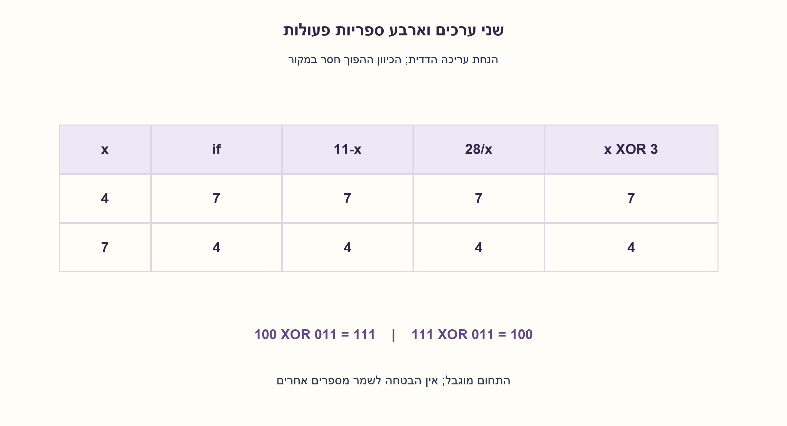
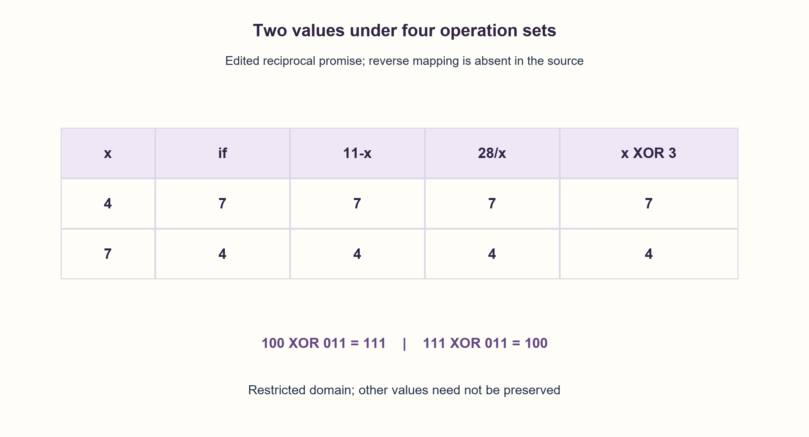

# PREP-119 — הרחבה מ־30.10.2026

הצעה בסיוע AI; ביקורת אנושית ממתינה.

[מקור פרטי](../sources/2026-10-30-batch70-03.png)

יש לך משתנה שמקבל את המספרים 4/7 כשהוא מקבל 4 הוא צריך להחזיר 7 וכשהוא מקבל 4 הוא צריך להחזיר 7, א. ממש בעזרת if ב. אסור בif מותר רק חיבור וחיסור ג. אסור חיבור וחיסור וif ד. לא ניתן להשתמש בכלום רק בxor.

## עברית

### הרחבה: מחליפים בין 4 ל־7 תחת ארבע ספריות פעולות
משתנה x מקבל רק 4 או 7. א. החזירו את הערך האחר בעזרת if. ב. ללא if, עם חיבור וחיסור בלבד. ג. ללא if, חיבור או חיסור. ד. באמצעות XOR בלבד.

במקור כתוב פעמיים 4→7 ולא כתובה הדרישה ההפוכה. המקור נשמר כלשונו; בעריכה נבחרה הכוונה ההדדית 4→7,7→4 לפי תחום הקלט ושאר הסעיפים. אם הכוונה המילולית היא רק 4→7, ההתנהגות עבור 7 אינה מוגדרת. מותרות קבועים, והגבלות כל סעיף הן עצמאיות. בסעיף ג נציג חלופה עם חלוקה שלמה מדויקת בתחום המובטח; אם גם חלוקה אינה מותרת זו דרישה נוספת, ו־XOR נשאר אפשרי אם הוא זמין. אין כאן החלפת שני משתנים כמו ב־PREP-077.

1. התחום כולל רק שני ערכים. אפשר לתכנן נוסחה שמחליפה אותם בלי להגדיר התנהגות לכל מספר אחר.
2. הסכום 4+7 והמכפלה 4·7 משותפים לשני הכיוונים. איך משתמשים בהם בחיסור או בחלוקה?
3. 4 XOR7 הוא 3. הפעלת XOR עם אותה מסכה פעמיים משחזרת את הקלט; בדקו גם 11−x וגם 28/x בתחום 4,7.

### כל סעיף מקבל פתרון תחת המגבלה שלו
א. if x==4 מחזיר 7, ואחרת מחזיר 4, בהסתמך על ההבטחה שהקלט חוקי. ב. ההפרש 11−x נותן 7 עבור 4 ו־4 עבור 7; אין תנאי ורק חיסור נדרש. ג. המכפלה של הערכים היא 28, לכן 28/x מחליף ביניהם. בשני הקלטים התוצאה שלמה בדיוק; בפייתון אפשר לכתוב 28//x ובשפת C עם טיפוס שלם 28/x. אין כאן חילוק באפס או טענת עיגול עבור קלטים אחרים. ד. המסכה 4 XOR7=100 XOR111=011, לכן x XOR3 נותן את הערך האחר.

שימו לב ש־4 ו־7 נבדלים בשני ביטים, בניגוד ל־9 ו־13 שבחלק המקורי ונבדלים בביט אחד. הזהות הכללית x XORa XOR b תקפה לשני ערכי תחום כלשהם. הפעלת כל אחת מהחלופות פעמיים מחזירה את x.

כל פתרון משתמש במספר קבוע של פעולות ומילות עזר בתחום קבוע, ללא טענת מינימום הוראות או מהירות. אין צורך לשנות את הגרסה המקורית 9/13, את קוד ה־XOR שלה או את שלושת הרמזים שלה. הוכנו כאן שלושה רמזים נפרדים בחומר המשלים בלבד. שמונה מקרי קלט/חלופה ושמונה בדיקות חזרה עברו, ובדיקת AST אימתה את איסורי התנאי והפעולות בשלושת הסעיפים המוגבלים.

```python
"""The edited promise is x in {4,7}; the repeated original 4->7 is archived."""


def conditional(x):
    if x == 4:
        return 7
    return 4


def addition_subtraction(x):
    return 11 - x


def without_add_subtract_if(x):
    # Exact on both legal inputs. No rounding occurs on the promised domain.
    return 28 // x


def xor_only(x):
    return x ^ 3
```




## English

### Extension: map4 and 7 under four operation sets
x is promised to be4 or7. A. Return the other value usingif. B. Noif, addition/subtraction only. C. Noif, addition or subtraction. D. XOR only.

The source repeats4→7 twice and omits the reverse rule. Preserve it verbatim; the edited task explicitly interprets the intended reciprocal map4→7,7→4 from its domain and parts. Under the literal text alone, behavior for 7 remains unspecified. Constants are allowed and each part has its own restrictions. ForC show integer division exact on the promised domain; forbidding division too would be an added restriction, andXOR works when available. This is not swapping two variables as inPREP-077.

1. Only two values are promised. The formula need not define a replacement rule for every integer.
2. Their sum4+7 and product4·7 are shared by both directions. How can subtraction or division use them?
3. 4 XOR7 equals 3, and applying the same XOR mask twice restores input. Also test 11−x and 28/x on4,7.

### Respect each part's own library
A. if x==4 returns7, otherwise4, using the legal-input promise. B.11−x returns7 for 4 and 4 for 7, with one subtraction and no branch. C. The values' product is 28, so28/x exchanges them. Both legal quotients are exact integers; Python can use28//x and integerC can use28/x. There is no zero divisor or claim about rounding on other inputs. D. The mask4 XOR7=100 XOR111=011, so x XOR3 returns the other value.

Unlike9/13 in the original part,4/7 differ in two bits. The general identity x XORa XOR b still toggles any promised pair. Applying any proposed map twice restoresx.

Each method has fixed operation/auxiliary-word cost on the fixed domain, without minimum-instruction or speed claims. Original9/13 text, code and hints remain intact. Three separate variant hints are supplemental only. All eight input/method cases and eight involution checks passed; AST checks verified the three restricted implementations' branch/operator limits.

```python
"""The edited promise is x in {4,7}; the repeated original 4->7 is archived."""


def conditional(x):
    if x == 4:
        return 7
    return 4


def addition_subtraction(x):
    return 11 - x


def without_add_subtract_if(x):
    # Exact on both legal inputs. No rounding occurs on the promised domain.
    return 28 // x


def xor_only(x):
    return x ^ 3
```




```json
{
  "assumptions": {
    "he": [
      "x מובטח להיות 4 או 7; הקבועים מותרים.",
      "כפל/חלוקה מותרים בסעיף ג; XOR בלבד בסעיף ד.",
      "תיקון הכוונה ההדדית מסומן בגלל הכפילות במקור."
    ],
    "en": [
      "x is promised4/7; constants allowed.",
      "Division is allowed inC; XOR only inD.",
      "The reciprocal interpretation explicitly resolves repeated source wording."
    ]
  },
  "optimality": {
    "he": "O(1) פעולות בתחום קבוע, ללא טענת מינימום.",
    "en": "O(1) operations on a fixed domain, no minimum claim."
  },
  "verification": {
    "he": "8 מקרי קלט/חלופה,8 בדיקות הפעלה כפולה,3 בדיקות AST.",
    "en": "Eight input/method cases, eight involutions, threeAST restriction checks."
  },
  "edge_cases": {
    "he": [
      "4→7 ו־7→4.",
      "אין קלט 0 לפי ההבטחה; אין הרחבה סמויה לכל השלמים."
    ],
    "en": [
      "4→7 and 7→4.",
      "Zero is excluded; no silent extension to all integers."
    ]
  },
  "common_mistakes": {
    "he": [
      "שימוש ב־if בסעיף שאוסר אותו.",
      "מסכה 4 הישנה של 9/13 במקום 3.",
      "הנחה שהמקור כתב במפורש 7→4."
    ],
    "en": [
      "Usingif in a no-branch part.",
      "Reusing the 9/13 mask4 instead of 3.",
      "Claiming the source explicitly supplied7→4."
    ]
  },
  "interview_answer": {
    "he": "לסעיפי if, חיסור, ללא חיסור ו־XOR אתן בהתאמה תנאי,11−x,28/x, x XOR3, תחת הבטחת הקלט 4/7.",
    "en": "Forif, subtraction, no-subtraction andXOR use a branch,11−x,28/x andx XOR3 under the 4/7 promise."
  },
  "source_ambiguities": {
    "he": [
      "המקור חוזר על אותו כיוון פעמיים; ההשלמה ההדדית היא הנחת עריכה.",
      "Intel מדווחת בצילום בלבד."
    ],
    "en": [
      "The source repeats one direction; reciprocal mapping is an editorial assumption.",
      "Intel is source-reported only."
    ]
  },
  "solution_extensions": {
    "he": [
      {
        "question": "מה משתנה אם צריך לשמר כל מספר אחר?",
        "answer_direction": "הנוסחאות הכלליות עשויות לשנות ערכים אחרים. דרושה בדיקת חברות בתחום או מנגנון מסכה מתאים, והיא כפופה לספריית הפעולות החדשה.",
        "principle": "הבטחת תחום מפשטת את הבעיה."
      }
    ],
    "en": [
      {
        "question": "What if every other value must stay unchanged?",
        "answer_direction": "These formulas can change other inputs. Add membership checking or an appropriate mask under the newly defined library.",
        "principle": "A domain promise is a useful constraint."
      }
    ]
  }
}
```
