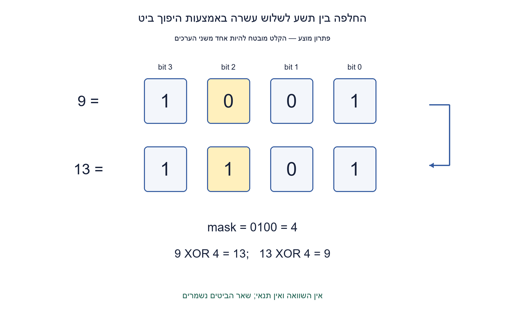
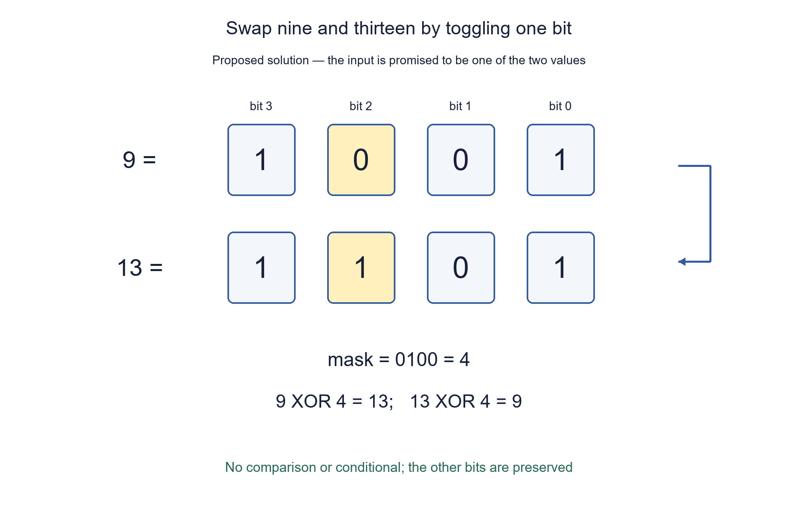

# PREP-119 — החלפה בין 9 ל־13 ללא if או else

פתרון מוצע בסיוע AI. ביקורת מקצועית אנושית ממתינה; הקושי לא כויל.

## מקור

[צילום מקורי](../sources/2026-10-24-batch30-05.png)

צריך לממש פונקציה שמקבלת 9 או 13. אם מקבלת 9 מוציאה 13 ואם מקבלת 13 מוציאה 9. צריך לממש ללא if,else

חברות מדווחות מהצילום בלבד, ללא אימות עצמאי: Apple, Intel, Amazon

## החלפה בין 9 ל־13 ללא if או else

ממשו פונקציה שמקבלת מספר שלם x המובטח להיות 9 או 13. אם x=9 עליה להחזיר 13, ואם x=13 עליה להחזיר 9. אסור להשתמש ב־if, ב־else או בביטוי תנאי. הסבירו מדוע המימוש עובד, והציגו אותו גם ברמת הביטים.

הבהרות: מותרות פעולות ביטים, לרבות XOR. אין דרישה לשמר קלטים אחרים, לאמת אותם או להחליף שני משתנים. הדומיין המצומצם הוא הבטחה מהמקור. מימוש בשערים הוא הרחבה לצורך ההסבר, ולא דרישה שהופיעה בצילום.

### שלושה רמזים

1. כתבו את שני המספרים בבינארי זה מעל זה. האם כל הביטים שלהם שונים?
2. פעולת XOR עם 1 הופכת ביט, ועם 0 משאירה אותו. איזו מסכה הופכת בדיוק את המקומות שבהם המספרים שונים?
3. המסכה היא 9 XOR 13, כלומר 4. בצעו XOR של הקלט עם המסכה; הפעולה הפיכה ומבטלת את עצמה בהפעלה כפולה.

### פתרון מוצע

### מזהים את הביט היחיד שמשתנה
ארבע הספרות הבינאריות הן 9=1001 ו־13=1101. רק ביט מספר 2, שמשקלו 4 כשהמספור מתחיל באפס, שונה. שאר הביטים צריכים להישאר בדיוק כפי שהם.

XOR עם 0100 הופך את ביט 2 ומשאיר את האחרים. לכן המימוש הוא `return x ^ 4`. אין צורך לבדוק איזה משני המספרים התקבל: אותה פעולה מעבירה כל אחד מהם לשני.

| קלט | XOR עם המסכה | פלט |
| --- | --- | --- |
| 1001 = 9 | 0100 = 4 | 1101 = 13 |
| 1101 = 13 | 0100 = 4 | 1001 = 9 |

### למה אותה פעולה עובדת בשני הכיוונים?
אם נגדיר mask=9 XOR 13, אז 9 XOR mask=9 XOR 9 XOR 13=13, ובאופן סימטרי נקבל 9 עבור קלט 13. השתמשנו בקיבוציות, חילופיות ו־a XOR a=0. הפעלה כפולה מחזירה את הקלט: (x XOR mask) XOR mask=x.

זהו גם נימוק כללי: עבור שני ערכים קבועים a,b וקלט שמובטח להיות אחד מהם, x XOR a XOR b מחליף ביניהם. ההבטחה חשובה: למשל 8 XOR 4 נותן 12, ולא משאיר את 8 ללא שינוי. זו אינה פונקציית החלפה כללית שמשאירה את כל המספרים האחרים כפי שהם. היא גם אינה תרגיל החלפת שני משתנים ללא משתנה עזר.

### פירוש כשערים ועלות
עבור קלט בן ארבעה ביטים, אפשר להפוך את x2 ולחבר את שאר הביטים ישירות למוצא. זהו פירוש של מסכת XOR קבועה, לא ארבעה שערי XOR הכרחיים. אין טענת מינימום שטח בספריית תאים. על מילת מכונה פעולת XOR היא מספר קבוע של פעולות ו־O(1) מקום עזר; ב־Python מספרים ענקיים היו מוסיפים עלות לפי רוחבם, אך בקלט הנתון יש רק שני ערכים קטנים.

### מה נבדק?
שני הקלטים החוקיים נבדקו מול טבלת הדרישה. להכללה נבדקו כל 65,536 זוגות ערכי בית, בשני כיווני המיפוי, בסך 131,072 בדיקות. בדיקה מבנית מאמתת שאין תנאי בקוד הראשי. הבדיקות אינן מרחיבות את דומיין ההבטחה של הפונקציה ל־9/13 ואינן מוכיחות מספר הוראות מינימלי.

```python
"""Domain promise: x is 9 or 13. No conditionals or validation branches."""


def toggle_nine_thirteen(x):
    return x ^ 4


def toggle_pair(x, first, second):
    """Generalization requires x in {first, second}; not a general replacement."""
    return x ^ first ^ second
```



## Map 9 to 13 and 13 to 9 without conditionals

Implement a function on an integer x promised to be either 9 or 13. Return 13 for 9 and 9 for 13, without if, else or a conditional expression. Explain correctness and the bit-level transformation.

Clarifications: bitwise operations, including XOR, are allowed. There is no requirement to preserve other values, validate them or swap two separate variables. The restricted domain is promised by the source. A gate-level interpretation is an explanatory extension, not a source requirement.

### Three hints

1. Write both numbers in binary, one above the other. Do all their bits differ?
2. XOR with one toggles a bit; XOR with zero preserves it. Which mask toggles exactly the differing positions?
3. The mask is 9 XOR 13, namely 4. XOR the input with this mask; applying the same transformation twice cancels it.

### Proposed solution

### Find the one differing bit
The four-bit representations are 9=1001 and 13=1101. Only bit 2, with weight 4 using zero-based indexing, differs. All other bits must remain unchanged.

XOR with 0100 toggles bit 2 and preserves the rest. Thus use `return x ^ 4`. There is no need to test which input arrived: the same operation maps either number to the other.

| Input | XOR mask | Output |
| --- | --- | --- |
| 1001 = 9 | 0100 = 4 | 1101 = 13 |
| 1101 = 13 | 0100 = 4 | 1001 = 9 |

### Why does it work in both directions?
Let mask=9 XOR 13. Then 9 XOR mask=9 XOR 9 XOR 13=13; the symmetric calculation gives 9 for input 13. XOR is associative and commutative, and a XOR a=0. Applying the transformation twice restores the input: (x XOR mask) XOR mask=x.

More generally, x XOR a XOR b swaps any two fixed values a,b when x is promised to be one of them. The promise matters: 8 XOR 4 gives 12, rather than preserving 8. This is not a general replacement function that leaves all other integers unchanged, nor is it swapping two variables without a temporary.

### Gate interpretation and cost
For a four-bit input, invert x2 and wire the other bits straight through. This is the constant-mask XOR interpretation, not a claim that four XOR cells are necessary. No minimum physical cell area is claimed. In a machine-word model, XOR and auxiliary storage are constant cost. Arbitrary-precision Python integers would introduce width-dependent cost, but the actual contract contains only two small integers.

### Verification
Both legal inputs were checked against the required table. The generalized form was checked on all 65,536 pairs of byte values in both directions, giving 131,072 assertions. A structural check rejects conditionals in the primary implementation. These checks neither expand its promised 9/13 domain nor prove a universal minimum instruction count.

```python
"""Domain promise: x is 9 or 13. No conditionals or validation branches."""


def toggle_nine_thirteen(x):
    return x ^ 4


def toggle_pair(x, first, second):
    """Generalization requires x in {first, second}; not a general replacement."""
    return x ^ first ^ second
```



## חומר משלים / Supporting material

```json
{
  "assumptions": {
    "he": [
      "x הוא מספר שלם המובטח להיות 9 או 13.",
      "XOR מותר; אין תנאי או ביטוי תנאי.",
      "אין דרישה לשמור על קלטים שאינם בדומיין."
    ],
    "en": [
      "x is an integer promised to be 9 or 13.",
      "XOR is permitted; conditionals and conditional expressions are forbidden.",
      "Other input values need not be preserved."
    ]
  },
  "optimality": {
    "he": "פעולת XOR אחת עם מסכה קבועה מספיקה. אין טענת מינימום הוראות לכל מעבד או מינימום שערים לספרייה פיזית.",
    "en": "One XOR with a fixed mask suffices. No processor-independent minimum instruction count or physical gate minimum is claimed."
  },
  "edge_cases": {
    "he": [
      "שני הקלטים החוקיים 9 ו־13.",
      "הפעלה כפולה מחזירה את הקלט.",
      "קלט אחר אינו מובטח להישאר ללא שינוי."
    ],
    "en": [
      "Both legal inputs, 9 and 13.",
      "Applying the function twice restores the input.",
      "Other inputs are not guaranteed unchanged."
    ]
  },
  "common_mistakes": {
    "he": [
      "להשתמש ב־OR עם 4: הוא משנה 9 ל־13 אבל משאיר את 13.",
      "להשתמש ב־AND שמכבה ביט בלי להחזירו בכיוון ההפוך.",
      "לבלבל את הבעיה עם החלפת שני משתנים או לדרוש בדיקת קלט שלא התבקשה."
    ],
    "en": [
      "OR with 4 changes 9 to 13 but leaves 13 unchanged.",
      "AND may clear a bit but does not set it in the reverse direction.",
      "Confusing the task with swapping two variables or inventing a validation requirement."
    ]
  },
  "interview_answer": {
    "he": "9 ו־13 שונים רק בביט שמשקלו 4. XOR עם 4 הופך אותו בשני הכיוונים, ולכן מחזירים x^4. ההבטחה שקלט הוא אחד משניהם חיונית.",
    "en": "9 and 13 differ only at the bit of weight 4. XOR with 4 toggles it in both directions, so return x^4. The two-value domain promise is essential."
  },
  "source_ambiguities": {
    "he": "המקור אינו קובע שפת תכנות או עלות מינימלית. הותר XOR במפורש בעריכה; קלטים אחרים נשארים מחוץ לחוזה המקורי.",
    "en": "The source does not specify a language or minimum cost. XOR permission is explicit in the edited contract; other inputs remain outside the original promise."
  },
  "verification": {
    "he": "שני מקרי הדרישה ו־131,072 כיווני מיפוי של ההכללה נבדקו בפייתון. בדיקת AST בודקת היעדר תנאי בפונקציה הראשית; לא בוצע ניסוי חומרה.",
    "en": "Both required cases and 131,072 generalized directional mappings were checked in Python. An AST check verifies no conditional in the primary function; no hardware experiment was performed."
  },
  "solution_extensions": {
    "he": {
      "question": "איך מחליפים בין שני ערכים קבועים a,b כשהקלט מובטח להיות אחד מהם?",
      "direction": "השתמשו במסכה a XOR b. ההוכחה מבטלת את העותק הכפול של הקלט. אם דורשים לשמר מספרים אחרים, זהו חוזה נוסף שדורש זיהוי חברות בדומיין."
    },
    "en": {
      "question": "How do you swap any fixed a,b when input is promised to be one of them?",
      "direction": "Use mask a XOR b. Correctness cancels the repeated input. Preserving all other numbers is a different contract requiring domain membership detection."
    }
  }
}
```
