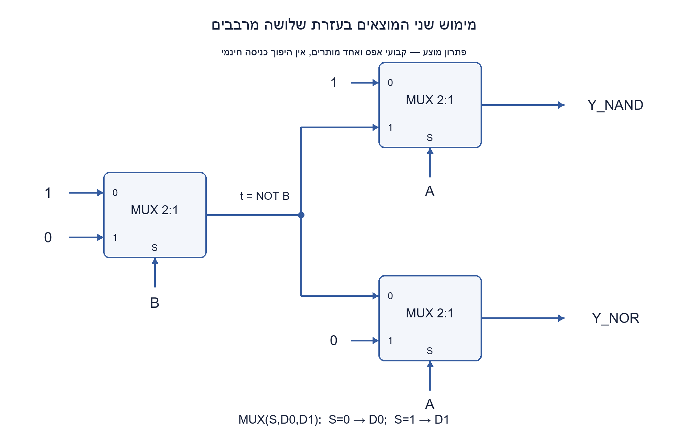
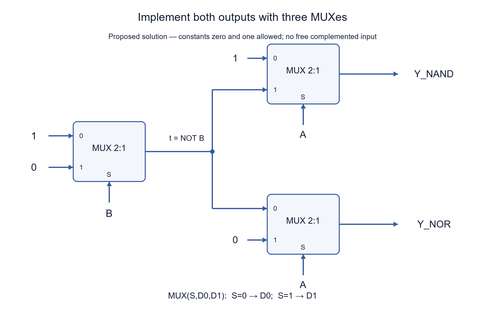

# PREP-120 — מימוש NAND ו־NOR באמצעות מרבבי 2:1

פתרון מוצע בסיוע AI. ביקורת מקצועית אנושית ממתינה; הקושי לא כויל.

## מקור

[צילום מקורי](../sources/2026-10-24-batch30-08.png)

נדרש לתכנן שער NAND ו-NOR על ידי MUX 2:1

חברות מדווחות מהצילום בלבד, ללא אימות עצמאי: NVIDIA

## מימוש NAND ו־NOR באמצעות מרבבי 2:1

תכננו עבור כניסות ביט A,B שער NAND ושער NOR בעזרת מרבבי 2:1. הגדירו את חיבורי ה־select והנתונים, הציגו טבלת אמת ונמקו. אחר כך בדקו אם אפשר לשתף רכיב כאשר שני המוצאים נדרשים יחד.

מודל שנוסף במפורש למקור: MUX(S,D0,D1) מחזיר D0 כש־S=0 ו־D1 כש־S=1. נתונים רק A,B שאינם מהופכים וקבועי 0,1; מותר חיווט, פיצול אות וכניסות קשורות. אין מהפך חינמי, שער נוסף, משוב או אחסון. מותרות יחידות MUX נוספות לפי הצורך. הדרישה המקורית אינה קובעת מינימום או היתר לקבועים, ולכן יש להסביר איך התוצאה משתנה אם B מהופך זמין מראש או אם רק אפס מותר.

### שלושה רמזים

1. בחרו ב־A כ־select והסתכלו על השורות שבהן A=0 ועל השורות שבהן A=1. איזה אות צריכה כל כניסת נתונים להעביר?
2. ב־NAND, כאשר A=0 התוצאה תמיד 1; כאשר A=1 היא NOT B. ב־NOR הסדר הוא NOT B ואז 0.
3. צרו NOT B בעזרת MUX עם select=B, נתוני 1 ו־0. חברו את אותו פלט ביניים לשני מרבבי המוצא, עם A כ־select.

### פתרון מוצע

### מרבב הוא שתי שורות של טבלה
כאשר A הוא select, כניסת D0 צריכה להכיל את הפונקציה הדרושה עבור A=0, ו־D1 את הפונקציה עבור A=1. כך מתכננים את החיבורים מתוך הדרישה, בלי לנחש.

| A | B | NAND | NOR |
| --- | --- | --- | --- |
| 0 | 0 | 1 | 1 |
| 0 | 1 | 1 | 0 |
| 1 | 0 | 1 | 0 |
| 1 | 1 | 0 | 0 |

ל־NAND, כש־A=0 בוחרים 1, וכש־A=1 בוחרים NOT B. ל־NOR, כש־A=0 בוחרים NOT B, וכש־A=1 בוחרים 0.

### איך יוצרים את ההיפוך בלי מהפך נוסף?
מרבב שמקבל select=B, ‏D0=1 ו־D1=0 מחזיר בדיוק NOT B. כעת נבנה:

```text
t      = MUX(B, 1, 0)    # NOT B
Y_NAND = MUX(A, 1, t)
Y_NOR  = MUX(A, t, 0)
```

עבור כל שער בנפרד דרושים שני MUX — אחד להיפוך ואחד לבחירת התוצאה. כשהמוצאים נבנים יחד, משתפים את t ונדרשים שלושה בסך הכול, לא ארבעה. שני המרבבים האחרונים מקבלים את אותו A ואת אותו אות ביניים, אך חיבורי D0,D1 שלהם שונים. אין שעון או מחזורי חישוב; זהו מעגל קומבינטורי.

### נכונות ומינימום במודל שהוגדר
הפירוק לפי A נותן את כל ארבע השורות: ב־A=0 מתקבלים 1 ו־NOT B; ב־A=1 מתקבלים NOT B ו־0. זו בדיוק הטבלה.

למה שער יחיד לא מספיק כשאין כניסות מהופכות? מרבב יחיד רשאי לחבר כל אחד משלושת פינים שלו ל־A,B,0,1 — סך הכול 4³=64 אפשרויות, כולל select קבוע וכניסות קשורות. מיצוי כל טבלאות האמת שלהן נותן 12 פונקציות שונות, אך לא NAND ולא NOR. גם חוט או קבוע ישיר אינם אף אחד מהיעדים. לכן שניים הם מינימום לכל יעד בנפרד.

לשני המוצאים יחד, שני מרבבים אינם מספיקים: ברשת חסרת מחזורים השער הראשון תלוי רק בכניסות הראשוניות, ולכן אינו יכול להיות אף אחד משני היעדים. השער השני יכול להפיק מוצא אחד בלבד, ואילו השניים שונים. הבנייה בשלושה משיגה את החסם במודל הזה. זו אינה טענת מינימום שטח או השהיה בספריית תאים פיזית.

### מדוע הגבלות המקור חשובות?
אם NOT B כבר נתון, כל יעד דורש רק את מרבב המוצא שלו; עלות יצירת ההיפוך אינה נעלמת אלא הוצאה מהמודל. אם מותר מהפך נוסף, אפשר לשתף מהפך בין שני מרבבים, אבל אז זו ספרייה אחרת.

אם מותר רק קבוע אפס ו־A,B ללא היפוך, אף רשת MUX קומבינטורית חסרת מחזורים אינה יכולה לייצר NAND או NOR: עבור A=B=0 כל האותות הראשוניים הם אפס, וכל מרבב בוחר בין אפסים. באינדוקציה כל מוצא אפס, בניגוד ל־1 הנדרש. זו מגבלה אחרת מהגרסה הראשית שמתירה גם 1. ההנחות נאמרות במפורש במקום להוסיף מהפך או קבוע שאינם מותרים בשקט.

### היקף הבדיקה
נבדקו כל ארבע שורות המימוש מול אורקל בוליאני עצמאי, וכל 64 אפשרויות חיווט של מרבב יחיד. הקוד ממדל את משמעות מרבב בסיסי ואז מחבר שלושה כאלה; בדיקות טיפוס בקוד אינן שערים שהוספו למעגל. לא בוצעו HDL, סינתזה או ניתוח תזמון פיזי.

```python
"""Gate-only stable two-state MUX construction with constants 0 and 1 allowed."""


def bit(value):
    if type(value) is not int or value not in (0, 1):
        raise ValueError("expected integer bit")
    return value


def mux(select, data0, data1):
    select, data0, data1 = map(bit, (select, data0, data1))
    return ((select ^ 1) & data0) | (select & data1)


def nand_nor(a, b):
    """Return (NAND, NOR); three MUXes share the complemented B signal."""
    a, b = bit(a), bit(b)
    not_b = mux(b, 1, 0)
    return mux(a, 1, not_b), mux(a, not_b, 0)
```



## NAND and NOR using only 2:1 MUXes

Design NAND and NOR for bit inputs A,B using 2:1 multiplexers. Specify select and data connections, give a truth table and justify them. Then consider sharing a component when both outputs are needed together.

Explicit added model: MUX(S,D0,D1) returns D0 for S=0 and D1 for S=1. Only uncomplemented A,B and constants 0,1 are available. Wires, fan-out and tied inputs are allowed. There is no free inverter, other gate, feedback or storage. Additional MUX instances may be used. The source does not specify a minimum or constant permission; explain the alternatives if complemented B is supplied or only zero is permitted.

### Three hints

1. Choose A as select and separate the A=0 and A=1 rows. What should each data input supply?
2. For NAND, A=0 requires one and A=1 requires NOT B. For NOR the required data values are NOT B then zero.
3. Generate NOT B using a MUX selected by B with data 1 and 0. Share this intermediate signal between the two output MUXes selected by A.

### Proposed solution

### A MUX represents two cases
With A as select, D0 must supply the function needed for A=0, and D1 the function needed for A=1. Derive the connections from the table rather than guessing.

| A | B | NAND | NOR |
| --- | --- | --- | --- |
| 0 | 0 | 1 | 1 |
| 0 | 1 | 1 | 0 |
| 1 | 0 | 1 | 0 |
| 1 | 1 | 0 | 0 |

For NAND, choose one when A=0 and NOT B when A=1. For NOR, choose NOT B when A=0 and zero when A=1.

### Generate the complement using another MUX
A MUX selected by B with D0=1,D1=0 returns NOT B. Thus:

```text
t      = MUX(B, 1, 0)    # NOT B
Y_NAND = MUX(A, 1, t)
Y_NOR  = MUX(A, t, 0)
```

Each output by itself uses two MUXes, one for the complement and one for output selection. Building both together shares t, giving three total rather than four. The two output MUXes use the same A and intermediate signal but different data-pin connections. This is combinational logic, not clocked computation.

### Correctness and the stated minimum
Splitting on A covers all rows: A=0 yields one and NOT B, whereas A=1 yields NOT B and zero. These are exactly the required truth tables.

A single MUX may wire each of its three pins to A,B,0,1: 4³=64 choices, including fixed selects and tied inputs. Exhausting their truth tables produces 12 distinct functions, but neither NAND nor NOR. A direct wire or constant is not either target. Two MUXes are therefore minimal per output in the stated library.

Two MUXes cannot supply both targets together. In an acyclic network the first gate uses only primary inputs, so cannot be either target. The remaining gate provides at most one output function, while NAND and NOR are different. Three attain this lower bound. This is not a minimum physical cell-area or delay claim.

### Input availability changes the count
If NOT B is supplied, each target needs only its output MUX. The complement's cost has been excluded, not eliminated. Allowing a separate inverter gives another library: one shared inverter and two MUXes.

If only zero and uncomplemented A,B are available, no finite acyclic MUX-only network can produce either target. At A=B=0 every initial signal is zero, and every MUX selects between zeros. Induction keeps every output zero, contradicting the required one. The primary contract explicitly permits constant one as well. Do not silently introduce a forbidden complement or constant.

### Verification scope
All four construction rows matched an independent Boolean oracle; all 64 single-MUX wiring choices were exhausted. The code defines the primitive's semantics, then connects three primitives. Its type checks are not added hardware gates. No HDL, synthesis or physical timing analysis was performed.

```python
"""Gate-only stable two-state MUX construction with constants 0 and 1 allowed."""


def bit(value):
    if type(value) is not int or value not in (0, 1):
        raise ValueError("expected integer bit")
    return value


def mux(select, data0, data1):
    select, data0, data1 = map(bit, (select, data0, data1))
    return ((select ^ 1) & data0) | (select & data1)


def nand_nor(a, b):
    """Return (NAND, NOR); three MUXes share the complemented B signal."""
    a, b = bit(a), bit(b)
    not_b = mux(b, 1, 0)
    return mux(a, 1, not_b), mux(a, not_b, 0)
```



## חומר משלים / Supporting material

```json
{
  "assumptions": {
    "he": [
      "מרבבים לא־מהפכים בעלי select יחיד; S=0 בוחר D0.",
      "A,B וקבועי 0,1 זמינים; כניסות מהופכות אינן חינם.",
      "רשת קומבינטורית חסרת מחזורים; מותר פיצול ושימוש חוזר בפלט ביניים."
    ],
    "en": [
      "Noninverting single-select MUXes; S=0 selects D0.",
      "A,B and constants 0,1 available; complemented inputs not free.",
      "Acyclic combinational network; fan-out and sharing intermediate outputs permitted."
    ]
  },
  "optimality": {
    "he": "שני MUX מינימליים לכל שער בנפרד; שלושה לשני המוצאים עם היפוך משותף. מיצוי 64 חיבורים שולל שער יחיד; נימוק השער הראשון שולל שניים לשני המוצאים יחד.",
    "en": "Two MUXes are minimal per target; three for both outputs sharing a complement. Exhausting 64 pin assignments excludes one; the first-gate argument excludes two for both outputs."
  },
  "edge_cases": {
    "he": [
      "כל ארבע שורות A,B, בפרט 00 שמחייב 1 בשני המוצאים.",
      "ל־NAND ול־NOR חיבורי נתונים שונים למרות select משותף.",
      "היתר להיפוך חינמי או לקבוע אחד בלבד משנה את המודל."
    ],
    "en": [
      "All four A,B rows, especially 00 requiring one at both outputs.",
      "NAND and NOR have different data connections despite the shared select.",
      "A free complement or only one permitted constant changes the model."
    ]
  },
  "common_mistakes": {
    "he": [
      "להחליף D0 ו־D1 בלי לשנות את הגדרת select.",
      "לצייר NOT B שמגיע משום מקום בלי לספור את יצירתו.",
      "לספור ארבעה מרבבים כשההיפוך ניתן לשיתוף, או לטעון שאחד מספיק כשאין כניסה מהופכת."
    ],
    "en": [
      "Swapping D0,D1 while keeping the select convention.",
      "Drawing NOT B without counting its generation.",
      "Counting four MUXes despite sharing, or claiming one suffices without a complemented input."
    ]
  },
  "interview_answer": {
    "he": "מייצרים t=NOT B באמצעות MUX(B,1,0). אחר כך NAND הוא MUX(A,1,t) ו־NOR הוא MUX(A,t,0). שניים לכל אחד בנפרד, או שלושה יחד כשמשתפים t.",
    "en": "Generate t=NOT B using MUX(B,1,0). NAND is MUX(A,1,t); NOR is MUX(A,t,0). Each alone takes two, or both share t for three total."
  },
  "source_ambiguities": {
    "he": "המקור אינו מגדיר קבועים, כניסות מהופכות, מלאי מרבבים או דרישת מינימום. המודל הראשי והחלופות מוגדרים במפורש; זה אינו אילוץ ״רק אפס״ של 031.",
    "en": "The source omits constants, complemented inputs, available MUX count and minimum requirements. The primary model and alternatives are explicit; this is not PREP-031's zero-only constraint."
  },
  "verification": {
    "he": "כל ארבע השורות וכל 64 חיבורי המרבב היחיד נבדקו בפייתון; נמצאו 12 פונקציות שונות, ללא NAND/NOR. הוכחת מינימום לשני מוצאים היא נימוק מבני נפרד.",
    "en": "All four rows and 64 single-MUX wirings were executed in Python, yielding 12 distinct functions without NAND/NOR. The two-output lower bound is a separate structural argument."
  },
  "solution_extensions": {
    "he": {
      "question": "האם אפשר לבנות אחד מהשערים אם מותר רק קבוע 0 וללא כניסות מהופכות?",
      "direction": "לא ברשת חסרת מחזורים: ב־A=B=0 כל אות התחלתי הוא אפס, וכל מרבב ישמור על אפס. שני היעדים דורשים דווקא 1 בקלט הזה."
    },
    "en": {
      "question": "Can either target be built with only zero and no complemented inputs?",
      "direction": "Not in an acyclic network: at A=B=0 every starting signal is zero, and every MUX preserves zero. Both targets require one at that input."
    }
  }
}
```


## מקור נוסף — 30.10.2026, מקבץ40, צילום 5

[צילום פרטי](../sources/2026-10-30-batch40-05.png)

זהו מקור נוסף לשאלה הקיימת; הגרסה והתוכן הטכני נשמרו ללא שינוי.
