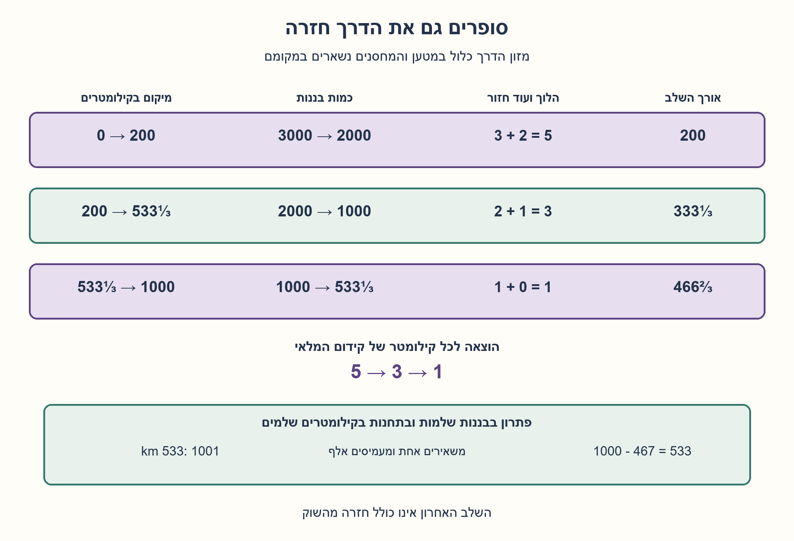
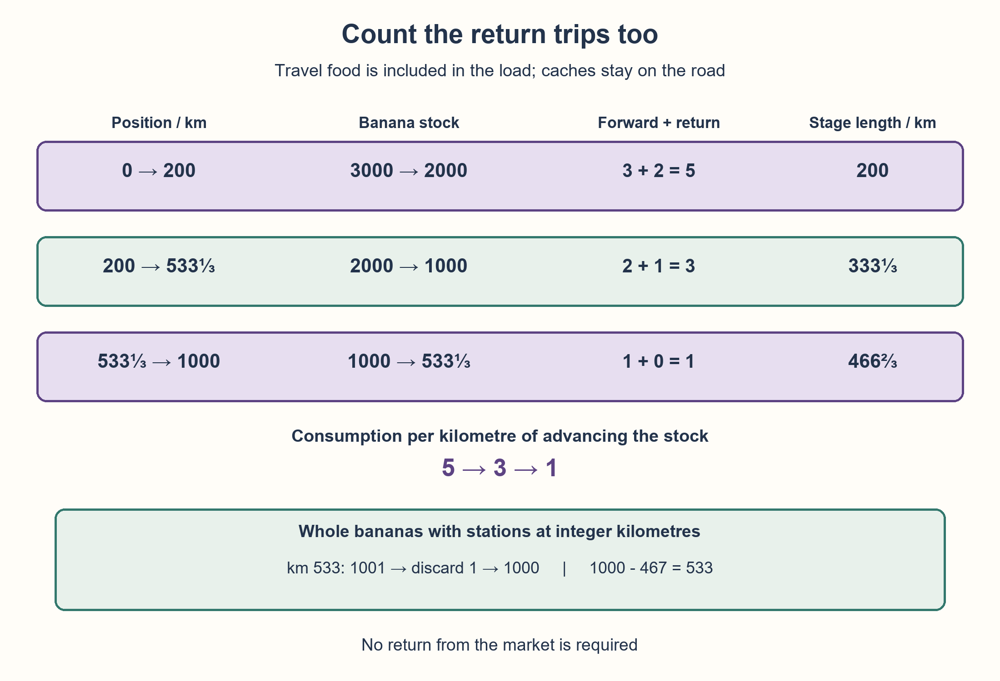

# PREP-121 — הגמל והבננות — מתכננים מחסנים וסופרים גם חזרות

פתרון מוצע בסיוע AI; ביקורת מקצועית ותרגום ממתינות. קושי אינו מכויל.

## מקור שמור / Archived source

[צילום מקור](../sources/2026-10-25-batch11-05.png)

סוחר רוצה להעביר את 3000 הבננות שלו לשוק הנמצא 1000 ק״מ מהן. לשם כך הוא משתמש בגמל שלו, שיכול לסחוב 1000 בננות לכל היותר בכל פעם, ואוכל בננה אחת בכל קילומטר שעובר. מהו מקסימום הבננות שיוכל הסוחר להעביר לשוק?

חברות מדווחות מהצילום בלבד / Companies reported by the supplied image only: Mellanox, Apple

## הגמל והבננות — מתכננים מחסנים וסופרים גם חזרות

לסוחר 3000 בננות ושוק במרחק 1000 ק״מ לאורך דרך אחת. גמל אחד נושא לכל היותר 1000 בננות בכל רגע ואוכל בננה אחת לכל קילומטר שהוא הולך. מהו מספר הבננות המרבי שניתן למסור בשוק? הסבירו איך מבצעים את ההעברה ומדוע אי אפשר לשפר אותה.

הבהרות שנוספו למקור: הגמל אוכל גם בדרך חזרה; בננות המזון נכללות בקיבולת 1000, ואין מזון חיצוני. מותר להפקיד, לאסוף ולהשאיר בננות במחסנים בכל נקודה בדרך, ללא קלקול, אובדן או עלות העמסה. כל 3000 הבננות מתחילות בנקודת היציאה, ויש רק גמל אחד. אין צורך להחזירו מהשוק בסיום.

נתחו שתי גרסאות בנפרד: א. מודל רציף אידאלי, שבו מותר לחלק בננות ולבחור מרחקי תחנות שבריים; ב. בננות שלמות ותחנות בקילומטרים שלמים, עם צריכת בננה אחת בכל קילומטר בכל כיוון. בגרסה ב׳ תנו תוכנית שלמה שמגיעה לתוצאה, ולא רק עיגול של תשובת א׳. המקור אינו קובע במפורש את מדיניות השברים או את רשות המחסנים.

### שלושה רמזים

1. אי אפשר להשאיר את הגמל בשוק אחרי כל מטען, כי צריך להביא גם את השאר. חשבו כמה מעברים, כולל חזרות, נדרשים כדי לקדם את כל המלאי קילומטר אחד.
2. כאשר דרושים שלושה מטענים יש שלוש הליכות קדימה ושתי חזרות. מתי כמות הבננות קטנה מספיק כדי להסתפק בשני מטענים, ואז באחד?
3. העלות לכל קילומטר קידום היא 5, אחר כך 3 ואחר כך 1. חשבו מרחק עד שנותרות 2000, ואז עד 1000. לגרסה השלמה בדקו תחנה בקילומטר 533, את מספר הבננות בה ואת הדלק הנדרש לסיום.

### הצעה לפתרון

### הרעיון: משלמים על מספר המעברים, לא רק על המרחק לשוק
הגמל יכול לשאת רק שליש מהמלאי. כדי לקדם שלושה מטענים לאותה תחנה, הוא הולך אליה שלוש פעמים וחוזר פעמיים להביא את המטען הבא. לכן קידום כל המלאי בקילומטר עולה חמש בננות. גם החזרות אוכלות בננות, והאוכל חייב להיות על הגמל בתוך הקיבולת.

כאשר נשארות 2000 בננות, די בשתי הליכות קדימה וחזרה אחת: העלות יורדת לשלוש בננות לכל קילומטר קידום. כאשר נשארות 1000, אין עוד חזרה ונדרשת בננה אחת לקילומטר. לכן כדאי לצמצם את מספר המטענים בדיוק כשמגיעים לספי הקיבולת.

### א. התוכנית הרציפה
1. משלוש הליכות קדימה ושתי חזרות מקבלים עלות 5 לק״מ. כדי לרדת מ־3000 ל־2000 אוכלים 1000, ולכן מקדמים את המחסן 1000/5=200 ק״מ.
2. שתי הליכות קדימה וחזרה אחת עולות 3 לק״מ. כדי לרדת מ־2000 ל־1000 אוכלים עוד 1000, ולכן מתקדמים 1000/3=333⅓ ק״מ. המחסן השני נמצא בקילומטר 533⅓.
3. נשארו 466⅔ ק״מ לשוק. מעמיסים את כל 1000 הבננות פעם אחת, אוכלים 466⅔ ומוסרים **533⅓ בננות**.

| תחילת השלב | סופו בק״מ | מלאי בתחילה | מלאי בסוף | הלוך + חזור |
| --- | --- | --- | --- | --- |
| 0 | 200 | 3000 | 2000 | 3+2 |
| 200 | 533⅓ | 2000 | 1000 | 2+1 |
| 533⅓ | 1000 | 1000 | 533⅓ | 1+0 |

### איך מבצעים את ההליכות בלי לחרוג מהקיבולת?
בשלב הראשון, מעמיסים 1000 והולכים 200 ק״מ. נותרו על הגמל 800. מפקידים 600 ושומרים 200 לאכילה בחזרה. חוזרים לנקודת ההתחלה ומגיעים עם אפס על הגמל. עושים זאת שוב: במחסן יש כעת 1200. לבסוף מביאים את המטען השלישי: 1000 פחות 200 מזון הם 800, כך שבמחסן יש בדיוק 2000 והגמל נמצא בו.

בשלב השני, שאורכו 333⅓ ק״מ, מביאים מטען של 1000; אחרי הדרך נותרו 666⅔. מפקידים 333⅓ ושומרים 333⅓ לחזרה. חוזרים ומביאים את המטען השני; ממנו נותרות 666⅔. יחד במחסן החדש יש בדיוק 1000. התוכנית משתמשת בתשעה קטעי הליכה בסך הכול: חמישה, שלושה ואחד. בכל קטע המטען אינו עולה על 1000 ויש בו מספיק מזון עד התחנה הבאה.

### למה שום פיזור מחסנים מתוחכם אינו משפר זאת?
צריך חסם לכל תוכנית, ולא רק להראות שהתוכנית שלנו עובדת. דמיינו חתך כלשהו בדרך. אם נדרשות מעבר לו b בננות, כולל המסירה בשוק וכל המזון שייאכל בהמשך משני הכיוונים, דרושות לפחות ceil(b/1000) חציות קדימה בגלל הקיבולת. הגמל מתחיל משמאל לחתך ומסיים מימינו; לכל חצייה נוספת קדימה נחוצה חזרה קודמת. לכן סך החציות הוא לפחות:

```text
2 * ceil(b / 1000) - 1
```

בננות שמובאות חזרה, מחסנים שנותרים מאחור או בננות שנזרקות אינם מקטינים את החסם על מה שחייב להגיע לצד שמעבר לחתך. כל קילומטר של חציות צורך בדיוק את מספר החציות בבננות. זהו נימוק על כל חתך, בלי להניח שכל הבננות נמצאות תמיד במחסן יחיד.

כעת עובדים מהשוק לאחור. נסמן יעד מסירה D, כאשר 333⅓<D<1000. עד שכמות הבננות הנדרשת עולה מ־D ל־1000, דרושה לפחות חצייה אחת לק״מ, ולכן אפשר לכסות לכל היותר 1000−D ק״מ במדרגה זו. העלייה מ־1000 ל־2000 דורשת לפחות שלוש חציות, ולכן מכסה לכל היותר 1000/3 ק״מ. ביתרת הדרך, שאורכה לפחות D−1000/3, כבר דרושות לפחות חמש חציות לק״מ. לכן בנקודת ההתחלה חייבים לפחות:

```text
2000 + 5 * (D - 1000/3) = 1000/3 + 5D
1000/3 + 5D <= 3000
D <= 1600/3 = 533⅓
```

אם אפשר היה למסור 1000 או יותר, אפשר היה לדרוש מתוכה מסירה של למשל 600; גם היא כבר נפסלת בחסם הזה. יעדים שאינם עולים על 333⅓ ממילא אינם משפרים את התוכנית. לכן החסם שולל כל שיפור, והתוכנית שמשיגה אותו מוכיחה מיטביות במודל הרציף. החסם אינו תלוי בתחנות שבחרנו, במספר העצירות או בסדר איסוף המחסנים.

### ב. בננות שלמות ותחנות בקילומטרים שלמים
החסם הרציף נותן כאן לכל היותר 533 בננות שלמות. אבל עיגול לבדו אינו תוכנית: צריך להראות שאפשר לנסוע עם אוכל שלם בכל שלב.

משתמשים בתחנה הראשונה בקילומטר 200 בדיוק כמו קודם, עם מלאי 2000. התחנה השנייה תהיה בקילומטר **533**, כלומר במרחק 333 ק״מ. בהליכה הראשונה עם 1000 מגיעים עם 667, מפקידים 334 ושומרים 333 לחזרה. חוזרים ומביאים עוד 1000; מגיעים עם 667 ומצרפים למחסן: 334+667=1001.

משאירים בננה אחת ומעמיסים 1000. נותרו 467 ק״מ לשוק, ולכן מוסרים **533 בננות שלמות**. כל מיקום, מטען, הפקדה ומנת אוכל בתוכנית הזאת הוא שלם. נאכלו 2466 בננות ובננה אחת הושארה, ולכן 3000−2466−1=533. כל תוכנית שלמה מותרת גם במודל הרציף המקל, ולכן אין אפשרות להגיע ל־534; התוכנית משיגה את החסם השלם.

### עלות, גבולות ואימות
זהו מקסום מטען שנמסר, לא מזעור זמן, מספר צעדים או מספר עצירות. בשתי התוכניות תשעה קטעי הליכה; הראשונה אוכלת 2466⅔ בננות, והשנייה 2466 ומשאירה אחת. חלוקת בננות ומחסנים חופשיים הן הנחות שונות מקריאה מילולית של בננות שלמות ללא תחנות. איסור מחסנים, מזון חיצוני, אכילה רק בכיוון אחד או חזרה מחויבת מהשוק מגדירים שאלות אחרות. אין להחליף אחת מהן בשקט.

מודל Fraction בדק את שלושת הספים במדויק. סימולטור נפרד בדק העמסות, הפקדות, מזון הלוך וחזור ושימור של כל 3000 הבננות לאורך 43 אירועי שתי התוכניות. חיפוש מצבים עצמאי מיצה 105 בעיות קטנות של בננות שלמות ותחנות שלמות, ובהן 1263 מצבים, בלי להניח את נוסחת השלבים; כולן עמדו בחסם הרציף, וב־76 המקרים שבהם תוצאתו שלמה התקבל גם שוויון. הבדיקות הקטנות אינן הוכחה למקרה הכללי: החסם לפי חתכים הוא ההוכחה. זו הצעה בסיוע AI הממתינה לביקורת מקצועית, לא ניסוי הובלה פיזי.



## Camel and bananas — caches and return-trip costs

A merchant has 3000 bananas and a market 1000 km away along one road. One camel can carry at most 1000 bananas at any instant and eats one banana per kilometre traveled. What is the maximum number delivered to the market? Give an executable transport plan and justify that it cannot be improved.

Added clarifications: the camel eats on return trips too; travel food counts within the 1000-banana capacity and no outside food exists. Bananas may be deposited, collected or left in caches anywhere on the road without spoilage, loss or loading cost. All 3000 start at the origin; only one camel is available. No return from the market is required at the end.

Analyze separately: (A) an ideal continuous model allowing divisible bananas and fractional cache positions; (B) whole bananas and integer-kilometre stations, consuming one whole banana per kilometre in either direction. In B give a complete attainable plan rather than merely rounding A. Fraction policy and permission for caches are not explicitly supplied by the source.

### Three hints

1. The camel cannot remain at the market after each load because it must fetch the rest. Count crossings, including returns, needed to advance all stock by one kilometre.
2. Three required loads mean three forward trips and two returns. When does the stock become small enough for two loads, then one?
3. Consumption per kilometre of advancing the stock is first five, then three, then one. Find where stock reaches 2000 and 1000. For whole bananas examine a station at kilometre 533, its stock and the fuel needed to finish.

### Proposed solution

### Pay for crossings, not just distance to the market
The camel can carry only one third of the stock. Advancing three loads to a cache takes three forward trips and two returns for the next load. Advancing all stock by one kilometre therefore consumes five bananas. Return journeys eat too, and their food must fit within the carried load.

At 2000 bananas, only two forward trips and one return are needed, reducing consumption to three per kilometre of stock advancement. At 1000, no return is needed and consumption becomes one. Reduce the number of loads when stock reaches these capacity thresholds.

### A. The continuous plan
1. Three forward trips and two returns cost five per kilometre. Reducing 3000 to 2000 consumes 1000, so move the cache 1000/5=200 km.
2. Two forward trips and one return cost three per kilometre. Reducing 2000 to 1000 consumes another 1000, allowing 1000/3=333⅓ km. The second cache is at kilometre 533⅓.
3. The remaining distance is 466⅔ km. Load the 1000 once, eat 466⅔ and deliver **533⅓ bananas**.

| Stage starts | Ends at km | Initial stock | Final stock | Forward + return |
| --- | --- | --- | --- | --- |
| 0 | 200 | 3000 | 2000 | 3+2 |
| 200 | 533⅓ | 2000 | 1000 | 2+1 |
| 533⅓ | 1000 | 1000 | 533⅓ | 1+0 |

### Execute the trips within capacity
In the first stage load 1000 and travel 200 km, leaving 800 on the camel. Deposit 600 and retain 200 for the return. Return to the origin with zero cargo. Repeat, making 1200 at the cache. Bring the third load without returning: 1000−200=800 arrives, giving exactly 2000 with the camel at that cache.

The second stage is 333⅓ km long. A 1000 load arrives with 666⅔. Deposit 333⅓ and retain 333⅓ for the return. Fetch the second load, which arrives with 666⅔. The new cache totals 1000. There are nine movement legs altogether: five, three and one. Every leg respects capacity and carries enough food to its next endpoint.

### Why can arbitrary cache schedules not do better?
We need an upper bound covering every plan. Consider any cut across the road. If b bananas must get beyond it, including market delivery and all food consumed beyond it in either direction, capacity requires at least ceil(b/1000) forward crossings. The camel starts on the left and finishes on the right, so every additional forward crossing requires a preceding return. Total crossings are at least:

```text
2 * ceil(b / 1000) - 1
```

Backward-carried bananas, abandoned caches and discarded food cannot reduce the required net transport beyond a cut. Each kilometre of crossings consumes as many bananas as there are crossings. This cut argument never assumes stock is always coalesced in one cache.

Work backward from a delivery target D with 333⅓<D<1000. Until required stock grows from D to 1000, at least one crossing per kilometre permits at most 1000−D km in this band. Growing from 1000 to 2000 requires at least three crossings, allowing at most 1000/3 km. The remaining road length is at least D−1000/3, and requires at least five crossings per kilometre. Thus initial stock must be at least:

```text
2000 + 5 * (D - 1000/3) = 1000/3 + 5D
1000/3 + 5D <= 3000
D <= 1600/3 = 533⅓
```

If delivering 1000 or more were possible, requiring only 600 of that delivery would also be possible, but even 600 violates this bound. Targets at most 333⅓ cannot improve the construction. The bound therefore excludes every improvement, and the matching construction proves continuous optimality. It does not depend on our chosen stations, number of stops or order of cache retrieval.

### B. Whole bananas and integer-kilometre stations
The continuous relaxation allows at most 533 whole bananas. Rounding alone does not show feasibility with integer food and distances.

Use the first cache at kilometre 200 exactly as above, leaving 2000. Place the second at kilometre **533**, a further 333 km. The first 1000 load arrives with 667; deposit 334 and retain 333 for the return. Fetch the second load, which arrives with 667. The cache now contains 334+667=1001.

Leave one banana and load 1000. Traveling the remaining 467 km delivers **533 whole bananas**. Every position, cargo, deposit and food quantity in this plan is integral. It consumes 2466 and leaves one, so 3000−2466−1=533. Every whole-banana schedule is also permitted by the more flexible continuous model, so 534 is impossible. This construction attains the integer bound.

### Cost, limits and actual checks
The objective is maximum delivered stock, not minimum elapsed time, stops or legs. Both constructions use nine movement legs; the first consumes 2466⅔ bananas, the second 2466 and leaves one. Divisibility and unrestricted caching are different assumptions from whole fruit without cache permission. Forbidding caches, supplying outside food, charging only forward travel or requiring a final market return changes the contract and needs fresh analysis.

An exact Fraction model checked all three thresholds. A separate cargo/cache simulator checked capacity, loading, deposits, food in both directions and conservation of all 3000 bananas across 43 events in the two plans. An independent state search exhausted 105 small whole-banana/integer-road problems, covering 1263 states without assuming the phase formula. All obeyed the continuous bound, and the 76 integral relaxation values were attained exactly. Small cases do not prove the general result: the written cut-crossing bound does. AI-assisted proposed content awaits professional review; no physical transport experiment was performed.



## קוד מודל ובדיקות / Model and checks

[Python model](../solutions/prep_121_camel_bananas.py)
[Executed verification](../checks/check_prep_121.py)
[Verification result](../checks/prep-121-verification.json)

## חומר משלים / Supporting material

```json
{
  "assumptions": {
    "he": [
      "גמל אחד; מזון הדרך נכלל בקיבולת ונאכל בכל כיוון.",
      "מחסנים חופשיים ללא קלקול או עלות העמסה, וכל המלאי בנקודת ההתחלה.",
      "אין חזרה מהשוק בסיום. רציף ושברים לעומת שלמים ותחנות שלמות הם מודלים נפרדים."
    ],
    "en": [
      "One camel; carried travel food counts toward capacity and is consumed in both directions.",
      "Unrestricted caches without spoilage/loading cost; all stock starts at the origin.",
      "No final return. Divisible/continuous and whole-banana/integer-station versions are separate models."
    ]
  },
  "optimality": {
    "he": {
      "objective": "מקסימום מסירה בשוק, לא מינימום נסיעות או זמן.",
      "continuous": "1600/3 בננות, מושג בחלוקה לעלויות 5,3,1; חסם חציות לפי חתכים חל גם על סדרי מחסנים אחרים.",
      "integer": "533 בננות שלמות מושגות בתחנות 200,533 עם השארת אחת; חסם רציף שולל 534."
    },
    "en": {
      "objective": "Maximum market delivery, not minimum legs or elapsed time.",
      "continuous": "1600/3 bananas, attained by consumption rates 5,3,1; the cut-crossing bound covers arbitrary cache schedules.",
      "integer": "533 whole bananas are attained at stations 200,533 with one left behind; the continuous bound excludes 534."
    }
  },
  "verification": {
    "he": "Fraction ושימור מטען לאורך 43 אירועי שתי תוכניות, תשעה קטעי הליכה בכל אחת; 105 בעיות שלמות קטנות ממצות ו־1263 מצבים מול חיפוש עצמאי. ההוכחה הכללית היא חסם חתכים, לא המקרים הסופיים.",
    "en": "Exact Fraction arithmetic and cargo conservation over forty-three events in two nine-leg plans; 105 exhaustive small integer-road cases covering 1263 states against an independent search. General proof is the cut bound, not finite cases."
  },
  "edge_cases": {
    "he": [
      "חייבים לשמור אוכל לחזרה לפני שמפקידים מטען; לעולם אין אוכל חינם.",
      "כאשר המלאי מגיע בדיוק ל־2000 או ל־1000 מספר המטענים יורד מיד.",
      "בגרסה השלמה יש 1001 בקילומטר 533; לא מעמיסים יותר מ־1000.",
      "תחנת הקילומטר 533⅓ אינה תחנה מותרת במודל תחנות שלמות."
    ],
    "en": [
      "Retain return food before depositing cargo; no free return travel.",
      "At exactly 2000 or 1000 stock, the load count decreases immediately.",
      "The integer plan has 1001 at km533; never load more than 1000.",
      "A km533⅓ cache is unavailable in the integer-station model."
    ]
  },
  "common_mistakes": {
    "he": [
      "לחשב צריכה רק בכיוון השוק, או להעמיס 1000 בננות ועוד מזון.",
      "להעביר מטען אחד את כל הדרך ולשכוח כיצד הגמל חוזר להביא אחרים.",
      "לעגל תשובה שברית בלי תוכנית שלמה, או להציג 533⅓ כבננות שלמות.",
      "להניח שכל תוכנית אופטימלית חייבת להיות בצורת המחסנים שבדוגמה בלי חסם כללי."
    ],
    "en": [
      "Charging only forward travel, or carrying 1000 cargo plus extra food.",
      "Sending one load all the way and ignoring how the camel returns for the rest.",
      "Rounding a fractional answer without an integer witness, or calling 533⅓ whole bananas.",
      "Assuming every optimal schedule has the example's depot shape without a general bound."
    ]
  },
  "interview_answer": {
    "he": "שלושה מטענים דורשים 5 חציות לק״מ עד שנותרות 2000 בקילומטר 200. שני מטענים דורשים 3 עד שנותרות 1000 בקילומטר 533⅓. מכאן הליכה אחת משאירה 533⅓. לשלמים משתמשים ב־533, משאירים אחת ומוסרים 533. חסם חציות לכל חתך מוכיח שאין שיפור.",
    "en": "Three loads cost five crossings/km until 2000 remain at km200. Two cost three until 1000 remain at km533⅓. One final trip delivers 533⅓. For whole fruit stop at533, leave one and deliver533. A cut-crossing bound excludes improvement."
  },
  "source_ambiguities": {
    "he": "המקור אינו מפרט מחסנים, טעינה, חלוקת בננות, תחנות שבריות, מזון חלופי או חזרת סיום. ההנחות הוספו בגלוי; ללא הגדרת מודל אין להצמיד תשובה שברית לכל קריאה של המקור.",
    "en": "The source omits caches, loading, divisible fruit, fractional stations, outside food and a final return. These are explicit clarifications; a fractional answer is not universal across every reading."
  },
  "relationship_note": {
    "he": "שאלה חדשה במאגר ההכנה; לא נמצאה כפילות במאגר הדוגמאות או האימות. העיקרון הוא מחיר העברה כתלות בקיבולת והוכחת חסם לכל תוכנית.",
    "en": "New preparation question; no equivalent example/validation-bank prompt found. Its principle is capacity-dependent transport cost and a bound for every schedule."
  },
  "solution_extensions": {
    "he": {
      "question": "מה משתנה למלאי התחלתי S ולקיבולת C במודל הרציף?",
      "direction": "במדרגה עם k=ceil(S/C) מטענים המחיר הוא 2k−1. מתקדמים עד הסף (k−1)C או עד היעד, ואז מחשבים מחדש. זהו גם המודל הכללי בקוד; אין להסיק ממנו ללא בדיקה תוכנית שלמה לכל נתון.",
      "integration_status": "הרחבה מוכנה בחומר; אינה נבחרת אוטומטית בתור ההמשך."
    },
    "en": {
      "question": "What changes for initial stock S and capacity C in the continuous model?",
      "direction": "With k=ceil(S/C) required loads, cost is 2k−1. Advance to threshold (k−1)C or the destination and recompute. The model code implements this generalization; it does not automatically provide an integer witness for arbitrary parameters.",
      "integration_status": "Prepared supporting material, not automatically selected by the follow-up queue."
    }
  }
}
```
