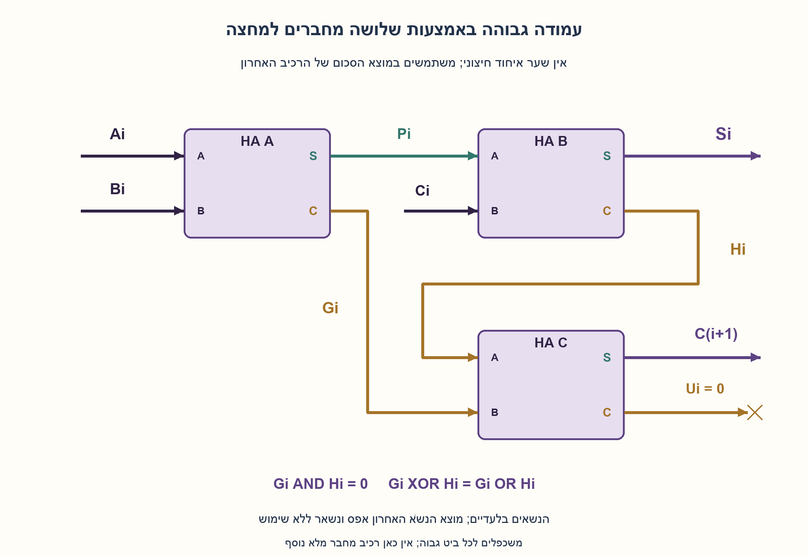
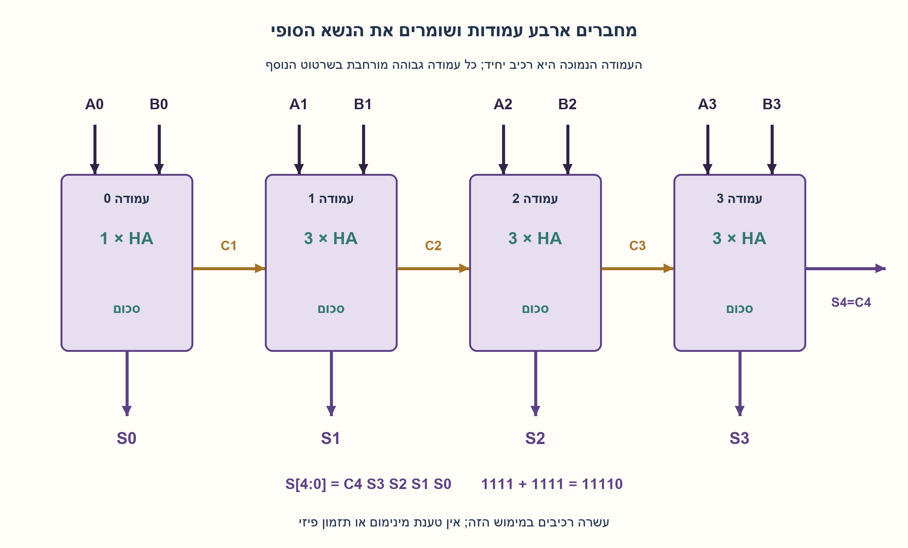
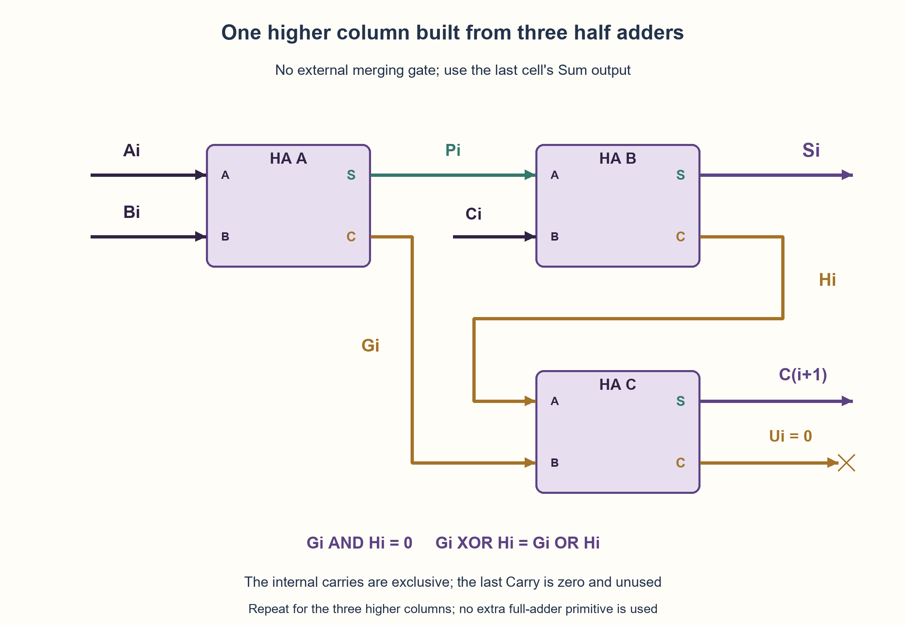
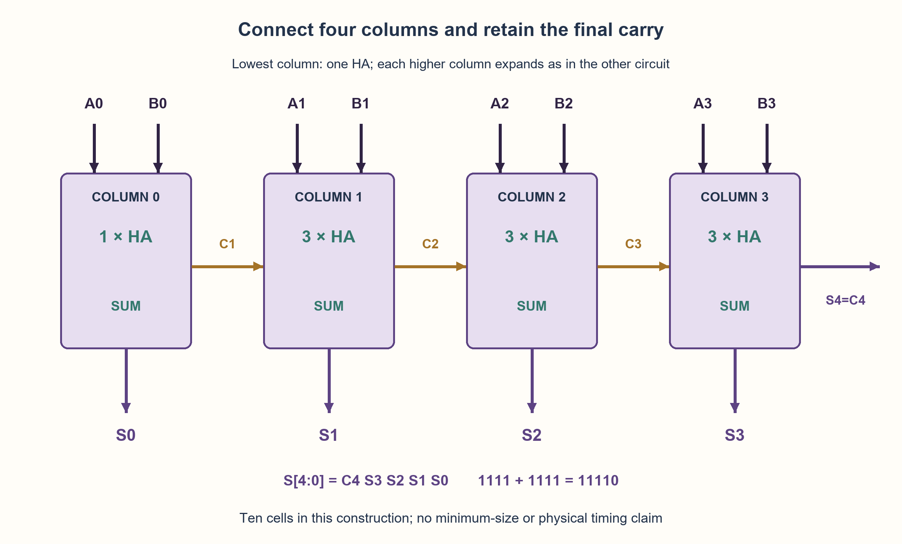

# PREP-122 — מחבר לשני מספרים בני ארבעה ביטים באמצעות HA בלבד

פתרון מוצע בסיוע AI; ביקורת מקצועית אנושית ממתינה. הקושי לא כויל.

## מקור

[צילום המקור](../sources/2026-10-25-batch11-07.png)

תכנן מחבר עבור 2 מספרים בעלי 4 סיביות כל אחד באמצעות HA בלבד

שיוכי החברות בצילום מדווחים ולא אומתו באופן עצמאי: Apple.

## נוסח ערוך

מחבר לשני מספרים בני ארבעה ביטים באמצעות HA בלבד

תכננו מעגל צירופי המחבר שני מספרים בני ארבעה ביטים באמצעות מחברים למחצה (HA) בלבד. הציגו את חיבורי הרכיבים, את ביטי התוצאה והסבר נכונות ועלות.

הבהרות עריכה: A[3:0],B[3:0] הם ללא סימן, 0..15, והפלט S[4:0] הוא הסכום המדויק 0..30. אין נשא כניסה חיצוני. כל HA מקבל שני ביטים ומוציא Sum ו־Carry לפי a+b=Sum+2·Carry. מותר חיווט ופיצול אותות, ואין שער OR/XOR נפרד, FA או מחבר מוכן מחוץ לרכיבי HA. אין צורך בשעון או באוגרים. אין דרישה להוכיח מינימום רכיבים; אל תסיקו אופטימליות מעצם מציאת מימוש. ציינו מה היה משתנה אילו נדרש פלט בן ארבעה ביטים בלבד.

### שלושה רמזים

1. העמודה הנמוכה מחברת רק שני ביטים, אך בכל עמודה מעליה עשוי להיכנס גם נשא. כמה מידע צריך להעביר לעמודה הבאה?
2. חברו a,b ב־HA ראשון, ואז את ביט ה־Sum שלו עם הנשׂא הנכנס ב־HA שני. מתי כל אחד משני הנשאים הפנימיים יכול להיות אחד?
3. שני הנשאים הפנימיים אינם יכולים להיות אחד יחד. לכן XOR שלהם שווה ל־OR שלהם; אפשר לקבל אותו ממוצא Sum של HA שלישי. מה ערך Carry של אותו HA, ומה עושים בעמודה הנמוכה שאין בה נשא כניסה?

### הצעה לפתרון

### הבעיה אינה ב־Sum אלא באיחוד הנשאים
HA יודע לחבר שני ביטים. בעמודה הנמוכה יש בדיוק A0,B0, ולכן HA אחד נותן S0 ו־C1. בכל עמודה גבוהה צריך לחבר שלושה ביטים: Ai,Bi והנשא Ci. אין לנו FA מוכן, וגם אסור להוסיף שער OR כדי להשלים אחד. נבנה את העמודה משלושה HA ונראה מדוע זה עובד.

### עמודה גבוהה משלושה HA
לכל i=1,2,3, רשמו בכל זוג מוצאים Sum ואחריו Carry:

```text
(Pi, Gi)       = HA(Ai, Bi)
(Si, Hi)       = HA(Pi, Ci)
(C(i+1), Ui)   = HA(Gi, Hi)
```

ה־HA הראשון שומר את הזוג הראשוני Gi ואת השארית Pi. השני מוסיף לשארית את הנשא הנכנס, ושומר נשא נוסף Hi. כעת צריך לאחד את Gi,Hi לנשא אחד לעמודה הבאה.

אם Gi=1 אז Ai=Bi=1, ולכן Pi=0 ו־Hi=0. אם Hi=1 אז Pi=1, ולכן Ai,Bi שונים ו־Gi=0. כלומר Gi ו־Hi בלעדיים: הם לעולם אינם אחד יחד. משום כך מוצא Sum של ה־HA השלישי, Gi XOR Hi, זהה ל־Gi OR Hi כאן. מוצא Carry שלו Ui=Gi AND Hi תמיד אפס ואפשר להשאירו ללא שימוש. אין במימוש שער OR חיצוני; ה־XOR וה־AND הם ההתנהגות הפנימית המותרת של HA.

### מחברים את ארבע העמודות
בעמודה 0 מחברים HA(A0,B0) ומקבלים S0,C1. מחברים את C1 לעמודה 1, את C2 לעמודה 2 ואת C3 לעמודה 3. לבסוף S4=C4, חוט הנשא האחרון. הפלט נקרא S4S3S2S1S0. אין צורך לקבע נשא כניסה לאפס בעזרת רכיב נוסף: בעמודה הראשונה יש רק ה־HA היחיד.

העלות היא HA אחד ועוד שלושה לכל אחת משלוש העמודות הגבוהות: 1+3·3=10 HA. זו עלות המימוש שהוצע, לא הוכחת מינימום. השרשרת הארוכה עוברת HA אחד בעמודה הנמוכה ואז שני HA לכל עמודה נוספת, כלומר שבע שכבות תלות של רכיבים עד C4 במודל מבני זה. אין להסיק מכך השהיה פיזית בלי זמני תאים, מסלולי Sum/Carry, עומס וחיווט.

### מדוע הסכום נשמר
לפי שני ה־HA הראשונים, Ai+Bi+Ci=Si+2(Gi+Hi). לפי הבלעדיות, Gi+Hi הוא ביט יחיד ושווה ל־C(i+1). לכן בכל עמודה Ai+Bi+Ci=Si+2C(i+1). כפל במשקל 2^i וחיבור העמודות מבטלים את הנשאים הפנימיים ונותנים A+B=S0+2S1+4S2+8S3+16C4. זהו הסכום המדויק.

בדוגמה A=B=1111, ה־HA הנמוך מוציא S0=0,C1=1. בכל עמודה גבוהה Pi=0,Gi=1 והנשא הנכנס הוא 1, ולכן Si=1,Hi=0 ו־C(i+1)=1. מתקבל 11110, כלומר 30. בדוגמה 0000+0000 הפלט 00000. אם המפרט דורש רק ארבעה ביטים, S3..S0 הם הסכום מודולו 16; C4 מסמן גלישה ללא סימן, ולא תנאי גלישה חתומה.

המודל נבדק בכל 256 זוגות הקלט, בכל 1,024 עמודות ובכל 768 איחודי הנשאים הגבוהים. זהו אימות Python פונקציונלי; לא בוצעו HDL, סינתזה או מדידת תזמון. האריתמטיקה בפייתון לאריזת חוטים ולבדיקה אינה רכיב חיבור נוסף במעגל.

```python
"""Exact unsigned four-bit plus four-bit addition with ten half-adder cells.

No external carry-in. The result has five bits. Only half_adder calls create
circuit logic; Python indexing/packing represents wires, not extra adder/OR cells.
"""


def half_adder(a, b):
    if any(type(x) is not int or x not in (0, 1) for x in (a, b)):
        raise ValueError("HA inputs must be binary integers")
    return a ^ b, a & b


def trace_add4(a, b):
    if any(type(x) is not int or not 0 <= x < 16 for x in (a, b)):
        raise ValueError("two unsigned four-bit inputs required")
    a0, b0 = a & 1, b & 1
    s0, carry = half_adder(a0, b0)
    rows = [{"bit": 0, "a": a0, "b": b0, "cin": 0, "sum": s0,
             "g": carry, "h": 0, "cout": carry, "discarded": 0, "ha_cells": 1}]
    for bit in range(1, 4):
        ai, bi, incoming = (a >> bit) & 1, (b >> bit) & 1, carry
        p, g = half_adder(ai, bi)
        si, h = half_adder(p, incoming)
        carry, unused = half_adder(g, h)
        rows.append({"bit": bit, "a": ai, "b": bi, "cin": incoming, "sum": si,
                     "g": g, "h": h, "cout": carry, "discarded": unused, "ha_cells": 3})
    return rows


def add4(a, b):
    rows = trace_add4(a, b)
    return sum(row["sum"] << row["bit"] for row in rows) + (rows[-1]["cout"] << 4)
```





## English edition

Add two four-bit numbers using half adders only

Design a combinational circuit adding two four-bit numbers using half-adder (HA) components only. Show component connections, result bits, correctness reasoning and cost.

Editorial clarifications: A[3:0],B[3:0] are unsigned 0..15, and S[4:0] is the exact sum 0..30. There is no external carry-in. Each HA receives two bits and produces Sum/Carry with a+b=Sum+2·Carry. Wiring and fanout are allowed, but no standalone OR/XOR, FA or prebuilt adder outside HA primitives. No clock/registers are needed. No minimum-component proof is requested; finding a construction alone does not establish optimality. State what changes if only four output bits are required.

### Three hints

1. The lowest column adds only two bits, but each higher column may receive a carry too. What information must reach the next column?
2. Add a,b with one HA, then add its Sum to the incoming carry with a second HA. When can each internal carry be one?
3. The two internal carries cannot both be one. Their XOR therefore equals their OR; obtain it from a third HA’s Sum. What is that HA’s Carry, and what changes in the lowest column without carry-in?

### Proposed solution

### The difficulty is merging carries, not producing Sum
An HA adds two bits. The lowest column contains exactly A0,B0, so one HA yields S0 and C1. Each higher column must add three bits: Ai,Bi and carry Ci. We have neither a ready-made FA nor permission to complete one with an external OR. Build that column from three HAs instead.

### Three HAs for a higher column
For i=1,2,3, each output pair below is ordered Sum, then Carry:

```text
(Pi, Gi)       = HA(Ai, Bi)
(Si, Hi)       = HA(Pi, Ci)
(C(i+1), Ui)   = HA(Gi, Hi)
```

The first HA retains the initial pair Gi and leftover Pi. The second adds incoming carry to the leftover, producing another carry Hi. We must merge Gi,Hi into the next column’s carry.

If Gi=1 then Ai=Bi=1, hence Pi=0 and Hi=0. If Hi=1 then Pi=1, hence Ai,Bi differ and Gi=0. Thus Gi and Hi are mutually exclusive: they never both equal one. The third HA’s Sum, Gi XOR Hi, consequently equals Gi OR Hi here. Its Carry Ui=Gi AND Hi is always zero and may be left unused. No external OR gate is introduced; XOR/AND describe the permitted internal behavior of an HA primitive.

### Connect four columns
Column zero uses HA(A0,B0)→(S0,C1). Wire C1 into column one, C2 into column two and C3 into column three. Finally S4=C4, the last carry wire. Read S4S3S2S1S0. No extra component creates a zero carry-in: the first column uses just its single HA.

Cost is one HA plus three in each of the three higher columns: 1+3·3=10 HAs. This is the proposed construction’s cost, not a minimum proof. The longest dependency traverses the lowest HA then two HAs per subsequent column: seven component layers to C4 in this structural model. Actual delay requires cell timing, Sum/Carry arcs, loading and routing; layer count is not a physical delay measurement.

### Why the sum is preserved
The first two HAs give Ai+Bi+Ci=Si+2(Gi+Hi). By exclusivity, Gi+Hi is a single bit equal to C(i+1). Thus each column obeys Ai+Bi+Ci=Si+2C(i+1). Weight by 2^i and sum columns: internal carries cancel, leaving A+B=S0+2S1+4S2+8S3+16C4. This is the exact sum.

For A=B=1111, the lowest HA gives S0=0,C1=1. Every higher column has Pi=0,Gi=1 and incoming carry one, so Si=1,Hi=0,C(i+1)=1. The result is 11110, or 30. Zero plus zero gives 00000. If only four output bits are specified, S3..S0 is addition modulo sixteen; C4 is unsigned overflow, not the signed-overflow condition.

All 256 input pairs, 1,024 columns and 768 higher-column carry merges were checked. This is executed functional Python verification, not HDL, synthesis or measured timing. Python arithmetic used to pack/check wires is not an extra adder cell in the circuit.

```python
"""Exact unsigned four-bit plus four-bit addition with ten half-adder cells.

No external carry-in. The result has five bits. Only half_adder calls create
circuit logic; Python indexing/packing represents wires, not extra adder/OR cells.
"""


def half_adder(a, b):
    if any(type(x) is not int or x not in (0, 1) for x in (a, b)):
        raise ValueError("HA inputs must be binary integers")
    return a ^ b, a & b


def trace_add4(a, b):
    if any(type(x) is not int or not 0 <= x < 16 for x in (a, b)):
        raise ValueError("two unsigned four-bit inputs required")
    a0, b0 = a & 1, b & 1
    s0, carry = half_adder(a0, b0)
    rows = [{"bit": 0, "a": a0, "b": b0, "cin": 0, "sum": s0,
             "g": carry, "h": 0, "cout": carry, "discarded": 0, "ha_cells": 1}]
    for bit in range(1, 4):
        ai, bi, incoming = (a >> bit) & 1, (b >> bit) & 1, carry
        p, g = half_adder(ai, bi)
        si, h = half_adder(p, incoming)
        carry, unused = half_adder(g, h)
        rows.append({"bit": bit, "a": ai, "b": bi, "cin": incoming, "sum": si,
                     "g": g, "h": h, "cout": carry, "discarded": unused, "ha_cells": 3})
    return rows


def add4(a, b):
    rows = trace_add4(a, b)
    return sum(row["sum"] << row["bit"] for row in rows) + (rows[-1]["cout"] << 4)
```





## חומר משלים דו־לשוני / Bilingual supporting material

```json
{
  "assumptions": {
    "he": [
      "שני קלטים ללא סימן בני ארבעה ביטים; פלט מדויק בן חמישה ביטים, ללא Cin חיצוני.",
      "רק רכיבי HA עם שני מוצאים; חיווט ופיצול מותרים, ואין שערים חיצוניים, FA או אוגרים.",
      "המעגל צירופי וערכי הכניסה בינאריים יציבים; אין טענת תזמון או מינימום פיזי."
    ],
    "en": [
      "Two unsigned four-bit inputs, exact five-bit output and no external Cin.",
      "Only two-output HA primitives; wires/fanout allowed, no external gates, FAs or registers.",
      "Combinational settled binary inputs; no physical timing or minimum-size claim."
    ]
  },
  "optimality": {
    "he": {
      "construction": "10 HA: אחד בעמודה הנמוכה ועוד שלושה לכל עמודה גבוהה.",
      "scope": "אין דרישת מינימום במקור, ולא נטען ש־10 מזערי.",
      "scaling": "אותה תבנית לרוחב n משתמשת ב־3n−2 רכיבי HA ובאורך תלות 2n−1 לרכיבים עד הנשׂא האחרון; O(n) משאבים ועומק מבני, ללא תדר פיזי."
    },
    "en": {
      "construction": "10 HAs: one in the lowest column and three in each higher column.",
      "scope": "The source does not demand a minimum, and ten is not claimed minimal.",
      "scaling": "At width n the same template uses 3n−2 HAs and 2n−1 component dependency layers to the last carry: O(n) resources/structural depth, without a physical frequency claim."
    }
  },
  "verification": {
    "he": "נבדקו ארבע שורות HA, כל 256 זוגות A,B, כל 1,024 משוואות העמודות, 768 מקרי בלעדיות נשאים ו־Ui=0, וחמש דחיות קלט. ההשוואה היא לחיבור שלמים עצמאי. מודל Python בלבד, ללא HDL, סינתזה או מדידה.",
    "en": "Checked four HA rows, all 256 A,B pairs, 1,024 column equations, 768 exclusive-carry/Ui=0 cases and five invalid inputs. Compared against independent integer addition. Python only; no HDL, synthesis or measurements."
  },
  "edge_cases": {
    "he": [
      "0000+0000=00000.",
      "1111+1111=11110; אין להשמיט את הביט החמישי.",
      "1111+0001=10000 בודק מעבר נשא דרך כל העמודות.",
      "1111+0000=01111 בודק היעדר גלישה.",
      "Ui הוא Carry של HA האיחוד ואפס תמיד; C(i+1) מגיע דווקא ממוצא Sum שלו."
    ],
    "en": [
      "0000+0000=00000.",
      "1111+1111=11110; retain the fifth bit.",
      "1111+0001=10000 exercises full carry propagation.",
      "1111+0000=01111 checks no overflow.",
      "Ui is the merge HA’s Carry and always zero; C(i+1) comes from its Sum output."
    ]
  },
  "common_mistakes": {
    "he": [
      "שימוש בשני HA ושער OR חיצוני, שאינו משאב מותר.",
      "לקיחת Carry במקום Sum מן ה־HA השלישי; ה־Carry שלו תמיד אפס.",
      "אמירה ש־XOR שווה ל־OR בכל מצב, בלי הוכחת בלעדיות.",
      "חיבור מוצאים זה לזה במקום חיבור למבואי רכיב.",
      "קיצור הפלט לארבעה ביטים בלי לציין מודולו וגלישה, או טענת מינימום לא מוכחת."
    ],
    "en": [
      "Using two HAs plus an external OR, which is not permitted.",
      "Taking Carry rather than Sum from the third HA; its Carry is always zero.",
      "Claiming XOR always equals OR instead of proving exclusivity.",
      "Shorting outputs together instead of feeding component inputs.",
      "Truncating to four bits without a modulo/overflow contract, or claiming an unproved minimum."
    ]
  },
  "interview_answer": {
    "he": "בעמודה הנמוכה HA אחד. בכל עמודה גבוהה HA ראשון מחבר Ai,Bi, שני מחבר את הסכום ל־Ci. הנשאים שלהם בלעדיים ולכן Sum של HA שלישי מאחד אותם ל־C(i+1), ו־Carry שלו אפס. שלוש עמודות כאלה ועוד העמודה הנמוכה נותנות 10 HA. הפלט החמישי הוא C4, ולכן מתקבל הסכום המלא עד 30.",
    "en": "Use one HA in the lowest column. In each higher column, one HA adds Ai,Bi and another adds its Sum to Ci. Their carries are exclusive, so a third HA’s Sum merges them into C(i+1), while its Carry is zero. Three such columns plus the lowest use ten HAs. Fifth output bit C4 retains the exact sum up to thirty."
  },
  "source_ambiguities": {
    "he": [
      "המקור אינו מציין סימן, נשא חיצוני או רוחב תוצאה; נבחרו קלטים ללא סימן ותוצאה מלאה ללא Cin.",
      "נבחר מעגל צירופי; לא נתבקשו שעון או אחסון.",
      "Apple מופיעה במקור; השיוך מדווח ולא אומת עצמאית."
    ],
    "en": [
      "The source omits signedness, external carry and result width; unsigned inputs/full output/no Cin are explicit choices.",
      "A combinational design is selected; clock/storage were not requested.",
      "Apple attribution is source-reported, not independently verified."
    ]
  },
  "solution_extensions": {
    "he": [
      {
        "question": "מה משתנה אם מוסיפים נשא כניסה Cin?",
        "answer_direction": "אפשר להשתמש בתא שלושת ה־HA גם בעמודה 0: ארבע עמודות נותנות מימוש של 12 HA. זהו מימוש תקף, ללא טענת מינימום.",
        "principle": "שינוי ממשק עשוי לשנות את עלות העמודה הראשונה."
      },
      {
        "question": "האם אפשר לקבל רק ארבעה ביטי תוצאה?",
        "answer_direction": "כן, אם מגדירים פלט מודולו 16. נשא C4 הוא מידע גלישה ללא סימן; בחיבור חתום יש להגדיר גלישה חתומה בנפרד.",
        "principle": "רוחב הפלט הוא חלק ממשמעות החיבור."
      }
    ],
    "en": [
      {
        "question": "What changes with an external carry-in Cin?",
        "answer_direction": "Use the three-HA cell in column zero too: four columns give a valid twelve-HA construction, without a minimum claim.",
        "principle": "An interface change can change first-column cost."
      },
      {
        "question": "Can the result have only four bits?",
        "answer_direction": "Yes under an explicit modulo-sixteen contract. C4 is unsigned-overflow information; signed overflow needs its own definition.",
        "principle": "Output width defines arithmetic semantics."
      }
    ]
  },
  "relationship_note": {
    "he": "PREP-034 בונה מחבר מ־FA ומנתחת ארכיטקטורות גדולות; כאן הספרייה מוגבלת ל־HA בלבד. דוגמת HW-008 משתמשת בשני HA וב־OR, ולכן אסור להעתיק אותה ללא שינוי.",
    "en": "PREP-034 builds from FAs and studies larger architectures; this question restricts the library to HAs. HW-008 uses two HAs plus OR, so its construction cannot be copied unchanged."
  }
}
```
